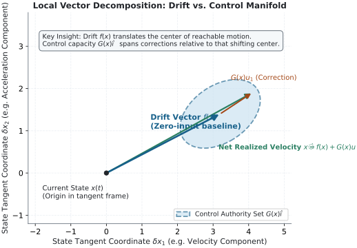
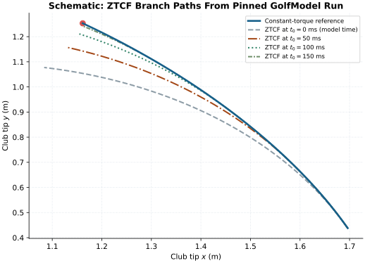

::: {.abstract}
Every golfer wonders how much clubhead speed comes from muscle power versus "letting the club swing." In control theory and multibody mechanics, that question has an exact answer, but only if you ask it at a single frozen instant. At that instant, total acceleration splits into two pieces: **drift** (what the body and club would do on their own, carried by momentum and gravity) and **control** (what joint torques add right now). This article explains the two counterfactual tools that compute that split—**ZTCF** and **ZVCF**—reconciles them with the familiar coaching distinction between active and passive motion, and explains the essential caveat: why this split works perfectly for a snapshot, but breaks down if you try to add the pieces over time.
:::

## The Coasting Car and the Playground Swing {#sec-everyday-intuition}

Imagine driving a car down a winding mountain road. You take your foot off the accelerator. The car does not instantly freeze; it coasts downhill, carried forward by its speed and pulled along by the slope. That coasting motion is determined entirely by where you are, which way you are already rolling, and the pull of the earth.

Now, while still coasting, you turn the steering wheel sharply to the left. 

Where the car accelerates next is the sum of two distinct influences:

1. **The coasting baseline:** where momentum and gravity would carry you if your hands did nothing new.
2. **Your steering action:** what your hands on the wheel are forcing into the car at this very second.

A child on a playground swing reveals the exact same split. As the swing rushes through the bottom of the arc, the child's body rises up the other side purely on momentum and gravity. If an adult steps in and gives a shove, that push adds to the motion. A tiny, well-timed push at the right point in the arc produces a huge rise; a clumsy push at the top disrupts the rhythm. The swing's instantaneous acceleration is always the sum of the motion already underway plus the push applied at that second.

In engineering mechanics, we give these two parts precise names: **drift** and **control**.

## The Golf Swing, Frame by Frame {#sec-frame-by-frame}

A golf downswing takes about one-third of a second. At every millisecond of that rush, your joints are rotating, your torso is unwinding, and the clubhead is accelerating toward the ball.

Suppose we freeze the swing at an exact instant midway down—shaft roughly parallel to the ground—and ask two thought experiments:

1. **"What if the golfer went completely limp at this instant?"**
   Suppose every muscle stopped firing right now ($\tau = 0$). The club would not drop straight to the turf like a dropped stone. It is already moving at sixty miles per hour. That existing velocity whips the segments forward through centrifugal and Coriolis coupling, while gravity pulls downward. In our framework, this zero-muscle baseline is called the **Zero-Torque Counterfactual (ZTCF)**, or simply **drift**.

2. **"What if the golfer pushed with their muscles, but had zero speed?"**
   Suppose we freeze the golfer in this identical body position, zero out all velocity, switch off gravity, and apply only the muscular torques the golfer is exerting at this moment. The resulting acceleration is what the muscles alone produce through the body's inertia matrix ($M^{-1}\tau$). In our framework, this active-torque baseline is called the **Zero-Velocity Counterfactual (ZVCF)**, or simply **control**.

At this frozen snapshot, nature gives us a remarkable mathematical fact: **drift plus control equals the exact total acceleration of the clubhead**.

::: {.callout-note}
### The Single Equation (For the Curious) {#sec-single-equation}
If you describe the golfer and club with joint positions $q$, velocities $\dot{q}$, inertia matrix $M(q)$, passive velocity/gravity forces $h(q, \dot{q})$, and muscle torques $\tau$, the instantaneous acceleration $\ddot{q}$ splits cleanly:
$$\ddot{q} = \underbrace{-M(q)^{-1} h(q, \dot{q})}_{\text{Drift (ZTCF)}} + \underbrace{M(q)^{-1} \tau}_{\text{Control (ZVCF)}}$$
At one fixed state, total acceleration is drift plus control. Gravity is counted exactly once, inside the drift term.
:::

{#fig-vector-split fig-alt="Vector diagram showing drift acceleration arrow and control acceleration arrow summing tip-to-tail to equal total acceleration vector."}

## Two Lenses on the Same Swing {#sec-two-lenses}

Golfers and coaches already talk about this distinction, though they usually use different words. They speak of **active** effort versus **passive** release:

- **Active motion:** what you muscle, steer, or pull with your hands and torso.
- **Passive motion:** letting the club "fall from the top," or letting the wrists unhinge like the tip of a cracked whip.

Notice how closely this coaching language mirrors the engineering terms:

- **The Active/Passive Lens** asks: *Who or what is exerting the force?* Muscles are active; gravity and momentum transfer between body segments are passive.
- **The Time Lens (Past vs. Present)** asks: *When was the cause established?* The existing momentum was built up over earlier frames (the past); the muscle torque is being exerted right now (the present).

Both lenses look at the same physical swing, and they arrive at the identical mathematical division. But they disagree on a subtle, fascinating question: **Where does gravity belong in time?**

## The Gravity Question: Where Does Gravity Belong? {#sec-gravity-question}

Consider gravity's role in the downswing:

In the **Active/Passive lens**, gravity is obvious. It is not a muscle force, so it is classified as *passive*. Furthermore, gravity acts *right now*—it pulls downward on the clubhead at 9.8 meters per second squared at this exact millisecond. It is not something the golfer did half a second ago.

In the **Time lens**, however, gravity sits inside *drift*—which we have labeled "the past." Why would an ever-present force of nature belong to the past?

Here is the key insight: **gravity acts in the present, but its effect on your swing is dictated entirely by your posture—and your posture is a creation of the past.**

Gravity only pulls straight down toward the center of the earth. But whether that downward pull speeds up your club, slows it down, twists the face open, or does nothing at all depends entirely on where your arms, wrists, and shaft are oriented in three-dimensional space. And that spatial orientation (your kinematic state) was manufactured by every movement you made from the takeaway to the transition.

| Physical Mechanism | Active vs. Passive Lens | Time Lens (Past vs. Present) | Where It Sits in Mechanics |
| :--- | :--- | :--- | :--- |
| **Segment Momentum (Coriolis & Centrifugal)** | Passive (no muscle effort now) | Past (built by earlier acceleration) | Drift (ZTCF) |
| **Gravity** | Passive (external force of nature) | Past-Determined State (posture set earlier) | Drift (ZTCF) |
| **Muscle Torques** | Active (joint motors firing now) | Present (action taken this instant) | Control (ZVCF) |

: Table 1: Reconciling the two lenses. Gravity is an instantaneous physical force whose mechanical leverage on the swing is governed entirely by the posture created by past motion. {#tbl-two-lenses}

This reconciliation reveals a deeper principle: **The state of your body right now is entirely a product of the past; the future is that past state plus the actions you take now.**

Everything passive—both the whip-like momentum coupling between your torso and your arms, and the mechanical leverage gravity has on your club—is computed directly from your current state. The only genuinely new information entering the universe at this millisecond is the active control torque from your muscles.

{#fig-divergence fig-alt="Plot showing the real swing trajectory diverging from the zero-torque counterfactual trajectory over time."}

## Reconciling Both With ZTCF and ZVCF {#sec-reconciliation}

We can now state the formal definitions established by Dieter Olson for the AffineDrift framework (per issue #5434 and `NOTATION.md`):

- **ZTCF (Zero-Torque Counterfactual) = Drift:** The complete autonomous acceleration of the golfer-club plant when declared muscle torques are set to zero. This includes all velocity-dependent Coriolis and centrifugal coupling, plus gravity evaluated at the current posture.
- **ZVCF (Zero-Velocity Counterfactual) = Control:** The acceleration produced purely by joint torques through the body's inertia matrix ($M^{-1}\tau$), with velocity and gravity switched off.
- **ZTCF + ZVCF = Total Acceleration:** At any fixed state, the sum of drift and control equals the real, instantaneous acceleration. Gravity is counted exactly once, inside drift.

*(Terminology note: Early exploratory drafts in 2024 occasionally used ZVCF to mean a gravity-only slice. Under the canonical AffineDrift standards, ZVCF strictly denotes the control acceleration $M^{-1}\tau$.)*

Both lenses carve the exact same line through the physics:
- **ZTCF** captures all passive terms evaluated at the past-made state.
- **ZVCF** captures all active terms added by current muscular effort.

## The Honest Caveats: Why Snapshots Break Over Time {#sec-caveats}

Every powerful concept has boundaries, and pretending those boundaries do not exist is bad science. Here are the precise limits of the drift-control split:

### 1. Snapshots Add; Movies Diverge {#sec-snapshot-vs-movie}
The most important caveat in this entire subject: **ZTCF and ZVCF add together only at a single frozen instant. Their integrated paths over time do not add up to the real swing.**

If you go limp mid-downswing (a forward ZTCF rollout), the club flies off on a runaway path. In that runaway path, your wrists bend differently, the shaft changes angle, and the body's inertia matrix $M(q)$ changes. Because the posture diverges immediately, the subsequent velocity and gravity forces also diverge. You cannot take the movie of the "limp golfer" and add it to the movie of the "isolated muscle push" to reconstruct the tournament swing. The sum is exact for acceleration *now*; it is not additive across *time*.

### 2. "Past" Isn't Completely in the Past {#sec-gravity-not-past}
As we saw, drift includes gravity. Gravity is not a past action—you did not create gravity on the backswing. What the past created is the *posture* through which gravity acts.

### 3. Passive Does Not Mean Free {#sec-passive-not-free}
When the club whips through impact largely on drift, that does not mean you got something for nothing. The momentum that makes up passive drift was pumped into the system by your muscles during the backswing and early transition. Calling a term "passive" simply means you do not have to push on it *at this millisecond*; it does not mean it required no work earlier.

### 4. Active Torque Is Not a Direct Muscle Effort Audit {#sec-not-muscle-effort}
The joint torques $\tau$ in our multi-body model are net generalized torques. In a living human being, opposing muscles can squeeze simultaneously (co-contraction), stiffening a joint without producing net rotational torque. Furthermore, tendons store and release elastic energy. A net joint torque lumps these biological complexities together; it is not a direct readout of individual muscle activation or metabolic fatigue.

## What a Golfer Can Take to the Tee {#sec-golfer-takeaway}

If you are a golfer or coach, what does this framework offer you beyond elegant physics?

It offers a clear diagnostic compass: **Are you trying to generate speed in the present that you should have set up in the past?**

Amateur golfers often attempt to "muscle" the ball at the bottom of the swing. In control terms, they are demanding enormous control torque (ZVCF) in the final fifty milliseconds before impact. But human muscles are slow to recruit, and the clubhead is moving too fast for late muscle interventions to catch up.

Elite ball-strikers do the opposite. They use their muscles early—in the transition and initial downswing—to build a favorable kinematic state: hip clearance, lead-side posting, and stored wrist lag. By the time the club reaches the delivery area, the swing is propelled by massive passive drift (ZTCF). Their muscles shift from driving the club to maintaining alignment, letting the accumulated momentum and gravitational torque do the heavy lifting.

Drift is the accumulated investment of your past; control is the decision you make right now. When the two work in harmony, the swing feels effortless because the present is riding the wave of what you prepared.

## Related Articles {#sec-related-articles}

- [Zero-Torque Counterfactual (ZTCF) Family](zero-torque-counterfactual.html) — Technical derivation and integration algorithms for isolating passive momentum.
- [Controllability & the Drift-Control Ratio](drift-control-ratio.html) — Quantitative boundaries between drift magnitude and finite-horizon reachability.
- [Control-Affine Framework](theory-part1.html) — Mathematical derivation of plant dynamics and input-state affine separability.
- [Zero-Torque and Zero-Velocity Counterfactuals](theory-part2.html) — Foundational formulation of ZTCF and ZVCF diagnostic tools.
