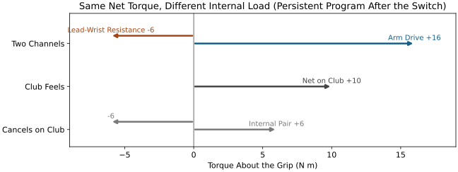
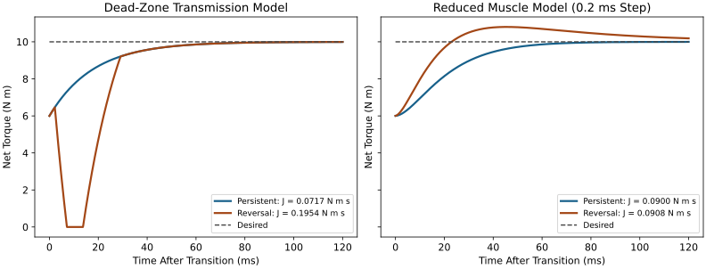
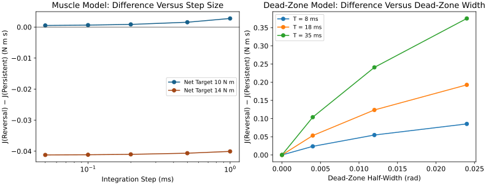
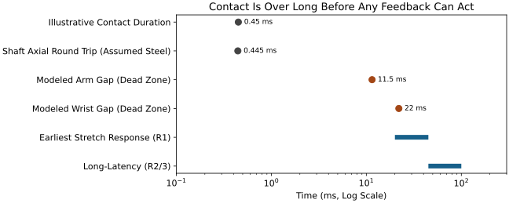

::: {.callout-note}
## In Layman's Terms

Tow a car with a rope and you can see it. When the rope hangs slack, the front car moves off and for a moment the towed car gets nothing; then the rope snaps taut and the pull arrives late, with a jerk. Keep a little tension on the rope and it never goes slack, so the towed car answers at once. Some golfers describe a "firm lead wrist" that may work like that steady tension. This page tests that idea in two computer models. In a model built with a gap, steady tension helps a lot. In a model built from muscles, which has lags but no gap, it hardly matters, and in one case the opposite strategy wins. As far as this project has found, nobody has measured whether a wrist or grip has a gap like this. So the idea is a hypothesis to measure, not a fact.
:::

::: {.callout-important}
## Status of This Draft

This is a draft for panel review under [AffineDrift #5134](https://github.com/D-sorganization/AffineDrift/issues/5134). It analyses two synthetic models and proposes measurements. It is not coaching advice, and it reports no human data. The blockers listed in @sec-scope are scoped out here, not resolved. Its companion, [Managing Slack in Linked Systems][slack] ([AffineDrift PR #5145](https://github.com/D-sorganization/AffineDrift/pull/5145)), compares the kinds of slack in full; this page keeps to the golf reading and the muscle model.
:::

## What Players Describe {#sec-feel}

Teachers and players often speak of a lead wrist that is "firm", "flat" or "bowed" through the late downswing, and of "holding off" the release. These words describe a feel. They do not say which muscles fire, which way each hand pushes, or how much give there is between the forearm and the club.
<!-- TODO(source, #5134): sourced player and teacher descriptions (Hogan, Nicklaus, Kelley / The Golfing Machine) with page references; none are verified, so no quotation appears here. -->

So here is the puzzle: if the feel is real, what is it a feel *of*? This page asks one narrow version of that question. Suppose two torque channels act on the club. (A *channel* here is simply one route by which a twisting push reaches the club.) One is an *arm drive* that pushes the club around. The other is a *lead-wrist resistance* that pushes back. (A **torque** is a twisting push, measured in newton metres, N m.) Does keeping each channel pushing the same way throughout, rather than letting them swap roles, help the club get the torque it is asked for?

## Three Things That Get Called "Firm" {#sec-three-meanings}

"Firm" can mean at least three physically different things. They lead to different predictions, so it pays to pull them apart. Each row gives the everyday sense first and the engineering name in brackets. In this page *slack* is the umbrella word for any give, a *gap* is give that transmits nothing at all, and a *lag* is a delay.

| Meaning | Plain picture | What it predicts |
|---|---|---|
| **No slop** (no dead zone) | A dead zone is like a dimmer knob that does nothing in the middle of its travel: turn it a little either way and the light stays off | Where there is a dead zone, reversing direction costs a gap during which nothing is transmitted |
| **Pushing one way** (preload) | A tow rope kept taut, so its slack is never let out | No gap, as long as the direction never reverses |
| **Hard to bend** (stiffness) | A stiff spring: a small twist gives a large restoring torque | Faster, smaller deflections; says nothing on its own about gaps |

The general mathematics of dead zones, and of play in gears (which, unlike a dead zone, remembers which side it last touched), is developed in [Classic Sources of Nonlinearity](sources-of-nonlinearity.html#backlash-mechanical-play) and is not repeated here.

The three are easy to run together. In a joint spanned by muscles, though, they come apart. A wrist is crossed by muscles that pull in opposite directions, and both sets can be tensed at once. Think of a tent pole held upright by two guy ropes pulled tight from opposite sides. The pole does not move, yet it resists a small, quick shove. That **co-contraction** can hold the net torque at zero while both tendons stay taut. Raising stiffness this way without changing net torque is a central idea of impedance control [@hogan1985impedance], and muscle short-range stiffness, meaning strong resistance to small twists, can account for measured arm endpoint stiffness [@hu2011ShortRange]. So stiffness does not need loading in one direction. Whether a co-contracted wrist keeps any small dead zone has not, as far as this project has found, been measured. (The muscle model in @sec-models tracks force only, so it cannot show this tent-pole kind of firmness.) So a firm-feeling wrist need not be a preloaded one, and a preloaded one need not feel firm. The same problem hides in an instruction like "create more negative wrist torque." It does not say whether it means a larger net torque, more co-contraction, or a sign that never changes.

## Two Hands, One Club: The Internal Load {#sec-internal-wrench}

Here is a fact about a two-handed grip that is easy to miss. The club responds only to the *net* push from both hands. But two hands can also push against each other, the way two people can squeeze a box between them without moving it. That part of the hand load cancels on the club. (In matrix language, the set of hand-load combinations that produce zero net load on the club is the null space of the grasp map, written $\ker\mathcal G$; [Intentional Constraint Collapse](intentional-constraint-collapse.html#constraints-internal-forces-and-acceleration) develops it. The rest of this page needs only the box picture. Engineers call a push and a twist taken together a *wrench*, which is why the page title speaks of an "internal wrench": it is this internal load.)

{#fig-internal-wrench fig-alt="Horizontal arrows: arm drive plus 16 and lead-wrist resistance minus 6 newton metres on one row; net plus 10 on the club on the next; an internal pair of plus 6 and minus 6 that cancels on the club on the last."}

@fig-internal-wrench uses the numbers of the model in @sec-models. After the switch (defined below) in the persistent program, an arm drive of +16 N m and a lead-wrist resistance of −6 N m give the club a net +10 N m. The same hand loads can be split another way: that net torque, plus an equal and opposite ±6 N m pair that cancels on the club. The club's motion cannot see the internal pair, so club kinematics alone cannot reveal it. But the pair is not free. It costs muscular effort. It loads skin and tissue. And through co-contraction it can raise the stiffness the club meets at the grip. To measure it, you need force sensors in the grip. Koike instrumented a club to separate the force and moment of each hand [@koike2016instrumented], and Choi and Park combined a measured internal grip force with upper-limb kinetics [@koike2020]. Neither study tested the firm-lead-wrist idea.

The muscle evidence that exists is compatible with several stories. Scapular muscles show phase-dependent activity in golfers [@kao1995], and lead and trail wrist extensor activity differs by side and phase [@robinson2023]. Neither establishes the direction of either hand's push or the presence of an internal pair.

## What the Two Models Say {#sec-models}

Both models come from the UpstreamDrift research code and are re-implemented here so every number can be rerun (@sec-reproduce). Both run the same small experiment. Two programs ask for the same net torque: 6 N m before a moment this page calls *the switch*, at time zero, and 10 N m after it. The switch is just the instant the requested torque steps up. The models do not tie it to any moment in a swing, so it should not be read as the golfer's "transition" at the top of the backswing. The only difference between the programs is how the two channels share the work.

- **Persistent direction.** The arm channel goes from +10 to +16 N m and the wrist channel from −4 to −6 N m. Neither changes sign.
- **Complete role reversal.** The arm channel goes from −4 to +16 N m and the wrist channel from +10 to −6 N m. Both change sign.

In plain words: in persistent direction the arm always drives and the wrist always holds back. In reversal, the wrist drives and the arm holds back before the switch, and then they swap jobs. A made-up picture, not a swing: two people turning a heavy revolving door, one pushing and one leaning back to steady it. Persistent: they keep those jobs as it speeds up. Reversal: they swap, so each has to stop pushing one way and start pushing the other. The models do not say which, if either, resembles a real swing.

How do we score them? At each moment, compare the torque the club actually receives with the torque that was asked for, and add up the misses over the 0.12 s after the switch. That sum is the **integrated tracking error** $J$,
$$
J=\int_0^{0.12\,\mathrm s}\bigl|\tau^{*}(t)-\tau(t)\bigr|\,dt ,
$$ {#eq-tracking-error}
where $\tau^{*}$ is the desired net torque, $\tau$ the net torque actually transmitted, and $t$ time. In pictures: draw the desired torque and the delivered torque on one graph, and $J$ is the area between the two curves. $J$ is measured in N m s: being 1 N m short for 1 s adds 1 N m s, and so does being 10 N m short for 0.1 s. $J$ is smaller when tracking is better. Falling short and overshooting both count as error, and they never cancel each other.^[Because the two kinds of miss never cancel, $J$ is *not* an angular impulse, which would let overshoot cancel shortfall, and it is not work either. The source code calls it an "error impulse"; this page does not.] To compare the programs, this page uses the **advantage $A$, relative to persistent**: $A=(J_\text{reversal}-J_\text{persistent})/J_\text{persistent}$. A positive $A$ favours persistent direction, and an advantage of 100% would mean reversal makes twice the error.

**The dead-zone model.** Picture each channel as a spring with a loose coupling at one end. Each channel has a gap of half-width $\delta=0.012$ rad (about 0.7 degrees). Inside the gap it transmits nothing. Outside the gap it acts as a spring of stiffness $k=600$ N m rad$^{-1}$, and it responds with a lag of time constant $T=18$ ms. These are synthetic values, not measured tissue properties. The run here uses a **loaded start**: each channel begins already pushing its before-switch torque, so it is pressed against one side of its gap.

**The muscle model.** Here no gap is built in: the model has lags but no gap. Each channel is a pair of opposing muscles, one pulling each way. Each muscle is a cut-down Hill-type model. Hill-type models are a standard engineering recipe for muscle force; cut down here means the force is simply maximum force times activation, with no effect of muscle length or speed and no stiffness of its own. A muscle's *activation* $a$ runs from 0, relaxed, to 1, fully on. It follows the nerves' "go" signal, which says how hard the muscle should work, with a nominal rise time of about 10 ms and a nominal decay time of about 40 ms. In other words, a muscle in this model switches on faster than it switches off, a standard asymmetry in muscle models [@thelen2003adjustment]. The force then passes through a tendon with a 12 ms lag. There is no gap anywhere.

Every muscle also keeps a light 8% baseline activation, so opposing muscles always pull a little against each other; in this model those pulls simply cancel. Because the model tracks force only, it cannot show the tent-pole kind of firmness described in @sec-three-meanings. Both programs start from rest 180 ms before the switch and use that time to build up to their before-switch forces, and nothing is reset at time zero. By time zero both have settled, so in the muscle model both programs in effect begin from a loaded start.

{#fig-two-models fig-alt="Two panels of net torque against time after the switch. In the dead-zone panel the reversal curve falls to zero for several milliseconds before recovering, while the persistent curve rises smoothly. In the muscle panel the reversal curve rises faster and overshoots ten newton metres, peaking near 45 milliseconds."}

| Model and condition | Persistent $J$ (N m s) | Reversal $J$ (N m s) | Advantage $A$, relative to persistent |
|---|---|---|---|
| Dead zone, loaded start | 0.0717 (no gap) | 0.1954 (gaps 11.5 ms arm, 22.0 ms wrist) | +172%: persistent wins by a lot |
| Muscle model, 0.2 ms step (published) | 0.08998 | 0.09084 | about +0.952%: persistent wins by just under 1%[^source-percent] |
| Muscle model, step-converged estimate | 0.0920 | 0.0924 | +0.44%: persistent wins narrowly |
| Muscle model, delivery target 14 N m (arm 20, wrist −6), converged | 0.1918 | 0.1505 | −22%: reversal wins |

: Integrated tracking error for the two programs; lower is better. The dead-zone gaps are per-channel counts of zero-torque samples on a 0.1 ms grid; the two channels are silent at different times, and the net torque is zero for only 6.6 ms, while both are silent at once. The delivery target is the net torque asked for after the switch. {#tbl-models}

[^source-percent]: The source chapter reports the same difference as 0.94% of the reversal value.

**In short:** with a gap built in, persistent direction wins by a lot. In the muscle model the two come out close, and which one wins depends on the target.

In @fig-two-models, the left panel is the dead-zone model from a loaded start. Role reversal drops to zero transmitted torque while each channel crosses its gap. The right panel is the muscle model at the published 0.2 ms step. Role reversal rises faster and overshoots the target, while persistent direction rises smoothly.

**Read the dead-zone row first.** In the dead-zone model, reversal's error is about 2.7× persistent's ($A$ = +172%). Why so large? Because the model was built with a gap. Reversing a channel forces it through the gap, and the club receives nothing from that channel meanwhile: the tow rope goes slack, and the next pull arrives late. Persistent direction keeps each rope taut, so neither channel ever has to cross its gap. Across a grid of four gap widths and three time constants, all three zero-gap cases are equivalent and all nine positive-gap cases favour persistent direction (@fig-robustness, right). The zero-gap tie holds only because both channels share the same lag. The companion article, [Managing Slack in Linked Systems][slack] (section "What Each Representation Says"), shows why, and shows that unequal channel lags separate the programs even with no gap. So a difference between programs is not, by itself, evidence of a gap. Put a gap in, and the advantage comes out. It is not evidence that wrists have one. Nor are these two programs the only choices: between them lie intermediate preparations with the same net torque. On the companion's grid one of them beats both on net error under the dead zone, but only at a single knife-edge split that its neighbours do not support ([Managing Slack in Linked Systems][slack], section "Managing Slack: Strategies and Costs").

**The muscle model nearly erases the difference.** At the published 0.2 ms step, $A$ is about 0.952%, just under 1%. Even that small number is not settled. The computer advances time in small steps, and the answer depends a little on how small. Refining the step from 1.0 ms to 0.05 ms shrinks the difference from 0.00277 to 0.000514 N m s, and an extrapolation to an infinitely fine step leaves about 0.4% (@fig-robustness, left). The step changes the absolute $J$ values too, by about 10% across that range, so neither should be quoted to more digits than the table gives.

**Why the muscles behave this way.** In the reversal program, each channel has to hand its work from one muscle to the opposing one. The muscle that was pulling one way must switch off, and the muscle pulling the other way must switch on. In this model how quickly a muscle switches on or off depends on how active it already is, so the nominal 10 ms and 40 ms are only a starting point.^[Compared with itself, one muscle in this model switches off about 16 times slower than it switches on when fully relaxed, about 10 times slower at the 8% baseline, and equally fast when fully on.] What matters at the switch is a race between two muscles. The incoming muscles start at the 8% baseline and rise with a time constant of about 6.2 ms. The outgoing ones decay with about 52 ms in the arm, from activation 0.18, and about 25 ms in the wrist, from 0.75. So at the switch the incoming muscles start rising roughly 4 to 8 times faster than the outgoing ones let go, and the newly driven direction outruns the fading one. The sum rises faster at first and then overshoots, peaking at 10.80 N m about 45 ms after the switch (@fig-two-models, right). So reversal has a smaller early shortfall than persistent direction, but it adds error by overshooting, and $J$ counts both: they add, they do not cancel. At the published step, role reversal roughly halves the early shortfall, 0.0427 against 0.0900 N m s for persistent direction, then adds 0.0481 N m s of overshoot, so the two totals end up close. For a larger delivery target, 14 N m net instead of 10 (arm torque 20 N m instead of 16, wrist still −6 N m), the faster rise wins outright: reversal scores 0.1505 against 0.1918 N m s for persistent direction at the converged step. Under this model the "keep each channel pushing one way" strategy is not reliably better: it is ahead by about 0.4% at one target and behind by about 22% at the other. The sign of the comparison depends on the task.

Two different speed effects are at work in this series. Here, reversal can win because muscles switch on faster than they switch off. In the companion article, one channel responds more slowly than the other, and in that linear model unequal channel lags always favour persistent direction. In @fig-robustness the left panel shows the muscle-model difference against step size for both targets, and the right panel shows the dead-zone difference against gap width for three time constants.

{#fig-robustness fig-alt="Left panel: two lines against integration step on a log axis; the 10 newton metre line is slightly above zero and falls toward zero as the step shrinks; the 14 newton metre line sits near minus 0.04. Right panel: three rising lines against dead-zone half-width, all starting at zero for zero width."}

The right panel plots the absolute difference in $J$ over 0.12 s, and that difference grows with the lag. The companion article measures the same dead zone as the ratio $A$ over a 0.5 s window, and there the advantage barely changes with the lag ([Managing Slack in Linked Systems][slack], section "How Big Must a Gap Be to Matter?"). Both statements hold: the difference grows with the lag, its ratio to the error does not.

So the honest summary is this: the preload hypothesis is **model-dependent**. It predicts a large benefit only if biological transmission really contains something like a gap. A gap is not absurd. Muscle models give a tendon a slack length below which it carries no force [@thelen2003adjustment], and a hand can shift on a grip. But in standard muscle models, a tendon held above its slack length by even light activation behaves as a spring, not as a gap.
<!-- TODO(source, #5134): cite tendon elasticity above slack length; no supporting entry is in the bibliography (the Roberts entries there are golf-impact papers). --> That leaves a plain question that nobody has to take on faith, because it can be measured: during a swing, is there any gap to take up, in the wrist, the forearm or the grip? That is the first thing to measure.

## Fit With the Heavy-Hit Analysis {#sec-heavy-hit}

The [heavy-hit article](technology-heavy-hit-impact-coupling.html) withdrew earlier claims of near-total decoupling and hand isolation, and states that no player-specific acoustic advantage has been established. Preload fits that corrected picture only in a limited way. It does not by itself add mass to the strike. ("Adding mass" would mean the hands making the clubhead act heavier during contact.) What it can change is the *state the club arrives in*: how bent and stressed the shaft is, and how stiffly the hands hold the grip (which, as far as the cited tests show, has only a limited effect during contact; see below).

{#fig-timescales fig-alt="Log-scale timeline: contact and shaft round trip near half a millisecond; modelled gaps of 11.5 and 22 milliseconds; reflex windows from 20 to 45 and 45 to 100 milliseconds."}

@fig-timescales puts the numbers on one axis, and the axis tells a story. Contact is drawn at an illustrative 0.45 ms, the value used in the [impact-mechanics reference](impact-mechanics-and-ball-flight.html); it is not a constant. Ball contact lasts well under a millisecond, and its length depends on equipment and speed [@roberts2001contacttime]. With the heavy-hit article's assumed steel properties, an axial wave makes a round trip along the shaft in about 445 microseconds, comparable to contact. The fastest stretch responses reported in the arm start about 20 ms after a disturbance, with longer-latency responses from 45 to 100 ms [@kurtzer2009multijoint]. So nothing the nervous system does in response to impact can act during contact. Anything the hands contribute must already be in place before the ball is struck: the activation, the co-contraction and the shaft prestress set up beforehand. Any bend already stored in the shaft is there at contact; it doesn't need a shudder to travel down from the hands.

Long description

**Internal wrench (@fig-internal-wrench):** Three horizontal rows of arrows. The top row shows arm drive +16 N m and lead-wrist resistance −6 N m. The middle row sums to net +10 N m on the club. The bottom row shows an equal and opposite ±6 N m pair that cancels on the club while loading the grip internally.

**Two models (@fig-two-models):** Two time-series panels of net torque after the switch at 0 s. Left (dead zone): reversal drops to zero for several milliseconds before recovering; persistent rises smoothly. Right (muscle): reversal rises faster and overshoots the 10 N m target near 45 ms.

**Robustness (@fig-robustness):** Left: advantage of persistent direction versus integration step (log axis) for 10 N m and 14 N m delivery targets. Right: dead-zone advantage versus gap half-width for three lag time constants; all curves start at zero width.

**Time scales (@fig-timescales):** Log-scale timeline from microseconds to 100 ms placing contact, shaft round trip, modelled dead-zone gaps, and reflex windows on one axis.

The grip is a mode-dependent boundary, not a simple loud-or-quiet switch. (A *mode* is one of the club's natural ways of vibrating, much as a struck bell rings several notes at once.) The [grip-impedance section](technology-heavy-hit-impact-coupling.html#sec-impact-grip-impedance) and its sources show a firmer grip can damp some modes and leave others, and one key study is internally inconsistent about whether firmer grip raises or lowers damping [@chiementin2019grip]. A clamped-club experiment found only a limited influence of the remote grip during the tested collision [@corke2018gripping]. Sound and feel are correlated in elite golfers [@roberts2005sound], but that does not show that a body adds mass to the strike. Any claimed sound difference between a "firm" and a "soft" lead wrist must survive level matching (comparing sounds played at equal loudness) and matched delivery (comparing strikes delivered the same way) before it counts.

## What Would Falsify It {#sec-falsify}

A hypothesis is only useful if it says what would prove it wrong. Each row below names one piece of the idea, what to measure, and the result that would count against it. A few terms are specialist. A *grip wrench* is the full push and twist each hand applies to the grip. The *internal pair* is the part of the two hands' load that cancels on the club (@sec-internal-wrench). A *participant holdout* means checking an effect on people who were not used to find it.

| Hypothesis | Observable | Weakened or falsified if |
|---|---|---|
| The wrist–grip path has a dead zone or other gap | Transmission lag and zero-force interval when a channel reverses | No measurable gap or extra reversal lag, beyond what activation and tendon lag explain |
| A firm lead wrist means persistent-direction loading | Bilateral grip wrench and wrist moments through the late downswing | Golfers who report a firm lead wrist show the same channel signs (which way each channel pushes) and internal pair as others, under a matched task |
| Persistent loading improves torque delivery | Tracking of a declared torque or club-acceleration target | No difference, or reversal is better, as the muscle model already allows |
| Preload changes the strike | Shaft strain, head and shaft acceleration, calibrated sound | The difference disappears with level-matched listening or matched delivery |
| Any effect is real for individuals | Participant-held-out comparison | The effect does not survive participant holdout |

: Hypotheses, what to measure, and what would count against each. {#tbl-falsify}

## Measurement Plan {#sec-measure}

These are the measurements that could settle the open questions above. The plan follows the measurement section of the [torque-allocation chapter](proximal_distal_energy_transfer/index.html#sec-torque-allocation-preload) and the [bilateral hand-wrench validation page](../models/bilateral-hand-wrench-validation.html).

1. Bilateral six-axis grip wrench (each hand's push in three directions and twist about three axes) and grip-pressure distribution, expressed at a declared club reference point.
2. Perturbation-based estimates of tangent stiffness at the wrist and grip (how strongly each resists a small extra twist at that moment, found by nudging it), to separate stiffness from slack.
3. Each channel's response time, measured separately, because unequal lags mimic slack ([Managing Slack in Linked Systems][slack], section "Measurements That Would Settle It").
4. Forearm and shoulder surface EMG (electromyography: skin electrodes that record when a muscle's electrical activity switches on), read as activation *timing* only, not as torque.
5. Shaft strain, and head and shaft accelerometry, through contact.
6. Calibrated audio, with blind, level-matched listening tests.
7. Comparison of persistent and reversed loading on held-out participants, with no universal optimum asserted from group means.

## Scope and Open Blockers {#sec-scope}

The following are not resolved by this draft and are scoped out of its claims. Readers who are not checking the research pipeline can skip this section.

- UpstreamDrift studies VAR-04 (grip preload to dispersion) and VAR-05 (impedance to dispersion) are deferred, and the null-space exploration epic is marked publication-blocked. Nothing here concerns dispersion.
- High-severity critiques `intentional_constraint_collapse`, `stiffness_pulse_paradox` and `nullspace_interpretation` remain open in [the adjudication summary](../critiques/adjudication-summary.html). The internal-wrench section uses only the definition of $\ker\mathcal G$, not the contested claims.
- The bilateral hand-wrench protocol has run only on synthetic fixtures.
- Player and teacher descriptions are unsourced (@sec-feel).
<!-- TODO(source, #5134): confirm whether a published measurement of a wrist or grip dead zone exists; none was found in the repository's bibliography. -->

## Reproducing the Numbers {#sec-reproduce}

Every number in @tbl-models and every figure is regenerated by `python3 -m scripts.build_lead_wrist_preload_figures`, which writes `data/lead_wrist_preload/results.json`. The models live in `src/tools/lead_wrist_preload_models.py`, a port of [`torque_allocation_preload.py`](https://github.com/D-sorganization/UpstreamDrift/blob/b700e58941205af6f673f13ebbffcd30f8cca9d8/scripts/research/proximal_distal_energy/torque_allocation_preload.py) and [`advanced_biological_bridge.py`](https://github.com/D-sorganization/UpstreamDrift/blob/b700e58941205af6f673f13ebbffcd30f8cca9d8/scripts/research/proximal_distal_energy/advanced_biological_bridge.py) at UpstreamDrift `b700e589` (byte-identical at `3fd2a59e`, the revision the expected test values were produced from). `tests/test_lead_wrist_preload_models.py` checks the port against values produced by the original code. The step-converged estimates are a Richardson extrapolation of the first-order Euler results at 0.02 and 0.01 ms; an independent check reached the same values to four figures. The race time constants are the model's activation time constants evaluated at the settled before-switch activations. The published chapters report the same original results: the [torque-allocation chapter](proximal_distal_energy_transfer/index.html#sec-torque-allocation-preload) for the dead-zone model and the [proximal-distal article](proximal-distal-energy-transfer.html) for the muscle model.

## Related Articles {.unnumbered}

- [Managing Slack in Linked Systems][slack]: the companion comparison of slack types on the same two-program task.
- [Classic Sources of Nonlinearity](sources-of-nonlinearity.html): dead-zone and play models in general.
- [Intentional Constraint Collapse](intentional-constraint-collapse.html): internal hand loads and their costs.
- [The Physics of a Heavy Hit](technology-heavy-hit-impact-coupling.html): contact time, shaft waves and grip impedance.
- [Bilateral Hand-Wrench Validation](../models/bilateral-hand-wrench-validation.html): the measurement protocol.

<!-- TODO(xref, #5135): switch the companion link to slack-management-linked-systems.html once AD PR #5145 merges. -->
[slack]: https://github.com/D-sorganization/AffineDrift/blob/c2b128ab81209ce483a1de2a764d359baffb909e/articles/slack-management-linked-systems.qmd

## References {.unnumbered}

::: {#refs}
:::
