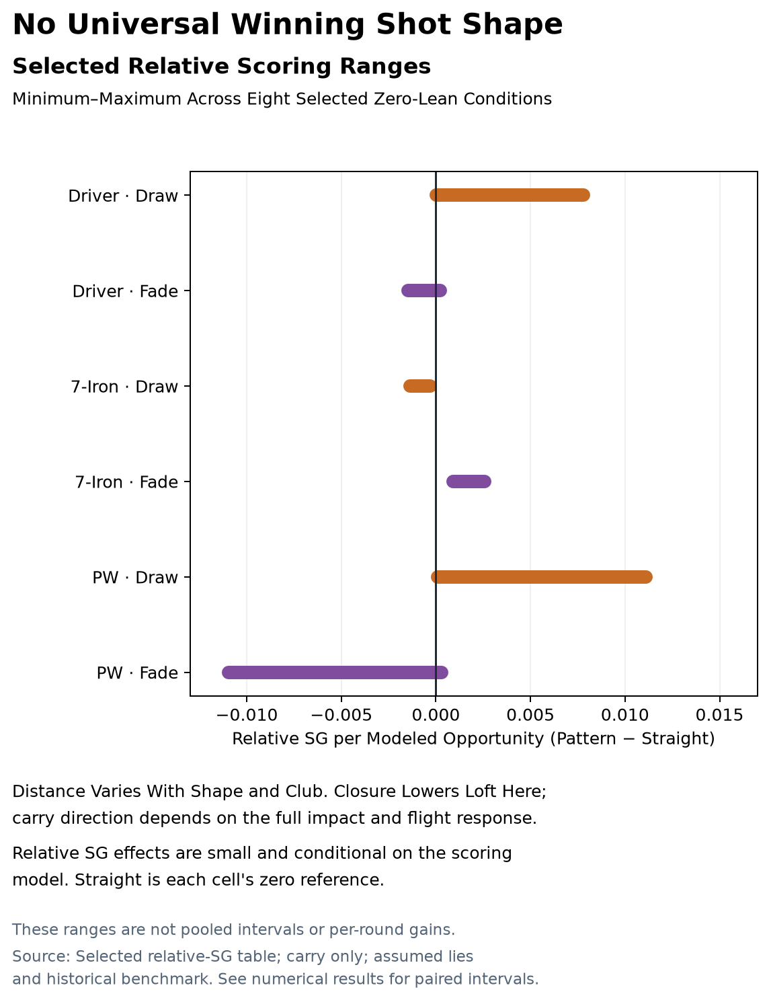

This study compares straight, draw, and fade patterns for modeled driver, seven-iron, and pitching-wedge geometries. For each feasible comparison, nominal face, path, and clubhead speed are solved so the zero-error shot reaches a shared target. Paired delivery variation is then propagated through club–ball impact, ball flight, endpoint dispersion, and a stated scoring scenario.

The simulations do not use a measured golfer dataset. Their results describe the declared model, delivery distributions, and course assumptions; they do not identify an individual player's best shot pattern.

[Download the Illustrated Research Report (PDF)](shot_pattern_analysis/report.pdf) · [View the Graphical Summary](shot_pattern_analysis/summary.png)

{fig-alt="The selected comparisons show club-dependent dispersion and scoring patterns, with no universal winner."}

## What the Study Compares

The study varies nominal shot shape, shaft lean, shaft-rotation variability, curve strength, and selected delivery-error profiles. The executed conditions use paired indices: the same seeded primitive error draw is applied across straight, draw, and fade populations. Each feasible pattern and condition attempts 10,000 shots. The executed populations contain 10.44 million attempted shot rows, including unsupported outcomes. Unavailable nominal matches remain separately recorded.

The modeled pipeline has five stages:

1. Match nominal face, path, and speed by forward simulation to a common raw landing target within 0.05 m.
2. Apply the specified paired delivery errors, including shaft rotation, path, speed, and strike variation where enabled.
3. Compute rigid-body club–ball impact.
4. Integrate ball flight with fourth-order Runge–Kutta at a 0.02 s step to first ground contact.
5. Summarize supported endpoint dispersion and evaluate a conditional score in the stated course scenario.

The matched nominal point does not make every noisy shot travel the same distance. Rematching face, path, and speed also means a difference between patterns cannot be attributed to curvature alone. Unsupported impacts and flights remain accounted for; they are not clipped, resampled, or assigned invented landing scores.

## Selected Conditional Scoring Results

The table reports the range across eight selected zero-lean conditions per club for Draw or Fade minus Straight strokes gained (SG), in strokes per modeled opportunity. These are descriptive ranges, not pooled effects or per-round gains.

| Club | Draw Minus Straight SG | Fade Minus Straight SG |
|:--|--:|--:|
| Driver | +0.000027 to +0.00780 | −0.00146 to +0.000234 |
| Seven Iron | −0.00136 to −0.000288 | +0.000893 to +0.00258 |
| Pitching Wedge | +0.000095 to +0.0111 | −0.01097 to +0.000292 |

For the eight selected seven-iron conditions, the paired intervals are positive for Fade and negative for Draw. Driver and wedge comparisons have mixed directions, including intervals that span zero. The pattern that scores better therefore depends on the modeled club, delivery variation, and scoring context. Pointwise interval directions are descriptive and are not multiplicity-adjusted discoveries.

## Dispersion Figures

The density plots show supported endpoint populations for the baseline zero-lean condition. Lateral distance is positive to the right; downrange distance is shown on the vertical axis. The contours are binned empirical highest-density regions, not confidence regions for a mean. Read them alongside target bias and downrange spread: lateral width alone does not determine scoring.

- [Driver Endpoint Dispersion](shot_pattern_analysis/driver_baseline_density.png)
- [Seven-Iron Endpoint Dispersion](shot_pattern_analysis/seven_iron_baseline_density.png)
- [Pitching-Wedge Endpoint Dispersion](shot_pattern_analysis/pitching_wedge_baseline_density.png)

The accompanying flight plates show 100 verified replays per pattern, selected by common supported shot IDs. These are illustrative subsets, not the full simulated population or an independent experiment. The replay reproduces saved paths and shot outcomes before accepting additional traces. Read each plot’s lateral magnification before comparing its curve with the downrange scale.

- [Driver Illustrative Flight Paths](shot_pattern_analysis/driver_baseline_flight_paths.png)
- [Seven-Iron Illustrative Flight Paths](shot_pattern_analysis/seven_iron_baseline_flight_paths.png)
- [Pitching-Wedge Illustrative Flight Paths](shot_pattern_analysis/pitching_wedge_baseline_flight_paths.png)

## Scoring and Model Limits

Driver scoring assumes a flat 400 m tee opportunity with fairway and rough regions. Seven-iron and wedge scoring use hypothetical approach opportunities with a centered green. First ground contact is treated as the final lie; bounce, roll, hazards, wind variation, and elevation are not modeled. The scoring reference is a historical population benchmark with an approximate putting fit, not a current player-specific model.

Paired bootstrap intervals quantify Monte Carlo sampling variation for the simulated populations. They do not include uncertainty in clubhead properties, impact law, flight physics, course geometry, scoring assumptions, or human delivery distributions. The primitive Gaussian errors and their correlations are sensitivity inputs, not measured player variability. Empirical qualification remains open.

Face closure is coupled to delivered loft under the modeled shaft-rotation convention, but that geometric relation alone does not determine carry. The effect depends on club geometry and the complete impact and flight model. A small score difference or narrow sampling interval does not establish a stable advantage in human play.

## Report and Provenance

[Read the Full Illustrated Report](shot_pattern_analysis/report.pdf) · [View the Graphical Summary](shot_pattern_analysis/summary.png)

The report records the study methods, saved-data audits, source identities, and figure provenance. It distinguishes supported endpoint populations, common-pattern scoring populations, and paired comparisons; their denominators differ. Unavailable nominal searches are reported as unavailable rather than interpreted as proof of physical impossibility.

## Related Articles

- [Impact Mechanics and Ball Flight](impact-mechanics-and-ball-flight.html) — Contact and flight assumptions behind the modeled outcomes.
- [On the Limits of Strokes-Gained Inference for Individual Golfers](strokes-gained-limitations.html) — The distinction between scoring accounting and player-specific prediction.
- [The Physics of the Rolling Putt](putting-roll-models.html) — A related model with explicit surface and scoring limits.
