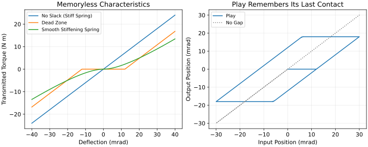
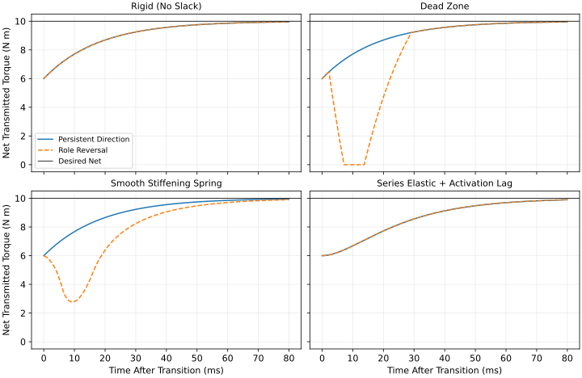
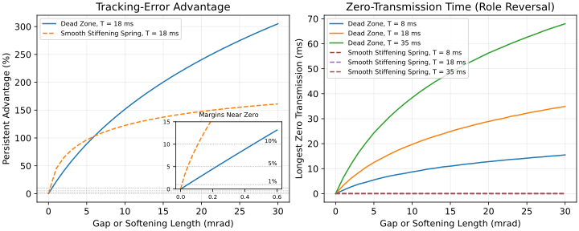
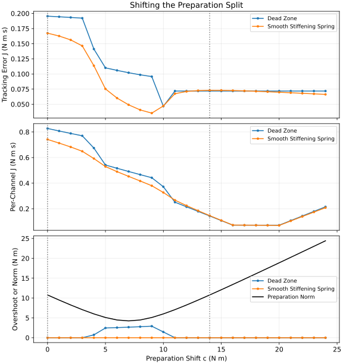

::: {.callout-note}
## In Layman's Terms

Tow a car with a rope and the rope goes slack whenever the cars drift together. The next pull arrives late, with a jerk. Gears and couplings have the same kind of give. Your hands on a club may have it too; whether they do has not been measured. Engineers call it slack, backlash or play. Most golf-swing models leave it out, which is fine when the answer you care about does not depend on it. This page sets up a small test that shows when the answer does depend on it, and what the usual ways of managing slack cost. It is a test of models, not of golfers.
:::

::: {.callout-important}
## Status, Scope and Sibling Articles

This is a **draft for panel review** and must not be published before the gate on [issue #5135](https://github.com/D-sorganization/AffineDrift/issues/5135) is cleared. It covers *modeling and management choices only*. The feel of a firm lead wrist, impact and the "heavy hit" belong to [#5134](https://github.com/D-sorganization/AffineDrift/issues/5134). Whether the order in which slack takes up can reveal where torque comes from belongs to [#5136](https://github.com/D-sorganization/AffineDrift/issues/5136).

The issue's blockers are scoped out rather than resolved. Three High critiques remain open: [Qualifying Rigid Constraints](../critiques/hard_constraint_fallacy.md), [Input-Dependent Boundary Conditions](../critiques/input_dependent_boundary_conditions.md) and [Null Space Forces and Closed-Chain Indeterminacy](../critiques/nullspace_interpretation.md). The UpstreamDrift null-space program is marked ["publication blocked"](https://github.com/D-sorganization/UpstreamDrift/blob/3fd2a59e390523169df846a3bbb395a6203c382c/docs/research/loop_nullspace/publication_gate.md#scope-and-current-status). Its grip-preload and co-contraction validations (VAR-04 and VAR-05) are deferred for lack of an instrumented grip. Nothing below depends on those items, and nothing below resolves them.
:::

## Ignoring Slack Is a Modeling Choice {#sec-choice}

A model that leaves slack out welds the hands to the club and the forearm to the hand. That is an idealization, and the repository's own guidance is to "document what was eliminated and why the reduced model remains adequate for the timescale of interest" ([Sources of Nonlinearity](sources-of-nonlinearity.qmd#transmission-nonlinearities)). The choice also has consequences. Changing only how the two hands are joined to the club changes the number of undetermined internal force directions (the allocation nullity) from 6 (weld) to 5 (shaft-twist revolute) to 3 (trail-hand ball joint). As the UpstreamDrift report puts it, "None of this says which grip a golfer uses" ([closure alternatives report](https://github.com/D-sorganization/UpstreamDrift/blob/3fd2a59e390523169df846a3bbb395a6203c382c/docs/research/loop_nullspace/closure_alternatives_report.md#summary-of-findings)).

This page proposes a working rule, to be tested rather than assumed: *slack may be idealized away only when each declared output stays within a stated tolerance across the plausible slack representations.* The rest of the page applies the rule to a small task and reports where it says "model it" and where it says "ignore it".

## Five Things Called Slack {#sec-taxonomy}

"Slack" can mean a grip gap, series-elastic extension, low tangent stiffness, activation delay or low activation, and these "are not interchangeable" ([Proximal-Distal Energy Transfer](proximal-distal-energy-transfer.qmd#what-slack-means-in-this-test)). @tbl-taxonomy lists the standard mathematical representations. Each one adds parameters, and each added parameter must either be measured or be shown not to matter.

| Representation | What it says | Memory? | Parameters it adds | Identification cost |
|---|---|---|---|---|
| No slack (stiff spring) | A stiff spring with no gap: it transmits from the first instant | No | None beyond stiffness and lag | None, but it hides the question |
| Dead zone | Nothing passes until the input exceeds a gap $\delta$ | No | Gap $\delta$ | $\delta$ is invisible while the channel stays loaded one way |
| Play (backlash) | The output keeps its last contact position until the input pushes the other face | Yes | Half-gap $\Delta$, initial contact side | Needs reversals; the history must be known |
| Smooth stiffening spring | Soft near zero, stiffer under load | No | Softening length, stiffness | Trades off against stiffness |
| Series elasticity with activation | A spring in series with a muscle whose force builds with a delay | Yes (internal states) | Stiffness, activation and force time constants | Delays trade off against each other |
| Hysteresis and friction | Loading and unloading follow different paths | Yes | Loop shape, friction coefficient | Excitation-dependent |
| Unilateral contact | A contact pushes but cannot pull, and may open | Yes (contact mode) | Contact stiffness or complementarity law, friction | Opening events must be observed |

: Slack representations, what each adds, and what it costs to identify. {#tbl-taxonomy}

The second and third rows are easy to confuse. A dead zone is a *memoryless* map: the output depends only on the current input. A play operator *remembers* which face it last touched [@brokate1996hysteresis; @nordin2002backlash]. @fig-ladder shows both: on the left, torque against deflection for the memoryless laws; on the right, a play operator driven through two cycles, whose output at the same input depends on which face was last touched. One archived repository result needs this caveat stated plainly. In the UpstreamDrift typed-slack audit, the class named `transmission_backlash` "is represented by the existing memoryless dead-zone-plus-damping surrogate; a stateful rate-independent play operator is not represented" ([typed-slack study, `limitations`](https://github.com/D-sorganization/UpstreamDrift/blob/92100115ea0be0d6744dcf7a4504ec8453fae6fa/docs/research/proximal_distal_energy_transfer/data/typed_slack_dynamic_study.json)). Results labelled "backlash" in that file are therefore dead-zone results.

{#fig-ladder fig-alt="Left panel: three torque-deflection curves; the dead zone is flat between plus and minus 12 milliradians, the smooth spring is flat near zero and stiffens, the no-slack line is straight. Right panel: a parallelogram loop of output position against input position for a play operator, beside a dotted no-gap diagonal."}

The test below keeps the load fixed in place, so a play element and a dead zone centred on the load act the same way; their difference needs a moving load and is not tested here. Hysteresis, friction and unilateral contact in the full complementarity sense [@brogliato2016nonsmooth] are also not run on this page.

## The Test Task {#sec-task}

The task comes from the published arm-wrist preload study ([arm–wrist torque allocation and transmission preload](proximal_distal_energy_transfer/index.qmd#sec-torque-allocation-preload)). Two abstract torque channels, called arm and wrist, push on the same load. Their sum is the *net torque*, and it must step from 6 N m before a transition to 10 N m after it. Two programs reach the same net targets in different ways:

- **Persistent direction.** The arm goes from $+10$ to $+16$ N m and the wrist from $-4$ to $-6$ N m. Neither channel changes sign.
- **Role reversal.** The arm goes from $-4$ to $+16$ N m and the wrist from $+10$ to $-6$ N m. Both channels change sign.

Each channel turns a desired torque $\tau^*$ into a target deflection $x^*$ (how far its spring must stretch). The deflection $x$ relaxes toward the target with time constant $T$, $\dot x=(x^*-x)/T$, and the channel transmits a torque $\tau(x)$ set by its representation. The published law uses a dead zone $\delta=0.012$ rad, stiffness $k=600$ N m rad$^{-1}$ and $T=18$ ms, all "synthetic sensitivity parameters, not identified tissue or grip properties." Starting from the loaded pre-transition state, we report four outputs:

1. **Net tracking error** $E$: the area between desired and transmitted net torque, $E=\int|\tau^*_\Sigma-\tau_\Sigma|\,dt$, in N m s. Smaller is better. Shortfall and overshoot both add to it, so it is not an angular impulse, although the published study and the data file call it an "error impulse".
2. **Per-channel tracking error**: the same area summed over each channel's own target.
3. **Zero-transmission time**: how long a channel transmits exactly zero torque.
4. **Peak overshoot**: the largest excess of transmitted over desired net torque.

The *persistent advantage* is $A=(E_\text{reversal}-E_\text{persistent})/E_\text{persistent}$. A positive $A$ favours persistent direction.

Before any new result, the code committed with this page reruns the published case on its 0.12 s window. It reproduces the published errors of 0.0717 N m s (persistent) and 0.1954 N m s (reversal), and the 11.5 ms and 22.0 ms zero-transmission intervals, to within $10^{-16}$ N m s. It also recovers the published grid verdict: of 12 dead-zone and time-constant cells, 9 favour persistent direction and 3 (all with zero dead zone) are equivalent. The new runs below use a 0.5 s window so that slower channels are not cut off.

## What Each Representation Says {#sec-results}

@tbl-results and @fig-traces run both programs through five representations; in the figure the black line is the desired 10 N m. The no-slack row is not rigid: it keeps the 600 N m rad$^{-1}$ spring and the 18 ms lag and removes only the gap. The unequal-lag row gives the arm an 18 ms lag and the wrist a 36 ms lag, with no slack at all.

| Representation | Net $E$, persistent (N m s) | Net $E$, reversal (N m s) | Advantage $A$ | Longest zero transmission | Per-channel $E$, persistent / reversal (N m s) | Reversal overshoot (N m) |
|---|---|---|---|---|---|---|
| No slack (stiff spring) | 0.0718 | 0.0718 | 0% | 0 ms | 0.144 / 0.646 | 0 |
| Dead zone | 0.0718 | 0.1955 | 172% | 22.0 ms | 0.144 / 0.827 | 0 |
| Smooth stiffening spring | 0.0730 | 0.1674 | 129% | 0 ms | 0.147 / 0.741 | 0 |
| Spring + second linear lag (10 ms) | 0.1114 | 0.1114 | 0% | 0 ms | 0.223 / 1.003 | 0 |
| No slack, unequal lags | 0.0599 | 0.2449 | 309% | 0 ms | 0.180 / 0.934 | 3.21 |

: Both programs under each representation (synthetic parameters, 0.5 s window). {#tbl-results}

{#fig-traces fig-alt="Five panels of net torque against time. In the no-slack and second-linear-lag panels the two programs overlap. In the dead-zone panel the role-reversal curve drops to zero for several milliseconds. In the smooth-spring panel it dips to about 3 newton metres without reaching zero. In the unequal-lag panel the role-reversal curve rises above the 10 newton-metre target."}

Four things follow.

**Shared linear channels cannot tell the programs apart by net torque.** When both channels obey the same linear dynamics, the net response depends only on the net targets (superposition), and both programs share those. The no-slack and second-linear-lag rows are equal to rounding, whatever the time constants. The second-linear-lag row adds an identical 10 ms linear lag ahead of each channel's deflection lag. It has no muscle, no on/off asymmetry and no opposing pair, so its 0% holds by construction and is not evidence about muscles; the nonlinear muscle model, which does not give 0%, is compared in [#5134](https://github.com/D-sorganization/AffineDrift/issues/5134). The published "equivalent at zero dead zone" verdict is this identity.

**Unequal lags separate the programs without any slack.** That identity needs *both* channels to respond at the same speed. With an 18 ms arm and a 36 ms wrist, the gap between the programs' net torques is $14\,(e^{-t/18\text{ ms}}-e^{-t/36\text{ ms}})$ N m. It is largest at $t=36\ln 2\approx 24.95$ ms, where it equals $-3.50$ N m, 35% of the 10 N m target. The simulation gives $-3.51$ N m at 24.9 ms. This counterexample came from Argon's independent check ([AffineDrift PR #5140](https://github.com/D-sorganization/AffineDrift/pull/5140)). A difference between the two programs is therefore not, by itself, evidence of slack.

**A gap detector can miss slack that matters.** The smooth stiffening spring never transmits exactly zero, so a zero-transmission count reports "no slack problem". Yet at a 12 mrad softening length its persistent advantage is 129%, against 172% for a 12 mrad dead zone, and below about 6 mrad the smooth spring's advantage is the larger of the two (@fig-flip). A softening length and a gap width are different quantities, so equal milliradian values are not equal amounts of slack; the comparison shows only that both change the answer by far more than any declared margin. Whether slack is negligible depends on the output that was declared, not on whether a gap is visible.

**The no-slack model is not neutral on per-channel outputs.** Even with no slack, role reversal has a larger per-channel error (0.646 against 0.144 N m s), simply because each channel has further to travel. Idealizing slack away is safe for one output and not automatically for another.

## How Big Must a Gap Be to Matter? {#sec-flip}

@fig-flip sweeps the gap (or the softening length) from 0 to 30 mrad. To apply the working rule, pick an *equivalence margin*: the largest advantage you are willing to call "no difference". The margin is a declared choice, not a fact about golf, so three are shown as dotted lines (1%, 5% and 10%); the inset magnifies the first 0.6 mrad, where all three are crossed. The right panel shows the longest zero-transmission interval of the role-reversal program for three lags.

{#fig-flip fig-alt="Left panel: two rising curves of advantage in percent against gap in milliradians; the dead-zone curve reaches about 300 percent at 30 milliradians and the smooth curve about 160 percent. An inset magnifies gaps up to 0.6 milliradians and advantages up to 15 percent, where both curves cross the 1, 5 and 10 percent margin lines. Right panel: zero-transmission time rises with gap for the dead zone and is larger for slower lags; the smooth-spring lines stay at zero."}

For the dead zone, the advantage passes 1% at a gap of 0.044 mrad, 5% at 0.22 mrad and 10% at 0.45 mrad. For the smooth spring the same margins are crossed at 0.0063, 0.044 and 0.11 mrad. For scale, the 6 N m wrist target stretches a 600 N m rad$^{-1}$ spring by 10 mrad. Under a 5% margin, then, a gap of about 2% of that stretch is already enough to require explicit modeling. At the declared 12 mrad, the advantage is 172% (dead zone) and 129% (smooth spring).

Two further results bear on the decision rule:

- **The advantage barely depends on the lag; the gap time does.** At 12 mrad the dead-zone advantage is 172% for lags of 8, 18 and 35 ms. The zero-transmission interval, by contrast, is 9.8, 22.0 and 42.8 ms. A conclusion stated in milliseconds of "dead time" is therefore much more sensitive to an unmeasured lag than one stated as a ratio of tracking errors.
- **A richer model passes the rule for one target and fails it for another.** The published reduced muscle model, with activation and series-force dynamics, gives 0.08998 against 0.09084 N m s at its 0.2 ms step ([Proximal-Distal Energy Transfer](proximal-distal-energy-transfer.qmd#preparation-history-with-activation-and-series-force-dynamics)), an advantage of 0.96%, inside all three margins. That is not a robust equivalence. The [#5134](https://github.com/D-sorganization/AffineDrift/issues/5134) draft's muscle-model results ([What the Two Models Say](https://github.com/D-sorganization/AffineDrift/blob/8a9e33165854fdfb23f5b629385c33bb143358b0/articles/firm-lead-wrist-preload.qmd#L98-L116), in [PR #5143](https://github.com/D-sorganization/AffineDrift/pull/5143)) show the difference shrinking to about 0.4% once the integration step is converged. For a 14 N m delivery target, role reversal scores 0.1505 against 0.1918 N m s for persistent direction, an advantage of about $-22\%$. That case leaves every margin, so under this page's rule the muscle model also requires its representation to be declared.

## Managing Slack: Strategies and Costs {#sec-strategies}

Engineers manage slack in several ways [@nordin2002backlash]. They preload a drive so it never crosses its gap. They invert a known dead zone in the controller, which can be done adaptively when the gap is unknown [@tao1994deadzone]. Or they deliberately add a series spring, accepting a lower force bandwidth in exchange for shock tolerance, more accurate force control and energy storage [@pratt1995sea]. Biology offers close analogues. Series compliance can slow the rate of force rise [@mayfield2016]. Short-range muscle stiffness gives an immediate response to perturbation [@degroote2017]. Co-contraction can buy robustness under uncertainty at an energetic cost [@berret2024]. These are analogies only; none of them shows what a golfer's hands do.

In the two-channel task, every preparation with the same 6 N m net can be written as role reversal plus an internal pair $c$: add $c$ to the arm and subtract it from the wrist. The net is unchanged, $c=0$ is role reversal and $c=14$ N m is persistent direction. @fig-split sweeps $c$ from 0 to 24 N m; dotted lines mark the two published programs.

{#fig-split fig-alt="Three stacked panels against internal pair c. Net error is lowest near c equals 9 to 10 and flat beyond about 12. Per-channel error falls to a floor between c equals 16 and 20 and then rises. Overshoot is nonzero for the dead zone between about c equals 4 and 10. The preparation norm is V-shaped with its minimum at c equals 7."}

The answer depends on what is being minimised:

- **Net error rewards unloading the channel that must reverse.** On the 1 N m grid, the lowest net error comes from a preparation that leaves the wrist near zero: $c=10$ for the dead zone (0.0467 N m s) and $c=9$ for the smooth spring (0.0353 N m s). Both beat persistent direction (0.0718 and 0.0730 N m s). The dead-zone value is a single grid point that its neighbours do not support: $c=9$ gives 0.0957 N m s and $c=11$ gives 0.0718 N m s. It sits at the centre of the gap and is a knife-edge, not a robust optimum. Under the dead zone that preparation also overshoots the target by 1.45 N m, because the wrist's opposing torque arrives late.
- **Per-channel error rewards preloading each channel in its delivery direction.** For the dead zone the per-channel error is lowest, at 0.0718 N m s, for every $c$ from 16 to 20 N m. For the smooth spring it is lowest at $c=20$ (0.0698 N m s). Beyond that, more internal load only adds error.
- **Internal load is not free.** The preparation torque norm $\sqrt{\tau_\text{arm}^2+\tau_\text{wrist}^2}$ is 10.77 N m for both extremes ($c=0$ and $c=14$), falls to 4.24 N m at $c=7$ and rises to 18.87 N m at $c=20$. Under the dead zone, net error is 0.0718 N m s for every $c$ from 11 to 24 N m: once both channels are loaded in their delivery direction, more internal load buys nothing. A Euclidean torque norm is not metabolic effort.

@tbl-strategies collects the strategies. "Not established" means the repository record contains no evidence either way.

| Strategy | What it does in the model | Modeled benefit | Modeled cost | Speed, face control, injury |
|---|---|---|---|---|
| Preload (persistent direction) | Keeps each channel loaded the way it will deliver | No zero-transmission gap; lowest per-channel error | Larger preparation torque than the minimum-norm split | Not established |
| Extra opposing torque | Adds internal load beyond sign consistency, with stiffness and gap held fixed (so not the stiffening of real co-contraction) | Smooth spring: slightly lower error | Torque norm grows; dead zone: no further gain | Not established |
| Exploit compliance | Accepts a spring in series | Shock tolerance and energy storage (engineering analogy) | Slower force rise | Not established |
| Early take-up by timing | Starts the reversal before the transition | Hides the recovery delay (wrist reversal recovers in 31.1 ms under the dead zone) | Requires an earlier, accurately timed command | Not established |
| Deliberate role reversal | Separates preparation and delivery roles | Lowest net error on the grid, at a single knife-edge split ($c=10$ under the dead zone), not a robust optimum | Gap, overshoot or both, depending on representation | Not established |

: Slack-management strategies, with the benefit and cost each shows in the synthetic task. {#tbl-strategies}

## One Output Channel Cannot Name the Slack {#sec-one-channel}

The working rule asks which representation is plausible. Data from a single output may not be able to say. In the UpstreamDrift audit of five slack classes under a multisine reversal, every local three-parameter sensitivity matrix is full rank. Yet the contact-disengagement and biological-series-compliance classes differ by only 1.96% in normalized output RMSE ([typed-slack study](https://github.com/D-sorganization/UpstreamDrift/blob/92100115ea0be0d6744dcf7a4504ec8453fae6fa/docs/research/proximal_distal_energy_transfer/data/typed_slack_dynamic_study.json)). Full rank means parameters can be estimated *if the class is already known*. It does not mean one class can be told from another. The same record's H10 entry adds that "preload matching reverses open/taut classification" ([falsification matrix](https://github.com/D-sorganization/UpstreamDrift/blob/3fd2a59e390523169df846a3bbb395a6203c382c/docs/research/proximal_distal_energy_transfer/MODEL_COMPLETION_FALSIFICATION_MATRIX.md)).

The distributed-grip evidence needs a counting caveat. At the pinned commit, the [distributed-grip atlas](https://github.com/D-sorganization/UpstreamDrift/blob/3fd2a59e390523169df846a3bbb395a6203c382c/docs/research/proximal_distal_energy_transfer/data/articulated_distributed_grip_atlas.json) reports `maximum_transition_count = 0` alongside `maximum_open_fraction = 1.0`. That zero is a property of the counter, which records only changes between "some station in contact" and "every station open". It does not count individual stations opening. The atlas's separate event probes register 80 openings and 186 reattachments. The atlas version that [Proximal-Distal Energy Transfer](proximal-distal-energy-transfer.qmd) describes (288 trajectories) has no friction. The pinned version (576 trajectories) adds Coulomb coefficients of 0 and 0.35, which the atlas labels "equipment-provisional bounds", with the true coefficient "not_identified". Whether take-up order could separate the classes is the subject of #5136 and is not argued here.

## A Decision Rule and Its Falsifiers {#sec-rule}

Stated as a procedure:

1. Declare the outputs (for example net tracking error, per-channel error, event timing, overshoot) and an equivalence margin for each.
2. Run each output across at least a no-slack model, a gap model, a smooth model and a model with unequal channel lags, over a plausible range of gap sizes.
3. If every output stays within its margin, the no-slack model is adequate *for those outputs*. If any output leaves its margin, represent the slack and report which representation was assumed.

The rule would show the no-slack idealization to be adequate if measured bilateral loads showed no sign reversals in the window of interest, *and* the declared outputs stayed within their margins across representations fitted to those loads. It would make representation mandatory if conclusions flipped between fitted representations. A third outcome, that conclusions flip but no measurement can say which representation holds, is the identifiability problem of #5136.

## Measurements That Would Settle It {#sec-measure}

The preload chapter lists the measurements ([measurements that can refute the interpretation](proximal_distal_energy_transfer/index.qmd#measurements-that-can-refute-the-interpretation)). They are: bilateral six-axis grip wrenches with pressure distribution, perturbation-based estimates of tangent stiffness, and surface EMG read as activation timing rather than torque. Instrumented clubs that measure internal grip force exist [@koike2020]. The UpstreamDrift record notes that each grip model "is a declared alternative and none is validated" ([closure alternatives report](https://github.com/D-sorganization/UpstreamDrift/blob/3fd2a59e390523169df846a3bbb395a6203c382c/docs/research/loop_nullspace/closure_alternatives_report.md)). This page adds one requirement: measure each channel's response time separately, because unequal lags mimic slack.

## What This Article Does Not Establish {#sec-limits}

Every number above comes from a synthetic task with invented parameters. The page does not show that a golfer's hands, wrists or forearms contain a gap, or how large one would be. It does not show that any management strategy changes club speed, face control, dispersion, injury risk or feel. The isometric task cannot separate play from a dead zone, and hysteresis, friction and full complementarity contact were not run.

::: {.callout-warning}
## Open Sourcing Items

- TODO(source): measured magnitudes of human grip, wrist or forearm slack (gap size, tangent stiffness near zero load, per-channel lag). None is cited here. An earlier unsourced dead-zone duration was removed upstream ([citation verification table](https://github.com/D-sorganization/UpstreamDrift/blob/3fd2a59e390523169df846a3bbb395a6203c382c/docs/research/loop_nullspace/loop_nullspace.tex)) and is deliberately not reused.
- TODO(source): any measured effect of grip preload or co-contraction on club or ball outcomes (UpstreamDrift VAR-04 and VAR-05, deferred).
- TODO(source): research-scout confirmation of the engineering summaries attributed to @nordin2002backlash, @tao1994deadzone and @pratt1995sea against the full texts. The DOIs and abstracts were checked; the full texts were not.
:::

## Reproducing the Numbers {.unnumbered}

Every number in @sec-task to @sec-strategies is read from `data/slack_management/results.json`, and every figure is drawn from it. Both are regenerated by:

```bash
python3 -m scripts.build_slack_management_data
```

The model is in `src/tools/slack_transmission.py` and the studies in `src/tools/slack_management_studies.py`. `tests/test_slack_transmission.py` checks the reproduction of the published study, the linear-superposition identity, the unequal-lag counterexample and that the committed data match a fresh build. `tests/test_slack_management_article.py` checks that each number quoted on this page matches the data file.

## Related Articles {.unnumbered}

- [Classic Sources of Nonlinearity in Mechanical Systems](sources-of-nonlinearity.qmd#backlash-mechanical-play): play, dead zone and transmission nonlinearities.
- [Proximal-Distal Energy Transfer](proximal-distal-energy-transfer.qmd#what-slack-means-in-this-test): the published preload and typed-slack studies.
- [Intentional Constraint Collapse](intentional-constraint-collapse.qmd): why zero external work is not zero effort.

## References {.unnumbered}

::: {#refs}
:::
