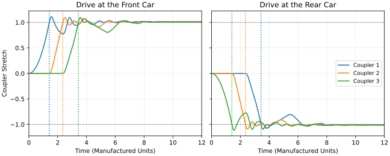
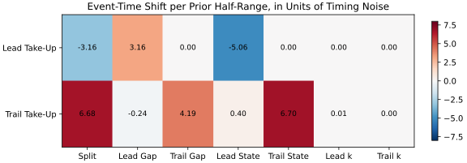
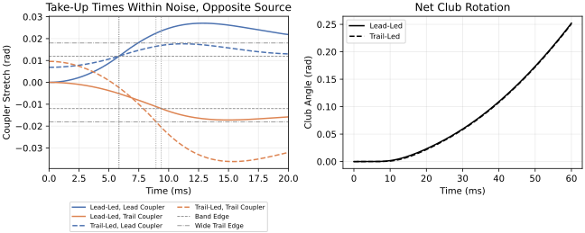
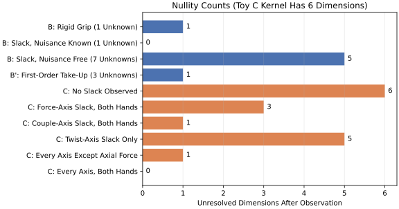

::: {.callout-note}
## In Layman's Terms

When a long train starts moving, you can hear it happen: clank, clank, clank, running down the line. The engine jerks forward first, then the first car, then the next, because each coupling has a little play that is taken up in turn. If you could only hear the clanks, you could still tell which end the engine is on. A golfer holds the club with two hands. The motion of the club tells you the total twist the hands put on it, but not how much each hand gave. This page asks whether the order in which small gaps at the hands are taken up could work like the train's clanks. It uses made-up computer models only. The short answer: the clanks help only in tidy cases, and a hidden squeeze between the hands can fake them.
:::

::: {.callout-important}
## Status: Draft Under Review

This page is a draft, not a finished result. Every number on it comes from made-up computer models whose settings we chose and state openly. Nobody has yet measured real hands on a real grip for this question, the earlier analysis it leans on has not been cleared for publication, and a key review question about that analysis is still open. So when the page says something is "identifiable", it means only that it can be worked out inside these toy models.

*For reviewers:* this is a draft for the publication gate on [AffineDrift #5136](https://github.com/D-sorganization/AffineDrift/issues/5136). The numbers are generated by `python -m scripts.build_slack_takeup_witness` into `data/slack_takeup_witness/results.json`. The open blockers are scoped out, not resolved. There are no instrumented-grip data (UpstreamDrift VAR-03 to VAR-05 are deferred), the null-space record is "publication blocked", and the critique `nullspace_interpretation` is open with no adjudication evidence registered.
:::

## The Question {#sec-question}

Here is the puzzle. A golfer holds the club with a lead hand (the top hand on the grip, the left for a right-handed golfer) and a trail hand (the lower one). "Lead" names a position, not a claim about who is doing the work. Watch the club in the middle of a swing and, from its motion alone, you can work out the total push and twist it is getting. You cannot work out who is supplying it. The lead hand could be doing most of the work, or the trail hand could, and the club would move the same way. A train has no such ambiguity, and it is worth seeing why.

A railway review defines slack action as "the progressive increase or decrease of inter-wagon distance being propagated through the train", and describes a start from a compressed train in which the locomotive moves, takes up the slack to the first wagon, and the momentum "would progress along the train" [@wagner2021draftgear]. The order of those take-up events is a record of where the pull came from.

A club held in two hands is different in one important way. Each hand applies a force and a couple to the club. A couple is a pure twist, like turning a key, with no push. The motion of the club fixes only the sum of all of these: the total push-and-twist, which engineers call the net wrench. Whatever part of the two hands' loads cancels on the club, such as the hands twisting against each other, leaves no trace in the club's motion. In the record (the project's earlier research), this cancelling set is the kernel of the grasp map $G$, the $6\times12$ matrix that turns the two hands' loads into the net wrench, and it has six dimensions (`UpstreamDrift:docs/research/loop_nullspace/loop_nullspace.tex` L524 at [`3fd2a59e`](https://github.com/D-sorganization/UpstreamDrift/blob/3fd2a59e390523169df846a3bbb395a6203c382c/docs/research/loop_nullspace/loop_nullspace.tex#L524)). Put plainly, there are six independent ways for the hands to fight each other without the club noticing. This page calls them the six hidden fighting directions.

So any calculation that works backwards from the club's motion has to pick a split between the hands, and the usual way to pick one is a choice, not a measurement. In the record's words, closed-chain inverse dynamics is therefore underdetermined, and "Regularization selects an allocation consistent with a penalty; it does not measure the selected internal forces" ([Inverse Dynamics](inverse-dynamics.html), L54 at [`20584d47`](https://github.com/D-sorganization/AffineDrift/blob/20584d47702c3b6f50a14728efc2fe2855561241/articles/inverse-dynamics.qmd#L54)).

So here is the hypothesis under test. It is a hypothesis, not a finding. Small gaps or compliances at the hands, wrists and forearms engage in an order and with latencies that act as extra observations, and so shrink the set of allocations that fit the data. Think of a loose spanner on a nut: it turns a little before it bites, and the moment it bites is something you could time. If the hypothesis were true, the clanks would tell us something the club's motion cannot. Nobody yet knows whether hands and wrists even have gaps like this. The hypothesis restates the open High critique `nullspace_interpretation` ([critiques/adjudication-summary.md](https://github.com/D-sorganization/AffineDrift/blob/20584d47702c3b6f50a14728efc2fe2855561241/critiques/adjudication-summary.md#L36) L36) as a computation.

Here is where we end up, so you can watch for it on the way. A one-ended train passes the test, as it should. Two hands driving one club pass only in tidy cases. An independent check finds an exact blind spot and an exact counterexample. It also corrected one of our own expectations: the proposal predicted that wrist slack could see three of the six hidden fighting directions, but in an idealized best case it could see five, two of them only faintly (@sec-toy-c).

This page covers identifiability only. The firm-lead-wrist and preload reading of slack, and its link to the heavy hit, belongs to [#5134](https://github.com/D-sorganization/AffineDrift/issues/5134). The choice of slack representation and the strategies for managing slack belong to [#5135](https://github.com/D-sorganization/AffineDrift/issues/5135). Neither is repeated here.

## What Earlier Work Already Says {#sec-record}

We are not starting from scratch. Earlier work in the record already settles some pieces of this question and puts limits on others. In short:

- The counting rule used below is settled mathematics: extra measurements remove exactly as many hidden directions as they can independently see, and a direction that moves the measurements by less than their noise counts as "not resolved by the data".
- Earlier models show that a full role reversal between the arm and wrist channels can leave windows in which nothing is transmitted, and that in a reduced muscle model the activation and force histories can make the route into the same net task visible.
- The limits matter as much. One output channel does not identify the mechanism. In one earlier model, a matched preload swaps which channels look open and which look taut, and natural events are "right-censored" at 5 ms: the record stops watching after 5 ms, so anything later goes unrecorded. A synthetic test of recovering how two hands share the load under adverse conditions came out "Negative".

The exact statements, these and several more, are listed with their sources in @tbl-record in the appendix.

## The Counting Argument {#sec-counting}

Before building any models, it pays to count. Counting tells us the most a measurement could reveal, before we ask what it actually does reveal.

Write the unknowns of an instant as a vector $x$ and the balance equations as $Ax=b$. Let $N$ be a matrix whose columns span the null space of $A$: the directions that change $x$ without changing $b$. These are the hidden directions, like the hands fighting each other. If extra measurements $y=E_x x$ are taken, the record's count is
$$
\text{nullity after observation}=\operatorname{nullity}(A)-\operatorname{rank}(E_xN).
$$ {#eq-nullity}
In words: start with the number of hidden directions, then subtract one for each independent hidden direction that the new measurements can see. That count, how many separate things the measurements can tell apart, is called the rank. A measurement that sees nothing hidden subtracts nothing. What is left is the number of directions the measurements are still blind to, even with perfect clocks.

Slack pulls this count two opposite ways. Each slack element adds unknowns: a half-gap $\delta$ (half the width of the dead band), a stiffness $k$, a damping and a starting state, meaning where in its band the element sits at $t=0$, or how far beyond the edge it is already pressed. If its take-up time can be observed, it also adds one observation. So each gap brings four new unknowns and at most one new observation. Counting alone cannot say whether that trade helps. It depends on what the event times respond to.

To make that precise, stack the original null coordinates and the new slack parameters into an augmented vector $p$. Let $t_{\mathrm{ev}}$ be the vector of event times, and let $J=\partial t_{\mathrm{ev}}/\partial p$ be its Jacobian (the matrix of first derivatives: how much each event time shifts when each parameter is nudged). The question is whether some combination of event-time shifts responds to the split and to nothing else. Formally, for small nudges (to first order, the straight-line approximation), a quantity such as the torque split is determined by the events exactly when its direction lies in the row space of $J$. This is the invariance test of [After One Solution](after-one-solution-null-space-exploration.html#prop-p4), applied to event times instead of balance rows. Real clocks are imperfect, so the record's test scales $J$ by the timing uncertainty $\sigma_t$, and a scaled singular value below one counts as unresolved: that direction moves the event times by less than the timing noise. A large one means the opposite: that direction moves the clocks by many noise-widths, so it is easy to see. As Toy B will show, a large value does not settle the matter on its own, because it can belong to a mix of the split and the other unknowns.

The train analogy works only if the event times respond to the source and not to the slack parameters. This page computes that; it does not assume it.

## Toy A: The Train, as a Positive Control {#sec-toy-a}

Start with a case where we know the answer should be yes. A positive control tests the test: if the method failed here, we would not trust it anywhere else.

Four equal cars move along one line, joined by three couplers. Each coupler transmits no force while its stretch $e$ (the change in spacing between the two cars it joins) stays inside the band $|e|<\delta$. Once $|e|\ge\delta$, it acts as a spring with damping. A constant drive is applied either to the front car or to the rear car. Gaps and stiffnesses vary by $\pm50\%$ between trials, and each coupler starts at a random point covering 80% of its band. The fixed rule "the end whose coupler takes up first is the driven end" is right in 100.0% of 400 trials.

{#fig-train fig-alt="Two panels of coupler stretch against time. With front drive, couplers one, two and three reach the upper band edge in that order; with rear drive, couplers three, two and one reach the lower edge in that order."}

Why can't the rule fail? Each car stays at rest until the coupler ahead of it engages, so the first event must be next to the driven car. Now take the slack away. Start the train taut, with every coupler already at its tension edge, and the front-drive trials produce no take-up at all: there is no slack left to take up, so there is no clank. The rule then falls to 74.2%. It is right whenever the train is pushed from the rear, and right only by chance when it is pulled. A taut start makes the witness go silent. That echoes the preload limit in @tbl-record, and it will come back.

## Toy B: Two Hands Driving One Club {#sec-toy-b}

Now the real puzzle, in its simplest form. Toy B keeps one rotation axis. A lead hand (rotational inertia $0.01\ \mathrm{kg\,m^2}$), a club ($0.05\ \mathrm{kg\,m^2}$) and a trail hand ($0.01\ \mathrm{kg\,m^2}$) sit in a line. Each hand connects to the club through a dead-zone coupler with half-gap $0.012$ rad (about 0.7°) and stiffness $600$ N m/rad, the magnitudes of the record's synthetic dead-zone definition. A total drive of $10$ N m is split so that the lead hand receives a fraction $\alpha$ (the split) and the trail hand $1-\alpha$. A lead-source trial has $\alpha\in[0.6,0.8]$ and a trail-source trial has $\alpha\in[0.2,0.4]$.

The other unknowns, the gaps, starting states and stiffnesses, are nuisance parameters: we don't care about them, but we don't know them, and they can mimic the thing we do care about. The witness is the pair of take-up times of the two couplers, each with $0.5$ ms of declared timing noise. A lag threshold is fitted on 400 training trials and scored on 400 held-out trials, fresh trials the rule had not seen. The pass rule was fixed in the code before the first run: the lower end of the held-out 95% Wilson interval must exceed chance (50%) by 20 percentage points. A Wilson interval is the range the true success rate probably lies in, given only 400 tries. We use it rather than the bare percentage because even 400 right out of 400 doesn't prove perfection: the range is still 99.0% to 100.0%. So success needs a margin, not a lucky score: even the pessimistic end of the range has to clear 70%.

| Regime | What we don't know (nuisance) | Held-out accuracy | Wilson 95% interval | Pass |
|---|---|---|---|---|
| Known slack | gaps, states and stiffness fixed | 100.0% | 99.0% to 100.0% | yes |
| Uncertain slack | gaps and stiffness $\pm50\%$, states over 80% of the band | 80.2% | 76.1% to 83.9% | yes |
| Preloaded | as above, plus an internal squeeze of 0 to 5 N m | 65.0% | 60.2% to 69.5% | no |
| Smooth spring | no gap at all | 52.8% | 47.9% to 57.6% | no |

: Held-out classification of the source hand in Toy B. {#tbl-toy-b}

Read the table from top to bottom and watch the witness fade. With everything known, it is perfect. With honest uncertainty about the gaps, it still passes. Add a squeeze between the hands, or take the gaps away, and it fails.

So the binary label, which hand leads, survives bounded uncertainty in this toy. The split itself does not. @fig-sensitivity shows why. It plots the scaled Jacobian: each entry is the shift in a take-up time when one parameter moves by its declared prior half-range (the half-width of our rough advance guess for that parameter), in units of timing noise. The lead take-up time responds to the split, the lead gap and the lead starting state with comparable strength, and the trail time likewise. The clock cannot tell whether a hand took up early because it pushed harder or because its gap was smaller. Two observations cannot separate seven unknowns.

Here is the lesson in the numbers. Both of the clocks' singular values are large, about 10.7 and 6.1, so the clocks clearly respond to *something*. But what they hear is a mix of split, gap and starting state, and that mix does not unpick. The split column has norm 7.39, so the split would be resolved if every nuisance parameter were known. With the nuisance parameters free, the split direction has a component of 0.72 outside the row space of $J$, on a scale where 0 would mean fully visible and 1 fully hidden. In plain terms, the split is roughly three-quarters of the way to fully hidden from the clocks, so it is not a first-order identifiable quantity. In the preloaded regime, 31.5% of held-out trials have no take-up event at all, and the smooth-spring regime has none by construction: a smooth law has no instant of take-up to observe.

{#fig-sensitivity fig-alt="A two-row heat map. The lead take-up row has similar-sized entries for split, lead gap and lead state; the trail take-up row has similar-sized entries for split, trail gap and trail state; stiffness entries are near zero."}

A direct counterexample makes the point concrete. A lead-led trial with $\alpha=0.7$ and centred slack takes up at 5.85 ms and 9.38 ms. A trail-led trial with $\alpha=0.3$, a trail gap at the top of its prior range and slack states inside the prior, takes up at 5.84 ms and 8.94 ms. The worst mismatch, 0.44 ms, is below the declared timing noise, and the club angles of the two trials never differ by more than 0.0016 rad (@fig-pair). Two different stories, one lead-led and one trail-led, leave nearly the same fingerprints, within one noise-width of each other. The search stopped at the edge of the declared prior, so a wider prior would close the remaining gap.

{#fig-pair fig-alt="Left, four stretch curves for the two trials with dotted take-up times nearly coinciding. Right, two club-angle curves that lie on top of each other over 60 milliseconds."}

## An Independent Check: First-Order Take-Up {#sec-first-order}

A result is worth more if it survives being rebuilt by someone else with different assumptions. Argon's independent verification in [AffineDrift #5140](https://github.com/D-sorganization/AffineDrift/pull/5140) (`docs/development/technical-review/proposal-5136-slack-takeup-train-verification.md` at [`41812816`](https://github.com/D-sorganization/AffineDrift/blob/41812816241939850937dc99b47a2aac5ec2da2e/docs/development/technical-review/proposal-5136-slack-takeup-train-verification.md)) uses a different representation, and this page reproduces it in `src/tools/slack_takeup_first_order.py`. Here "first-order" describes the kind of lag, not who engages first. Each hand channel creeps toward a target set by its push, beyond its band edge, at a pace set by a single time constant: the record's 18 ms torque-development time $T$.

Write the hand torques as $\tau_{\mathrm{lead}}=5-s$ and $\tau_{\mathrm{trail}}=5+s$ N m, so the internal torque $s$ is the null-space coordinate and $s>0$ means the trail hand supplies more. The total is always 10 N m. Changing $s$ only moves effort from one hand to the other, which is exactly the part the club cannot see. A channel with remaining gap $d=\delta-x(0)$, where $x(0)$ is its starting deflection, engages at
$$
t=T\ln\!\Bigl(1+\frac{k\,d}{\tau}\Bigr).
$$ {#eq-first-order}
Read it this way: a bigger remaining gap means a longer wait, and a harder push means a shorter one. The time constant $T$ sets the overall pace.

Each time depends on $s$ and on its own remaining gap. That is three unknowns and only two clocks. So the $2\times3$ Jacobian in $(s,d_{\mathrm{lead}},d_{\mathrm{trail}})$ has rank 2, with one exact unobservable direction. At $s=0$ and $d=\delta$, each time moves by 2.125 ms per N m of $s$ and by 0.885 ms per mrad of gap. A 1 N m change in $s$ is therefore cancelled exactly by a 2.4 mrad change in each remaining gap, in opposite directions for the two hands. That is the blind spot made concrete. Move one newton-metre from one hand to the other, shift each gap by 2.4 thousandths of a radian (less than a sixth of a degree), and to first order both clocks read the same as before.

Now the practical question. Suppose we don't know the gaps exactly but have a rough idea of them. Can we still learn $s$? Our rough advance guess (a prior, in the jargon) is that each gap is known to within about 8 mrad (one standard deviation), and that $s$ is typically within about 2.5 N m (also one standard deviation). Averaging over all the gap sizes that guess allows (marginalizing the gaps under an 8 mrad prior, with a 2.5 N m prior on $s$) gives a scaled singular value of 0.866 at a timing resolution of 5 ms. That number says how many noise-widths a typical change in $s$ moves the clocks, once the gap uncertainty is counted as extra noise. It is below one, so the split is not resolved. The 5 ms value borrows the record's censoring horizon as a conservative resolution and is not a measured sensor property. At the 0.5 ms jitter used in Toy B the value is 1.058, barely above one.

How can a value get over the line at all, when the previous paragraph found an exact blind spot? Because the rough guess fences the blind spot in. Along the blind direction, the gaps would have to drift further and further, and the guess says large drifts are unlikely. So the clocks keep a little information about $s$, but only a little. A clock ten times sharper only just lifts it over the line. The gap prior, not the clock, limits what the events can say.

Flipping the preload gives an exact counterexample, and it is not a near miss. Here is what is flipped. Instead of starting inside its band, the lead hand starts pressed the wrong way, past the far edge of its band, so it has further to travel before it bites, while it pushes harder. With zero preload and $s=+2$ N m (trail-led), the channels engage at 22.03 ms and 12.73 ms, trail first. With $s=-2$ N m (lead-led) and starting deflections of -16.000 mrad (lead, pressed beyond the far edge of its 12 mrad band) and 6.857 mrad (trail), the engagement times are identical to machine precision. The event pattern says "trail" while the lead hand is the source. Here the witness does not merely go quiet, as it did for the taut train. It points the wrong way.

## Toy C: Which Internal Directions Could Slack See? {#sec-toy-c}

Toy B squeezed everything onto one axis. Real hands can fight each other in six independent ways. Which of those six hidden fighting directions could slack, even in principle, see?

Toy C uses the record's spatial grasp map with the hands 0.06 m either side of the club reference point along the shaft. The six internal coordinates are half the difference of the two hands' forces (axial squeeze along the shaft and two transverse shears, or sideways shoves) and half the difference of their couples (a twist couple about the shaft and two bending couples). Treat a slack channel at its most informative, as if it measured its wrench component continuously, and count how many of the six hidden fighting directions (the kernel basis $K$) that measurement can tell apart: its rank on the kernel [@murray1994mathematical]. This is an upper bound: a real take-up event gives one time per engagement, not a continuous signal. Toy C is generous on purpose. It shows the most these channels could see, not what they do see.

| Slack channel | Hidden fighting directions it can see (rank) | Hidden internal directions it still misses |
|---|---|---|
| None | 0 | all six |
| Force axes, both hands | 3 | twist and both bending couples |
| Couple (wrist rotation) axes, both hands | 5 | axial squeeze |
| Twist axis only | 1 | all but the twist couple |
| Every axis except axial force | 5 | axial squeeze |
| Every axis | 6 | none |

: Exact ranks of idealized slack channels on the six-dimensional grasp kernel (the six hidden fighting directions). {#tbl-toy-c}

::: {.callout-warning}
## Correction: Wrist Slack Could See Five Directions at Best, Not Three

The proposal predicted that play in the wrists could at best detect 3 of the 6 hidden ways the hands can fight each other (the twist and the two bending couples). Argon's check found 5 (rank 5, not rank 3). The two extra directions, sideways shoves, are detected about 16.7 times more faintly at this hand spacing, and squeezing along the shaft can't be detected at all. All of this is an idealized upper bound, not a measurement.
:::

Why five? Through the lever arm between the hands, the couples also carry the two transverse shear forces. Picture the two hands pushing sideways on the shaft in opposite directions. Because they hold it 0.12 m apart, that pair of pushes would turn the club end over end, so to keep the club still each wrist has to hold a small bending twist against it. That held twist is what the wrist channel feels. The lever is short, though. The shears' column norm is 0.0849, against 1.4142 for the couples, so they are seen about 16.7 times more weakly at this hand spacing. Put another way, when each hand shoves sideways with one newton, in opposite directions, each wrist has to hold a bending twist of only 0.06 N m, while a bending fight of one newton-metre at each wrist shows up in full. The comparison sets newtons against newton-metres, so the factor depends on that choice of units as well as on the spacing.

Axial squeeze has column norm exactly zero, because a force along the shaft has no lever arm about the shaft. Each hand's couple is $c=\mp d\times f_{\mathrm{diff}}\mp c_{\mathrm{diff}}$, where here $d$ is the offset from the club reference point to a hand (not the remaining gap of @sec-first-order). The term $d\times f$ vanishes for $f$ along $d$. Squeeze the shaft between your hands like an accordion and no wrist has to twist, so no rotational channel can see it. @fig-nullity collects the counts.

{#fig-nullity fig-alt="Two horizontal bar charts of blind directions out of unknowns. Top, Toy B: rigid grip 1 of 1, slack with known nuisance 0 of 1, slack with free nuisance 5 of 7, first-order take-up 1 of 3. Bottom, Toy C channels out of 6: 6, 3, 1, 5, 1 and 0."}

## Where the Train Analogy Breaks {#sec-breaks}

An analogy is a tool, and every tool has edges. Here are six places where the train and the hands part company.

1. **Dimension.** A coupler acts along one line. The grip has six hidden fighting directions, and @tbl-toy-c shows that no single channel sees all of them.
2. **Gap versus smooth compliance.** A coupler has free slack. Tissue may be mostly smooth and stiffening, and a smooth law has no take-up instant (@tbl-toy-b, last row). Whether human grip slack has discrete gaps is open.
3. **Memory and direction.** Real draft gear has "a hysteresis loop due to the different behaviour in loading and unloading" [@bosso2020longtrain], and backlash keeps memory ([Sources of Nonlinearity](sources-of-nonlinearity.html#backlash-mechanical-play)). The dead zones here are memoryless, so history effects are untested.
4. **Two drivers.** The train has one engine. Two hands can push against each other with zero net load, so take-up can reflect the internal squeeze rather than its source (@sec-first-order).
5. **Active elements.** Couplers are passive. Muscles change stiffness and preload within a swing, so the "slack" is itself controlled. That is not modelled here.
6. **Bandwidth.** The take-up times here lie between 5.84 ms and 22.03 ms. The record's natural events are right-censored at 5 ms: the record stops watching after 5 ms, so anything later goes unrecorded. Every take-up time quoted on this page falls after that window closes. Impact contact is shorter than any neural correction ([Heavy Hit and Impact Coupling](technology-heavy-hit-impact-coupling.html#sec-impact-timescales)).

## What Would Falsify the Idea, and What to Measure {#sec-falsifiers}

An idea is only worth testing if it could lose. This one fails if any of the following holds on real data:

- event timing becomes insensitive to the source hand once gap and preload uncertainty are marginalized;
- smooth-compliance models fit as well as gap models;
- impulses applied at a known hand do not produce the predicted take-up order;
- preload changes alone reproduce the observed order.

The synthetic results already show the last failure is possible in principle (@sec-first-order).

Measurement is worth planning only for the regimes that passed here. The plan would combine a high-rate bilateral six-axis grip wrench with pressure arrays. That is the only direct check on the internal wrench, and it is the binding blocker (VAR-03 at L279 of `publication_gate.md`). It would add accelerometers on forearms, hands and shaft to time engagement onsets, EMG for timing only, and known-location impulses as ground truth. Because the gap prior dominates (@sec-first-order), any such study must calibrate each subject's slack state before the event, or the events cannot speak to the source. Engineering methods for identifying and compensating backlash and dead zones [@nordin2002backlash; @tao1994deadzone], and observability tests for hybrid systems [@bemporad2000observability; @vidal2003hybrid; @kong2024saltation], are context for that design. Whether their specific results transfer to tissue is TODO(source), pending research-scout.

## Claim Status {#sec-status}

- **Established (mathematics of the declared models):** the rank counts in @tbl-toy-c and @sec-first-order, the null direction, and the exact preload flip.
- **Modeled (synthetic, declared parameters):** the classification rates in @tbl-toy-b, the sensitivity map and the matched pair. They are not golfer results.
- **Open, and open to anyone with the right instruments:** whether real grip, wrist or forearm slack has discrete gaps and of what size; whether take-up order differs between golfers or strategies; whether any slack observation reduces the closed-loop null space for real data.
- **TODO(source):** further train-dynamics references proposed in review (Garg and Dukkipati 1984; Cole 2006) have not been checked against their text, and the hybrid-observability and backlash sources are cited for their titles only.

## Appendix: The Record Statements in Full {#sec-record-table .appendix}

| Statement | Status | Source (pinned) |
|---|---|---|
| Observations reduce nullity by exactly $\operatorname{rank}(E_xN)$; a scaled singular value below one is a direction "not resolved by the data" | Established (mathematics) | `loop_nullspace.tex` L274 and L287 at `3fd2a59e` |
| No stiffness or co-contraction inference is made from net joint torques | Established (scope rule) | `loop_nullspace.tex` L1783 at `3fd2a59e` |
| Changing the closure rows changes the nullity, yet "None of this says which grip a golfer uses" | Modeled | `closure_alternatives_report.md` L57 at `3fd2a59e` |
| Full role reversal leaves zero-transmission windows of 11.5 ms (arm) and 22.0 ms (wrist) in a dead-zone model | Modeled | [Proximal-Distal Energy Transfer](proximal-distal-energy-transfer.html) L837 at `20584d47` |
| Activation and series-force histories make "the route into an identical net task observable" in a reduced muscle model | Modeled | same article, L989 |
| "One transmitted-output channel therefore does not identify the mechanism" | Modeled (limit) | same article, L826 |
| Typed slack "does not identify timing economy, self-correction, biological slack, or intent"; the distributed-grip opening question is "untested here rather than answered" | Modeled (limit) | same article, L676 and L696 |
| "preload matching reverses open/taut classification and natural events are right-censored at 5 ms" | Modeled (limit) | `MODEL_COMPLETION_FALSIFICATION_MATRIX.md` L54 (H10) at `3fd2a59e` |
| A voluntary basis equal to displacement leaves a stiffness/voluntary null direction | Modeled (counterexample) | [Active Impedance Identification](../models/active-impedance-identification.html) L204 |
| Synthetic bilateral allocation recovery under adverse perturbation is "Negative" | Modeled (limit) | [Bilateral Hand-Wrench Validation](../models/bilateral-hand-wrench-validation.html) L159 |

: Record statements this page builds on. UpstreamDrift paths are under `docs/research/` at commit [`3fd2a59e`](https://github.com/D-sorganization/UpstreamDrift/tree/3fd2a59e390523169df846a3bbb395a6203c382c/docs/research); AffineDrift line numbers are at commit [`20584d47`](https://github.com/D-sorganization/AffineDrift/tree/20584d47702c3b6f50a14728efc2fe2855561241). {#tbl-record}

## Related Articles {.unnumbered}

- [After One Solution: Exploring Dynamically Equivalent Force Allocations](after-one-solution-null-space-exploration.html): when a functional of an allocation is invariant.
- [The Null Space of the Constraint Jacobian](null-space-constraint-jacobian.html): the projector algebra behind @eq-nullity.
- [Classic Sources of Nonlinearity in Mechanical Systems](sources-of-nonlinearity.html#deadzone): dead zones and backlash.

## References {.unnumbered}

::: {#refs}
:::
