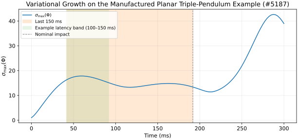
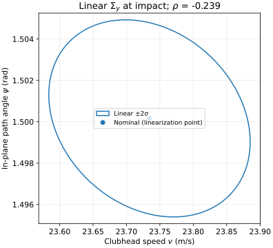
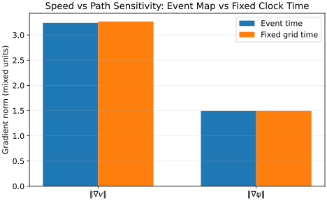
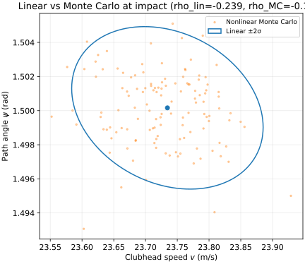

::: {.callout-note}
## In Layman's Terms

A golf swing is over in a third of a second. That is too fast for the brain to steer the club through impact the way you steer a car. What good players may have instead is a motion planned earlier, with wrists and arms set so that small wobbles in the body cancel before they reach the ball—or land in directions that barely change speed and face together. This page names that idea in maths, states one sharp test about whether speed and face errors stay uncorrelated at impact, and is honest about what a simple computer model can and cannot prove.
:::

::: {.callout-important}
## Thesis and Scope

**Dynamics claim (established in prior AffineDrift material, recapped here).** A downswing is a one-shot transient. Without sustained feedback, asymptotic stability concepts do not apply over a horizon of order one local Lyapunov time. Robustness means a *finite-time funnel*: increments that may grow in some directions are steered, by nominal motion and passive impedance, so that task-relevant outcome scatter stays small.

**Falsifiable hypothesis (not yet tested here).** Let $v$ be clubhead speed and $\phi$ a declared face-angle chart at the *impact event* $t_e$. Perturb the pre-impact state with covariance $\Sigma_0$. Propagate with the event-time-corrected state-transition map $\Phi_e$ to $\Sigma_e = \Phi_e \Sigma_0 \Phi_e^{\mathsf T}$. Define task gradients $\nabla v$ and $\nabla \phi$ at $t_e$ (full state $(q,\dot q)$, event-time Jacobian). The **Σ-metric cosine**

$$
\cos_\Sigma \theta = \frac{\nabla v^{\mathsf T} \Sigma_e \nabla \phi}{\|\nabla v\|_\Sigma \|\nabla \phi\|_\Sigma}
$$

equals the correlation $\rho(\delta v, \delta \phi)$ of first-order speed and face errors under $\Sigma_e$. **Prediction:** $|\rho|$ is smaller in skilled golfers than in less-skilled golfers, with $\sigma_v$, $\sigma_\phi$, and protocol preregistered; falsified if the gap vanishes against a structural null that keeps the same model but uses isotropic or column-shuffled $\Sigma_0$ (so that only $\Sigma_0$ shape, not scale, is tested).

**Proves versus illustrates (#5187).** The planar 3DOF worked example *proves* (within its declared torque program and tolerances) statements about a discrete-time $\Phi$, windowed $\sigma_{\max}$ and FTLE, an event-time sensitivity correction for a ground-plane guard, fixed-time versus event-time task Jacobians, and a Monte Carlo cross-check against linearized $\Sigma_y$ for the **path-angle proxy** $\psi$ (in-plane clubhead velocity heading). It *illustrates only* funnel language and timing sensitivity; it does **not** test $\phi$ on SO(3) or Dieter's skill-group prediction. In-plane outputs are path proxies, never face angle. Scope and falsifiers for the planar Σ-metric correlation are registered as [ad-sfd-001](core-theses-registry.html#claim-ad-sfd-001).

**Mechanism-only diagnostic.** The mass-matrix cosine on velocity blocks, $\cos_M \theta$ built from $M^{-1}$, asks whether the generalized impulse that most efficiently changes speed also redirects the in-plane heading $\psi$; report it beside $\rho$, not as the skill test.

**Windowed report.** Plot $\rho(t)$ or $\cos_\Sigma\theta(t)$ over the last 150 ms aligned to impact; Morrison et al. found orientation variability controlled more early in the downswing [@morrison2016].
:::

## Introduction {#sec-intro}

AffineDrift already treats downswings as **increment dynamics**: a nominal trajectory $\bar x(t)$, variational equation $\dot\Phi = A(t)\Phi$, and affine propagation $\delta x(t) = \Phi(t,t_0)\delta x_0$ for small perturbations in a fixed contact mode ([Part 2](../articles/tangent-hyperplanes-series/part-2-dynamics.html)). Hybrid impact adds an event-time correction and saltation when the guard is transverse ([Part 6](../articles/tangent-hyperplanes-series/part-6-hybrid.html)). This article connects that machinery to motor abundance [@scholz1999ucm], goal-equivalent manifolds [@cusumano2006gem], and golf-specific Jacobian structure already computed in [Transmission Robustness](../articles/proximal_distal_energy_transfer/index.html#sec-transmission-robustness), [Proximal–Distal Energy Transfer](../articles/proximal-distal-energy-transfer.html), and [Constraint Torques at the Wrist](../articles/wrist-universal-joint.html).

Parent review: [AffineDrift #5180](https://github.com/D-sorganization/AffineDrift/issues/5180). Worked example delivery: [#5187](https://github.com/D-sorganization/AffineDrift/issues/5187). Lie-group face chart: [#5186](https://github.com/D-sorganization/AffineDrift/issues/5186). Part 4 finite-horizon bound quotes await [#5184](https://github.com/D-sorganization/AffineDrift/issues/5184).

## Why “Stable” Is the Wrong Word {#sec-stability}

Lyapunov stability asks whether trajectories that start near a reference still converge to it as $t\to\infty$. A downswing ends at impact in roughly 250–350 ms—far below any correction loop that could enforce asymptotic convergence ([Drift, Control Capacity](../articles/drift-control-ratio.html)). **Liouville's theorem** applies to the *passive* conservative skeleton: Hamiltonian flow preserves phase volume, so there is no smooth attracting set without dissipation or feedback. Muscles inject non-conservative power; the relevant object is still a **finite-time** map to the impact event, not a limit cycle.

AffineDrift's [Drift, Control Capacity and Golf-Swing Correction](../articles/drift-control-ratio.html) and [Precision vs Gross Control](../critiques/precision_vs_gross_control.html) develop the correction-time argument. This section does not re-derive them; it only fixes vocabulary so “robust” means *funnel width at $t_e$*, not eigenvalues at infinity.

## Finite-Time Sensitivity and FTLE {#sec-ftle}

For variational dynamics $\dot\Phi = A(t)\Phi$,

$$
\delta x(t_f) = \Phi(t_f,t_0)\,\delta x_0,
\qquad
\mathrm{FTLE}(T) = \frac{1}{T}\ln \sigma_{\max}(\Phi(t_0+T,t_0)).
$$

[Part 2: Dynamics](../articles/tangent-hyperplanes-series/part-2-dynamics.html) derives $\Phi$ and warns that impact time moves under perturbation. An open UpstreamDrift sensitivity study ([#13789](https://github.com/D-sorganization/UpstreamDrift/issues/13789), **unreviewed, provisional**) reported $\sigma_{\max}\approx 124$ near impact for one planar 3DOF model. **Here,** the AffineDrift manufactured torque program in `src/affine_control/planar_5187.py` reaches $\sigma_{\max}(\Phi)\approx 42.7$ before nominal impact on the stored grid, while the event-time-corrected map used for $\Sigma_y$ has $\sigma_{\max}(\Phi_e)\approx 17.4$—same *kind* of object (variational growth before contact), different model and discretization, so UpstreamDrift numbers are **not** a comparative performance bound.

{#fig-sigma-max fig-alt="Plot of sigma max of Phi versus time in milliseconds with shaded last 150 ms and latency band before impact"}

## Below the Feedback Horizon {#sec-feedback}

Voluntary corrections incur sensorimotor delay often quoted above 100 ms for gross limb adjustments. When less than ~150 ms remains before impact, a closed-loop correction cannot close before contact. Robustness must come from **open-loop plan** (nominal trajectory chosen earlier) plus **passive impedance** ($-K\,\delta q - D\,\delta\dot q$ in the variational channel) as in [Passive Stabilization](../articles/The_Physics_of_Golf/quarto/ch09b_passive_stabilization.html) and [Intentional Constraint Collapse](../articles/intentional-constraint-collapse.html). That is compatible with funnel language without claiming infinite-time stability.

## Funnels Without Feedback {#sec-funnels}

A **funnel** is a tube of states around the nominal swing whose image at $t_e$ is narrow in task coordinates. AffineDrift uses the term at several evidence levels; Volume II funnel synthesis carries a guardrail that a numerical funnel certifies only the model and controller that produced it. Here the funnel claim is **path-shaping language**: choose nominal motion and impedance so directions of large $\sigma_{\max}$ growth align, where possible, with task-null directions of the impact Jacobian $J$.

## Helpful Covariance and the Uncontrolled Manifold {#sec-ucm}

Let $y = h(x)$ be task outputs and $J = \partial h / \partial x$ at the linearization point. Outcome covariance under affine propagation is

$$
\Sigma_y = J \Phi \Sigma_0 \Phi^{\mathsf T} J^{\mathsf T}.
$$

Motor abundance asks that trial-to-trial scatter have large variance *parallel* to $J$ (unchanging $y$) and small variance *orthogonal* to it [@scholz1999ucm; @muller2004decomposition]. Analysis of covariance matrices is a standard way to structure variability in redundant tasks [@tucker2014]. [ch09b](../articles/The_Physics_of_Golf/quarto/ch09b_passive_stabilization.html) defines $V_\parallel$ and $V_\perp$ with declared scaling $S$ and notes that **speed requires velocities in the state**. Morrison, McGrath, and Wallace [@morrison2016] applied UCM to the golf swing: higher skill associated with proportionally more variance in the UCM for clubhead orientation, with orientation variance **rising** near impact while location variability narrowed—so a “face funnel narrowing at impact” is **not** supported by that paper, though it neither confirms nor denies speed–face decoupling.

Signal-dependent torque noise motivates structured $\Sigma_0$ [@harris1998signal]. Goal-equivalent manifolds address metric choice directly [@cusumano2006gem; @sternad2011neuromotor].

## Speed Versus Face: Σ Metric, Timing Trap, and Coupling {#sec-speed-face}

Two task rows $J_v$ and $J_\phi$ define speed and face. Each has its own null space; the intersection $\ker J_v \cap \ker J_\phi$ is the joint abundance subspace. Weight face and path heavily and speed lightly when reporting scalar summaries, as in [transmission robustness](../articles/proximal_distal_energy_transfer/index.html#sec-transmission-robustness) (8 inputs, speed / face-path / hand-force Jacobian, rank 3, nullity 5).

### Block-Orthogonality Trap {#sec-block-trap}

At a **fixed clock time** $t$, face angle depends primarily on configuration $q$ while clubhead speed depends primarily on $\dot q$. Gradients with respect to the stacked state $(q,\dot q)$ are therefore nearly **block-orthogonal** in many coordinate choices—even before skill enters. A raw gradient-angle claim can be true by construction. **Real coupling runs through impact timing:** perturbations that shift $t_e$ multiply the face-closing rate and every quantity that moves the event. The event-time correction in [Part 6](../articles/tangent-hyperplanes-series/part-6-hybrid.html#derive-the-event-time-correction) is where the hypothesis is actually tested:

$$
\delta t_e = -\frac{n^{\mathsf T}\xi^-}{\gamma},
\qquad
\xi^+ = \Xi\,\xi^- \text{ with saltation } \Xi \text{ when post-impact states matter.}
$$

Pre-impact speed and face at the event use the **event-time Jacobian**; saltation is for post-contact outputs such as launch, not for pre-impact $v$ and $\phi$.

[Proximal–Distal Energy Transfer](../articles/proximal-distal-energy-transfer.html) compares **clock-triggered** and **state-triggered** perturbation responses; timing is the coupling channel that fixed-time analyses miss.

### Σ-Metric Correlation (Primary Test) {#sec-sigma-metric}

With $\Sigma_e$ at the impact event, $\cos_\Sigma\theta = \rho(\delta v,\delta\phi)$ as in the thesis box. Report $\sigma_v$, $\sigma_\phi$, and $\rho(t)$ over the final 150 ms. Compare skill groups to the **structural null**: same model and gradients, $\Sigma_0$ isotropic or column-shuffled. If skilled golfers' smaller $|\rho|$ disappears under that null, the decoupling claim fails (scale-free $\rho$ still depends on $\Sigma_0$ shape).

### $M^{-1}$ Cosine (Mechanism Only) {#sec-m-cosine}

On velocity coordinates,

$$
\cos_M\theta = \frac{(\partial_{\dot q} v)^{\mathsf T} M^{-1} (\partial_{\dot q}\psi)}{\| \partial_{\dot q} v \|_{M^{-1}} \| \partial_{\dot q}\psi \|_{M^{-1}}}.
$$

Use the velocity blocks of $\nabla v$ and $\nabla\psi$ from the same state as the planar #5187 Jacobian rows. This is coordinate-free on the velocity block but does not use the noise geometry; present it as mechanical explanation, not the skill test. Mixing $q$ and $\dot q$ in one angle requires a declared time scale (e.g. 150 ms window).

{#fig-cov-ellipse fig-alt="Two-dimensional covariance ellipse in speed versus path angle with linearized correlation"}

{#fig-event-vs-fixed fig-alt="Bar chart comparing gradient norms at event time and fixed time"}

## Worked Example: Planar 3DOF (#5187) {#sec-worked-example}

The **canonical model** is `GolfModel` in `src/affine_control/golf_model.py` with the manufactured torque schedule from `synthetic_swing` in `src/affine_control/swing_analysis.py`. The nominal swing is integrated with fixed-step RK4 on a uniform grid ($\mathrm{d}t=2.5\,\mathrm{ms}$ over $300\,\mathrm{ms}$). Variational dynamics use the same grid with an explicit one-step Euler update for $\Phi$ and central finite differences for $A(t)$; sub-stepping advances $\Phi$ to the bisected impact time $t_e\approx 0.192\,\mathrm{s}$ on the **first upward crossing** of a ground plane through the club tip ($y_{\mathrm{tip}}=0$ in AffineDrift’s fixed-base coordinates).

**Pinned numerics** (seed $5187$, $N=128$ Monte Carlo samples, diagonal $\Sigma_0$ with $\sigma_q=0.01\,\mathrm{rad}$ and $\sigma_{\dot q}=0.05\,\mathrm{rad/s}$, additive torque noise $\mathcal N(0,(0.08\,\mathrm{N\,m})^2)$) are committed in [`planar-5187-results.json`](swing-robust-funnels-figures/planar-5187-results.json):

| Quantity | Value |
|----------|-------|
| $\sigma_{\max}(\Phi)$, global max on grid | $\approx 42.7$ |
| $\sigma_{\max}(\Phi)$, slice before $t_e$ | $\approx 13.5$ |
| $\sigma_{\max}(\Phi_e)$ (event-corrected map) | $\approx 17.4$ |
| Linear $\rho(v,\psi)$ at $t_e$ | $\approx -0.24$ |
| Monte Carlo $\rho(v,\psi)$ at $t_e$ | $\approx -0.13$ |
| $\cos_M\theta$ (velocity-block diagnostic) | $\approx -0.39$ |

The linear and Monte Carlo $\rho$ **disagree moderately** because the linearization uses discrete $\Phi$ and finite-difference task rows, while Monte Carlo integrates the nonlinear flow with a lighter Heun step for speed; both are declared approximations, not bounds. A **face** row is intentionally omitted: this chain has no SO(3) face chart.

{#fig-mc-linear fig-alt="Scatter of Monte Carlo speed and path angle with overlaid linear covariance ellipse"}

**Regenerate** figures and JSON after changing the model: `PYTHONPATH=. python scripts/build_swing_robust_funnels_figures.py`.

Linear propagation fails when second-order flow curvature and Part 4 residuals dominate; keep the Monte Carlo map as a qualitative cross-check at moderate noise. Do not quote Part 4 numerical bounds until #5184 lands. UpstreamDrift [#13789](https://github.com/D-sorganization/UpstreamDrift/issues/13789) remains **provisional** for cross-engine parity; this AffineDrift script is independent evidence.

## Minimum Model for a Real Face Test {#sec-minimum-model}

Capability requirements, not a fixed DOF count:

- **3D kinematic chain** with shoulder, forearm pronation/supination, and wrist flexion/extension (and radial/ulnar deviation as needed).
- **Face-angle chart** on $\mathrm{SO}(3)$ relative to target line and path, not a planar proxy.
- **Event-time Jacobians** at the contact guard with transversality checked.
- **Declared $\Sigma_0$** per participant or justified population, with signal-dependent noise [@harris1998signal].
- **Monte Carlo validation** of linear $\Sigma_y$ in the perturbation regime used for inference.

Deliver in [#5186](https://github.com/D-sorganization/AffineDrift/issues/5186) or a follow-up issue; do not expand this article's scope to full 3D implementation.

Human protocol (deferred): apply the same $\rho$ and windowed $\rho(t)$ to motion capture across skill bins, preregistered, following Morrison et al.'s UCM machinery where compatible [@morrison2016].

## Outlook: Shaping the Funnel {#sec-outlook}

Stochastic trajectory optimization (iLQG-style costs on $\mathrm{tr}(Q_y\Sigma_y)$) is the natural design tool once $\Sigma_y$ is trusted. Compare nominal iLQR to robust costs heavy on face and path; report $\Sigma_y$ ellipses and $\rho$, not only open-loop nominal paths. Details belong in Part 3 control material and a future simulation PR—not this draft's proof burden.

## What Would Break This Story {#sec-critique}

| Risk | Consequence |
|------|-------------|
| Metric or units undeclared | $\rho$ and gradient angles are empty labels |
| Fixed-time Jacobian only | Answers the wrong impact-time question |
| Block $(q,\dot q)$ orthogonality ignored | False support from coordinate choice |
| Large task gains with small $\rho$ | Orthogonal rows can still spray the ball |
| Morrison orientation rise near impact | Body-frame face funnel may not narrow; timing may compensate |
| Smaller $\Sigma_0$ alone in skilled players | Tighter impact without geometric decoupling |
| Linear $\Sigma_y$ without Monte Carlo | Invalid funnel claims when $\sigma_{\max}$ is large |
| UCM structure from feedback | Cannot separate passive mechanics from late corrections [ch09b] |
| Planar proxy called “face” | Invalid test of Dieter's hypothesis |

Hip-timing versus wrist-release negative covariance remains a **site hunch**, not a published golf result—mark unverified if used.

## Related Articles {#sec-related}

::: {.callout-note title="See Also"}

- **[Part 2: Dynamics](tangent-hyperplanes-series/part-2-dynamics.html)** — State transition matrix $\Phi$ and variational dynamics
- **[Part 6: Hybrid Systems](tangent-hyperplanes-series/part-6-hybrid.html)** — Event-time correction and saltation
- **[Proximal–Distal Energy Transfer](proximal-distal-energy-transfer.html)** — Clock- versus state-triggered timing coupling
- **[Transmission Robustness](proximal_distal_energy_transfer/index.html#sec-transmission-robustness)** — Speed, face-path, and hand-force Jacobian nullity
- **[Passive Stabilization (ch09b)](The_Physics_of_Golf/quarto/ch09b_passive_stabilization.html)** — UCM split and impedance framing
- **[After One Solution](after-one-solution-null-space-exploration.html)** — Null-space fibres in redundant control
:::

## References {#sec-refs}

Bibliography entries are drawn from verified sources cited in text. UpstreamDrift #13789 numbers remain provisional until that issue is reviewed. Claim [ad-sfd-001](core-theses-registry.html#claim-ad-sfd-001) registers the scope-bounded planar Σ-metric path proxy used in this article.
