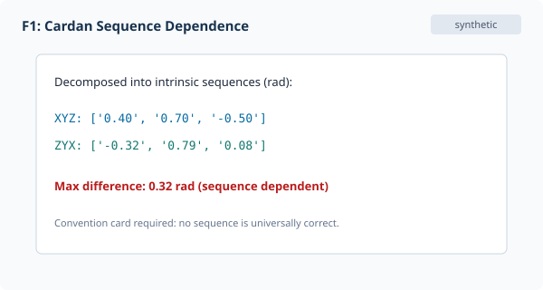
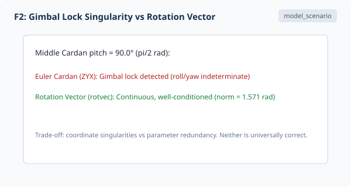
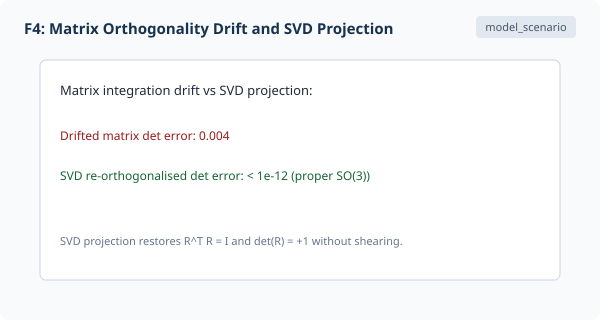
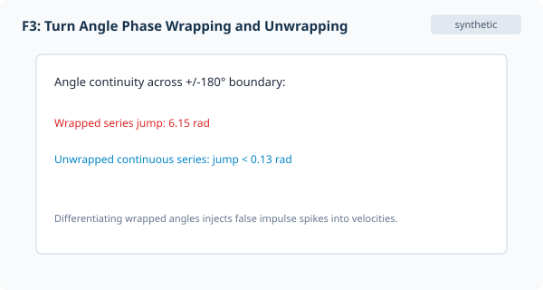

## Overview

Measuring human segment orientation begins with physical sensors—optical markers or inertial measurement units (IMUs)—and ends with mathematical representations. Core representations (rotation matrices, Euler angles, gimbal lock, axis-angle, unit quaternions, and double cover) are established in [Rotation Representations: A Cross-Reference Guide](../../../articles/rotation-representations-reference.qmd). This article focuses on measurement realities, sequence dependence, and finite screw axes. IMU sensor fusion and magnetic drift are omitted per the article scope (PLAN.md). Readers can interactively inspect 3D sequence dependence and gimbal lock in the [Interactive Companion](interactive_companion.html).

## 1.1 Frames and Measurement

Human movement analysis tracks rigid segments (pelvis, thorax, limbs) by establishing anatomical or technical coordinate frames (Figure F1). All segment and laboratory systems follow the right-handed Cartesian convention ($X \times Y = Z$), ensuring that positive rotations obey the right-hand grip rule. An anatomical frame is defined by palpable bony landmarks (e.g., ASIS, PSIS, C7, suprasternal notch), whereas a technical frame is defined by marker clusters or sensor cases [@woltring1994]. Two laboratories tracking the "same" subject can report markedly different joint angles if marker placement, anatomical landmark calibration, or frame alignment differ by even a few millimetres.

{#fig-f1}

::: {.callout-note collapse="false"}
## Convention Discipline
Because segment frame definitions, marker sets, and sequence choices alter measured angles, kinematic reports must always accompany an explicit convention declaration.
:::

## 1.2 Cardan and Euler Sequences

Cardan sequences (permutations of XYZ) parameterise orientation into three successive rotations about moving axes. As covered in [Rotation Representations](../../../articles/rotation-representations-reference.qmd), intrinsic ZYX and XYZ sequences produce fundamentally different angle trajectories for identical three-dimensional rotations (Figure F2). Synthetic tests in `motion_measurement_fixtures.py` show angle discrepancies exceeding 0.1 rad for the same orientation. Near a middle angle of $\pm 90^\circ$, gimbal lock destroys the third degree of freedom and amplifies noise.

{#fig-f2}

::: {.callout-warning collapse="false"}
## Gimbal Lock Singularity
Near a pitch angle of $\pm 90^\circ$, Euler and Cardan parameterisations lose a degree of freedom, causing yaw and roll to become indistinguishable and severely amplifying sensor noise. Interactive 3D sequence explorations and rotation vector visualizations are available in the [Interactive Companion](interactive_companion.html).
:::

## 1.3 Matrices and Composition

Direction cosine matrices $R \in SO(3)$ describe active rotations of column vectors with $R^TR=I$ and $\det R = 1$. When composing segment transforms across a kinematic chain, order matters: $R_{AC} = R_{AB} R_{BC}$. Measurement noise corrupts matrix orthogonality; numerical re-orthogonalisation via singular value decomposition (SVD) recovers the nearest proper rotation matrix without arbitrary distortion (Figure F4):

$$R_{\mathrm{re\text{-}ortho}} = U V^T$$

{#fig-f4}

## 1.4 Axis-Angle and Quaternions

A rotation vector $\rho = \theta n$ and its unit quaternion equivalent $q = (\cos(\theta/2), n\sin(\theta/2))$ avoid coordinate singularities (Figure F3) [@shoemake1985]. Because $q$ and $-q$ represent the same physical rotation (the double cover $S^3 \to SO(3)$), time-series of unit quaternions require hemisphere continuity unwrapping: consecutive quaternions must satisfy $q_k \cdot q_{k-1} \ge 0$ before applying digital filters. Intuitively, a continuous $360^\circ$ spatial rotation around an axis takes $q$ to $-q$; a full $720^\circ$ rotation is required to return the unit quaternion to its identity state ($+1$). Without enforcing hemisphere sign-continuity, digital smoothing across an antipodal boundary causes artificial norm collapse.

{#fig-f3}

::: {.callout-tip collapse="false"}
## Quaternion Double Cover
Because $q$ and $-q$ represent the same physical rotation ($S^3 \to SO(3)$), digital filters must enforce hemisphere continuity ($q_k \cdot q_{k-1} \ge 0$) to avoid catastrophic norm collapse.
:::

## 1.5 Screw Axis

By Chasles' theorem, any spatial displacement decomposes into a translation along and a rotation about a unique directed line: the finite helical axis (Figure F4). Woltring et al. [-@woltring1985] (1985, *J Biomech* 18(5):379-389) showed that estimating helical axis orientation from noisy landmarks is ill-conditioned at small rotation magnitudes: direction error scales roughly as $\sigma / \Delta\theta$. For moving axes on coning trajectories, finite-difference step size creates a U-shaped total error curve balancing noise amplification against kinematic truncation bias.
