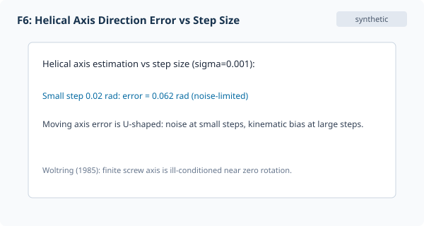
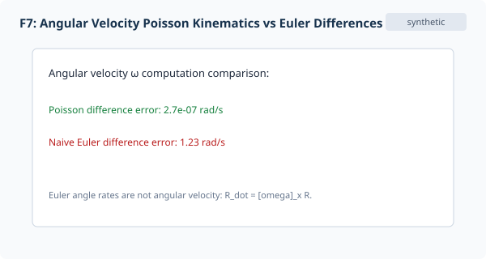
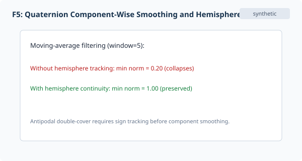
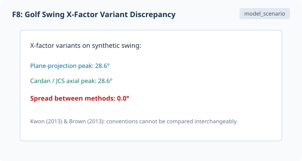

## Overview

Part 2 examines the transformation of measured orientation into joint kinematics and velocity metrics. Foundations of rotation algebra are referenced from [Rotation Representations: A Cross-Reference Guide](../../../articles/rotation-representations-reference.qmd), with interactive 3D demonstrations accessible in the [Interactive Companion](interactive_companion.html). Here we analyze Joint Coordinate Systems (JCS), Poisson angular velocity estimation, filtering artifacts, golf X-factor definitions, and kinematic sequence timing.

## 2.1 Joint Coordinate Systems

Clinical and biomechanical standards describe relative joint motion using Joint Coordinate Systems (Grood & Suntay 1983 [-@grood1983]; Wu et al. 2002 [-@wu2002], 2005 [-@wu2005]). As illustrated in Figure F5, a JCS consists of two body-fixed axes (proximal and distal) connected by a floating axis perpendicular to both. Mathematically, this construction is equivalent to a specific Cardan sequence (typically flexion-extension about the proximal transverse axis, lateral tilt about the floating axis, and axial rotation about the distal longitudinal axis).

::: {.callout-note collapse="false"}
## Joint Coordinate System Standard
A Joint Coordinate System (JCS) defines relative motion across two body-fixed axes connected by a floating axis perpendicular to both, equivalent to an intrinsic Cardan sequence [@grood1983; @wu2002].
:::

## 2.2 Angular Velocity

Segment angular velocity $\omega$ represents an instantaneous vector in $\mathbb{R}^3$, distinct from rates of Euler angles (Figure F6 and Figure F7). It is related to rotation matrix derivatives via Poisson's equation $\dot{R} = [\omega]_\times R$ (global spatial) or $\dot{R} = R [\omega_{\mathrm{local}}]_\times$ (segment-local), where $[\omega]_\times \in \mathfrak{so}(3)$ is the skew-symmetric cross-product matrix:

$$\dot{R} = [\omega]_\times R, \qquad \dot{R} = R [\omega_{\mathrm{local}}]_\times$$

As demonstrated in `motion_measurement_fixtures.py`, reading Euler angle differences directly as angular velocity components introduces substantial errors (>0.1 rad/s on smooth synthetic paths), amplifying dramatically as the middle angle approaches gimbal lock. Robust differentiation calculates $\omega$ from finite orientation differences: $\omega \approx \mathrm{rotvec}(R_{k+1} R_{k-1}^T) / (2 \Delta t)$.

{#fig-f6}

{#fig-f7}

## 2.3 Noise and Filtering

Raw orientation measurements inherit high-frequency noise from skin motion and sensor precision (Figure F7). Filtering unit quaternions component-wise requires sign-continuity unwrapping across the double cover ($q \to -q$): in synthetic fixture tests (Figure F5), moving-average filtering across a sign boundary without unwrapping collapses the quaternion norm to <0.5, while hemisphere-continuous unwrapping preserves norm >0.99. Regarding finite-difference derivatives, analytic fixtures demonstrate that noise error is independent of $\omega$, whereas truncation error scales as $\omega^3 \Delta t^2$ on harmonic trajectories; no general $O(\omega^2)$ noise law exists.

{#fig-f5}

::: {.callout-important collapse="false"}
## Hemisphere Continuity
Filtering unit quaternions component-wise requires sign-continuity unwrapping across the double cover ($q \to -q$): in synthetic tests, moving-average filtering without unwrapping collapses the norm to $<0.5$, whereas hemisphere tracking ($q_k \cdot q_{k-1} \ge 0$) preserves unit norm $>0.99$.
:::

## 2.4 X-Factor and Spine Dynamics

X-factor measures the relative axial orientation between thorax and pelvis (Figure F8). Studies (Kwon 2013 [-@kwon2013]; Brown 2013 [-@brown2013]; Cheetham 2001 [-@cheetham2001]) document four common computation methods:

1. *Line turn*: Projection of acromion and ASIS lines onto the ground plane.
2. *JCS axial rotation*: True 3D relative rotation about the spinal longitudinal axis.
3. *Position proxy*: Linear distances between shoulder and hip markers.
4. *Legacy Euler yaw*: Difference of independent global heading angles.

| Computation Method | Basis | Implementation Strengths | Measurement Vulnerabilities |
|---|---|---|---|
| 1. Line turn | 2D projection onto ground plane | Simple to calculate from planar video or marker clusters | Severe geometric crosstalk with trunk tilt and lateral bend (up to 10°–15°) |
| 2. JCS axial rotation | 3D spine longitudinal axis | Mathematically isolates true axial torsion from tilt and bend | Requires full anatomical segment frames and 3D tracking |
| 3. Position proxy | Linear distance between markers | Minimal sensor requirements; no angular decomposition | Non-linear proxy; sensitive to shoulder stance and marker migration |
| 4. Legacy Euler yaw | Independent global heading angles | Readily available from standard Euler decompositions | Sequence-dependent; subject to gimbal lock amplification near vertical |

{#fig-f8}

::: {.callout-warning collapse="false"}
## 2D Line Turn vs 3D JCS Axial Twist
When the torso flexes or bends laterally, 2D line projections introduce substantial geometric crosstalk (distorting relative turn by 10°–15° during transition and impact), whereas 3D JCS axial rotation isolates torsion from trunk tilt and lateral bend. Furthermore, commercial launch monitor tracking (e.g., TrackMan horizontal line-of-sight) differs systematically from biomechanical systems (AMM, ISB JCS) that measure spinal-axis torsion.
:::

## 2.5 Kinematic Sequence

The kinematic sequence evaluates proximal-to-distal velocity transfer across pelvis, thorax, lead arm, and club head [@chu2010]. Metrics include peak timing sequence and speed gain (the ratio or difference of successive peak segment angular velocities). Comparing trajectories across swings requires event-relative time normalisation across landmarks (Address, Top of Backswing, Impact, Finish).

## Registry Mapping (UD#14421)

Per PLAN.md, all golf metric definitions map to the UpstreamDrift canonical registry under parent issue UD#14421. Until registry approval lands, all child slice entries are classified as `pending`:

| Metric discussed | Registry slice | Status |
|---|---|---|
| Parent registry coordination | UD#14421 | `pending` |
| Registry schema and citation metadata (GM-1a) | UD#14422 | `pending` |
| X-factor computation variants (GM-1b) | UD#14423 | `pending` |
| Pelvis and thorax turn conventions (GM-1c) | UD#14424 | `pending` |
| Spinal coupling and lateral bend (GM-2) | UD#14425 | `pending` |
| Kinematic sequence, speed gain, and X-factor stretch (GM-3) | UD#14426 | `pending` |
| Event-relative time normalisation (GM-4) | UD#14427 | `pending` |
| Segment orientations at impact events (GM-5) | UD#14428 | `pending` |

## Metric Convention Cards

Every metric below carries a formal 7-field convention specification.

### Convention Card 1: X-factor variants
- **Frame**: Thorax segment frame relative to pelvis segment frame (or each relative to laboratory global frame).
- **Axes**: ISB trunk coordinate system; Z longitudinal (spine), Y lateral, X anterior.
- **Sequence**: Intrinsic ZXY Cardan sequence (JCS axial) vs horizontal plane projection (line turn, subject to 10°–15° tilt crosstalk) vs independent ZYX yaw.
- **Sign**: Positive indicates thorax rotated further clockwise/closed to pelvis (backswing stretch in right-handed swing).
- **Velocity component**: Relative axial angular velocity about thorax longitudinal axis.
- **Events**: Address (ADD), Top of Backswing (TB), Maximum Stretch (MS), Impact (IMP).
- **Units**: Degrees ($^\circ$) for orientation; degrees per second ($^\circ/\mathrm{s}$) for velocity.

### Convention Card 2: X-factor stretch
- **Frame**: Thorax relative to pelvis.
- **Axes**: Longitudinal spinal axis (JCS) or projected horizontal shoulder-pelvis line angle.
- **Sequence**: Intrinsic ZXY Cardan or 2D projected line difference.
- **Sign**: Positive for increase in thorax-pelvis separation beyond top of backswing value (Cheetham et al. 2001 [-@cheetham2001]).
- **Velocity component**: Time rate of relative axial rotation ($\dot{\theta}_{\mathrm{X\text{-}factor}}$).
- **Events**: Top of Backswing (TB) to point of Maximum Stretch (MS).
- **Units**: Degrees ($^\circ$) for stretch amplitude; milliseconds ($\mathrm{ms}$) for stretch duration.

### Convention Card 3: Shoulder and pelvis turn
- **Frame**: Segment anatomical frame (thorax or pelvis) relative to laboratory global frame.
- **Axes**: Global vertical $Z_{\mathrm{global}}$ for heading (TrackMan style), or segment longitudinal axis for axial rotation (AMM/ISB style).
- **Sequence**: Intrinsic ZYX Euler angles (heading, tilt, roll) or projected line angle.
- **Sign**: Positive counter-clockwise viewed from above (closed backswing for right-handed golfer).
- **Velocity component**: Angular velocity about global vertical axis or segment anatomical axis.
- **Events**: Address (ADD), Top of Backswing (TB), Impact (IMP), Finish (FIN).
- **Units**: Degrees ($^\circ$) for turn angle; degrees per second ($^\circ/\mathrm{s}$) for turn velocity.

### Convention Card 4: Kinematic sequence & speed gain
- **Frame**: Segment local frames (pelvis, thorax, lead arm, club) and laboratory global frame.
- **Axes**: Segment principal functional axes (longitudinal for torso segments, swing plane normal for club).
- **Sequence**: Component-wise angular velocity extraction via Poisson formula or rigid cluster tracking.
- **Sign**: Positive in the downswing direction (counter-clockwise toward target).
- **Velocity component**: Segment-local axial component or total 3D resultant speed $\|\omega\|$.
- **Events**: Peak pelvis velocity ($t_{\mathrm{pelvis}}$), peak thorax velocity ($t_{\mathrm{thorax}}$), peak arm velocity ($t_{\mathrm{arm}}$), Impact (IMP).
- **Units**: Degrees per second ($^\circ/\mathrm{s}$) for peak velocities; dimensionless ratio or difference ($^\circ/\mathrm{s}$) for speed gain.

### Convention Card 5: Event-relative time normalisation
- **Frame**: Temporal trial frame partitioned into phase segments.
- **Axes**: Non-dimensional normalized time axis ($t^* \in [0, 100\%]$).
- **Sequence**: Piecewise cubic spline interpolation matching physical landmarks.
- **Sign**: Monotonically increasing time sequence from start to finish.
- **Velocity component**: Rescaled derivative $\mathrm{d}\theta / \mathrm{d}t^*$ with respect to normalized phase time.
- **Events**: Event intervals: Address (0%), Top of Backswing (100% backswing / 0% downswing), Impact (100% downswing / 0% follow-through), Finish (100%).
- **Units**: Percent phase time (% phase) or milliseconds ($\mathrm{ms}$) of actual elapsed time.

### Convention Card 6: Trunk tilt and lateral bend
- **Frame**: Thorax segment frame relative to pelvis segment frame or global vertical.
- **Axes**: Thorax sagittal axis (flexion/extension) and coronal axis (lateral bend / side tilt).
- **Sequence**: ISB recommended ZXY Cardan sequence (lateral bend as secondary floating axis).
- **Sign**: Positive forward flexion and positive lead-side lateral bend (towards target at impact).
- **Velocity component**: Instantaneous angular velocity vector projected onto segment anatomical axes.
- **Events**: Address (ADD), Top of Backswing (TB), Impact (IMP).
- **Units**: Degrees ($^\circ$) for tilt and lateral bend; degrees per second ($^\circ/\mathrm{s}$) for tilt rate.
