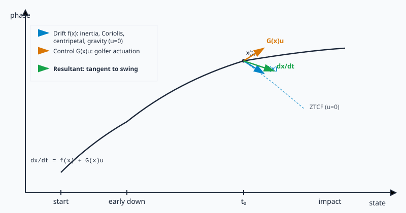

```{=html}
<!-- Mobile navigation is handled by Quarto's built-in .navbar-toggler
     (see js/navigation.js::initNavbarCollapse); the former custom
     .mobile-menu-toggle / .sidebar-overlay controls were dead no-ops and
     were removed (issue #3327, closes #2955). -->
<div class="ad-page-container page-has-custom-h1">
  <div class="home-layout home-layout--single">
    <div class="home-content section-stack">
      <!-- Hero -->
      <section id="welcome" class="welcome-section home-hero" aria-labelledby="welcome-heading">
        <span id="welcome-heading" class="sr-only">Welcome to AffineDrift</span>
        <h1>AffineDrift</h1>
        <p class="home-hero__subtitle welcome-subtitle">Scientific Notes on Golf Mechanics, Modeling, and Control</p>
        <p class="home-hero__lede welcome-lede">
          Understand the golf swing through the physics of passive momentum and active muscular control.
        </p>
        <div class="home-hero__actions">
          <a class="site-button" href="pages/start-here.html">Start Here (5 minutes)</a>
          <a class="site-button site-button--ghost" href="resources/articles.html">Explore the Research</a>
        </div>
        <p class="home-hero__secondary"><a href="books/index.html">Browse Books</a> · <a href="resources/articles.html">Browse All Articles</a></p>
      </section>

      <!-- Three Ways In: Audience Strip -->
      <section id="three-ways-in" class="three-ways-section" aria-labelledby="three-ways-heading">
        <h2 id="three-ways-heading">Three Ways In</h2>
        <div class="three-ways-grid">
          <div class="site-card pathway-card">
            <h3>Curious Reader &amp; Golfer</h3>
            <p>Start with simple physical concepts and intuitive analogies before diving into mathematical equations.</p>
            <ul class="pathway-links">
              <li><a href="pages/start-here.html">Start Here (5-Minute Overview)</a></li>
              <li><a href="pages/big-idea.html">The Big Idea in Five Minutes</a></li>
              <li><a href="pages/glossary.html">Mechanics &amp; Control Glossary</a></li>
            </ul>
          </div>
          <div class="site-card pathway-card">
            <h3>Student &amp; Coach</h3>
            <p>Explore biomechanical models, practical swing trade-offs, and torque delivery mechanisms on the lesson tee.</p>
            <ul class="pathway-links">
              <li><a href="articles/drift-control-ratio.html">Drift-Control Ratio (DCR)</a></li>
              <li><a href="articles/wrist-universal-joint.html">Wrist as a Universal Joint</a></li>
              <li><a href="pages/Golf_Control_Theory.html">Golf Control Theory Notes</a></li>
            </ul>
          </div>
          <div class="site-card pathway-card">
            <h3>Researcher &amp; Engineer</h3>
            <p>Inspect governing equations, testable falsification criteria, calibration roadmaps, and companion simulation code.</p>
            <ul class="pathway-links">
              <li><a href="articles/core-theses-registry.html">Core Theses Claim Registry</a></li>
              <li><a href="pages/validation-roadmap.html">Model-to-Human Validation Roadmap</a></li>
              <li><a href="models/programming/index.html">UpstreamDrift Companion Catalog</a></li>
            </ul>
          </div>
        </div>
      </section>

      <!-- The Big Idea at a Glance -->
      <section id="big-idea-preview" class="big-idea-section" aria-labelledby="big-idea-heading">
        <span id="framework"></span>
        <h2 id="big-idea-heading">The Big Idea at a Glance</h2>
        <figure class="big-idea-figure">
          
          <figcaption id="big-idea-caption">
            At every instant of the golf swing, total motion splits into two physical parts. Passive mechanics, gravity, and body momentum create the drift. Muscular torque and golfer effort supply active control. Combining passive swing geometry with timed muscular input directs the clubhead into the ball, showing that the swing is not muscular force fighting against nature, but steering within it.
          </figcaption>
        </figure>

        <details class="math-toggle">
          <summary>In Symbols (Show Mathematical Formulation)</summary>
          <div class="math-showcase">
            $$\dot{x} = f(x) + G(x)u$$
          </div>
          <p>
            Here <em>f(x)</em> is the passive drift, representing what unforced mechanics, inertia, and intersegmental couplings do on their own. <em>G(x)u</em> is the control input, representing torques exerted by the golfer.
          </p>
```



```{=html}
          <aside class="provenance-note">
            <strong>Provenance.</strong> The control-affine form ẋ = f(x) + G(x)u is standard in control theory (Isidori, 1995; Nijmeijer &amp; van der Schaft, 1990). Using it for golf is AffineDrift's own synthesis. That includes the drift and input split, the zero-torque counterfactual (ZTCF), and the drift-control ratio (DCR). See <a href="articles/theory-part1.html">Theory Series, Part 1</a> for the derivation. See <a href="critiques/index.html">Critiques &amp; Responses</a> for the limits of its scope.
          </aside>
        </details>
      </section>

      <!-- Featured Works -->
      <section id="featured-works" class="featured-works-section" aria-labelledby="featured-works-heading">
        <span id="books"></span>
        <span id="latest"></span>
        <h2 id="featured-works-heading">Featured Works</h2>
        <div class="featured-works-grid">
          <div class="site-card work-card">
            <h3><a href="books/biomechanics-biology-to-systems.html">The Articulated Body</a></h3>
            <span class="maturity-badge-wrapper"><a href="pages/scope-and-limits.html#maturity-key" class="status-badge status-badge--experimental">Working Draft</a></span>
            <p>Multibody kinematic chains, intersegmental dynamics, and recursive algorithms for skeletal motion.</p>
          </div>
          <div class="site-card work-card">
            <h3><a href="books/human-motor-control.html">The Computational Brain</a></h3>
            <span class="maturity-badge-wrapper"><a href="pages/scope-and-limits.html#maturity-key" class="status-badge status-badge--planned">Outline Only</a></span>
            <p>Neural delay, internal models, predictive estimation, and motor control in high-speed athletic movement.</p>
          </div>
          <div class="site-card work-card">
            <h3><a href="books/control-is-motion.html">The Geometry of Touch</a></h3>
            <span class="maturity-badge-wrapper"><a href="pages/scope-and-limits.html#maturity-key" class="status-badge status-badge--planned">Outline Only</a></span>
            <p>Contact mechanics, sensory feedback, grip impedance, and constraint interactions during impact delivery.</p>
          </div>
          <div class="site-card work-card">
            <h3><a href="books/tangent-space-methods.html">Forward Dynamics &amp; Motion Matching</a></h3>
            <span class="maturity-badge-wrapper"><a href="pages/scope-and-limits.html#maturity-key" class="status-badge status-badge--experimental">Working Draft</a></span>
            <p>Forward integration, counterfactual simulation, and trajectory matching across nonlinear dynamical models.</p>
          </div>
        </div>
        <p class="featured-works__more"><a href="books/index.html">Browse All Books &amp; Textbooks →</a></p>
      </section>

      <!-- Featured Reading -->
      <section id="featured-reading" class="home-latest">
        <h2>Featured Reading</h2>
        <ul class="entry-list">
          <li class="entry-list__item">
            <a class="entry-list__title" href="articles/The_Physics_of_Golf/quarto/index.html">The Physics of Golf</a>
            <p class="entry-list__dek"><a href="pages/scope-and-limits.html#maturity-key" class="status-badge status-badge--available">Working Draft</a> A textbook on how golf motion, forces, and control work. Each chapter keeps its own evidence and review status.</p>
          </li>
          <li class="entry-list__item">
            <a class="entry-list__title" href="articles/The_Geometry_of_Motion/quarto/index.html">The Geometry of Motion</a>
            <p class="entry-list__dek"><a href="pages/scope-and-limits.html#maturity-key" class="status-badge status-badge--available">Working Draft</a> The geometry of rigid-body motion, including Lie groups. Each chapter states its own scope and review state.</p>
          </li>
          <li class="entry-list__item">
            <a class="entry-list__title" href="articles/proximal_distal_energy_transfer/index.html">Proximal-to-Distal Energy Transfer in the Golf Swing</a>
            <p class="entry-list__dek">Technical monograph and computational publication. Its results depend on the model used. It includes counterfactual tests, exact links to evidence, and stated ways each claim could be proved wrong. Independent scientific review and human validation remain open.</p>
          </li>
          <li class="entry-list__item">
            <a class="entry-list__title" href="articles/theory-part1.html">Theory Series, Part 1: Control-Affine Foundations</a>
            <p class="entry-list__dek">A derivation of the control-affine model. Its results depend on the model. It does not validate human intent or muscle action.</p>
          </li>
        </ul>
      </section>

      <!-- Scientific Rigor & Transparency Strip -->
      <section id="trust-strip" class="trust-strip-section" aria-labelledby="trust-heading">
        <h2 id="trust-heading">Scientific Rigor &amp; Transparency</h2>
        <p class="trust-strip__lede">
          AffineDrift separates mathematical identity from simulation results and human evidence. We maintain public audit ledgers, critique records, and empirical validation criteria for every thesis.
        </p>
        <div class="trust-grid">
          <div class="site-card trust-card">
            <h3><a href="critiques/index.html">Adversarial Critique Ledger</a></h3>
            <p>Documented counterarguments, edge-case falsifications, and technical responses across all published models.</p>
          </div>
          <div class="site-card trust-card">
            <h3><a href="articles/core-theses-registry.html">Core Theses Claim Registry</a></h3>
            <p>Formal catalog of mathematical and physical claims with explicit proof chains and verification status.</p>
          </div>
          <div class="site-card trust-card">
            <h3><a href="pages/validation-roadmap.html">Model-to-Human Validation Roadmap</a></h3>
            <p>Protocols for testing simulation findings against empirical laboratory data and human biomechanical experiments.</p>
          </div>
          <div class="site-card trust-card">
            <h3><a href="pages/scope-and-limits.html">Scope &amp; Limits</a></h3>
            <p>Explicit boundaries of what the control-affine framework establishes, and how to read the <a href="pages/how-to-read.html">evidence ladder</a>.</p>
          </div>
        </div>
      </section>

      <!-- Connect -->
      <section id="connect" class="home-connect">
        <h2>Connect</h2>
        <ul class="entry-list entry-list--compact">
          <li class="entry-list__item"><a class="entry-list__title" href="pages/about.html">About</a></li>
          <li class="entry-list__item"><a class="entry-list__title" href="pages/contact.html">Contact</a></li>
          <li class="entry-list__item"><a class="entry-list__title" href="pages/collaborate.html">Collaborate</a></li>
        </ul>
      
      <p class="trust-strip-note">Each work carries an explicit maturity state (<span class="status-badge status-badge--available">Available</span>, <span class="status-badge status-badge--experimental">Experimental</span>, or <span class="status-badge status-badge--planned">Planned</span>); public availability <a href="pages/how-to-read.html#publication-states">does not imply peer review or validation</a>. <a href="evidence/claims.html">Read the Evidence</a>.</p>
</section>
    </div>
  </div>
</div>

<script src="js/home.js"></script>
```
