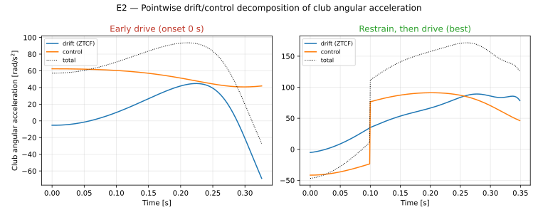

::: {.callout-warning}
## Draft: Not Published

This page is a draft for the site visual plan (#5426, parent epic #5427). Publication needs
Dieter's approval and the Assessment Board gate.
:::

## Background

The site visual-placement audit ([VIS-SITE-1, #5423](../docs/audits/vis-site-visual-placement-audit-5423.md))
identified the Zero-Torque Counterfactual (ZTCF) drift-versus-control decomposition as the
top placement pick (Priority P1) for *The Physics of Golf* (Chapter 6).

This draft page demonstrates the accessible video/render component ([VIS-SITE-2, #5424](../_extensions/vis-video/vis-video.lua))
embedding a synchronized simulation alongside the traced static figure projected from UpstreamDrift.

## Zero-Torque Counterfactual (ZTCF)

The branched zero-torque counterfactual evaluates what the club would do if every joint
torque were set to zero at a chosen instant, with the forward trajectory branching from
that copied state.

{{< vis-video src="../static/explainers/ztcf.webm" poster="../static/explainers/ztcf.poster.png" captions="../static/explainers/ztcf.en.vtt" alt="Zero-Torque Counterfactual (ZTCF) drift versus control simulation" record="evidence/projections/ud_figure_maps/proximal_distal_energy_transfer.json" caption="Source: UpstreamDrift release-preset/make_figures run 44c11639c1f3ab21500c9b9047af9c15c1bf1caa6af3cbd052fc9fbace8e9b41 at commit b753c2799f05291842a1b34fbaf1ec75bd6ccef8 (evidence/projections/ud_figure_maps/proximal_distal_energy_transfer.json; site audit #5423)." >}}

## Traced UpstreamDrift Render

The static counterpart is traced byte-for-byte in the repository's figure projection map
([`evidence/projections/ud_figure_maps/proximal_distal_energy_transfer.json`](../evidence/projections/ud_figure_maps/proximal_distal_energy_transfer.json)):

### Provenance

- **Source repository:** `D-sorganization/UpstreamDrift`
- **Source commit:** `b753c2799f05291842a1b34fbaf1ec75bd6ccef8`
- **Simulation run:** `44c11639c1f3ab21500c9b9047af9c15c1bf1caa6af3cbd052fc9fbace8e9b41`
- **Preset model:** `release-preset/make_figures`
- **Output path:** `docs/research/proximal_distal_energy_transfer/figures/fig_ztcf_drift_control.svg`
- **Audit reference:** `#5423` placement audit (P1 top pick)
- **Publication requirement:** Publication needs Dieter's approval and the Assessment Board gate.
