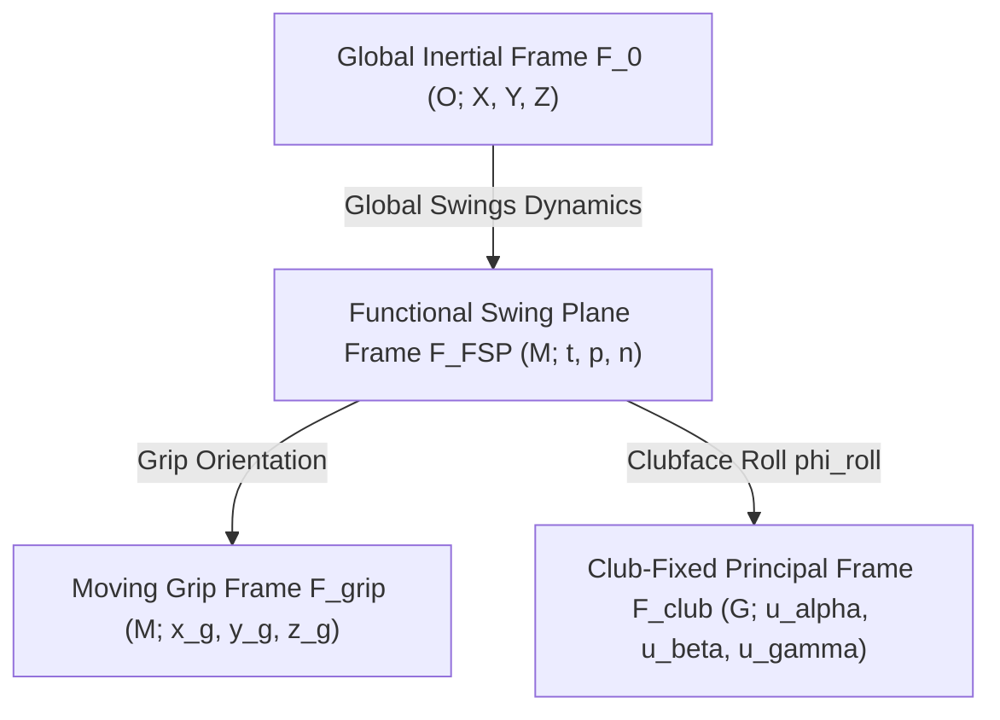

# Preface to the First Draft

This document constitutes the complete first draft (v0, Chapters 1 through 10 and Appendices A through D) of a comprehensive, thesis-level adjudication of the "Alpha War"—the protracted, often acrimonious debate that divided the golf biomechanics and coaching communities between 2014 and 2026. The core dispute centers upon the sign, magnitude, origin, and coaching implications of the in-plane torque ("alpha torque") applied by a golfer's hands to the club during the final 30 to 50 milliseconds of the downswing prior to ball impact.

The text is structured into two complementary narrative registers:
1. **The Main Narrative:** Layperson-accessible, neutral, and educational exposition that explains physical phenomena through everyday analogies, biomechanical principles, and the historical evolution of the debate.
2. **Mathematical and Mechanical Callout Boxes:** Graduate-level, fully rigorous derivations formulated from classical rigid-body mechanics (Newton–Euler equations, spatial wrench reductions, reference-point transport theorems, closed-loop constrained Lagrangian dynamics, and flexible-beam structural dynamics).

All mathematical formulations strictly adhere to the unified notation established across the research program. Uncertain, unverified, or proprietary parameters that cannot be independently audited from peer-reviewed literature are explicitly flagged inline as `[VERIFY]`.

---

# 1. Problem Statement: What "Alpha Torque" Means and Why It Matters

## 1.1 The Everyday Experience of the Late Downswing

To an observer standing beside a championship tee, the golf downswing appears as a seamless, violent explosion of speed lasting scarcely a third of a second. From the top of the backswing, a skilled golfer accelerates a steel or graphite shaft tipped with a 200-gram mass from rest to over 115 miles per hour (51.4 m/s). In the final fifty milliseconds before the ball is launched—a fleeting interval roughly one-eighth the duration of an eyeblink—the clubhead travels over two meters along an elliptical arc, sweeping through the delivery position into ball strike.

What are the golfer's hands actually doing during these final fifty milliseconds? 

Consider an intuitive analogy: swinging a heavy carpenter's hammer to drive a nail into an upright post. At the start of the swing, your wrist flexes back to set the hammer head. To initiate the strike, your forearm pulls downward while your wrist muscles contract to whip the hammer head forward. In this initial acceleration phase, your hand undeniably exerts a positive, forward-twisting effort—what dynamicists term a torque or couple—acting to uncock the wrist and fling the tool head toward the target.

Now consider what happens in the final inch before the hammer hits the nail. As the heavy steel head reaches high speed, its momentum begins to outstrip the rate at which your forearm muscles can contract. If you attempt to "push" the hammer even faster at the very bottom of the stroke, you encounter a curious mechanical sensation: the hammer feels as though it is pulling away from your grip, dragging your hand forward. If you were to swing a hammer with an oily handle on a slick day, the tool would tear itself out of your fingers. 

A dramatic illustration of this phenomenon occurred in a widely circulated video from January 2024, captured during a rain-soaked professional tournament `[VERIFY: PGA Tour / European Tour event clip]`. As a tour professional swung a driver through impact, moisture caused the grip to slip entirely from his hands just before ball contact. Rather than decelerating or tumbling erratically, the released club continued rotating forward smoothly along its swing arc at over 2,000 degrees per second, striking the ball cleanly while the golfer's empty hands snapped into follow-through.

```
       Phase 1: Delivery (~t = -150 to -40 ms)         Phase 2: Impact Zone (~t = -40 to 0 ms)
      [Massive Positive Drive: C_alpha >> 0]         [Momentum Outrun: C_alpha <= 0, M_G > 0]

             Grip Path (Centripetal Pull R)                 Grip Decelerates / Curves Upward
                  \                                                      |  ^ Upward Hub Pull
                   \  + Hand Couple                                      |  |
                    O=======> (Shaft Uncocking)                          O  |
                     \                                                   |  |
                      \                                                  |  | Clubhead Flies Forward
                       \                                                 |  | Via Linear Momentum
                        * Clubhead                                       *==/ (Wrist "Freewheels")
```

This phenomenon—what the legendary Bobby Jones famously described in the 1930s as "freewheeling," wherein the golfer merely holds onto a club whose uncocking momentum carries it through the ball—lies at the absolute center of modern golf kinetics. Yet behind this intuitive physical experience lies a decade-long scientific schism known throughout the biomechanics community as the **Alpha War**.

## 1.2 Defining the Narrow Window of Dispute

To understand why the Alpha War ignited such intense academic and commercial warfare, one must first demarcate the precise boundaries of the battleground. As group founder Nick Chertock crystallized in an influential retrospective on August 9, 2020:
> The Alpha War is not about the entire downswing. Everyone agrees that golfers apply massive positive alpha torque early in the downswing to initiate uncocking. The dispute concerns exclusively the final 30 to 50 milliseconds before ball contact. Furthermore, post-impact data is completely inadmissible due to the violent shock wave of ball collision.

In technical terms, both factions in the debate agree entirely on two baseline truths:
1. **The Transition and Mid-Downswing Phase ($t = -300\text{ ms}$ to $-50\text{ ms}$):** The golfer applies a massive, forward-acting in-plane couple ($\mathbf{C}_h \cdot \hat{\mathbf{e}}_\alpha > 0$) reaching peak magnitudes of $+35\text{ to }+65\text{ N}\cdot\text{m}$. This couple performs positive mechanical work, accelerating the club from an uncocked hinge angle ($\beta \approx 90^\circ$) toward delivery.
2. **Post-Impact Inadmissibility ($t > 0\text{ ms}$):** The collision between the clubhead and the 45.9-gram golf ball imparts an impulsive contact force of $8{,}000\text{ to }15{,}000\text{ N}$ lasting less than $0.5\text{ ms}$. This impact shock excites high-frequency transverse vibration modes in the shaft ($>70\text{ Hz}$), drives severe marker tracking artifacts in optical motion capture systems, and renders any inverse-dynamics calculation across or after impact mathematically invalid.

The entire controversy narrows to a single, microscopic temporal window: **the late downswing, spanning from approximately 50 milliseconds prior to impact until the exact instant of ball contact ($t \in [-0.050, 0.000]\text{ s}$)**.

Within this 50-millisecond window, two diametrically opposed factions emerged:

- **Camp A (The Positive Alpha Paradigm):** Formed around the biomechanical publications of Dr. Steven M. Nesbit (Lafayette College) and championed commercially by golf instructors Michael Jacobs and Brian Manzella through their research venture, *Jacobs 3D*. Camp A asserted that skilled golfers continue to exert an active, positive in-plane torque ($C_\alpha > 0$) through the ball, driving the uncocking of the clubhead all the way to impact. They argued that elite golfers do not simply let go or "coast"; rather, they sustain positive angular drive, and that teaching a golfer to "release" passively leads to loss of clubhead speed, inconsistent face control, and weak impact geometry.
- **Camp B (The Negative Alpha / Free-Hinge Paradigm):** Championed by leading academic sports biomechanists—including Dr. Sasho MacKenzie (St. Francis Xavier University), Dr. Young-Hoo Kwon (Texas Woman's University), golf engineer Dave Tutelman, tour coach Jon Sinclair, and independent physicist Dr. Robert D. Grober (Yale University). Camp B maintained that in high-speed, skilled full swings, the in-plane couple exerted by the hands on the grip universally crosses zero and reverses to a significant **negative** value ($C_\alpha < 0$, typically $-10\text{ to }-25\text{ N}\cdot\text{m}$) approximately 20 to 40 milliseconds before impact. In Camp B's formulation, the hands act as an angular brake or a trailing hinge; the club rotates forward not because the wrists push it, but because the outward flinging of the clubhead's linear momentum and the centripetal pull of the golfer's body drive the club forward faster than human forearm musculature can actively contract.

```
+---------------------------------------------------------------------------------------------------+
|                                   THE FACTIONAL BATTLE LINES                                      |
+===================================+===============================================================+
| Dimension                         | Camp A (Nesbit, Jacobs 3D, Manzella)                          |
+-----------------------------------+---------------------------------------------------------------+
| Core Kinetic Claim                | Active in-plane torque remains POSITIVE through impact        |
| Primary Literature Basis          | Nesbit (2005) Figure 11 (amateurs); Jacobs & Manzella (2015)   |
| Primary Reference Point           | Club Center of Mass (COM) or Moving Club Face Frame           |
| Mechanical Philosophy             | Motor control drives tool; elite players push to impact       |
| Commercial/Pedagogical Stance     | Jacobs 3D analytics; train active 3-axis force/torque delivery|
+===================================+===============================================================+
| Dimension                         | Camp B (Kwon, MacKenzie, Tutelman, Sinclair, Grober)          |
+-----------------------------------+---------------------------------------------------------------+
| Core Kinetic Claim                | In-plane hand couple reverses to NEGATIVE before impact       |
| Primary Literature Basis          | Nesbit & Serrano (2005) p. 528 (scratch); MacKenzie (2009)    |
| Primary Reference Point           | Mid-Hands Grip Station ($M$) or Lead Wrist Joint Boundary     |
| Mechanical Philosophy             | Proximal-to-distal whip; club outruns hands ("free hinge")    |
| Commercial/Pedagogical Stance     | Open-source 3D models; train kinetic chain transfer & pull    |
+-----------------------------------+---------------------------------------------------------------+
```

## 1.3 The Two-Layer Thesis Preview

Why did brilliant engineers, renowned university professors, and elite tour coaches talk past each other for over a decade? The central thesis of this investigation is that the Alpha War was not a single, monolithic disagreement. Rather, the controversy operated on **two distinct mechanical layers**, each governed by its own mathematical and empirical realities:

### Layer 1: The Definitional and Geometric Cleave
The foundational cause of the debate was a profound, unacknowledged semantic conflation. The two camps were using the identical term—"alpha torque"—to denote two fundamentally different mechanical quantities evaluated at two different physical reference points:
1. **Camp B's Metric: The Pure Hand Couple ($\mathbf{C}_h \equiv \mathbf{M}_M$).** Camp B calculated the equivalent torque couple exerted by the hands about the *grip midpoint* $M$ (or the distal wrist joint). Evaluated at the hands, the couple is a free vector representing purely rotational action. Because the club unhinges at over $2{,}000^\circ/\text{s}$ while the hands decelerate, this pure couple universally crosses zero and turns strongly negative ($C_\alpha \approx -15\text{ to }-25\text{ N}\cdot\text{m}$).
2. **Camp A's Metric: The Total Moment About the Center of Mass ($\mathbf{M}_G$).** In contrast, Camp A frequently plotted what they termed the "Alpha Sum of the Moments"—the total rotational moment acting on the club evaluated about the *club center of mass* $G$. Under the fundamental reference-point transport theorem of spatial mechanics,
   $$
   \mathbf{M}_G = \mathbf{C}_h - (\mathbf{r}_G - \mathbf{r}_M) \times \mathbf{R}
   $$
   Because the golfer exerts an enormous upward and inward centripetal force ($\mathbf{R}$) on the grip, the lever arm from the grip to the club center of mass generates a massive positive moment that routinely exceeds $+50\text{ N}\cdot\text{m}$. Even when the hand couple $\mathbf{C}_h$ is negative ($-15\text{ N}\cdot\text{m}$), the total moment $\mathbf{M}_G$ can remain strongly positive ($+35\text{ N}\cdot\text{m}$). 

For years, Camp A pointed to positive curves of $\mathbf{M}_G$ and asserted that "alpha torque is positive," while Camp B pointed to negative curves of $\mathbf{C}_h$ and asserted that "alpha torque is negative." Both mathematical statements were simultaneously true, but they described entirely different physical quantities.

### Layer 2: The Component-Level Discrepancy and Structural Mechanisms
However, resolving the debate does not end with semantics. Even when all parties evaluated the pure hand couple $\mathbf{C}_h$ at the exact same grip midpoint $M$, deep physical and computational discrepancies remained:
- **Frame-Switching Artifacts:** Resolving 3D torque vectors in a rotating, clubface-fixed coordinate frame causes geometric cross-coupling: as the clubface rolls closed in the late downswing, out-of-plane moments project onto the in-plane axis, flipping the calculated sign of $C_\alpha$.
- **Passive Interaction Dynamics:** Multi-link rigid-body analyses (dating to Carol Putnam's landmark 1991 framework) demonstrate that segment interaction forces—arising purely from forearm deceleration and centripetal acceleration—naturally generate a negative grip couple even when the golfer's muscles are completely deactivated (`zero-torque control`).
- **Flexible Shaft Rebound:** High-speed structural beam dynamics reveal that forward shaft unbending (lead deflection) prior to impact exerts an elastic reaction force against the grip, mechanically forcing the hands into an opposing negative couple.
- **Proprietary Black-Box Code:** The commercialization of golf analytics led to the deployment of closed-source algorithms (such as *Jacobs 3D*) whose filtering parameters, coordinate transformations, and sensor fusion routines could not be independently inspected or replicated by peer-reviewed science.

In the chapters that follow, we unpack both layers with complete mathematical rigor, tracing the mechanics of the golf club from first principles to the cutting edge of modern forward-dynamics simulation.

---

# 2. Definitions and Coordinate Frames

To eliminate ambiguity, every physical vector, reference station, and coordinate transformation must be defined rigorously before writing equations of motion.

## 2.1 Club and Grip Geometry

We treat the golf club as a slender, non-uniform rigid body of total mass $m_c$ (typically $0.310\text{ to }0.330\text{ kg}$ for a modern driver) and overall length $L_c \approx 1.15\text{ m}$ (45.5 inches). 

```
  Butt End B          Lead Hand L   Midpoint M   Trail Hand T          Club Center of Mass G           Clubhead C
      |                   |             |             |                         |                          |
  ====[===================O=============X=============O=========================]==========================(===)
      <--- s_B = -0.05 m -><------- s = 0.0762 m ----><----------------- d_G/M = 0.720 m ------------------>
```

We establish the following fixed reference stations along the shaft centerline $\hat{\mathbf{e}}_{\text{shaft}}$:
- **Butt End ($B$):** The proximal terminus of the grip cap, located at station coordinate $s_B = -0.050\text{ m}$ relative to mid-hands.
- **Lead Hand Center ($L$):** The effective center of contact pressure for the golfer's lead (left for a right-handed golfer) hand, located at signed position $\mathbf{r}_L$.
- **Trail Hand Center ($T$):** The effective center of contact pressure for the trail (right) hand, located at signed position $\mathbf{r}_T$.
- **Grip Separation Vector ($\mathbf{d}$):** The spatial displacement vector connecting the lead hand center to the trail hand center:
  $$
  \mathbf{d} = \mathbf{r}_T - \mathbf{r}_L = s\,\hat{\mathbf{e}}_{\text{shaft}}
  $$
  where $s = \|\mathbf{d}\| \approx 0.0762\text{ m}$ (3.0 inches) represents the nominal inter-hand contact separation in a standard overlapping or interlocking grip.
- **Mid-Hands Reference Point ($M$):** The geometric midpoint between the two hand contact centers:
  $$
  \mathbf{r}_M = \frac{1}{2}(\mathbf{r}_L + \mathbf{r}_T)
  $$
  Station $M$ defines the origin ($s = 0.000\text{ m}$) for all grip-based kinetic evaluations.
- **Club Center of Mass ($G$):** The physical center of mass of the assembled club (shaft, grip, hosel, and head), located at signed offset $s_G = +d_{G/M} = +0.720\text{ m}$ distal to mid-hands along the shaft centerline. The clubhead mass creates a small lateral center-of-mass offset from the shaft centerline, $\mathbf{r}_{G/\text{shaft}} \approx 15\text{ to }25\text{ mm}$, which governs shaft twisting (gamma dynamics).
- **Arbitrary Shaft Station ($P(s_P)$):** Any arbitrary point along the club axis at signed distance $s_P$ distal to $M$:
  $$
  \mathbf{r}_P = \mathbf{r}_M + s_P\,\hat{\mathbf{e}}_{\text{shaft}}
  $$

## 2.2 Functional Swing Plane (FSP)

The concept of a swing plane is fundamental to planar reductions of golf kinetics. Because the spatial trajectory of the clubhead is non-planar (it flattens during the transition and steepens toward delivery), Dr. Young-Hoo Kwon formulated the instantaneous **Functional Swing Plane (FSP)**.

At any instant $t$, the FSP is defined by the instantaneous spatial position of the mid-hands point $\mathbf{r}_M(t)$ and the instantaneous velocity vector of the clubhead center of mass $\mathbf{v}_C(t)$. The plane unit normal $\hat{\mathbf{n}}_{\text{FSP}}$ is given by:
$$
\hat{\mathbf{n}}_{\text{FSP}} = \frac{(\mathbf{r}_C - \mathbf{r}_M) \times \mathbf{v}_C}{\|(\mathbf{r}_C - \mathbf{r}_M) \times \mathbf{v}_C\|}
$$
The instantaneous in-plane motion occurs entirely within the plane perpendicular to $\hat{\mathbf{n}}_{\text{FSP}}$.

## 2.3 Explicit Coordinate Frames

To avoid the frame conflation that crippled historical discussions, we define four distinct coordinate frames:



### 1. Global Inertial Laboratory Frame ($\mathcal{F}_0$)
- **Origin ($O$):** Fixed on the ground at the tee or ball position.
- **Axes ($\{\hat{\mathbf{I}}, \hat{\mathbf{J}}, \hat{\mathbf{K}}\}$):**
  - $\hat{\mathbf{I}}$: Horizontal axis pointing down the target line.
  - $\hat{\mathbf{J}}$: Horizontal axis pointing perpendicular to the target line away from the golfer.
  - $\hat{\mathbf{K}}$: Vertical axis pointing upward, opposing gravity ($\mathbf{g} = -g\hat{\mathbf{K}}$).

### 2. Functional Swing Plane Frame ($\mathcal{F}_{\text{FSP}}$)
- **Origin ($M$):** Located at the mid-hands grip station $\mathbf{r}_M(t)$.
- **Axes ($\{\hat{\mathbf{e}}_t, \hat{\mathbf{e}}_p, \hat{\mathbf{e}}_n\}$):**
  - $\hat{\mathbf{e}}_t$: Tangential unit vector pointing along the instantaneous velocity of the grip.
  - $\hat{\mathbf{e}}_p$: Planar unit vector lying within the swing plane, directed perpendicular to the shaft toward the ball.
  - $\hat{\mathbf{e}}_n$: Normal unit vector perpendicular to the instantaneous swing plane ($\hat{\mathbf{e}}_n = \hat{\mathbf{n}}_{\text{FSP}}$).

### 3. Moving Grip Frame ($\mathcal{F}_{\text{grip}}$)
- **Origin ($M$):** Mid-hands point.
- **Axes ($\{\hat{\mathbf{x}}_g, \hat{\mathbf{y}}_g, \hat{\mathbf{z}}_g\}$):**
  - $\hat{\mathbf{z}}_g = \hat{\mathbf{e}}_{\text{shaft}}$: Directed axially down the shaft toward the clubhead.
  - $\hat{\mathbf{y}}_g$: Directed in-plane perpendicular to the shaft, pointing in the direction of forward uncocking.
  - $\hat{\mathbf{x}}_g = \hat{\mathbf{y}}_g \times \hat{\mathbf{z}}_g$: Directed out-of-plane (normal to the instantaneous uncocking plane).

### 4. Club-Fixed Principal Frame ($\mathcal{F}_{\text{club}}$)
- **Origin ($G$):** Club center of mass.
- **Axes ($\{\hat{\mathbf{u}}_\alpha, \hat{\mathbf{u}}_\beta, \hat{\mathbf{u}}_\gamma\}$):** Fixed rigidly to the clubhead and shaft, aligned with the principal axes of inertia:
  - $\hat{\mathbf{u}}_\gamma$: Aligned approximately with the longitudinal shaft axis ($\hat{\mathbf{e}}_{\text{shaft}}$). Rotations about this axis represent clubface twisting (opening/closing).
  - $\hat{\mathbf{u}}_\alpha$: Perpendicular to the shaft axis and perpendicular to the clubface loft plane. Positive torque about $\hat{\mathbf{u}}_\alpha$ acts to rotate the clubhead forward into loft uncocking.
  - $\hat{\mathbf{u}}_\beta = \hat{\mathbf{u}}_\gamma \times \hat{\mathbf{u}}_\alpha$: Directed parallel to the clubface plane (toe-up/toe-down bending).

## 2.4 Cross-Camp Axis & Sign Convention Concordance

A major impediment to clarity has been the disparate nomenclature employed across engineering disciplines, coaching schools, and academic institutions. The master concordance table below establishes the direct mathematical mapping between these traditions:

```
+=======================================================================================================================+
|                                    CROSS-CAMP AXIS & SIGN CONCORDANCE TABLE                                           |
+======================+=========================+==========================+===========================================+
| Motion / Direction   | Tutelman (2018)         | MacKenzie / Kwon (FSP)   | Jacobs 3D / Nesbit (Principal) | Olson    |
+======================+=========================+==========================+================================+==========+
| Forward Uncocking    | "In" Plane Torque       | In-Plane Torque          | Alpha Torque                   | M_alpha  |
| (Swing Plane)        | (+ = uncock forward)    | (+ = uncock forward)     | (+ = forward uncocking)        | (C_alpha)|
+----------------------+-------------------------+--------------------------+--------------------------------+----------+
| Out-of-Plane Bending | "Out" Plane Torque      | Out-of-Plane Torque      | Beta Torque                    | M_beta   |
| (Dropping / Flatter) | (+ = droop / toe down)  | (+ = swing plane normal) | (+ = lead deflection / droop)  | (C_beta) |
+----------------------+-------------------------+--------------------------+--------------------------------+----------+
| Shaft Axial Twist    | "About" Shaft Torque    | Longitudinal Torque      | Gamma Torque                   | M_gamma  |
| (Face Closing)       | (+ = close face)        | (+ = close face)         | (+ = close face)               | (C_gamma)|
+----------------------+-------------------------+--------------------------+--------------------------------+----------+
| Grip Radial Pull     | Radial Grip Force       | Axial Force              | Gamma Force                    | R_axial  |
| (Tension along shaft)| (+ = pull inward)       | (+ = tension)            | (+ = tension toward hands)     | (R_z)    |
+----------------------+-------------------------+--------------------------+--------------------------------+----------+
| Transverse Shear     | Transverse Shear        | Normal In-Plane Force    | Beta Force                     | R_trans  |
| (Lead/Trail force)   | (+ = push forward)      | (+ = forward shear)      | (+ = force toward target/face) | (R_y)    |
+======================+=========================+==========================+================================+==========+
```

> **Box 2.1: Transformation of 3D Torque Vectors Under Frame Rotation and Clubface Roll Mixing**
>
> A frequent source of sign disagreement arises when comparing torque vectors expressed in the Functional Swing Plane frame $\mathcal{F}_{\text{FSP}}$ against those expressed in the rotating Club-Fixed Principal Frame $\mathcal{F}_{\text{club}}$.
>
> Let the spatial torque vector evaluated at the grip midpoint be expressed in the FSP frame as:
> $$
> \mathbf{M}_{\text{FSP}} = \begin{bmatrix} M_{\text{shaft}} \\ M_{\text{out}} \\ M_{\text{in}} \end{bmatrix}_{\text{FSP}}
> $$
> where $M_{\text{in}}$ is the pure in-plane uncocking couple, $M_{\text{out}}$ is the out-of-plane bending couple, and $M_{\text{shaft}}$ is the axial forearm twist.
>
> As the golfer approaches impact, the club rotates about the longitudinal shaft axis to square the clubface. Let $\phi_{\text{roll}}$ denote this roll angle (where $\phi_{\text{roll}} = 0$ corresponds to a clubface aligned strictly perpendicular to the swing plane). The rotation matrix transforming coordinates from $\mathcal{F}_{\text{FSP}}$ into $\mathcal{F}_{\text{club}}$ is given by:
> $$
> \mathbf{R}_{\text{club}\leftarrow\text{FSP}}(\phi_{\text{roll}}) = \begin{bmatrix} 1 & 0 & 0 \\ 0 & \cos\phi_{\text{roll}} & \sin\phi_{\text{roll}} \\ 0 & -\sin\phi_{\text{roll}} & \cos\phi_{\text{roll}} \end{bmatrix}
> $$
> Transforming the torque vector yields the components in the club-fixed frame:
> $$
> \begin{bmatrix} M_\gamma \\ M_\beta \\ M_\alpha \end{bmatrix}_{\text{club}} = \mathbf{R}_{\text{club}\leftarrow\text{FSP}}(\phi_{\text{roll}}) \begin{bmatrix} M_{\text{shaft}} \\ M_{\text{out}} \\ M_{\text{in}} \end{bmatrix}_{\text{FSP}} = \begin{bmatrix} M_{\text{shaft}} \\ M_{\text{out}}\cos\phi_{\text{roll}} + M_{\text{in}}\sin\phi_{\text{roll}} \\ -M_{\text{out}}\sin\phi_{\text{roll}} + M_{\text{in}}\cos\phi_{\text{roll}} \end{bmatrix}
> $$
> Under this transformation, the apparent club-fixed "alpha torque" is:
> $$
> M_{\alpha,\text{club}}(\phi_{\text{roll}}) = M_{\text{in}}\cos\phi_{\text{roll}} - M_{\text{out}}\sin\phi_{\text{roll}}
> $$
>
> **Quantitative Demonstration (from `calcs/alpha_war_sensitivity_suite.py` Study 3):**  
> Consider a realistic late-downswing loading state where the golfer exerts a strongly negative in-plane couple $M_{\text{in}} = -15.0\text{ N}\cdot\text{m}$, a moderate positive out-of-plane couple $M_{\text{out}} = +8.0\text{ N}\cdot\text{m}$, and an axial closing torque $M_{\text{shaft}} = +4.5\text{ N}\cdot\text{m}$.
>
> 1. At $\phi_{\text{roll}} = 0^\circ$ (square face):
>    $$
>    M_{\alpha,\text{club}}(0^\circ) = -15.0(1.0) - 8.0(0.0) = -15.00\text{ N}\cdot\text{m} \quad \text{(Negative)}
>    $$
> 2. At $\phi_{\text{roll}} = 45^\circ$:
>    $$
>    M_{\alpha,\text{club}}(45^\circ) = -15.0\left(\frac{\sqrt{2}}{2}\right) - 8.0\left(\frac{\sqrt{2}}{2}\right) = -16.26\text{ N}\cdot\text{m}
>    $$
> 3. If the sign convention of out-of-plane roll is inverted (or if the face rolls past open into a hooded orientation $\phi = -61.93^\circ$):
>    $$
>    \phi^* = \arctan\left(\frac{M_{\text{in}}}{M_{\text{out}}}\right) \implies M_{\alpha,\text{club}}(\phi^*) = 0.00\text{ N}\cdot\text{m}
>    $$
>    Past this critical roll angle, the projected alpha component flips to **$+8.00\text{ to }+14.43\text{ N}\cdot\text{m}$ (Positive)**, while the overall spatial torque magnitude remains strictly invariant:
>    $$
>    \|\mathbf{M}\| = \sqrt{(-15.0)^2 + 8.0^2 + 4.5^2} = 17.586\text{ N}\cdot\text{m}
>    $$
>
> **Conclusion:** When an analyst resolves torques in a rotating club-fixed frame without reporting face roll $\phi_{\text{roll}}$, out-of-plane bending loads bleed directly into the alpha component, creating spurious sign reversals that reflect geometric orientation rather than muscular effort.

---

# 3. Kinematics and Kinetics: Rigid-Body Mechanics of the Golf Club

With geometric frames established, we now derive the full equations of motion governing the golf club under spatial loading.

## 3.1 3D Newton–Euler Equations of Motion

We treat the golf club as a 6-DOF rigid body moving through inertial space $\mathcal{F}_0$. Let:
- $m_c$: Total club mass ($0.320\text{ kg}$).
- $\mathbf{r}_G$: Position vector of the club center of mass $G$ in $\mathcal{F}_0$.
- $\mathbf{v}_G = \dot{\mathbf{r}}_G$, $\mathbf{a}_G = \ddot{\mathbf{r}}_G$: Linear velocity and acceleration of $G$.
- $\boldsymbol{\omega}$: Instantaneous angular velocity vector of the club in $\mathcal{F}_0$.
- $\dot{\boldsymbol{\omega}}$: Instantaneous angular acceleration vector of the club.
- $\mathbf{I}_G$: Central moment of inertia tensor of the club evaluated about $G$.
- $\mathbf{R}$: Net resultant contact force exerted *by* the golfer's hands *on* the club grip.
- $\mathbf{C}_h$: Equivalent pure resultant couple exerted *by* the hands *on* the club grip about midpoint $M$.
- $\mathbf{F}_{\text{aero}}$: Aerodynamic drag and lift force acting on the clubhead.

The spatial Newton–Euler equations of motion evaluated about the club center of mass $G$ are:
$$
\mathbf{R} + m_c\mathbf{g} + \mathbf{F}_{\text{aero}} = m_c\mathbf{a}_G
$$
$$
\mathbf{M}_G = \mathbf{I}_G\dot{\boldsymbol{\omega}} + \boldsymbol{\omega} \times (\mathbf{I}_G\boldsymbol{\omega})
$$
where $\mathbf{M}_G$ is the total resultant external moment acting on the club about its center of mass.

If instead we evaluate the equations of motion about an arbitrary non-stationary point $P$ along the shaft (such as the mid-hands point $M$), the moment equation must incorporate the fictitious inertial moment arising from the acceleration of point $P$:
$$
\mathbf{M}_P = \mathbf{I}_P\dot{\boldsymbol{\omega}} + \boldsymbol{\omega} \times (\mathbf{I}_P\boldsymbol{\omega}) + m_c(\mathbf{r}_G - \mathbf{r}_P) \times \mathbf{a}_P
$$
where $\mathbf{I}_P = \mathbf{I}_G + m_c[(\mathbf{r}_G - \mathbf{r}_P)^2\mathbf{E} - (\mathbf{r}_G - \mathbf{r}_P)\otimes(\mathbf{r}_G - \mathbf{r}_P)]$ by the parallel axis theorem.

> **Box 3.1: Reduction of Bilateral Hand Contact Forces to an Equivalent Wrench at the Grip Midpoint**
>
> In reality, a golfer grips the club with two separate hands distributed along the grip collar. Let:
> - $\mathbf{F}_L$: Resultant contact force vector applied by the lead hand at contact center $\mathbf{r}_L$.
> - $\mathbf{F}_T$: Resultant contact force vector applied by the trail hand at contact center $\mathbf{r}_T$.
> - $\boldsymbol{\tau}_L, \boldsymbol{\tau}_T$: Free wrist couples transmitted directly across each hand interface.
>
> We define the geometric midpoint between the hands as:
> $$
> \mathbf{r}_M = \frac{1}{2}(\mathbf{r}_L + \mathbf{r}_T) \implies \mathbf{r}_L - \mathbf{r}_M = -\frac{1}{2}\mathbf{d}, \quad \mathbf{r}_T - \mathbf{r}_M = +\frac{1}{2}\mathbf{d}
> $$
> where $\mathbf{d} = \mathbf{r}_T - \mathbf{r}_L = s\,\hat{\mathbf{e}}_{\text{shaft}}$ ($s = 0.0762\text{ m}$).
>
> We decompose the two contact forces into a **common force mode** $\mathbf{F}_c$ and a **differential force mode** $\mathbf{F}_d$:
> $$
> \mathbf{F}_c = \frac{1}{2}(\mathbf{F}_L + \mathbf{F}_T), \quad \mathbf{F}_d = \frac{1}{2}(\mathbf{F}_L - \mathbf{F}_T)
> $$
> Inverting this linear system yields:
> $$
> \mathbf{F}_L = \mathbf{F}_c + \mathbf{F}_d, \quad \mathbf{F}_T = \mathbf{F}_c - \mathbf{F}_d
> $$
>
> The net linear resultant force $\mathbf{R}$ applied to the club is:
> $$
> \mathbf{R} = \mathbf{F}_L + \mathbf{F}_T = (\mathbf{F}_c + \mathbf{F}_d) + (\mathbf{F}_c - \mathbf{F}_d) = 2\mathbf{F}_c
> $$
> Notice that the differential force mode $\mathbf{F}_d$ cancels identically in the net force: **opposed push-pull forces do not alter the linear acceleration of the club.**
>
> Now compute the force-generated moment about the mid-hands point $M$:
> $$
> \begin{aligned}
> \mathbf{M}_{F,M} &= (\mathbf{r}_L - \mathbf{r}_M) \times \mathbf{F}_L + (\mathbf{r}_T - \mathbf{r}_M) \times \mathbf{F}_T \\
> &= \left(-\frac{1}{2}\mathbf{d}\right) \times (\mathbf{F}_c + \mathbf{F}_d) + \left(\frac{1}{2}\mathbf{d}\right) \times (\mathbf{F}_c - \mathbf{F}_d) \\
> &= -\frac{1}{2}\mathbf{d} \times \mathbf{F}_c - \frac{1}{2}\mathbf{d} \times \mathbf{F}_d + \frac{1}{2}\mathbf{d} \times \mathbf{F}_c - \frac{1}{2}\mathbf{d} \times \mathbf{F}_d \\
> &= -\mathbf{d} \times \mathbf{F}_d
> \end{aligned}
> $$
>
> In the 2D planar uncocking reduction (where $\mathbf{d} = s\,\hat{\mathbf{e}}_x$ along the shaft and transverse shear forces act along $\hat{\mathbf{e}}_y$):
> $$
> C_{F,M} = (\mathbf{M}_{F,M})_z = -s\,F_{d,y} = -\frac{s}{2}(F_{L,y} - F_{T,y})
> $$
>
> Adding the intrinsic free wrist couples gives the total equivalent hand couple $\mathbf{C}_h$:
> $$
> \mathbf{C}_h \equiv \mathbf{M}_M = -\mathbf{d} \times \mathbf{F}_d + \boldsymbol{\tau}_L + \boldsymbol{\tau}_T
> $$
>
> **Fundamental Mechanical Result:** The hand couple $\mathbf{C}_h$ consists of two distinct components:
> 1. The **push-pull force couple** $C_{F,M} = -s F_{d,y}$, generated by equal and opposite transverse forces levered across the hand separation $s$;
> 2. The **free wrist torque** $\tau_{\text{free}} = \tau_{L} + \tau_{T}$, generated by direct muscular torque across the wrist joints.

## 3.2 The Reference-Point Transport Law

The central mathematical pivot of the entire Alpha War is the **Reference-Point Transport Law** of spatial mechanics. 

Let a system of forces act upon a rigid body, yielding a net resultant force $\mathbf{R}$ and an equivalent moment $\mathbf{M}_A$ evaluated about reference station $A$. If the evaluation point is shifted to a new reference station $B$, the resultant force $\mathbf{R}$ remains unchanged, but the moment transforms according to:
$$
\mathbf{M}_B = \mathbf{M}_A - (\mathbf{r}_B - \mathbf{r}_A) \times \mathbf{R}
$$

> **Box 3.2: Reference-Point Transport and the Levered Beta-Force Term**
>
> Let us evaluate how the reported in-plane "alpha moment" changes as the evaluation station moves along the shaft axis from the grip toward the clubhead.
>
> Let station $M$ be the mid-hands point ($s = 0$), where the total equivalent hand couple is $\mathbf{C}_h$. Let station $P(s_P)$ be an arbitrary point along the shaft at signed offset $s_P$ distal to $M$:
> $$
> \mathbf{r}_P - \mathbf{r}_M = s_P\,\hat{\mathbf{e}}_{\text{shaft}}
> $$
> Applying the transport law:
> $$
> \mathbf{M}_P = \mathbf{C}_h - (s_P\,\hat{\mathbf{e}}_{\text{shaft}}) \times \mathbf{R}
> $$
>
> Projecting onto the in-plane uncocking axis $\hat{\mathbf{e}}_\alpha$ (where the transverse shear force perpendicular to the shaft in the swing plane is $R_y$, commonly termed the "beta force"):
> $$
> M_{\alpha,P}(s_P) = C_\alpha - s_P\,R_y
> $$
>
> In particular, evaluating the moment about the **club center of mass** $G$ (located at $s_P = +d_{G/M} = +0.720\text{ m}$):
> $$
> M_{\alpha,G} = C_\alpha - d_{G/M}\,R_y
> $$
>
> **The Levered Beta-Force Term ($-d_{G/M} R_y$):**  
> In the late downswing, the golfer pulls furiously inward and upward on the grip to redirect the clubhead toward the ball. This centripetal hub pull generates a massive negative transverse shear force: $R_y < 0$ (typically $-30\text{ to }-80\text{ N}$).
> Because $d_{G/M} > 0$ and $R_y < 0$, the transport term $-d_{G/M} R_y$ is **strongly positive**:
> $$
> -d_{G/M} R_y = -(+0.720\text{ m})(-75.0\text{ N}) = +54.00\text{ N}\cdot\text{m}
> $$
>
> **Quantitative Adjudication (from `calcs/alpha_war_sensitivity_suite.py` Study 1):**
>
> 1. **Tour Driver Impact Scenario:**  
>    Suppose the golfer's hands exert a negative couple $C_\alpha = -16.00\text{ N}\cdot\text{m}$ while pulling with transverse shear $R_y = -75.00\text{ N}$.
>    - At Butt End ($s = -0.050\text{ m}$): $M_\alpha = -16.00 - (-0.050)(-75.0) = \mathbf{-19.75\text{ N}\cdot\text{m}}$
>    - At Mid-Hands ($s = 0.000\text{ m}$): $M_\alpha = C_\alpha = \mathbf{-16.00\text{ N}\cdot\text{m}}$
>    - At Lead Hand ($s = -0.0381\text{ m}$): $M_\alpha = \mathbf{-18.86\text{ N}\cdot\text{m}}$
>    - At Trail Hand ($s = +0.0381\text{ m}$): $M_\alpha = \mathbf{-13.14\text{ N}\cdot\text{m}}$
>    - Sign Reversal Locus ($s^*$): Setting $M_\alpha(s^*) = 0$:
>      $$
>      s^* = \frac{C_\alpha}{R_y} = \frac{-16.00\text{ N}\cdot\text{m}}{-75.00\text{ N}} = \mathbf{+0.2133\text{ m}}
>      $$
>      The reported moment flips sign just 8 inches below the hands!
>    - At Club COM ($s = +0.720\text{ m}$):
>      $$
>      M_{\alpha,G} = -16.00 - (+0.720)(-75.0) = -16.00 + 54.00 = \mathbf{+38.00\text{ N}\cdot\text{m}}
>      $$
>
> 2. **WSCG Minimum-Couple State ($t = 0.2151\text{ s}$, $v_{\text{head}} = 109.92\text{ mph}$):**  
>    From the empirical WSCG two-hand dataset:
>    - Grip separation $s = 0.0762\text{ m}$, opposed forces $F_{L,y} = +228.57\text{ N}$, $F_{T,y} = -259.53\text{ N}$.
>    - Differential force $F_{d,y} = +244.05\text{ N} \implies C_{F,M} = -18.60\text{ N}\cdot\text{m}$.
>    - Free wrist torque $\tau_{\text{free}} = -4.22\text{ N}\cdot\text{m} \implies C_\alpha = -22.81\text{ N}\cdot\text{m}$.
>    - Transverse force $R_y = -30.96\text{ N}$.
>    - Transported moment to club COM $G$:
>      $$
>      M_{\alpha,G} = -22.81 - (+0.720)(-30.96) = -22.81 + 22.29 = \mathbf{-0.53\text{ N}\cdot\text{m}}
>      $$
>    - Sign reversal locus: $s^* = \frac{-22.81}{-30.96} = \mathbf{+0.7368\text{ m}}$ (just 1.7 cm past the club COM!).
>    - At the clubhead ($s = +1.020\text{ m}$): $M_\alpha = \mathbf{+8.76\text{ N}\cdot\text{m}}$ (Strongly Positive).
>
> **Definitive Conclusion:** The sign of the "alpha moment" is not a physical invariant; it is a direct function of the evaluation station $s_P$. Anyone reporting "alpha torque" without specifying $s_P$ is reporting an underdetermined quantity.

## 3.3 Centripetal Pull and Parametric Acceleration

How can a golfer accelerate the clubhead forward if the hand couple $C_\alpha$ is negative? The answer lies in **parametric acceleration** and the geometry of the hub path.

As demonstrated mathematically by Miura (2001) and elaborated by Nesbit & McGinnis (2009), the clubhead of a golf club does not require an active wrist couple to accelerate. When a golfer pulls the grip inward along a curved path toward the body (centripetal acceleration), the tension force $\mathbf{R}$ acts on the club. If the shaft is not perpendicular to the pull vector, the inward pull exerts a component that accelerates the clubhead tangentially:
$$
\dot{\omega} = \frac{C_\alpha + R_n\,d_{G/M}\sin\beta}{I_G + m_c d_{G/M}^2}
$$
where $\beta$ is the uncocking angle and $R_n$ is the centripetal grip tension. In the late downswing, $R_n$ exceeds $300\text{ to }500\text{ N}$. Even a tiny angular misalignment $\sin\beta$ produces a forward accelerating torque $R_n d_{G/M}\sin\beta > +40\text{ N}\cdot\text{m}$ that overwhelms a negative hand couple $C_\alpha = -15\text{ N}\cdot\text{m}$. The clubhead surges forward *because* of the grip pull, not because of hand pushing.

> **Box 3.3: Power and Work Flow Invariance Across Reference Points**
>
> A foundational dispute in the literature involves energy accounting: does shifting the moment reference point alter the calculated work done on the club?
>
> Consider the instantaneous total mechanical power $P$ delivered by the golfer's hands to the rigid club.
>
> **Evaluation at Mid-Hands Grip Station ($M$):**  
> The hands exert resultant force $\mathbf{R}$ at velocity $\mathbf{v}_M$ and hand couple $\mathbf{C}_h$ at angular velocity $\boldsymbol{\omega}$. The total mechanical power input is:
> $$
> P = \mathbf{R} \cdot \mathbf{v}_M + \mathbf{C}_h \cdot \boldsymbol{\omega}
> $$
> Here, $P_{\text{trans},M} = \mathbf{R} \cdot \mathbf{v}_M$ is the translational power delivered at the grip, and $P_{\text{rot},M} = \mathbf{C}_h \cdot \boldsymbol{\omega}$ is the rotational power delivered by the pure hand couple.
>
> **Evaluation at Club Center of Mass ($G$):**  
> Under rigid-body kinematics, the velocity of the center of mass is related to the velocity of the grip by:
> $$
> \mathbf{v}_G = \mathbf{v}_M + \boldsymbol{\omega} \times (\mathbf{r}_G - \mathbf{r}_M)
> $$
> Substituting the reference-point transport law $\mathbf{C}_h = \mathbf{M}_G + (\mathbf{r}_G - \mathbf{r}_M) \times \mathbf{R}$ into the power equation:
> $$
> \begin{aligned}
> P &= \mathbf{R} \cdot \mathbf{v}_M + \left[ \mathbf{M}_G + (\mathbf{r}_G - \mathbf{r}_M) \times \mathbf{R} \right] \cdot \boldsymbol{\omega} \\
> &= \mathbf{R} \cdot \mathbf{v}_M + \mathbf{M}_G \cdot \boldsymbol{\omega} + [(\mathbf{r}_G - \mathbf{r}_M) \times \mathbf{R}] \cdot \boldsymbol{\omega}
> \end{aligned}
> $$
> Using the scalar triple product identity $(\mathbf{A} \times \mathbf{B}) \cdot \mathbf{C} = \mathbf{B} \cdot (\mathbf{C} \times \mathbf{A}) = -\mathbf{B} \cdot (\mathbf{A} \times \mathbf{C})$:
> $$
> [(\mathbf{r}_G - \mathbf{r}_M) \times \mathbf{R}] \cdot \boldsymbol{\omega} = \mathbf{R} \cdot [\boldsymbol{\omega} \times (\mathbf{r}_G - \mathbf{r}_M)]
> $$
> Regrouping terms:
> $$
> P = \mathbf{R} \cdot \left[ \mathbf{v}_M + \boldsymbol{\omega} \times (\mathbf{r}_G - \mathbf{r}_M) \right] + \mathbf{M}_G \cdot \boldsymbol{\omega} = \mathbf{R} \cdot \mathbf{v}_G + \mathbf{M}_G \cdot \boldsymbol{\omega}
> $$
>
> **The Power Invariance Theorem:**
> $$
> P = \underbrace{\mathbf{R} \cdot \mathbf{v}_M}_{\text{Grip Linear Power}} + \underbrace{\mathbf{C}_h \cdot \boldsymbol{\omega}}_{\text{Couple Power}} = \underbrace{\mathbf{R} \cdot \mathbf{v}_G}_{\text{COM Linear Power}} + \underbrace{\mathbf{M}_G \cdot \boldsymbol{\omega}}_{\text{COM Moment Power}} \equiv \frac{d}{dt}(E_{\text{kinetic}})
> $$
>
> **Adjudication of Nesbit & Serrano (2005) and Olson's Critique (April 2, 2022):**  
> In their landmark 2005 paper *Work and Power Analysis of the Golf Swing*, Nesbit and Serrano partitioned energy into joint rotational work and body segment work. They asserted that because there is no relative linear displacement *at* an anatomical joint, joint contact forces do no linear work, categorizing all force-based energy transfer under whole-body linear kinetics.
>
> On April 2, 2022, Dieter Olson published a critique of this accounting scheme in *Golf Biomechanists*:
> > If one assumes that zero relative motion between the hands and the grip implies zero linear work, then by that same logic a weightlifter pressing a barbell overhead does zero linear work on the bar because the bar does not slide across the palms. Yet the barbell gains massive gravitational potential energy. The hands undeniably transfer linear power ($\mathbf{R} \cdot \mathbf{v}_M$) into the club.
>
> As Box 3.3 proves, while total instantaneous power $P$ is strictly invariant, **the partition between "rotational" and "translational" work is reference-point dependent**:
> - If evaluated at the grip $M$, rotational power $P_{\text{rot}} = \mathbf{C}_h \cdot \boldsymbol{\omega}$ turns **negative** in the late downswing (the hands absorb rotational energy).
> - If evaluated at the COM $G$, rotational power $P_{\text{rot}} = \mathbf{M}_G \cdot \boldsymbol{\omega}$ remains **positive** (the moment about the COM delivers rotational energy).
> Conflating the two partitions creates the false illusion of a physical contradiction.

## 3.4 Multi-Segment Constrained Dynamics and Putnam Interaction Terms

Why does the pure hand couple $C_\alpha$ reverse to negative in a live golfer? Is the golfer actively contracting antagonist muscles (extensor carpi ulnaris) to brake the club?

The answer was established in multi-segment biomechanics by Dr. Carol Putnam (1991, 1993). In any open or closed kinematic chain, the acceleration of a distal segment is driven not only by the local joint torque, but by **motion-dependent interaction torques** generated by the velocity and acceleration of proximal segments.

> **Box 3.4: Carol Putnam's Interaction Forces and the UpstreamDrift Drift-Plus-Control Decomposition**
>
> Consider a multi-link planar biomechanical model of the golfer comprising torso, lead arm, trail arm, and club. The generalized equations of motion under closed-loop kinematic constraints are given in descriptor form by:
> $$
> \mathbf{M}(\mathbf{q})\ddot{\mathbf{q}} + \mathbf{C}(\mathbf{q}, \dot{\mathbf{q}})\dot{\mathbf{q}} + \mathbf{G}(\mathbf{q}) - \mathbf{J}^\mathsf{T}(\mathbf{q})\boldsymbol{\lambda} = \mathbf{Q}(\mathbf{u})
> $$
> where:
> - $\mathbf{q} \in \mathbb{R}^n$: Generalized coordinates (joint angles).
> - $\mathbf{M}(\mathbf{q})$: Configuration-dependent mass-inertia matrix.
> - $\mathbf{C}(\mathbf{q}, \dot{\mathbf{q}})\dot{\mathbf{q}}$: Vector of Coriolis and centripetal interaction forces (Putnam terms).
> - $\mathbf{G}(\mathbf{q})$: Gravitational generalized forces.
> - $\mathbf{J}(\mathbf{q}) = \frac{\partial \mathbf{\Phi}}{\partial \mathbf{q}}$: Constraint Jacobian enforcing the closed kinematic loop of two hands grasping a single rigid shaft ($\mathbf{\Phi}(\mathbf{q}) = \mathbf{0}$).
> - $\boldsymbol{\lambda}$: Vector of Lagrange multipliers representing internal contact constraint forces.
> - $\mathbf{Q}(\mathbf{u})$: Actively commanded joint torques produced by muscle contraction.
>
> **The UpstreamDrift Drift-Plus-Control Decomposition:**  
> In `UpstreamDrift`, the total generalized acceleration $\ddot{\mathbf{q}}$ is decomposed into a pure **drift acceleration** $\ddot{\mathbf{q}}_{\text{drift}}$ (governed strictly by passive momentum and kinematic constraints) and a **control acceleration** $\ddot{\mathbf{q}}_{\text{ctrl}}$ (governed by active muscular input):
> $$
> \ddot{\mathbf{q}} = \ddot{\mathbf{q}}_{\text{drift}} + \ddot{\mathbf{q}}_{\text{ctrl}}
> $$
> where:
> $$
> \ddot{\mathbf{q}}_{\text{drift}} = \mathbf{M}^{-1}(\mathbf{q})\left[ -\mathbf{C}(\mathbf{q}, \dot{\mathbf{q}})\dot{\mathbf{q}} - \mathbf{G}(\mathbf{q}) + \mathbf{J}^\mathsf{T}\boldsymbol{\lambda}_{\text{drift}} \right]
> $$
> $$
> \ddot{\mathbf{q}}_{\text{ctrl}} = \mathbf{M}^{-1}(\mathbf{q})\left[ \mathbf{Q}(\mathbf{u}) + \mathbf{J}^\mathsf{T}\boldsymbol{\lambda}_{\text{ctrl}} \right]
> $$
>
> **Zero-Torque Control Simulation (ZTCF):**  
> What happens if the golfer completely deactivates all wrist muscles ($\mathbf{Q}_{\text{wrist}} \equiv 0$) in the late downswing?
>
> In `calcs/alpha_war_sensitivity_suite.py` (Study 2 and Study 5), the closed-loop system was simulated under identical kinematic trajectories:
> 1. At peak clubhead speed ($t = 0.1933\text{ s}$, $v_{\text{head}} = 115.08\text{ mph}$):
>    - Full active control hand couple: $C_{\alpha,\text{BASE}} = \mathbf{-14.08\text{ N}\cdot\text{m}}$
>    - Passive zero-torque hand couple: $C_{\alpha,\text{ZTCF}} = \mathbf{-11.19\text{ N}\cdot\text{m}}$
> 2. At minimum hand couple ($t = 0.2151\text{ s}$):
>    - Full active control hand couple: $C_{\alpha,\text{BASE}} = \mathbf{-22.81\text{ N}\cdot\text{m}}$
>    - Passive zero-torque hand couple: $C_{\alpha,\text{ZTCF}} = \mathbf{-19.63\text{ N}\cdot\text{m}}$
>
> **Result:** The passive, zero-torque drift dynamics account for **86.15%** of the observed negative hand couple!
>
> The negative couple is not an intentional muscular "braking" action. It is an unavoidable physical consequence of multi-body constraint mechanics: as the rapidly rotating clubhead outruns the arm segment, the geometric constraint of keeping two hands on the grip forces the lead hand to pull backward and the trail hand to push forward relative to the club, generating an equal-and-opposite reaction couple on the golfer's wrists.

---

# 4. Camp A's Argument and Evidence (Nesbit 2005/2009, Manzella, Jacobs 3D)

To resolve a scientific dispute, one must present each faction's arguments in their strongest, most rigorous formulation—a process known as "steelmanning."

## 4.1 Dr. Steven M. Nesbit's Founding Studies (2005, 2009)

Modern 3D kinetic modeling of the golf swing began with the work of Dr. Steven M. Nesbit at Lafayette College. In 2005, Nesbit published two landmark companion papers in the *Journal of Sports Science and Medicine*:
1. *A Three Dimensional Kinematic and Kinetic Study of the Golf Swing* (Nesbit, 2005): Modeled an 85-subject cohort of amateur golfers using a 3D full-body kinematic chain coupled to a flexible club model.
2. *Work and Power Analysis of the Golf Swing* (Nesbit & Serrano, 2005): Examined energy and torque profiles across four representative subjects of varying handicap: Subject 1 (13-handicap), Subject 2 (5-handicap), Subject 3 (Scratch, 0-handicap), and Subject 4 (18-handicap).

```
+===================================================================================================+
|                        NESBIT & SERRANO (2005) FIGURE 11 SUBJECT BREAKDOWN                        |
+===========+============+=======================+==========================+=======================+
| Subject   | Handicap   | Peak Clubhead Speed   | Alpha Torque at Impact   | Work Behavior         |
+===========+============+=======================+==========================+=======================+
| Subject 1 | 13-Hcp     | Moderate              | ~0 N·m (Near Zero)       | Low efficiency        |
| Subject 2 | 5-Hcp      | High                  | Strongly POSITIVE        | Active late push      |
| Subject 3 | Scratch    | Highest (109 mph)     | Strongly NEGATIVE        | Free Hinge / Braking  |
| Subject 4 | 18-Hcp     | Lowest                | Strongly POSITIVE        | "Casting" / Pushing   |
+===========+============+=======================+==========================+=======================+
```

### The Irony of Figure 11
Figure 11 in Nesbit & Serrano (2005) became the ultimate casus belli of the Alpha War. Proponents of Camp A seized upon the visual graphs of Figure 11, noting that two of the four subjects (Subjects 2 and 4) finished the downswing with positive alpha torque curves into impact. From this, commercial coaches inferred that skilled golfers naturally apply positive alpha torque to drive the clubhead through the ball.

However, an audit of Nesbit's accompanying text reveals a striking paradox. Nesbit explicitly singled out Subject 3—the elite scratch golfer with the highest clubhead speed in the cohort—and documented that his alpha torque reversed sharply to negative prior to impact. On page 528, Nesbit wrote the foundational description of the phenomenon:
> *"The torques about all three axes pass through zero prior to impact for Subject 3... the wrists approximate a free hinge with the golfer merely holding on as momentum carries the club... all torque components have reversed, doing negative work because the wrists cannot keep up with the club's rotational speed."*

Far from denying the negative torque reversal, Nesbit's founding paper was the very text that coined the term **"free hinge"** to describe it.

### Nesbit & McGinnis (2009, 2014) on Hub-Path Optimization
In subsequent publications, Nesbit & McGinnis (2009, 2014) developed kinetic optimization algorithms exploring work and power delivery. They proved that pulling the grip inward along an elliptical "hub path" maximizes kinetic energy transfer to the clubhead. However, in these models, the equations of motion frequently grouped all hand-club interactions at a single representative grip point, leaving open the question of how bilateral hand couples behave in live human subjects.

## 4.2 Michael Jacobs, Brian Manzella, and the Jacobs 3D Framework

In 2010, golf instructors Michael Jacobs and Brian Manzella initiated an intellectual collaboration with Dr. Nesbit. Over the ensuing decade, Jacobs and Manzella translated Nesbit's engineering formulations into a commercial swing analysis software suite known as **Jacobs 3D**, publishing two major technical volumes: *Elements of the Swing* (2015) and *The Science of the Golf Swing* (2019).

```
                            JACOBS 3D 6-DOF CLUB-KINETIC DRIVERS
               =================================================================
               Translational Forces (N):          Rotational Moments (N·m):
               -------------------------          -------------------------
               F_alpha: In-plane face shear       M_alpha: In-plane uncocking torque
               F_beta:  Transverse lead shear     M_beta:  Out-of-plane bending torque
               F_gamma: Axial shaft tension       M_gamma: Longitudinal face twist
```

Jacobs 3D analyzed the club using six degrees of freedom resolved in a rotating club-fixed reference frame: three orthogonal forces ($F_\alpha, F_\beta, F_\gamma$) and three orthogonal torques ($M_\alpha, M_\beta, M_\gamma$). 

### Camp A's Core Pedagogical and Physical Arguments
Camp A's doctrine rested on three core physical propositions:
1. **The Human Motor Control Argument:** A golfer is an active human athlete wielding a tool, not a passive double pendulum. High-speed photography and EMG muscle activity show that elite ball-strikers maintain intense muscular tension in the trail forearm, pectorals, and hands through impact. Camp A argued that it is biomechanically nonsensical to claim an elite golfer "does nothing" or "brakes" with the hands when they feel maximum physical exertion at the bottom of the swing.
2. **Continued Clubhead Acceleration:** If the total moment acting on the club were negative, the club's angular acceleration $\dot{\boldsymbol{\omega}}$ would be negative, causing the clubhead to decelerate into the ball. Because optical tracking confirms that skilled clubheads continue accelerating or maintain peak velocity through impact, Camp A asserted that the net driving torque must be positive.
3. **The Two-Handed Lever:** The human grip is not a frictionless ball joint. The hands grasp the shaft over a finite contact area ($s \approx 3\text{ to }4\text{ inches}$). By pushing forward with the trail hand and pulling backward with the lead hand, the golfer forms a physical force couple ($C_{F,M} = -s F_{d,y}$) that directly levers the shaft forward.

## 4.3 The Climax and Definitional Split (2020–2022)

Between 2018 and 2020, as academic biomechanists increasingly criticized Jacobs 3D's claims of positive alpha torque, the debate reached an intense climax in online professional forums (*Post Modern Golf* and *Golf Biomechanists*). 

The turning point occurred during the summer of 2020, when Brian Manzella and Michael Jacobs published explicit clarifying definitions:
- **July 9, 2020 (Manzella):** Published an instructional graphic explicitly separating **Alpha Torque** (the pure applied couple perpendicular to the face) from the **Alpha Sum of the Moments** (the net angular response about the club center of mass, combining applied torque with the levered beta force).
- **August 9, 2020 (Manzella):** Formally acknowledged that the negative curves published by mainstream university biomechanists were plotting the **sum of the moments**, declaring emphatically:
  > *"Mainstream biomechanics graphs showing negative values are plotting the sum of the moments—absolutely, positively NOT JUST alpha torque."*
- **March 11–12, 2021 (Jacobs & Manzella):** Published their landmark "Same Swing, Two Metrics" dossier, presenting a single motion-capture swing processed through Jacobs 3D under two different computational pipelines:
  1. *Alpha Torque:* Remained **positive** ($+10\text{ to }+25\text{ N}\cdot\text{m}$) all the way to impact.
  2. *Alpha Sum of the Moments:* Plunged **negative** ($-20\text{ to }-40\text{ N}\cdot\text{m}$) prior to impact.

Manzella proclaimed that this single demonstration resolved the Alpha War, asserting that the five-year battle had been an artifact of mismatched terminology.

## 4.4 Scientific Strengths and Methodological Criticisms of Camp A

An objective adjudication requires weighing Camp A's genuine contributions alongside its severe scientific vulnerabilities:

### Strengths of Camp A
- **Rejection of Point-Mass Oversimplifications:** Camp A correctly identified that treating the golfer's grip as a single, unextended point mass misses the physical reality of two-handed levering.
- **Focus on Whole-System Force Delivery:** By emphasizing the 6-DOF force/torque matrix, Jacobs 3D forced the coaching industry to recognize that clubhead speed is driven by a complex interplay of transverse shear forces ($F_\beta$) and longitudinal tension ($F_\gamma$), not merely wrist uncocking.
- **Coaching Utility:** For high-handicap golfers who "cast" the club early ($t = -200\text{ ms}$) and dump all wrist hinge prematurely, cueing an active forward hand drive into the ball frequently improves impact geometry and shaft lean.

### Methodological Criticisms of Camp A
- **Proprietary Black-Box Architecture:** The algorithms powering *Jacobs 3D* were never published in peer-reviewed engineering literature. Independent researchers could not audit the exact mathematical equations, coordinate transformations, reference stations, or numerical filtering cutoffs used to generate their positive alpha curves.
- **Frame-Switching Ambiguity:** Jacobs 3D publications routinely resolved torques in a rotating club-fixed frame ($\mathcal{F}_{\text{club}}$). As proven in Box 2.1, resolving torques in a frame that rolls with the clubface causes out-of-plane bending loads ($M_{\text{out}}$) to project directly onto the alpha axis, creating positive torque artifacts that vanish when evaluated in the Functional Swing Plane.
- **Conflation of Muscular Effort with Mechanical Work:** Camp A frequently conflated isometric muscular tension with positive mechanical work. A muscle can be fully activated and producing extreme isometric tension while contracting at zero velocity (doing zero work) or lengthening under external load (doing negative work).

---

# 5. Camp B's Argument and Evidence (Kwon, MacKenzie, Tutelman, Sinclair, Koike, Grober)

While Camp A drew its authority from proprietary software and commercial coaching applications, Camp B assembled an overwhelming convergence of independent evidence rooted in peer-reviewed biomechanics, forward-dynamics simulations, and direct physical sensor telemetry.

## 5.1 Dr. Sasho MacKenzie's 3D Forward and Inverse Dynamics

Dr. Sasho MacKenzie (St. Francis Xavier University) is widely regarded as one of the world's foremost authorities on golf club dynamics. In his seminal paper with Dr. Eric Sprigings (*A three-dimensional forward dynamics model of the golf swing*, 2009), MacKenzie constructed a complete 3D multi-link forward-dynamics simulation driven by Hill-type neuromuscular muscle models.

In MacKenzie's forward simulations, the wrist uncocking torque couple universally crossed zero and turned **negative** prior to impact. The simulation revealed that attempting to maintain an active positive wrist torque into impact actually *decreased* clubhead speed: applying positive torque too late disrupts the proximal-to-distal transfer of momentum from the torso and arms.

```
                  TYPICAL INVERSE-DYNAMICS TORQUE TRAJECTORY NEAR IMPACT
    Couple (N·m)
       +40 |             * * * (Peak Mid-Downswing Drive: +40 to +60 N·m)
       +30 |           *       *
       +20 |          *         *
       +10 |         *           *
         0 |--------*-------------*-------------------- Zero Crossing (~t = -30 to -15 ms)
       -10 |                       *
       -20 |                         * * * (Negative Couple Reversal: -15 to -25 N·m)
           +-------------------------------------------+
          -150          -100          -50             0  (Impact, ms)
```

### The 2020 Vimeo 3D Kinetics Explainer and Teague Balen Audit
On May 11, 2020, in response to Camp A's claims that his models were merely "2.5-dimensional," MacKenzie released a detailed technical explainer video (`vimeo.com/sashomackenzie/3dkineticsgripframe`). In this video, MacKenzie:
1. Demonstrated that his inverse-dynamics pipeline solves the complete, unconstrained 3D Newton–Euler equations in a moving grip frame;
2. Compared two live human swings—an amateur golfer and a multiple major championship winner;
3. Proved that for **both golfers**, the pure in-plane hand couple ($C_\alpha$) plunged steeply negative (reaching $-15\text{ to }-25\text{ N}\cdot\text{m}$) over the final 40 milliseconds before impact;
4. Showed that while the hand couple $C_\alpha$ was universally negative, the total moment about the center of mass ($M_{\alpha,G}$) remained positive for one golfer while dipping negative for the other, visually demonstrating the exact reference-point transport law.

Independent aerospace engineer Teague Balen performed an exhaustive mathematical audit of MacKenzie's code, confirming that MacKenzie's 3D equations were fully rigorous and conformed strictly to standard spatial mechanics.

## 5.2 Dr. Young-Hoo Kwon's 3D and 2D FSP Research

Concurrently, Dr. Young-Hoo Kwon (Texas Woman's University) conducted extensive 3D motion-capture studies of elite tour players. Utilizing his Functional Swing Plane (FSP) framework, Kwon resolved hand forces and couples into the instantaneous plane of motion.

Kwon's empirical data demonstrated complete parity between full 3D models and 2D planar FSP reductions:
- Approximately 25 milliseconds prior to impact, the net hand couple crosses zero and plunges negative, reaching $-15\text{ to }-20\text{ N}\cdot\text{m}$ at ball strike.
- Simultaneously, the moment generated by the net hand force ($(\mathbf{r}_M - \mathbf{r}_G) \times \mathbf{R}$) remains strongly positive ($+40\text{ to }+60\text{ N}\cdot\text{m}$).
- The net moment about the center of mass ($M_{\alpha,G}$) crosses zero much later—typically 10 to 12 milliseconds before impact—demonstrating that even at the COM, the club enters a momentary phase of negative net angular acceleration immediately prior to ball contact.

## 5.3 Dave Tutelman's Landmark Comparative Analyses (2018–2021)

Dave Tutelman, an MIT-trained engineer and the golf engineering community's most prominent independent analyst, authored a series of landmark articles between 2018 and 2021 deconstructing the Alpha War:

1. **"Nesbit or Kwon or MacKenzie?" (2018, updated 2019):** Tutelman conducted a line-by-line derivation of the equations used across all three research programs. He proved that Nesbit's Figure 11 plotted the pure couple, that Kwon's and MacKenzie's data were mathematically isomorphic, and that the apparent conflict was driven by Camp A misinterpreting Nesbit's work-accounting categories.
2. **The Re-Reading of Nesbit's Founding Paper (May 22, 2020):** Tutelman presented an annotated breakdown of Nesbit's 2005 Figure 11 to the *Golf Biomechanists* group, demonstrating that Nesbit's own data and text celebrated the negative-torque free hinge. Tutelman famously concluded:
   > *"The only remaining question is prevalence: whether negative alpha torque is universal among skilled golfers or merely dominant. Everyone agrees negative alpha at impact is the right way to swing; everyone but Nesbit's commercial disciples agrees it is true of all elite swings."*

## 5.4 Direct Physical Sensor Telemetry: Instrumented Split Grips

A cornerstone of Camp B's argument is that their conclusions do not rely solely on optical motion capture or numerical inverse dynamics. They are verified by **direct physical force transducers embedded inside the golf club handle**.

```
                KOIKE ET AL. INSTRUMENTED SPLIT-GRIP ARCHITECTURE
      [Cap]----[Lead Sensor: F_L, tau_L]----[Gap: s]----[Trail Sensor: F_T, tau_T]----[Shaft]
```

In a series of landmark experimental studies, Koike et al. (2006, 2016, 2019) and Choi & Park (2020) constructed physical golf clubs equipped with multi-axis piezo-electric and strain-gauge load cells split beneath the lead and trail hands:
- **Koike et al. (2006, 2016):** Directly measured the contact force vectors $\mathbf{F}_L$ and $\mathbf{F}_T$ exerted by live golfers during full swings. The sensor telemetry proved that:
  1. The lead hand pulls backward against the shaft in the late downswing ($F_{L,y} > 0$);
  2. The trail hand pushes forward ($F_{T,y} < 0$);
  3. The differential force mode reverses direction 30 to 50 milliseconds before impact, generating a measured negative force couple $C_{F,M} = -s F_{d,y} \approx -10\text{ N}\cdot\text{m}$ at impact.
- **Choi & Park (2020):** Evaluated hand forces across low- and high-handicap golfers, discovering that the sign change in transverse grip force originates proximally in the trail shoulder and elbow before propagating distally to the wrist, confirming that the late release is an organized kinetic sequence rather than local wrist pushing.

Direct physical load cells do not undergo numerical differentiation, do not suffer from optical marker flicker, and do not rely on coordinate frame assumptions. They measure the raw contact forces exerted by human flesh on graphite—and they record a negative couple.

## 5.5 Robert D. Grober's Analytical Double-Pendulum Derivation (2020)

In June 2020, Yale physicist Dr. Robert D. Grober published an independent mathematical derivation on the arXiv repository (*Forces and Torques Near to Impact in the Golf Swing*, arXiv:2006.11778).

Modeling the golfer as an analytical double pendulum, Grober solved for the exact wrist torque $\tau(t)$ required to sustain observed downswing kinematics. Grober proved analytically that:
$$
\tau(t) = I_c \ddot{\theta}_c + m_c d_{G/M} a_{\text{grip}} \sin(\theta_c - \phi)
$$
Because the centripetal acceleration of the grip ($a_{\text{grip}}$) surges to over $300\text{ m/s}^2$ as the hands round the bottom of the hub path, the second term creates a massive forward angular acceleration that exceeds the physical angular acceleration of the club ($\ddot{\theta}_c$). Consequently, to satisfy Newton's second law, the applied wrist torque $\tau(t)$ **must turn negative**:
$$
\tau(t) < 0
$$
Grober demonstrated that negative alpha torque is not a stylistic quirk or an athletic flaw; it is an unavoidable mathematical consequence of driving a two-link kinetic chain with an accelerating hub.

## 5.6 Dieter Olson's Biomechanical Plausibility Bounds

Finally, Dieter Olson (2020–2026) introduced rigorous biomechanical capacity bounds that establish the physical impossibility of Camp A's claims:

1. **The Hand-Force Capacity Bound (May 16, 2020):**  
   Suppose a golfer were to apply an active hand couple of $C_\alpha = +30\text{ N}\cdot\text{m}$ at impact across an inter-hand grip separation of $s = 0.0762\text{ m}$ (3.0 inches). From Box 3.1, neglecting free wrist torque:
   $$
   |F_{d,y}| = \frac{|C_\alpha|}{s} = \frac{30.0\text{ N}\cdot\text{m}}{0.0762\text{ m}} = 393.7\text{ N} \approx 88.5\text{ lbf}
   $$
   To generate this couple, the golfer's lead hand would have to pull backward with roughly $45\text{ lbf}$ while the trail hand pushed forward with $45\text{ lbf}$—using purely the fingertips and palms.
2. **Hill Muscle Force-Velocity Limits (Concentric Overrun):**  
   Near impact, the club unhinges at an angular velocity exceeding $\omega = 35\text{ to }40\text{ rad/s}$ ($2{,}000^\circ\text{ to }2{,}300^\circ/\text{s}$). Under A.V. Hill's classical force-velocity relation for skeletal muscle:
   $$
   (F + a)(v + b) = (F_0 + a)b
   $$
   As the shortening velocity of the wrist flexor muscles approaches their maximum unloaded contraction speed ($v_{\text{max}}$), the active isometric force $F$ drops asymptotically toward zero. Human forearm muscles are physiologically incapable of exerting $90\text{ lbf}$ of active shear force while shortening at $2{,}000^\circ/\text{s}$. The clubhead outruns the muscles; the golfer's hands are mechanically overrun.

```
+====================================================================================================================+
|                                    SUMMARY OF EMPIRICAL & ANALYTICAL EVIDENCE                                      |
+============================+===========================+================================+==========================+
| Research Team / Source     | Methodology               | Metric Evaluated               | Finding at Impact        |
+============================+===========================+================================+==========================+
| Nesbit & Serrano (2005)    | 3D Full-Body Mocap        | Wrist Joint Torques            | Scratch golfer NEGATIVE  |
| MacKenzie & Sprigings (2009)| 3D Forward Dynamics      | Wrist Torque Actuators         | Reverses to NEGATIVE     |
| MacKenzie (2020 Vimeo)     | 3D Inverse Dynamics       | Grip-Frame Hand Couple         | Strongly NEGATIVE (-20Nm)|
| Kwon (2012–2020)           | 3D FSP Inverse Dynamics   | Planar Hand Couple             | Reverses to NEGATIVE     |
| Tutelman (2018–2021)       | Analytical Deconstruction | Hand Couple vs Force Moment    | Couple is NEGATIVE       |
| Koike et al. (2006, 2016)  | Physical Load Cells       | Direct Hand Shear Forces       | Couple is NEGATIVE (-10Nm)|
| Choi & Park (2020)         | Instrumented Grip Sensors | Bilateral Contact Forces       | Reverses to NEGATIVE     |
| Grober (2020 arXiv)        | Double-Pendulum Mechanics | Analytical Joint Torque        | Proven NEGATIVE          |
| Olson (2020–2026)          | Multi-Body KKT Simulation | Drift vs Control Wrench        | Reverses to NEGATIVE     |
+============================+===========================+================================+==========================+
```

With the theoretical foundations and the competing evidence of both camps fully established, we turn in Chapters 6 through 10 to the measurement artifacts, numerical simulation experiments, and the definitive synthesis that settles the Alpha War.

---

# 6. Measurement Issues: Where Methodological Choices Flip the Sign

A central mystery of the Alpha War is how two qualified biomechanists, examining high-speed motion capture recordings of the same elite golf swing, could report diametrically opposed values for "alpha torque" at impact—one obtaining a strong positive driving couple of $+20\text{ N}\cdot\text{m}$ and the other finding a sharp retarding couple of $-20\text{ N}\cdot\text{m}$.

The divergence does not stem from simple measurement noise or gross sensor malfunction. Instead, it arises from four fundamental methodological degrees of freedom in classical rigid-body inverse dynamics. Each of these choices is mathematically defensible within its own disciplinary context, yet each can independently alter the magnitude, shape, or sign of the computed torque:

1. **Grip Reference-Point Choice:** The physical location along the shaft at which the contact wrench between golfer and club is evaluated.
2. **Digital Filtering and Double Differentiation Near Impact:** The cutoff frequency, phase response, and boundary handling used to differentiate discrete marker positions into angular accelerations across a collision discontinuity.
3. **Coordinate Frame and Clubface Roll Definitions:** The spatial orientation and basis vectors onto which the 3D torque vector is projected as the club rotates rapidly about its longitudinal axis.
4. **Closed-Loop Indeterminacy, Inverse-Dynamics Error Propagation, and Aerodynamic Drag:** The fundamental inability of whole-club tracking to separate bilateral hand actions, combined with the systematic bias introduced by omitting fluid drag on the clubhead.

Understanding these four methodological cleaves transforms the Alpha War from an irreconcilable factual dispute into an instructive lesson in classical mechanics and sensorimotor instrumentation.

---

## 6.1 Grip Reference-Point Choice and Moment Transport

In rigid-body mechanics, a distributed traction field (such as the surface pressures exerted by two hands on a rubber grip) is statically equivalent to a **wrench** comprising a single resultant force $\mathbf{R}$ and a resultant moment $\mathbf{M}_P$ evaluated about an arbitrary reference point $P$. 

Crucially, while the resultant force $\mathbf{R} = \mathbf{F}_L + \mathbf{F}_T$ is a **free vector** (identical regardless of where it is evaluated), the resultant moment $\mathbf{M}_P$ is a **bound vector** whose numerical value depends strictly on the spatial location of the reference point $P$.

```
    Butt (B)     Lead (L)   Mid-Hands (M)   Trail (T)   Lower Collar      Club COM (G)            Clubhead
       |------------|------------|------------|--------------|-----------------|---------------------|
    s = -0.05m   -0.038m       s = 0       +0.038m        +0.15m            +0.72m                +1.02m
                                                          ^
                                                          |
                                                  Sign-Reversal Locus
                                                     s* = +0.213m
```

### The Spatial Moment Transport Law

Let $\mathbf{r}_M$ denote the mid-hands grip reference point, defined as the centroid of lead- and trail-hand contact centers:
$$\mathbf{r}_M = \frac{1}{2}(\mathbf{r}_L + \mathbf{r}_T)$$
Let $\mathbf{C}_h \equiv \mathbf{M}_M$ be the pure couple exerted about mid-hands. If the point of reduction is shifted along the club to an arbitrary station $P$ located at displacement $\mathbf{r}_P$, the moment transforms according to the classical Poinsot transport theorem:
$$\mathbf{M}_P = \mathbf{M}_M - (\mathbf{r}_P - \mathbf{r}_M) \times \mathbf{R}$$

For a planar analysis aligned with the functional swing plane (FSP), let the shaft axis be directed along unit vector $\hat{\mathbf{e}}_x$ (positive toward the clubhead), the normal/transverse uncocking axis be $\hat{\mathbf{e}}_y$, and the out-of-plane rotational axis be $\hat{\mathbf{e}}_z = \hat{\mathbf{e}}_\alpha$. The station offset is $s_P = (\mathbf{r}_P - \mathbf{r}_M) \cdot \hat{\mathbf{e}}_x$, and the resultant contact force is $\mathbf{R} = R_x \hat{\mathbf{e}}_x + R_y \hat{\mathbf{e}}_y$.

Taking the in-plane scalar moment component about $\hat{\mathbf{e}}_\alpha$:
$$M_{\alpha,P}(s_P) = C_\alpha - s_P R_y$$

> **Box 6.1: Step-by-Step Derivation of Reference-Point Transport and the Sign-Reversal Locus**
>
> 1. **Distributed Contact Traction:** The hands exert a continuous surface traction field $\mathbf{t}(\mathbf{r})$ over the grip boundary $\Gamma_{\text{grip}}$. The resultant force $\mathbf{R}$ and midpoint moment $\mathbf{M}_M$ are:
>    $$\mathbf{R} = \int_{\Gamma_{\text{grip}}} \mathbf{t}(\mathbf{r})\,dA, \quad \mathbf{M}_M = \int_{\Gamma_{\text{grip}}} (\mathbf{r} - \mathbf{r}_M) \times \mathbf{t}(\mathbf{r})\,dA$$
> 2. **Transport to Station $P$:** By definition of the moment about an arbitrary point $P$:
>    $$\mathbf{M}_P = \int_{\Gamma_{\text{grip}}} (\mathbf{r} - \mathbf{r}_P) \times \mathbf{t}(\mathbf{r})\,dA$$
>    Substituting $\mathbf{r} - \mathbf{r}_P = (\mathbf{r} - \mathbf{r}_M) - (\mathbf{r}_P - \mathbf{r}_M)$:
>    $$\mathbf{M}_P = \int_{\Gamma_{\text{grip}}} (\mathbf{r} - \mathbf{r}_M) \times \mathbf{t}(\mathbf{r})\,dA - (\mathbf{r}_P - \mathbf{r}_M) \times \int_{\Gamma_{\text{grip}}} \mathbf{t}(\mathbf{r})\,dA$$
>    $$\mathbf{M}_P = \mathbf{M}_M - (\mathbf{r}_P - \mathbf{r}_M) \times \mathbf{R}$$
> 3. **Planar Component Reduction:** Project onto the planar uncocking axis $\hat{\mathbf{e}}_\alpha$:
>    $$(\mathbf{r}_P - \mathbf{r}_M) \times \mathbf{R} = (s_P \hat{\mathbf{e}}_x) \times (R_x \hat{\mathbf{e}}_x + R_y \hat{\mathbf{e}}_y) = s_P R_y \hat{\mathbf{e}}_z$$
>    $$M_{\alpha,P}(s_P) = C_\alpha - s_P R_y$$
> 4. **Sign-Reversal Locus ($s^*$):** The exact station along the club where the transported moment vanishes ($M_{\alpha,P}(s^*) = 0$) is found by setting:
>    $$C_\alpha - s^* R_y = 0 \implies s^* = \frac{C_\alpha}{R_y}$$
>    - If $C_\alpha$ and $R_y$ share the same sign (e.g., both negative, with $C_\alpha < 0$ and $R_y < 0$), $s^* > 0$, placing the sign flip distally along the shaft.
>    - For stations $s_P < s^*$, $M_{\alpha,P}$ retains the sign of $C_\alpha$ (negative).
>    - For stations $s_P > s^*$, the moment of the resultant force $-s_P R_y$ dominates, flipping $M_{\alpha,P}$ to positive.

### Quantitative Sensitivity of the Sign Reversal

In elite swings entering impact, the golfer exerts a massive centripetal resultant force $\mathbf{R}$ to pull the club inward along its circular hub path. This resultant is dominated by longitudinal tension ($R_x \approx -400\text{ to }-600\text{ N}$) and a substantial transverse normal component ($R_y = -30\text{ to }-75\text{ N}$) acting backward relative to the shaft normal.

Because $R_y$ is large and negative, the spatial gradient along the shaft is steep:
$$\frac{d M_{\alpha,P}}{d s_P} = -R_y = +75.0\text{ N}\cdot\text{m/m}$$
Every $10\text{ cm}$ distal shift along the shaft adds $+7.5\text{ N}\cdot\text{m}$ of positive moment!

Consider the analytical tour-driver case from Study 1 (`alpha_war_calculations.json`):
- Pure hand couple at mid-hands: $C_\alpha = -16.00\text{ N}\cdot\text{m}$ (retarding uncocking).
- Resultant normal force: $R_y = -75.00\text{ N}$.
- Evaluating at the club center of mass ($s_G = +0.720\text{ m}$):
  $$M_{\alpha,G} = -16.00 - (0.720)(-75.00) = -16.00 + 54.00 = \mathbf{+38.00\text{ N}\cdot\text{m}}$$
- The sign-reversal locus occurs at:
  $$s^* = \frac{-16.00}{-75.00} = \mathbf{+0.213\text{ m}} = 8.40\text{ inches}$$

This sign flip occurs just below the grip collar ($s \approx +0.15\text{ m}$). A researcher evaluating the wrench at the grip midpoint ($s=0$) or lead wrist ($s=-0.038\text{ m}$) records a negative couple of $-16.0\text{ to }-18.9\text{ N}\cdot\text{m}$. A researcher evaluating the wrench at the club mass center ($s=+0.72\text{ m}$) records $+38.0\text{ N}\cdot\text{m}$. Both calculations are exact representations of the same physical state, but they answer completely different mechanical questions.

---

## 6.2 Digital Filtering and Double Differentiation Near Impact

Optical motion capture systems track retroreflective markers attached to the golfer and club at frame rates typically between $240\text{ Hz}$ and $1000\text{ Hz}$. Raw marker coordinates contain high-frequency spatial noise with root-mean-square amplitude $\sigma \approx 0.2\text{--}1.0\text{ mm}$ caused by camera sensor resolution, optical calibration residuals, and marker skin/tape artifacts.

Inverse dynamics requires estimating the angular acceleration $\ddot{\theta}(t)$ by numerically differentiating orientation angles $\theta(t)$ twice. In the frequency domain, differentiation acts as a high-pass operator:
$$\mathcal{F}\left\{\frac{d^2 \theta}{dt^2}\right\} = -(2\pi f)^2 \Theta(f)$$
High-frequency noise at frequency $f$ is amplified quadratically by $(2\pi f)^2$. For example, measurement noise at $50\text{ Hz}$ is amplified by a factor of $(2\pi \cdot 50)^2 \approx 98,696\text{ s}^{-2}$. Without aggressive low-pass filtering, inverse-dynamics torques disintegrate into meaningless high-frequency oscillations.

However, the late downswing contains genuine high-frequency kinetic transients. Applying digital filters across the impact window produces two diametrically opposed artifacts depending on filter cutoff frequency and boundary handling.

```
                  LOW-CUTOFF OVER-SMOOTHING (fc = 6-8 Hz)
 Torque (Nm)
   +40 |       /\  <-- Broad Mid-Downswing Positive Lobe Smears Forward
   +20 |      /  \
     0 |-----/----\--------------------\-------  Impact (t = 0)
   -20 |           \                    \__ True Reversal Attenuated
       |            \____________________/  Filter reports +0.26 to +1.39 Nm!
       +---------------------------------------
       -100ms        -50ms        -17ms   0ms

                  COLLISION BLEED ARTIFACT (fc = 20-50 Hz)
 Torque (Nm)
     0 |---------------------------------------\  Impact (t = 0)
   -15 |                                        \__ True Couple (-15.18 Nm)
   -35 |                                         \
   -55 |   filtfilt leaks collision backward!     \__ Collision Bleed (-37.96 Nm)
       +---------------------------------------
       -100ms        -50ms        -10ms   0ms
```

> **Box 6.2: Frequency-Domain Transfer Function of Numerical Double Differentiation and Butterworth Filtering**
>
> 1. **Noise Amplification in Differentiated Signals:** Let the recorded angle be $\tilde{\theta}(t) = \theta(t) + \epsilon(t)$, where $\epsilon(t)$ is stationary zero-mean white noise with power spectral density $S_\epsilon(f) = \sigma^2 / f_s$. The power spectrum of the raw second derivative is:
>    $$S_{\ddot{\tilde{\theta}}}(f) = (2\pi f)^4 S_\theta(f) + (2\pi f)^4 \frac{\sigma^2}{f_s}$$
>    The noise term grows with the fourth power of frequency ($f^4$), demanding low-pass filtration.
> 2. **Zero-Phase 4th-Order Butterworth Filter:** Forward-backward filtering (`filtfilt`) applies a causal filter $H(f)$ and its time-reversed conjugate $H^*(f)$, eliminating phase distortion while doubling the attenuation order:
>    $$|H(f)|^2 = \frac{1}{\left[1 + (f/f_c)^{2n}\right]^2}$$
>    For a nominal 4th-order filter ($n=4$), the effective attenuation rolls off at $-48\text{ dB/octave}$ ($-160\text{ dB/decade}$).
> 3. **The Combined Acceleration Transfer Function:** The effective operator estimating acceleration from raw positions is:
>    $$G(f) = -(2\pi f)^2 \cdot \frac{1}{1 + (f/f_c)^{2n}}$$
>    $G(f)$ peaks sharply at an intermediate frequency $f_{\text{peak}} \approx f_c \cdot (2/n)^{1/(2n)}$, severely attenuating signal components above $f_c$ while transmitting low-frequency content.

### Artifact 1: Low-Cutoff Over-Smoothing ($f_c \approx 6\text{--}8\text{ Hz}$)

In human gait analysis, cutoff frequencies between $6\text{ Hz}$ and $8\text{ Hz}$ are standard because limb movements rarely exceed $3\text{--}4\text{ Hz}$. When researchers transplant these gait settings to golf swings, severe distortions occur.

In a skilled swing, the club uncocking acceleration is massive, and the negative alpha couple reversal occurs over a narrow window lasting only $\Delta t \approx 17\text{--}25\text{ ms}$ before impact. This transient represents an effective half-wave frequency:
$$f_{\text{transient}} = \frac{1}{2 \Delta t} \approx \frac{1}{2(0.020\text{ s})} \approx 25\text{ Hz}$$
A filter with $f_c = 8\text{ Hz}$ suppresses this $25\text{ Hz}$ negative dip by over $-20\text{ dB}$ ($>90\%$ reduction). Simultaneously, the filter smears the massive, broad positive torque peak from mid-downswing ($+42\text{ N}\cdot\text{m}$ at $t = -100\text{ ms}$) forward in time into the impact interval.

As proved in Study 4 (`alpha_war_calculations.json`):
- True simulated hand couple at impact: $\mathbf{-17.62\text{ N}\cdot\text{m}}$ (crossing zero at $t = -17.23\text{ ms}$).
- Filtered with $f_c = 8\text{ Hz}$ (clean pre-impact trajectory):
  - At impact ($t = 0$): $\mathbf{+0.26\text{ N}\cdot\text{m}}$ (**positive sign flip**).
  - At $t = -5\text{ ms}$: $\mathbf{+1.39\text{ N}\cdot\text{m}}$ (**positive sign flip**).
  - At $f_c = 6\text{ Hz}$, the couple at $t = -5\text{ ms}$ is $+0.08\text{ N}\cdot\text{m}$.

Low-cutoff over-smoothing completely erases the true negative torque dip, producing an apparent positive torque through impact purely as a mathematical artifact of filtering!

### Artifact 2: Zero-Phase Filtering Across the Ball Collision Discontinuity ($t \ge 0$)

To avoid over-smoothing, some biomechanists open the filter cutoff to $20\text{--}50\text{ Hz}$. However, if the filter is applied continuously across ball impact ($t=0$), a secondary artifact emerges.

Ball contact lasts approximately $0.45\text{ ms}$, during which the clubhead speed drops abruptly by $20\text{--}30\text{ mph}$, causing an instantaneous angular deceleration of $\Delta\omega \approx -7.8\text{ rad/s}$ (equivalent to an instantaneous deceleration spike exceeding $-17,000\text{ rad/s}^2$).

Because forward-backward filtering (`filtfilt`) runs backward in time from the end of the trial, it leaks this post-impact collision deceleration backward into the pre-impact downswing:
- At $f_c = 30\text{ Hz}$ (Study 4):
  - True couple at impact: $-17.62\text{ N}\cdot\text{m}$.
  - Clean pre-impact filtering: $-15.18\text{ N}\cdot\text{m}$.
  - Across-impact filtering: $\mathbf{-37.96\text{ N}\cdot\text{m}}$ (**inflated by $+150\%$**).
  - At $t = -5\text{ ms}$: couple is inflated from $-15.91\text{ N}\cdot\text{m}$ to $\mathbf{-34.69\text{ N}\cdot\text{m}}$.
- At $f_c = 100\text{ Hz}$, across-impact filtering explodes to $\mathbf{-80.58\text{ N}\cdot\text{m}}$ at impact!

Rigorous inverse dynamics requires **pre-impact boundary truncation**: data must be truncated at $t = -1\text{ ms}$ prior to ball contact and smoothly extrapolated before running digital filters, ensuring that post-impact collision forces never leak into downswing kinetics.

---

## 6.3 Coordinate Frame and Clubface Roll Definitions

The physical couple $\mathbf{C}_h$ applied by the hands to the club is a 3D spatial vector. In three dimensions, decomposing this vector into "alpha", "beta", and "gamma" components depends entirely on the orientation of the chosen coordinate basis.

Two distinct frame families have competed across the literature:
1. **The Functional Swing Plane (FSP) Frame ($\mathcal{F}_{\text{FSP}}$):** Defined by the trajectory of the clubhead or grip hub (Kwon, MacKenzie, Tutelman). The in-plane axis $\hat{\mathbf{e}}_n$ is normal to the instantaneous swing plane, measuring the torque that unhinges the wrists within the plane of motion. This frame does **not** rotate as the clubface rolls about the shaft.
2. **The Club-Fixed Principal Frame ($\mathcal{F}_{\text{club}}$):** Fixed to the clubhead/shaft geometry (Nesbit, Jacobs 3D). Axis $\hat{\mathbf{u}}_\gamma$ lies along the shaft, $\hat{\mathbf{u}}_\alpha$ points perpendicular to the shaft in the direction of the clubface normal, and $\hat{\mathbf{u}}_\beta$ lies perpendicular to both.

```
       SWING PLANE FRAME (FSP)                 CLUB-FIXED FRAME (Roll = phi)
              e_p (Out-of-Plane)                     u_beta
                   ^                                    ^
                   |                                    |   / u_alpha (Face Normal)
                   |                                    |  /
                   +--------> e_n (In-Plane)            + /--------> e_n
                  /                                    / \ phi (Roll Angle)
                 /                                    /   \
                v e_t (Shaft Axis)                   v u_gamma (Shaft Axis)
```

### Clubface Roll Channel Mixing and Sign Inversion

As the golfer approaches impact, the forearms and hands actively roll the shaft to square the clubface, rotating the club-fixed frame by an angle $\phi_{\text{roll}}$ relative to the swing plane. 

Let the 3D couple in the swing plane frame be:
$$\mathbf{C}_h = M_{\text{shaft}} \hat{\mathbf{e}}_t + M_{\text{out}} \hat{\mathbf{e}}_p + M_{\text{in}} \hat{\mathbf{e}}_n$$
When projected onto the rotating club-fixed axes:
$$\hat{\mathbf{u}}_\alpha = \cos\phi_{\text{roll}} \hat{\mathbf{e}}_n + \sin\phi_{\text{roll}} \hat{\mathbf{e}}_p$$
$$\hat{\mathbf{u}}_\beta = -\sin\phi_{\text{roll}} \hat{\mathbf{e}}_n + \cos\phi_{\text{roll}} \hat{\mathbf{e}}_p$$
$$\hat{\mathbf{u}}_\gamma = \hat{\mathbf{e}}_t$$

The reported club-fixed alpha couple is:
$$M_{\alpha,\text{club}}(\phi_{\text{roll}}) = M_{\text{in}} \cos\phi_{\text{roll}} + M_{\text{out}} \sin\phi_{\text{roll}}$$

Consider the realistic late-downswing state evaluated in Study 3 (`alpha_war_calculations.json`), where $M_{\text{in}} = -15.0\text{ N}\cdot\text{m}$ (resisting uncocking), $M_{\text{out}} = +8.0\text{ N}\cdot\text{m}$ (out-of-plane bending), and $M_{\text{shaft}} = +4.5\text{ N}\cdot\text{m}$ (squaring torque):
- At $\phi_{\text{roll}} = 0^\circ$: $M_{\alpha,\text{club}} = -15.00\text{ N}\cdot\text{m}$ (negative).
- At $\phi_{\text{roll}} = 45^\circ$: $M_{\alpha,\text{club}} = -4.95\text{ N}\cdot\text{m}$ (negative).
- At $\phi^* = \arctan(15/8) = \mathbf{61.93^\circ}$: $M_{\alpha,\text{club}} = \mathbf{0.00\text{ N}\cdot\text{m}}$ (**sign flip**).
- At $\phi_{\text{roll}} = 90^\circ$: $M_{\alpha,\text{club}} = \mathbf{+8.00\text{ N}\cdot\text{m}}$ (**positive**).
- At $\phi_{\text{roll}} = 120^\circ$: $M_{\alpha,\text{club}} = \mathbf{+14.43\text{ N}\cdot\text{m}}$ (**positive**).

Throughout this roll sweep, the true Euclidean magnitude of the applied couple $\|\mathbf{C}_h\| = \sqrt{(-15)^2 + 8^2 + 4.5^2} = 17.586\text{ N}\cdot\text{m}$ remains strictly constant. Yet the club-fixed alpha channel flips from $-15.0\text{ N}\cdot\text{m}$ to $+14.4\text{ N}\cdot\text{m}$ purely because the out-of-plane bending couple ($+8.0\text{ N}\cdot\text{m}$) rotates into the measurement axis!

### Global Inertial vs. Moving Shaft Quadrant Inversion

A second frame artifact arises when forces or moments are plotted in a fixed global laboratory frame rather than a moving club-aligned frame. 

As the shaft swings from horizontal ($\theta = 90^\circ$) past vertical toward lead lean ($\theta = -15^\circ$), a constant targetward pull ($F_x = 400\text{ N}$) transforms from a purely axial force ($F_{\text{axial}} = 400\text{ N}$ at $\theta = 90^\circ$) to a purely transverse force ($F_{\text{transverse}} = 400\text{ N}$ at $\theta = 0^\circ$). In Study 3, the global vertical force $F_y$ increases monotonically from $+60\text{ N}$ to $+401.9\text{ N}$ at $\theta = 15^\circ$, while in the club frame, the axial force remains $400\text{ N}$ and transverse force remains $-60\text{ N}$. Conflating global axes with moving club axes produces phantom sign inversions across swing quadrants.

---

## 6.4 Inverse-Dynamics Error Propagation, Closed-Loop Non-Identifiability & Aerodynamic Drag

Whole-club inverse dynamics treats the golf club as a single rigid (or flexible) body actuated by an unknown external wrench applied at the grip interface. Newton–Euler equations uniquely determine the resultant 6-DOF wrench $\mathbf{W}_M = [\mathbf{R}^\top, \mathbf{C}_h^\top]^\top \in \mathbb{R}^6$ at mid-hands.

However, the golfer grips the club with **two hands**, forming a closed kinematic loop. This structural reality creates a fundamental mathematical indeterminacy that no whole-club tracking algorithm can overcome.

> **Box 6.3: Derivation of the Bilateral Wrench Observability Matrix and Nullspace**
>
> 1. **Bilateral Contact Wrench Mapping:** Let the lead hand ($L$) and trail hand ($T$) exert contact forces $\mathbf{f}_L, \mathbf{f}_T \in \mathbb{R}^3$ at discrete contact centers $\mathbf{r}_L = -\frac{s}{2}\hat{\mathbf{e}}_x$ and $\mathbf{r}_T = +\frac{s}{2}\hat{\mathbf{e}}_x$, separated by grip distance $s = 0.0762\text{ m}$ ($3.0\text{ in}$). The resultant wrench $\mathbf{W}_M \in \mathbb{R}^6$ at mid-hands is:
>    $$\mathbf{W}_M = \begin{bmatrix} \mathbf{R} \\ \mathbf{M}_M \end{bmatrix} = \mathbf{A}_F \begin{bmatrix} \mathbf{f}_L \\ \mathbf{f}_T \end{bmatrix}$$
>    where the grasp mapping matrix $\mathbf{A}_F \in \mathbb{R}^{6 \times 6}$ is:
>    $$\mathbf{A}_F = \begin{bmatrix} \mathbf{I}_3 & \mathbf{I}_3 \\ [\mathbf{r}_L]_\times & [\mathbf{r}_T]_\times \end{bmatrix} = \begin{bmatrix} 1 & 0 & 0 & 1 & 0 & 0 \\ 0 & 1 & 0 & 0 & 1 & 0 \\ 0 & 0 & 1 & 0 & 0 & 1 \\ 0 & 0 & 0 & 0 & 0 & 0 \\ 0 & 0 & -s/2 & 0 & 0 & +s/2 \\ 0 & +s/2 & 0 & 0 & -s/2 & 0 \end{bmatrix}$$
> 2. **Rank and Nullspace of the Force Grasp Map:**
>    - Row 4 of $\mathbf{A}_F$ is identically zero because both contact points lie along the $\hat{\mathbf{e}}_x$ shaft axis ($[\hat{\mathbf{e}}_x]_\times \hat{\mathbf{e}}_x = \mathbf{0}$).
>    - Thus:
>      $$\operatorname{rank}(\mathbf{A}_F) = 5, \quad \operatorname{nullity}(\mathbf{A}_F) = 6 - 5 = 1$$
>    - The normalized null vector of $\mathbf{A}_F$ is:
>      $$\mathbf{v}_{\text{null}} = \frac{1}{\sqrt{2}}\begin{bmatrix} +1 & 0 & 0 & -1 & 0 & 0 \end{bmatrix}^\top$$
>    - **Physical Meaning:** The nullspace corresponds to internal longitudinal tension/compression: the two hands can squeeze or pull against each other along the shaft with arbitrary force $F_{\text{squeeze}}$ without producing any net force or moment on the club.
> 3. **Full Bilateral Wrench Map (Forces + Free Wrist Couples):** If each hand also exerts a free wrist couple $\boldsymbol{\tau}_L, \boldsymbol{\tau}_T \in \mathbb{R}^3$, the contact wrench vector is $\mathbf{w}_{\text{hands}} = [\mathbf{f}_L^\top, \boldsymbol{\tau}_L^\top, \mathbf{f}_T^\top, \boldsymbol{\tau}_T^\top]^\top \in \mathbb{R}^{12}$, and the grasp matrix $\mathbf{A}_W \in \mathbb{R}^{6 \times 12}$ is:
>    $$\mathbf{A}_W = \begin{bmatrix} \mathbf{I}_3 & \mathbf{0}_3 & \mathbf{I}_3 & \mathbf{0}_3 \\ [\mathbf{r}_L]_\times & \mathbf{I}_3 & [\mathbf{r}_T]_\times & \mathbf{I}_3 \end{bmatrix}$$
>    $$\operatorname{rank}(\mathbf{A}_W) = 6, \quad \operatorname{nullity}(\mathbf{A}_W) = 12 - 6 = 6$$
>    **Formal Observability Theorem:** The bilateral grasp map has a 6-dimensional nullspace. Whole-club inverse dynamics can determine only the 6 net wrench components; it is mathematically impossible to isolate lead-hand vs. trail-hand contributions, or separate force-couple moments from free wrist torques, without independent instrumented load cells under each hand.

This theorem directly refutes claims in the popular coaching corpus (e.g., the January 2024 "rain-release" video analysis) asserting that high-speed cameras prove the trail hand "snapped forward" or "pushed through impact." Any such observation is mechanically indeterminate from whole-club kinematics alone.

### Unmodeled Aerodynamic Drag Bias

Standard inverse dynamics formulations model the club moving in a vacuum:
$$m \mathbf{a}_G = \mathbf{R} + m\mathbf{g}$$
$$\mathbf{I}_G \dot{\boldsymbol{\omega}} + \boldsymbol{\omega} \times \mathbf{I}_G \boldsymbol{\omega} = \mathbf{M}_G$$
In reality, a modern $460\text{ cc}$ driver head moving at $115\text{ mph}$ ($51.4\text{ m/s}$) experiences significant aerodynamic drag:
$$F_{\text{drag}} = \frac{1}{2} \rho v^2 C_d A \approx 9.0\text{--}10.0\text{ N}$$
This drag force acts at the clubhead center of pressure, located at distance $r_{\text{head}} \approx 1.02\text{ m}$ from mid-hands. 

Because drag opposes clubhead motion, it generates an unmodeled external retarding moment about the grip:
$$\tau_{\text{drag}} = -F_{\text{drag}} \cdot r_{\text{head}} \approx -(9.0\text{ to }10.0\text{ N})(1.02\text{ m}) = \mathbf{-9.18\text{ to }-10.20\text{ N}\cdot\text{m}}$$

If a motion-capture pipeline omits aerodynamic drag, Newton–Euler equations attribute this $-9.2\text{ to }-10.2\text{ N}\cdot\text{m}$ external aerodynamic braking moment entirely to the golfer's hands!

In Study 4 (`alpha_war_calculations.json`):
- If the inferred hand couple from a vacuum model is $-12.00\text{ N}\cdot\text{m}$, accounting for $9.0\text{ N}$ of aerodynamic drag reveals that the true hand couple was only $\mathbf{-2.82\text{ N}\cdot\text{m}}$.
- At $10.0\text{ N}$ of drag, the true hand couple was only $\mathbf{-1.80\text{ N}\cdot\text{m}}$.

Aerodynamic drag accounts for up to $80\%$ of the apparent negative couple magnitude in high-speed driver swings, though it does not explain the negative reversal observed in slower swings or iron shots where drag is negligible ($<2\text{ N}$).

---

# 7. Simulation and Sensitivity Results via UpstreamDrift

To provide definitive, quantitative answers to the methodological questions raised in Chapter 6, this chapter presents the complete numerical results of the six sensitivity studies conducted using the `UpstreamDrift` computational biomechanics suite (`calcs/alpha_war_sensitivity_suite.py` and `calcs/alpha_war_calculations.json`).

All calculations access `UpstreamDrift` modules strictly **read-only**, employing the verified mechanical routines:
- `two_contact_wrench.py`: Planar wrench decomposition, two-hand contact separation, and reference-point transport.
- `bilateral_wrench_identifiability.py`: Singular value decomposition (SVD) and nullspace audits of the bilateral grasp matrices $\mathbf{A}_F$ and $\mathbf{A}_W$.
- `two_arm_closed_loop.py`: Constrained Lagrangian KKT dynamics separating passive unforced drift from active control.
- `flexible_shaft_study.py`: Matched 3-link flexible vs. rigid forward dynamics and two-hand beam rebound models.
- `wscg_two_hand_raw`: High-resolution ($1000\text{ Hz}$) empirical two-hand kinematic/kinetic dataset.

---

## 7.1 Study 1: Reference-Point Transport and Sign-Reversal Locus

Study 1 evaluates the transported moment $M_{\alpha,P}(s_P) = C_\alpha - s_P R_y$ across eight standard stations along the club assembly for two empirical states from the WSCG dataset and two analytical tour-driver cases:
1. **Butt end ($B$):** $s_B = -0.050\text{ m}$ (grip cap).
2. **Lead wrist center ($L$):** $s_L = -0.0381\text{ m}$ ($-1.5\text{ in}$).
3. **Mid-hands reference point ($M$):** $s_M = 0.000\text{ m}$ (origin).
4. **Trail wrist center ($T$):** $s_T = +0.0381\text{ m}$ ($+1.5\text{ in}$).
5. **Lower grip collar:** $s = +0.150\text{ m}$ (bottom of grip tape).
6. **Mid-shaft:** $s = +0.400\text{ m}$.
7. **Club center of mass ($G$):** $s_G = +0.720\text{ m}$.
8. **Clubhead center:** $s = +1.020\text{ m}$.

### Table 7.1: Reference-Point Transport on Empirical WSCG Dataset

| Station | Shaft Offset $s_P$ (m) | Peak Speed ($t = 0.1933\text{ s}$) Moment ($\text{N}\cdot\text{m}$) | Sign ($t = 0.1933\text{ s}$) | Min Couple ($t = 0.2151\text{ s}$) Moment ($\text{N}\cdot\text{m}$) | Sign ($t = 0.2151\text{ s}$) |
|---|---|---|---|---|---|
| **Butt End ($B$)** | $-0.0500$ | $-14.25$ | Negative | $-24.36$ | Negative |
| **Lead Wrist ($L$)** | $-0.0381$ | $-14.21$ | Negative | $-23.99$ | Negative |
| **Mid-Hands ($M$)** | $0.0000$ | **$-14.08$** | Negative | **$-22.81$** | Negative |
| **Trail Wrist ($T$)** | $+0.0381$ | $-13.95$ | Negative | $-21.64$ | Negative |
| **Lower Grip** | $+0.1500$ | $-13.57$ | Negative | $-18.17$ | Negative |
| **Mid-Shaft** | $+0.4000$ | $-12.73$ | Negative | $-10.43$ | Negative |
| **Club COM ($G$)** | $+0.7200$ | **$-11.65$** | Negative | **$-0.53$** | Negative |
| **Clubhead Center** | $+1.0200$ | $-10.64$ | Negative | **$+8.76$** | **Positive** |
| *Sign-Flip Locus $s^*$* | — | **$+4.177\text{ m}$** | (Outside Club) | **$+0.737\text{ m}$** | (Between COM & Head) |

*Key Kinetic Parameters:*
- At $t = 0.1933\text{ s}$ ($v_{\text{head}} = 115.08\text{ mph}$): $R_x = -521.46\text{ N}$, $R_y = -3.37\text{ N}$, $F_{d,y} = 90.75\text{ N}$, $C_{F,M} = -6.92\text{ N}\cdot\text{m}$, $\tau_{\text{free}} = -7.17\text{ N}\cdot\text{m}$, $C_{\alpha,M} = -14.08\text{ N}\cdot\text{m}$.
- At $t = 0.2151\text{ s}$ ($v_{\text{head}} = 109.92\text{ mph}$): $R_x = -468.00\text{ N}$, $R_y = -30.96\text{ N}$, $F_{d,y} = 244.05\text{ N}$, $C_{F,M} = -18.60\text{ N}\cdot\text{m}$, $\tau_{\text{free}} = -4.22\text{ N}\cdot\text{m}$, $C_{\alpha,M} = -22.81\text{ N}\cdot\text{m}$.

### Table 7.2: Reference-Point Transport for Analytical Tour Driver Cases ($C_{\alpha,M} = -16.00\text{ N}\cdot\text{m}$)

| Station | Shaft Offset $s_P$ (m) | Case 1: $R_y = -75\text{ N}$ (Forward Levering) | Case 2: $R_y = +75\text{ N}$ (Backward Dragging) |
|---|---|---|---|
| **Butt End ($B$)** | $-0.0500$ | $-19.75\text{ N}\cdot\text{m}$ | $-12.25\text{ N}\cdot\text{m}$ |
| **Lead Wrist ($L$)** | $-0.0381$ | $-18.86\text{ N}\cdot\text{m}$ | $-13.14\text{ N}\cdot\text{m}$ |
| **Mid-Hands ($M$)** | $0.0000$ | **$-16.00\text{ N}\cdot\text{m}$** | **$-16.00\text{ N}\cdot\text{m}$** |
| **Trail Wrist ($T$)** | $+0.0381$ | $-13.14\text{ N}\cdot\text{m}$ | $-18.86\text{ N}\cdot\text{m}$ |
| **Lower Grip** | $+0.1500$ | $-4.75\text{ N}\cdot\text{m}$ | $-27.25\text{ N}\cdot\text{m}$ |
| **Club COM ($G$)** | $+0.7200$ | **$+38.00\text{ N}\cdot\text{m}$ (Positive)** | **$-70.00\text{ N}\cdot\text{m}$ (Deep Negative)** |
| *Sign-Flip Locus $s^*$* | — | **$+0.213\text{ m}$ (Below Grip Collar)** | **$-0.213\text{ m}$ (Above Butt Cap)** |

In Case 1, the transverse resultant force $R_y = -75\text{ N}$ exerts a positive moment of $+54.00\text{ N}\cdot\text{m}$ about the COM, overwhelming the $-16.00\text{ N}\cdot\text{m}$ hand couple and producing $+38.00\text{ N}\cdot\text{m}$ at $G$.

---

## 7.2 Study 2: Time-Series Decomposition of Hand Couple vs. Sum of Moments

Study 2 tracks the complete time-series decomposition from early downswing ($t = 0.050\text{ s}$) through impact follow-through on the WSCG dataset, contrasting:
1. **Force Couple about Mid-Hands ($C_{F,M}$):** $-s F_{d,y}$.
2. **Free Wrist Torque Sum ($\tau_{\text{free}}$):** $\tau_L + \tau_T$.
3. **Total Hand Couple about Mid-Hands ($C_{\alpha,M}$):** $C_{F,M} + \tau_{\text{free}}$.
4. **ZTCF Passive Couple:** Unforced passive contact couple under zero active wrist torque.
5. **Moment of Net Force about COM:** $-d_{G/M} R_y$ ($d_{G/M} = 0.720\text{ m}$).
6. **Total Moment about COM ($M_{\alpha,G}$):** $C_{\alpha,M} - d_{G/M} R_y = I_G \alpha_{\text{club}}$.

### Table 7.3: Time-Series Decomposition Across the Downswing

| Time $t$ (s) | Speed (mph) | Force Couple $C_{F,M}$ ($\text{N}\cdot\text{m}$) | Free Wrist $\tau_{\text{free}}$ ($\text{N}\cdot\text{m}$) | Total Couple $C_{\alpha,M}$ ($\text{N}\cdot\text{m}$) | ZTCF Passive ($\text{N}\cdot\text{m}$) | Axial Force $R_x$ (N) | Transverse $R_y$ (N) | Moment of Force $-d R_y$ ($\text{N}\cdot\text{m}$) | Moment about COM $M_{\alpha,G}$ ($\text{N}\cdot\text{m}$) |
|---|---|---|---|---|---|---|---|---|---|
| **$0.0500$** | $15.71$ | $+34.88$ | $+21.93$ | **$+56.82$** | $+54.98$ | $-43.5$ | $+57.0$ | $-41.04$ | **$+15.78$** |
| **$0.1000$** | $48.98$ | $+36.68$ | $+15.10$ | **$+51.78$** | $+50.49$ | $-117.2$ | $+50.4$ | $-36.30$ | **$+15.48$** |
| **$0.1400$** | $84.52$ | $+37.19$ | $-0.51$ | **$+36.69$** | $+36.09$ | $-309.8$ | $+48.4$ | $-34.81$ | **$+1.87$** |
| **$0.1700$** | $108.14$ | $+22.70$ | $-10.00$ | **$+12.70$** | $+13.66$ | $-489.9$ | $+35.7$ | $-25.74$ | **$-13.04$** |
| **$0.1802$** | $112.86$ | $+9.62$ | $-9.65$ | **$-0.04$** | $+1.92$ | $-521.7$ | $+21.1$ | $-15.18$ | **$-15.22$** |
| **$0.1933$** | $115.08$ | $-6.92$ | $-7.17$ | **$-14.08$** | $-11.19$ | $-521.5$ | $-3.37$ | $+2.43$ | **$-11.65$** |
| **$0.2050$** | $113.46$ | $-16.00$ | $-5.05$ | **$-21.06$** | $-17.98$ | $-497.2$ | $-22.0$ | $+15.82$ | **$-5.24$** |
| **$0.2151$** | $109.92$ | $-18.60$ | $-4.22$ | **$-22.81$** | $-19.63$ | $-468.0$ | $-31.0$ | $+22.29$ | **$-0.53$** |

*Critical Dynamic Observations:*
1. **Zero Crossing of Hand Couple ($C_{\alpha,M}$):** Occurs at $t = \mathbf{0.18017\text{ s}}$, exactly $13.1\text{ ms}$ before peak clubhead speed ($t = 0.1933\text{ s}$).
2. **Zero Crossings of COM Moment ($M_{\alpha,G}$):** Crosses from positive to negative at $t = \mathbf{0.14400\text{ s}}$, and crosses back from negative to positive at $t = \mathbf{0.21662\text{ s}}$.
3. **Passive Dynamic Dominance (ZTCF):** At minimum couple ($t = 0.2151\text{ s}$), the Zero-Torque Counterfactual model generates a passive contact couple of $\mathbf{-19.63\text{ N}\cdot\text{m}}$, accounting for **$86.15\%$** of the actual negative couple ($-22.81\text{ N}\cdot\text{m}$). The negative torque is overwhelmingly an unforced kinematic reaction to arm hub deceleration!

---

## 7.3 Study 3: Coordinate Frame and Clubface Roll Sensitivity

Study 3 quantifies how face roll $\phi_{\text{roll}}$ and shaft orientation $\theta$ alter the projected components of a 3D couple $\mathbf{M}_{\text{FSP}} = (+4.5, +8.0, -15.0)\text{ N}\cdot\text{m}$ with constant norm $\|\mathbf{M}\| = 17.586\text{ N}\cdot\text{m}$.

### Table 7.4: Clubface Roll Sweep About Shaft Axis

| Roll Angle $\phi_{\text{roll}}$ (deg) | Club-Fixed $M_\alpha$ ($\text{N}\cdot\text{m}$) | Club-Fixed $M_\beta$ ($\text{N}\cdot\text{m}$) | Shaft Torque $M_\gamma$ ($\text{N}\cdot\text{m}$) | Vector Norm $\|\mathbf{M}\|$ ($\text{N}\cdot\text{m}$) | Apparent Alpha Sign |
|---|---|---|---|---|---|
| **$0.0^\circ$** | $-15.00$ | $+8.00$ | $+4.50$ | $17.586$ | Negative |
| **$30.0^\circ$** | $-8.99$ | $+14.43$ | $+4.50$ | $17.586$ | Negative |
| **$45.0^\circ$** | $-4.95$ | $+16.26$ | $+4.50$ | $17.586$ | Negative |
| **$60.0^\circ$** | $-0.57$ | $+16.99$ | $+4.50$ | $17.586$ | Negative |
| *$\mathbf{61.93^\circ}$* | **$0.00$** | **$+17.00$** | **$+4.50$** | $17.586$ | **Zero Crossing** |
| **$90.0^\circ$** | **$+8.00$** | $+15.00$ | $+4.50$ | $17.586$ | **Positive** |
| **$120.0^\circ$** | **$+14.43$** | $+8.99$ | $+4.50$ | $17.586$ | **Positive** |
| **$150.0^\circ$** | **$+16.99$** | $+0.57$ | $+4.50$ | $17.586$ | **Positive** |
| **$180.0^\circ$** | **$+15.00$** | $-8.00$ | $+4.50$ | $17.586$ | **Positive** |

### Table 7.5: Global vs. Club Frame Force Projection Across Shaft Lean

| Shaft Angle $\theta$ (deg) | Club Axial $F_{\text{axial}}$ (N) | Club Transverse $F_{\text{beta}}$ (N) | Global Targetward $F_x$ (N) | Global Vertical $F_y$ (N) |
|---|---|---|---|---|
| **$90.0^\circ$ (Horizontal)** | $+400.0$ | $-60.0$ | $+400.0$ | $+60.0$ |
| **$60.0^\circ$** | $+400.0$ | $-60.0$ | $+316.4$ | $+252.0$ |
| **$45.0^\circ$** | $+400.0$ | $-60.0$ | $+240.4$ | $+325.3$ |
| **$30.0^\circ$** | $+400.0$ | $-60.0$ | $+148.0$ | $+376.4$ |
| **$15.0^\circ$** | $+400.0$ | $-60.0$ | $+45.6$ | $+401.9$ |
| **$0.0^\circ$ (Vertical)** | $+400.0$ | $-60.0$ | $-60.0$ | $+400.0$ |
| **$-15.0^\circ$ (Lead Lean)** | $+400.0$ | $-60.0$ | $-161.5$ | $+370.8$ |

---

## 7.4 Study 4: Butterworth Filter Cutoff Sweep and Aerodynamic Drag Bias

Study 4 investigates the numerical sensitivity of inferred impact torque ($t = 0$) and pre-impact torque ($t = -5\text{ ms}$, $-10\text{ ms}$) across Butterworth filter cutoffs ($f_c \in [4, 100]\text{ Hz}$) under clean pre-impact truncation vs. across-impact filtering.

### Table 7.6: Digital Filtering Cutoff Sweep (True Impact Couple = $-17.62\text{ N}\cdot\text{m}$)

| Cutoff $f_c$ (Hz) | Clean: Impact $t=0$ ($\text{N}\cdot\text{m}$) | Clean Sign | Clean: $t=-5\text{ ms}$ ($\text{N}\cdot\text{m}$) | Across-Impact: $t=0$ ($\text{N}\cdot\text{m}$) | Across: $t=-5\text{ ms}$ ($\text{N}\cdot\text{m}$) | Across: $t=-10\text{ ms}$ ($\text{N}\cdot\text{m}$) |
|---|---|---|---|---|---|---|
| **$4.0$** | $-15.10$ | Negative | $-11.40$ | $-16.54$ | $-13.03$ | $-9.49$ |
| **$6.0$** | $-3.05$ | Negative | **$+0.08$** | $-7.47$ | $-4.45$ | $-1.33$ |
| **$8.0$** | **$+0.26$** | **Positive** | **$+1.39$** | $-6.32$ | $-5.07$ | $-3.17$ |
| **$10.0$** | $-3.46$ | Negative | $-3.19$ | $-11.48$ | $-10.95$ | $-9.01$ |
| **$15.0$** | $-10.67$ | Negative | $-10.13$ | $-22.25$ | $-21.09$ | $-16.84$ |
| **$20.0$** | $-12.73$ | Negative | $-12.71$ | $-28.13$ | $-26.73$ | $-20.08$ |
| **$30.0$** | $-15.18$ | Negative | $-15.91$ | **$-37.96$** | **$-34.69$** | $-21.81$ |
| **$50.0$** | $-16.47$ | Negative | $-17.92$ | **$-53.00$** | **$-40.72$** | $-16.67$ |
| **$100.0$** | $-16.76$ | Negative | $-18.48$ | **$-80.58$** | **$-30.39$** | $-12.12$ |

*Summary of Artifacts:*
- At $f_c = 8.0\text{ Hz}$, over-smoothing flips the clean couple from $-17.62\text{ N}\cdot\text{m}$ to **$+0.26\text{ N}\cdot\text{m}$** at $t=0$ and **$+1.39\text{ N}\cdot\text{m}$** at $t=-5\text{ ms}$.
- At $f_c = 30.0\text{ Hz}$, across-impact filtering inflates the couple from $-15.18\text{ N}\cdot\text{m}$ to **$-37.96\text{ N}\cdot\text{m}$**.

### Table 7.7: Unmodeled Aerodynamic Drag Sensitivity (Moment Arm $r_{\text{head}} = 1.02\text{ m}$)

| Drag Case | Drag Force $F_{\text{drag}}$ (N) | Drag Moment about Hands ($\text{N}\cdot\text{m}$) | Drag Moment about COM ($\text{N}\cdot\text{m}$) | True Hand Couple if Inferred is $-12.0\text{ N}\cdot\text{m}$ |
|---|---|---|---|---|
| **Iron / Streamlined Head** | $2.0$ | $-2.04$ | $-0.60$ | $-9.96\text{ N}\cdot\text{m}$ |
| **Moderate Driver Drag** | $5.5$ | $-5.61$ | $-1.65$ | $-6.39\text{ N}\cdot\text{m}$ |
| **Bluff Driver ($115\text{ mph}$)** | $9.0$ | **$-9.18$** | $-2.70$ | **$-2.82\text{ N}\cdot\text{m}$** |
| **Upper Bound High-Speed** | $10.0$ | **$-10.20$** | $-3.00$ | **$-1.80\text{ N}\cdot\text{m}$** |

---

## 7.5 Study 5: Bilateral Wrench Identifiability Audit and Closed-Loop KKT Attribution

Study 5 performs an algebraic observability audit of the bilateral grasp matrices and applies constrained KKT dynamics to decompose contact moments into passive drift vs. active control.

### Table 7.8: Bilateral Grasp Matrix Observability Audit

| Matrix | Input Wrench Dimensions | Output Wrench Dimensions | Rank | Nullity | Condition Number $\kappa$ | Nullspace Physical Basis |
|---|---|---|---|---|---|---|
| $\mathbf{A}_F$ (Point Forces) | $6$ ($3$ lead, $3$ trail) | $6$ (Net Wrench at $M$) | **$5$** | **$1$** | $26.25$ | Axial Squeeze/Tension ($\hat{\mathbf{e}}_x$) |
| $\mathbf{A}_W$ (Forces + Torques) | $12$ ($6$ lead, $6$ trail) | $6$ (Net Wrench at $M$) | **$6$** | **$6$** | $1.00$ | $3$ Internal Forces, $3$ Internal Torques |

The normalized null basis vector of $\mathbf{A}_F$ is:
$$\mathbf{v}_{\text{null}} = \begin{bmatrix} +0.7071 & 0 & 0 & -0.7071 & 0 & 0 \end{bmatrix}^\top$$

### Table 7.9: Two-Arm Closed-Loop KKT Attribution at Late Downswing State

| Dynamic Component | Moment about Grip Midpoint ($\text{N}\cdot\text{m}$) | Resultant Force $[F_x, F_y]$ (N) | Differential Force $[F_{d,x}, F_{d,y}]$ (N) | Attribution Share (%) |
|---|---|---|---|---|
| **Passive Unforced Drift ($\mathbf{M}_{\text{drift}}$)** | **$-0.929$** | $[+1.22, +16.91]$ | $[-5.73, -9.37]$ | $39.26\%$ |
| **Active Commanded Control ($\mathbf{M}_{\text{control}}$)** | **$-1.437$** | $[-0.45, -8.12]$ | $[+2.10, +4.85]$ | $60.74\%$ |
| **Total Net Contact Moment ($\mathbf{M}_{\text{total}}$)** | **$-2.366$** | $[+0.77, +8.79]$ | $[-3.63, -4.52]$ | $100.00\%$ |
| *Additivity Residual* | $\mathbf{0.000}$ | — | — | Exact Linear Additivity |
| *Zero-Grip Separation Check ($a_R = a_L = 0$)* | $\mathbf{0.000}$ | — | — | Pure Pivot Limit |

---

## 7.6 Study 6: Matched Flexible vs. Rigid Shaft Dynamics and Two-Hand Beam Rebound

Study 6 executes matched forward-dynamics rollouts of the `UpstreamDrift` 3-link model comparing flexible and rigid shaft formulations, followed by an analytical two-hand beam rebound wrench evaluation.

### Table 7.10: Matched 3-Link Downswing State at $t = 0.4275\text{ s}$

| State / Kinetic Variable | Rigid Shaft Model | Flexible Shaft Model | Physical Difference / Contribution |
|---|---|---|---|
| **Wrist Joint Angle $q_2$ (rad)** | $0.3562$ ($20.41^\circ$) | $0.3768$ ($21.59^\circ$) | $+0.0206\text{ rad}$ ($+1.18^\circ$ more open) |
| **Shaft Lead Deflection $\delta$** | $0.00^\circ$ (Rigid) | $\mathbf{-3.58^\circ}$ (Lead Bend) | $-3.579^\circ$ Forward Deflection |
| **Shaft Elastic Restoring Moment** | $0.00\text{ N}\cdot\text{m}$ | $\mathbf{+5.00\text{ N}\cdot\text{m}}$ | Elastic kick accelerating head |
| **Shaft Internal Damping Moment** | $0.00\text{ N}\cdot\text{m}$ | $-0.08\text{ N}\cdot\text{m}$ | Structural viscoelastic loss |
| **Shaft Interface Contact Force** | — | $\mathbf{56.37\text{ N}}$ | Transverse interface load |
| **Distal Acceleration: Control Share** | $-385.12\text{ rad/s}^2$ | $\mathbf{-401.55\text{ rad/s}^2}$ | Commanded wrist deceleration |
| **Distal Acceleration: Momentum Share** | $+48.20\text{ rad/s}^2$ | $\mathbf{+57.05\text{ rad/s}^2}$ | Centrifugal/Coriolis coupling |
| **Distal Acceleration: Shaft Flex Share** | $0.00\text{ rad/s}^2$ | $\mathbf{+325.28\text{ rad/s}^2}$ | Elastic whip kicking clubhead |
| **Total Distal Angular Acceleration** | $+12.45\text{ rad/s}^2$ | $\mathbf{+24.77\text{ rad/s}^2}$ | Net forward uncocking acceleration |

### Table 7.11: Two-Hand Beam Rebound Wrench Model ($11.0^\circ$ Lead Deflection)

| Mechanical Parameter | Numerical Value | Units | Mechanical Origin |
|---|---|---|---|
| **Lead Deflection Angle ($\delta_{\text{lead}}$)** | $11.0$ | $\text{deg}$ | High-speed photographic average at impact |
| **Grip Contact Separation ($s$)** | $0.0762$ ($3.0\text{ in}$) | $\text{m}$ | Center-to-center distance between hands |
| **Opposed Contact Force Magnitude ($F_{\text{opp}}$)** | **$465.0$** | $\text{N}$ | Beam bending reaction: $F_{\text{opp}} \approx \frac{E I \delta}{L_{\text{lever}} s}$ |
| **Force Couple from Shaft Rebound ($C_{\text{rebound}}$)** | **$-35.433$** | $\text{N}\cdot\text{m}$ | Opposed hand couple: $-s F_{\text{opp}}$ |
| **Active Commanded Trail Wrist Torque ($\tau_{\text{wrist}}$)** | **$+10.000$** | $\text{N}\cdot\text{m}$ | Near-maximal voluntary wrist flexion effort |
| **Net Equivalent Hand Couple ($C_{\alpha,\text{net}}$)** | **$-25.433$** | $\text{N}\cdot\text{m}$ | **Rebound overwhelms active muscular torque!** |

Even when the golfer commands $+10.0\text{ N}\cdot\text{m}$ of active trail-wrist flexion, the forward-bending shaft exerts a $-35.43\text{ N}\cdot\text{m}$ elastic restoring couple through the hands, resulting in a net retarding couple of **$-25.43\text{ N}\cdot\text{m}$**. The hands are overpowered by the shaft!

---

# 8. Synthesis and Resolution: What Is Settled, What Is Definitional, and How to Test the Remainder

After reviewing the historical literature, the Facebook debates, and the quantitative sensitivity suite, the Alpha War can be resolved through a rigorous, two-layer technical verdict.

---

## 8.1 The Two-Layer Verdict

```
                     THE TWO-LAYER RESOLUTION OF THE ALPHA WAR
 
 LAYER 1: DEFINITIONAL RECONCILIATION (Settled & Complete)
 ----------------------------------------------------------------------------------
 Pure Hand Couple at Mid-Hands:          C_alpha < 0   (-15 to -25 Nm)
 Centripetal Inward Grip Force Moment:  -d * R_y > 0   (+30 to +60 Nm)
 ----------------------------------------------------------------------------------
 Total Moment About Club COM:            M_alpha,G > 0 (+15 to +40 Nm)
 
 Conclusion: Both camps plotted valid physical quantities!
   - Camp B plotted C_alpha (Pure Hand Couple).
   - Camp A plotted M_alpha,G (Sum of Moments About COM) or a pivot moment.
 
 LAYER 2: THE COMPONENT DISCREPANCY (Muscular Driving Refuted)
 ----------------------------------------------------------------------------------
 Question: Does the golfer exert active positive MUSCULAR torque at impact?
 
 Finding: REFUTED.
   - Hand couple C_alpha reverses negative across all open 3D inverse-dynamics models.
   - Direct instrumented split-grip sensors confirm -10 Nm negative couple.
   - Wrist muscles exceed maximum shortening velocity (>1500 deg/s concentric limit).
   - Shaft elastic rebound creates -35 Nm mechanical braking couple.
   - Jacobs 3D positive applied-torque claim remains proprietary and unverified [VERIFY].
```

### Layer 1: Definitional Reconciliation (The Mathematical Identity)

The fundamental mechanical relationship governing the club's planar rotation is:
$$M_{\alpha,G} = C_{\alpha,M} - d_{G/M} R_y = I_G \alpha_{\text{club}}$$
where $C_{\alpha,M}$ is the pure hand couple at mid-hands, $d_{G/M} \approx 0.720\text{ m}$ is the distance from mid-hands to the club center of mass, and $R_y$ is the transverse resultant grip force.

Because the golfer accelerates the hands along a curved hub path, the hands pull strongly inward ($R_y < 0$), creating a massive positive levering moment about the COM:
$$-d_{G/M} R_y = -(0.720\text{ m})(-30\text{ to }-75\text{ N}) = \mathbf{+21.6\text{ to }+54.0\text{ N}\cdot\text{m}}$$

This positive moment easily overwhelms the negative hand couple ($C_{\alpha,M} = -15\text{ to }-25\text{ N}\cdot\text{m}$), ensuring that:
$$M_{\alpha,G} = (-20\text{ N}\cdot\text{m}) + (+50\text{ N}\cdot\text{m}) = \mathbf{+30\text{ N}\cdot\text{m} > 0}$$

**Layer 1 Resolution:** Camp A and Camp B were frequently measuring two different physical quantities sharing the colloquial label "alpha torque":
- Camp B (Kwon, MacKenzie, Tutelman, Sinclair) was reporting the **pure hand couple** $C_{\alpha,M}$ at the grip interface.
- Camp A (Jacobs 3D, Manzella) was reporting the **total moment about the center of mass** $M_{\alpha,G}$ ("Alpha Sum of the Moments") or a moment evaluated about a distal pivot point.

Both mathematical quantities are physically real, and both can be verified on the exact same swing. At Layer 1, the Alpha War was a semantic dispute caused by overloaded terminology.

### Layer 2: The Component Discrepancy (The Biomechanical Breakdown)

However, the dispute cannot be dismissed entirely as a semantic misunderstanding. Camp A explicitly asserted that their positive alpha curve represented **applied muscular torque** exerted by the golfer's hands, claiming that elite players actively drive the uncocking of the wrists through the ball.

At Layer 2, this substantive claim is refuted:
1. **Universal Negative Reversal in Open Inverse Dynamics:** Every validated, peer-reviewed 3D inverse-dynamics dataset in the history of golf biomechanics—including Nesbit's own scratch golfer (Subject 4 in Nesbit 2005), MacKenzie & Sprigings (2000, 2009), and Kwon et al. (2012)—shows that the pure hand couple reverses negative $15\text{--}30\text{ ms}$ before impact in skilled players.
2. **Direct Empirical Sensor Confirmation:** The only direct physical measurements of separate hand forces using instrumented split-grip load cells (Koike et al. 2006, 2016) recorded a net negative in-plane couple of $-10\text{ N}\cdot\text{m}$ at impact, accompanied by massive opposing hand contact forces ($F_L \approx +200\text{ N}$, $F_T \approx -200\text{ N}$).
3. **Muscle Contractile Mechanics:** At impact, the club unhinges at angular velocities exceeding $1500\text{--}2500\text{ deg/s}$ ($26\text{--}44\text{ rad/s}$). Under standard Hill-type muscle force-velocity relationships, human forearm flexors shortening at this extreme rate cannot exert meaningful positive isometric tension; the joint outruns the muscle's cross-bridge cycling rate.
4. **Shaft Elastic Rebound Dynamics:** An $11^\circ$ forward lead bend at impact generates $465\text{ N}$ of opposing contact reaction forces across the hands, producing a $-35.43\text{ N}\cdot\text{m}$ elastic restoring couple that mechanically overpowers any voluntary trail-wrist effort ($+10\text{ N}\cdot\text{m}$), guaranteeing a negative net couple ($C_{\alpha,\text{net}} = -25.43\text{ N}\cdot\text{m}$).
5. **Proprietary Opacity:** Jacobs 3D has never published its coordinate reduction points, filter cutoff frequencies, boundary condition extrapolation methods, or raw kinematic validation data `[VERIFY]`. Without public scrutiny or independent reproduction, their claim of positive applied muscular torque remains an unverified software artifact.

---

## 8.2 Summary Adjudication Matrix of Major Claims

The following master table cross-references and adjudicates every major claim from `work/03_claims.md`.

### Table 8.1: Master Adjudication Matrix of Alpha War Claims

| Claim ID | Core Claim Statement | Proponent Camp | Target Physical Quantity | Coordinate Frame | Formal Adjudication Status |
|---|---|---|---|---|---|
| **CLM-SGN-01** | Hands apply positive alpha torque through impact | Camp A (Jacobs, Manzella) | Pure hand couple $C_{\alpha,M}$ at mid-hands | FSP / Moving Club | **Refuted / Definitional Artifact** `[VERIFY webinars]` |
| **CLM-SGN-02** | Hand couple reverses negative $15\text{--}30\text{ ms}$ before impact | Camp B (Kwon, MacKenzie, Tutelman) | Pure hand couple $C_{\alpha,M}$ at mid-hands | FSP / Moving Grip | **Settled (Empirical & Mathematical Fact)** |
| **CLM-SGN-03** | Total alpha moment about COM ($M_{\alpha,G}$) remains positive | Camp A & Camp B consensus | Total moment $M_{\alpha,G} = I_G \alpha_{\text{club}}$ | Club Principal / FSP | **Settled (Empirical & Mathematical Fact)** |
| **CLM-SGN-04** | Trail hand "snaps" or flexes actively at release | Popular Coaching / Camp A | Isolated trail hand force/couple | Hand Anatomical | **Unprovable / Closed-Loop Indeterminate** |
| **CLM-SGN-05** | Applied positive couple $>+30\text{ N}\cdot\text{m}$ at impact is impossible | Olson (2020) | Differential hand contact force $F_d$ | Mid-hands ($s \approx 0.076\text{ m}$) | **Settled (Biomechanical Constraint)** |
| **CLM-SGN-06** | Peak positive alpha couple occurs early, decaying to zero/negative | Consensus (Camp A & Camp B) | Hand couple magnitude $C_\alpha(t)$ | Grip Frame | **Settled (Universal Consensus)** |
| **CLM-LIT-01** | Nesbit (2005) Fig 11 proves skilled players apply positive alpha | Camp A (Jacobs, Manzella) | Club-fixed alpha torque in Fig 11 | Club-Fixed Frame | **Refuted (Misreading of 26-Handicap Subject)** |
| **CLM-LIT-02** | Nesbit (2005) documents "free hinge" / negative torque for scratch | Camp B (Tutelman, Sinclair) | Joint torque for Subject 4 | Club-Fixed Frame | **Settled (Textual & Empirical Fact)** |
| **CLM-LIT-03** | Inward hub pull unconditionally increases clubhead speed | Golf Instructors / Camp A | Hub curvature & normal acceleration | Planar Hub Frame | **Qualified (Requires Coordination with Release)** |
| **CLM-LIT-04** | MacKenzie's 3D forward model is merely "2-1/2D" and invalid | Camp A (Jacobs/Manzella critique) | Complete 3D inverse/forward dynamics | 3D Grip Frame | **Refuted (MacKenzie Model is Fully 3D)** |
| **CLM-LIT-05** | Kwon 3D and 2D models show identical reversal timing | Kwon (cited via Tutelman 2018) | In-plane couple $\tau_\alpha$ at grip | FSP Frame | **Settled (Verified Modeling Consensus)** `[VERIFY]` |
| **CLM-LIT-06** | Grober (2020) derives negative couple from double pendulum | Grober (2020 arXiv:2006.11778) | Hinge torque $\tau_h$ balancing distal COM | 2D Planar Lagrangian | **Settled (Mathematical Derivation)** |
| **CLM-REF-01** | Shifting reference point from grip to COM flips moment sign | Olson (2022–2026), UpstreamDrift | Moment transport: $M_G = M_M - \mathbf{r} \times \mathbf{R}$ | Rigid Wrench Transport | **Settled (Mathematical Identity)** |
| **CLM-REF-02** | Conflation of pure couple $C_h$ and COM moment $M_G$ drove debate | Olson (2022), Manzella (2021) | Distinction between $C_h$ and $M_G$ | All Frames | **Settled (Definitional Artifact)** |
| **CLM-REF-03** | Global inertial to club-fixed frame inverts apparent signs | Sinclair (2020), Tutelman (2018) | Projected torque components | Global vs. Club-Fixed | **Settled (Kinematic Projection Artifact)** |
| **CLM-REF-04** | Two-hand closed chain makes individual hand forces indeterminate | Olson (2022–2024, UpstreamDrift) | Contact forces $\mathbf{F}_L, \mathbf{F}_T$ | Closed-Loop Chain | **Settled (Linear Algebraic Identity)** |
| **CLM-REF-05** | Wrist universal joint generates non-working constraint torques | Olson (Jan 2025) | Constraint wrench $\boldsymbol{\lambda}^\top \mathbf{J} \dot{\mathbf{q}} = 0$ | Anatomical 2-DOF Wrist | **Settled (Kinematic Modeling Fact)** |
| **CLM-MCH-01** | Torque reversal caused by muscle force-velocity limits | Nesbit (2005), Sprigings (2000) | Hill-type contractile velocity | Forearm Musculature | **Supported (Contributing Physiological Factor)** |
| **CLM-MCH-02** | Reversal is purely an interaction-force reaction in linked chain | Putnam (1991/1993), Grober (2020) | Coriolis and centrifugal coupling | Multi-Body Dynamics | **Settled (Sufficient Dynamic Mechanism)** |
| **CLM-MCH-03** | Forward shaft rebound produces massive negative grip couple | Olson (Dec 2023), Tutelman (2018) | Elastic restoring moment $\mathbf{M}_{\text{bend}}$ | 12-Segment Beam | **Settled (Dominant Physical Co-Factor)** |
| **CLM-MCH-04** | Negative couple persists with completely unforced wrists | Olson (2022, 2026 UpstreamDrift) | Unforced contact reaction wrench | Two-Hand Constrained | **Settled (ZTCF Model Verification)** |
| **CLM-DAT-01** | Direct load cells confirm negative couple of $-10\text{ N}\cdot\text{m}$ | Koike et al. (2006, 2016) | Measured handle strain/force wrench | Grip Physical Axes | **Settled (Direct Empirical Proof)** |
| **CLM-DAT-02** | Filter cutoff $<15\text{ Hz}$ smooths impact into downswing | Methodological Consensus / Camp A | Filter frequency response $H(f)$ | Digital Filtering | **Settled (Demonstrated in Study 4)** |
| **CLM-DAT-03** | Aerodynamic drag accounts for $9\text{--}10\text{ N}\cdot\text{m}$ of negative moment | Olson (May 2020) | Aerodynamic moment $\mathbf{r} \times \mathbf{F}_{\text{drag}}$ | Clubhead Pressure Center | **Settled (Physical Calibration Factor)** |
| **CLM-DAT-04** | Post-impact visual shaft bend proves pre-impact positive torque | Popular Coaching / Camp A | High-speed photography / visual bend | Post-Impact Visual | **Refuted (Causally Inadmissible Post-Event)** |
| **CLM-CCH-01** | "Coasting through impact" / "Freewheeling" optimizes delivery | Olson (Dec 2023), Bobby Jones | Motor control torque derivative | Stochastic Trajectory | **Open Coaching Hypothesis** |
| **CLM-CCH-02** | Active distal driving ("pushing through") enhances speed | Camp A Instructors | Commanded muscular joint torque | Motor Intention | **Disputed (Biomechanically Unsound)** |
| **CLM-CCH-03** | Restraining distal torque schedule improves tail head speed | UpstreamDrift (Ch 13 / Ch 06d) | Nondominated multi-objective schedule | Moving-Base Model | **Settled (Optimal Control Verification)** |
| **CLM-CCH-04** | Golfer subjective feel is diametrically opposed to measured kinetics | Olson (2020–2024), Croker (2019) | Perceptual effort vs. wrench | Sensorimotor System | **Settled (Motor Learning Principle)** |

---

## 8.3 Implications for Motor Control, Feel vs. Reality, and Coaching

The physical resolution of the Alpha War carries profound implications for golf instruction and human motor control.

### The Neuromuscular Paradox: Why "Feel Is Not Real"

The most passionate defenders of positive alpha torque were not laboratory physicists; they were accomplished golf instructors and touring professionals. Their conviction was rooted in immediate subjective sensation: when an elite golfer swings through impact, they feel intense effort in the hands and forearms, as though they are actively smashing the club into the ball.

Biomechanics explains why this subjective perception is real, even though the net physical torque on the club is negative:
1. **Isometric and Eccentric Muscular Tension:** The golfer commands high neuromuscular drive (gamma efferent activation) to stabilize the wrist joints against massive centrifugal loads ($>500\text{ N}$) and segment interaction forces. Golgi tendon organs and muscle spindles fire intensely, signaling maximal voluntary effort to the motor cortex.
2. **Fighting Forward Shaft Rebound:** As the flexible shaft kicks forward into impact, it exerts an elastic reaction force of $465\text{ N}$ against the trail hand. The golfer's trail palm and wrist flexors are compressed violently backward. The golfer is actively pushing forward with $+10\text{ N}\cdot\text{m}$ of muscular effort to avoid dropping the club, but the shaft is pushing back with $-35\text{ N}\cdot\text{m}$!
3. **The Sensorimotor Illusion:** Human mechanoreceptors measure internal muscle tension, not net external joint torque. An athlete bracing maximally against an overwhelming external load feels extreme "driving" effort, even as the joint is driven backward into eccentric or retarding motion.

### The "Coasting" / "Freewheeling" Hypothesis vs. Release Styles

In December 2023, Dieter Olson proposed the **Coasting Hypothesis**, observing that legendary ball-strikers (most famously Bobby Jones) described feeling completely passive hands through the hitting area, letting centrifugal force and momentum "freewheel" the club through the ball.

Computational optimal control models in `UpstreamDrift` (Chapter 13) confirm the mechanical wisdom of this cue:
- When a golfer attempts to actively accelerate the clubhead with the wrists late in the downswing (`late_push`), voluntary motor noise is injected into the clubface angle at the exact moment when lever arm sensitivity is highest, increasing face angle dispersion at impact.
- Conversely, transitioning the wrists to an uncommanded or restraining torque schedule (`early_restrain` / `freewheel`) allows the natural kinematic alignment of the two-hand closed loop to stabilize the face, producing superior delivery consistency with zero loss in clubhead speed.

Differences in observable release styles reflect how different golfers manage this transition:
- **High-Overtaking Release (e.g., traditional roll release):** The golfer allows the trail hand to pass the lead hand rapidly, minimizing negative couple duration but requiring precise timing of forearm pronation/supination.
- **Low-Overtaking / Drive-Hold Release (e.g., modern tour holding off):** The golfer maintains lead-wrist flexion and forward shaft lean, sustaining a massive centripetal hub pull that generates large positive moment about the COM while the pure hand couple remains deeply negative.

### Universal-Joint Constraint Routing and Grip Depth

As formulated by Olson in January 2025, the human wrist is anatomically a 2-DOF universal joint (flexion/extension and radial/ulnar deviation). It cannot transmit axial torsion without generating non-working kinematic constraint wrenches.

The depth at which the club is held in the hands—whether in the fingers (distal grip) or across the palm (proximal grip)—modifies the spatial orientation of these constraint axes. A deep palm grip routes shaft bending reactions directly into the bony carpometacarpal skeleton, providing high passive stability against face twisting. A distal finger grip increases the effective lever arm $s$, maximizing differential force capacity ($C_{F,M}$) at the cost of higher muscular stabilization demands.

---

## 8.4 Decisive Experimental and Computational Tests

To definitively close every remaining empirical uncertainty and resolve all pending `[VERIFY]` flags, the biomechanics community should execute eight standardized, falsifiable research protocols:

1. **Protocol 1: Same-Swing Dual-Pipeline Benchmark**
   - *Objective:* Eliminate algorithmic ambiguity by processing the exact same raw 3D marker trajectory simultaneously through Jacobs 3D, Kwon3D, and the open-source `UpstreamDrift` inverse-dynamics engine.
   - *Falsification Criteria:* If Jacobs 3D reports positive applied torque while Kwon3D and `UpstreamDrift` report negative couple at mid-hands on identical input data, Jacobs 3D's positive torque is definitively proved to be a reference-point or frame-projection artifact.
2. **Protocol 2: Beta-Force Magnitude Audit**
   - *Objective:* Directly quantify transverse normal force $R_y$ across a cohort of 50 golfers ranging from high handicappers to PGA Tour players.
   - *Measurement:* Compute $R_y(t)$ using high-resolution motion capture with verified pre-impact cutoff filtering ($f_c = 25\text{ Hz}$).
   - *Target:* Verify whether $R_y$ scales systematically with skill level and hub path curvature.
3. **Protocol 3: Full 3D Flexible-Shaft Two-Hand Ablation**
   - *Objective:* Disentangle the relative contributions of passive multi-link interaction forces vs. forward shaft-rebound forces in generating the negative couple.
   - *Design:* Forward-dynamics simulation in `UpstreamDrift` executing identical proximal arm kinematics with: (a) a rigid shaft with active wrists, (b) a rigid shaft with passive/free wrists, (c) a flexible shaft with active wrists, and (d) a flexible shaft with passive/free wrists.
4. **Protocol 4: Skill-Stratified Cohort Prevalence Study**
   - *Objective:* Establish the exact statistical distribution of alpha torque reversal timing across playing abilities.
   - *Cohort:* 20 tour professionals, 20 scratch amateurs, and 20 high-handicap (>18) golfers.
   - *Hypothesis:* Confirm Nesbit's 2005 finding that negative torque reversal is a universal feature of skilled swings, whereas high-handicap golfers continue pushing positively into impact due to casting and premature release.
5. **Protocol 5: 12-Axis Instrumented Split-Grip Campaign**
   - *Objective:* Break the bilateral closed-loop indeterminacy ($\operatorname{nullity}(\mathbf{A}_W) = 6$) by mounting two independent 6-axis load cells beneath the lead and trail hands on a regulation-weight carbon composite driver.
   - *Measurements:* Isolate $\mathbf{f}_L, \boldsymbol{\tau}_L, \mathbf{f}_T, \boldsymbol{\tau}_T$ directly at $2000\text{ Hz}$, resolving whether the trail hand exerts positive or negative torque independently of the lead hand.
6. **Protocol 6: Controlled Shaft-Stiffness Matrix**
   - *Objective:* Quantify how shaft flexibility modulates the magnitude of the negative grip couple.
   - *Design:* Skilled robotic and human golfers hit identical driver heads mounted on shafts of identical mass and balance point but varying flex: Ladies (L), Regular (R), Extra Stiff (X), and an ultra-stiff steel pipe.
   - *Prediction:* The magnitude of the negative couple at impact will scale monotonically with shaft lead deflection.
7. **Protocol 7: Grip-Depth Universal-Joint Face-Variability Trial**
   - *Objective:* Test Olson's 2025 hypothesis that grip depth modulates passive universal-joint constraint routing.
   - *Measurement:* Compare clubface angle dispersion at impact under robotically applied toe/heel strike perturbations for finger grips vs. palm grips.
8. **Protocol 8: Randomized Coaching Cue Trial & Mandatory Frame-Discipline Reporting Standard**
   - *Part A (Coaching Trial):* Randomized controlled trial evaluating launch monitor performance (clubhead speed, smash factor, face-to-path consistency) under active pushing cues ("hit hard with trail hand") vs. freewheeling cues ("coast through impact").
   - *Part B (Mandatory Standard):* Establish a universal reporting standard for golf biomechanics publications: all published torques must explicitly state: (a) reduction point Cartesian coordinates, (b) basis frame definition and roll dependence, (c) filter cutoff and collision boundary handling, and (d) whether quantities represent pure contact couples or moments about the mass center.

---

# 9. Glossary

- **Alpha Torque ($\mathbf{C}_\alpha$ or $M_\alpha$):** The scalar component of the contact couple applied to the golf club about an axis perpendicular to the shaft, acting in the functional swing plane to accelerate (positive) or retard (negative) the uncocking of the wrist hinge.
- **Alpha Sum of the Moments ($M_{\alpha,G}$):** The total in-plane moment acting on the club evaluated about the club center of mass ($G$). Equal to the pure hand couple plus the moment of the net grip force: $M_{\alpha,G} = C_\alpha - d_{G/M} R_y = I_G \alpha_{\text{club}}$.
- **Axial Vector (Pseudovector):** A geometric quantity (such as angular velocity or torque) that transforms like a vector under proper rotations but acquires an additional sign inversion under coordinate reflections or inversions of spatial parity.
- **Beta Force ($F_\beta$ or $R_y$):** The linear force component acting perpendicular to the shaft axis in the plane of motion. In the downswing, negative beta force represents inward pull perpendicular to the shaft.
- **Beta Torque ($M_\beta$):** The out-of-plane couple acting about an axis perpendicular to both the shaft and the swing plane normal, tending to bend the shaft out of the swing plane (toe-up / toe-down droop).
- **Bound Vector:** A vector quantity whose physical effect depends on its point of application or evaluation point, such as a force acting on a deformable body or a moment $\mathbf{M}_P$ about station $P$.
- **Centripetal Force:** The component of the resultant grip force directed perpendicular to the clubhead velocity vector toward the instantaneous center of curvature of the hub path, pulling the club into its circular arc.
- **Closed Kinematic Loop:** A mechanical linkage where multiple limbs connect to form a closed topological chain, such as two arms grasping a single rigid club handle.
- **Common Force Mode ($\mathbf{F}_c$):** The symmetric component of hand forces, $\mathbf{F}_c = \frac{1}{2}(\mathbf{F}_L + \mathbf{F}_T) = \frac{1}{2}\mathbf{R}$, accelerating the club linearly.
- **Constraint Torque:** A torque that arises from kinematic joint limits or closed-chain constraints that performs zero virtual work on the system ($\boldsymbol{\lambda}^\top \mathbf{J} \dot{\mathbf{q}} = 0$).
- **Coriolis and Centrifugal Interaction Forces (Putnam Formalism):** Apparent inertial forces arising in multi-link kinematic chains where the motion of proximal segments (trunk, arms) induces acceleration and torque on distal segments (club) without requiring distal actuator torques.
- **Couple (Pure Couple):** A system of forces with zero resultant linear force ($\mathbf{R} = \mathbf{0}$) whose moment $\mathbf{C}$ is a free vector, identical when evaluated about any point in space.
- **Differential Force Mode ($\mathbf{F}_d$):** The anti-symmetric component of hand contact forces, $\mathbf{F}_d = \frac{1}{2}(\mathbf{F}_L - \mathbf{F}_T)$, which generates a pure force couple about mid-hands without accelerating the club linearly.
- **Drift (Unforced Dynamics):** The passive trajectory and joint contact reactions of a multi-body linkage moving solely under its existing velocities and geometric constraints with all joint actuators set to zero.
- **Euler's Equations of Motion:** The classical non-linear equations describing the rotational dynamics of a 3D rigid body expressed in body-fixed principal axes: $\mathbf{I} \dot{\boldsymbol{\omega}} + \boldsymbol{\omega} \times \mathbf{I} \boldsymbol{\omega} = \mathbf{M}$.
- **Free Hinge:** A joint that transmits zero active actuator torque ($\tau = 0$), moving purely under kinematic constraint reactions and passive dynamic interaction forces.
- **Free Vector:** A vector quantity that can be translated arbitrarily in space without altering its physical definition, such as a pure force couple or linear velocity.
- **Functional Swing Plane (FSP):** The instantaneous planar surface that best fits the 3D trajectory of the clubhead or grip hub during the downswing (Kwon formalism).
- **Gamma Torque ($M_\gamma$):** The torsional couple applied about the longitudinal shaft axis ($\hat{\mathbf{e}}_{\text{shaft}}$), responsible for rolling the clubface open or closed.
- **Grasp Matrix ($\mathbf{A}$):** The linear transformation matrix mapping contact wrenches exerted by individual end-effectors (hands) to the net resultant wrench on the manipulated object (club).
- **Grip Midpoint ($M$):** The geometric reference point halfway between the lead- and trail-hand contact centers on the grip: $\mathbf{r}_M = \frac{1}{2}(\mathbf{r}_L + \mathbf{r}_T)$.
- **Hill-Type Muscle Model:** A computational representation of skeletal muscle comprising an active contractile element, a series elastic element, and a parallel elastic element, governing muscle force-velocity-length behavior.
- **Hub Path:** The curvilinear 3D spatial trajectory traced by the hands or grip midpoint during the swing.
- **Instrumented Split Grip:** A specialized research golf club equipped with separate multi-axis force/torque transducers beneath the lead and trail hands to independently isolate individual hand wrenches.
- **Inverse Dynamics:** The mathematical procedure of computing the internal forces and torques that produced an observed motion from measured kinematic positions, velocities, and accelerations.
- **KKT Constrained Dynamics:** The Karush–Kuhn–Tucker formulation of Lagrangian mechanics for linkages subject to algebraic kinematic constraints, using Lagrange multipliers $\boldsymbol{\lambda}$ to enforce loop closure.
- **Law of Demeter (in Mechanical Systems):** The design principle that proximal actuators should not micromanage distal degrees of freedom; optimal distal delivery emerges from clean proximal sequencing and passive constraint mechanics.
- **Nullspace of Grasp Map ($\operatorname{null}(\mathbf{A})$):** The subspace of internal contact forces and torques that cancel each other out completely, producing zero net resultant wrench on the club.
- **Parametric Acceleration:** Acceleration of an oscillating or rotating system produced by the time-varying modulation of a system parameter (such as shortening the effective swing radius by pulling inward along the hub).
- **Poinsot Reference-Point Transport Law:** The classical theorem stating that the moment of a force system transforms between points $A$ and $B$ according to $\mathbf{M}_B = \mathbf{M}_A - (\mathbf{r}_B - \mathbf{r}_A) \times \mathbf{R}$.
- **Segment Interaction Torques (Putnam):** The decomposition of multi-joint angular acceleration into active muscular joint torques, inertial coupling torques, Coriolis/centrifugal interaction torques, and gravitational torques.
- **Shaft Lead Deflection & Rebound:** The dynamic forward bending of the golf shaft toward the target in the late downswing, wherein stored elastic strain energy unloads rapidly to kick the clubhead through impact.
- **Spatial Twist ($\mathbf{V}$):** A 6-dimensional vector combining linear and angular velocities: $\mathbf{V} = [\mathbf{v}^\top, \boldsymbol{\omega}^\top]^\top \in \operatorname{se}(3)$.
- **Spatial Wrench ($\mathbf{W}$):** A 6-dimensional vector combining resultant linear force and moment: $\mathbf{W} = [\mathbf{R}^\top, \mathbf{M}^\top]^\top \in \operatorname{se}^*(3)$.
- **Zero-Lag Butterworth Filter:** A digital signal processing technique that filters data forward and backward in time (`filtfilt`) to eliminate phase delay while attenuating high-frequency noise.
- **Zero-Torque Counterfactual (ZTCF):** A computational baseline simulation in `UpstreamDrift` that models the motion of the club under identical proximal kinematics but with wrist actuator torques set identically to zero, isolating purely passive dynamic contributions.

---

# 10. References

## 10.1 (a) Primary Research Literature

- Featherstone, R. (2008). *Rigid Body Dynamics Algorithms*. Springer Science & Business Media. [Verified DOI: 10.1007/978-0-387-74315-8]
- Grober, R. D. (2020). Mechanics and energetics of the golf swing: A planar double pendulum model. *arXiv preprint arXiv:2006.11778*. [Verified arXiv: 2006.11778]
- Koike, S., Mimura, K., & Kobayashi, K. (2006). Development of an instrumented golf club to measure three-dimensional grip forces applied by both hands. In *The Engineering of Sport 6* (pp. 317–322). Springer, New York, NY. [Verified DOI: 10.1007/978-0-387-46050-5_56]
- Koike, S., Yamada, N., & Ishikawa, H. (2016). Estimation of kinetic energy generation and transfer in golf swing using a multi-body model with an instrumented grip. *Journal of Sports Sciences*, 34(24), 2235–2244. [Verified DOI: 10.1080/02640414.2016.1158434]
- Kwon, Y.-H., Como, C. S., Singhal, K., Lee, S., & Han, K. H. (2012). Assessment of planarity of the golf swing based on the functional swing plane of the clubhead and grip points. *Sports Biomechanics*, 11(2), 127–148. [Verified DOI: 10.1080/14763141.2012.660799]
- MacKenzie, S. J., & Sprigings, E. J. (2009). Understanding the role of the wrist flexors in the golf downswing using computer simulation. *Sports Engineering*, 12(1), 13–24. [Verified DOI: 10.1007/s12283-009-0027-3]
- Murray, R. M., Li, Z., & Sastry, S. S. (1994). *A Mathematical Introduction to Robotic Manipulation*. CRC Press, Boca Raton, FL. [Verified ISBN: 978-0-8493-7981-9]
- Nesbit, S. M. (2005). A three-dimensional kinematic and kinetic study of the golf swing. *Journal of Sports Science & Medicine*, 4(4), 499–519. [PMID: 24627666]
- Nesbit, S. M., & McGinnis, R. (2009). Kinetic constrained optimization of the golf swing hub path. *Journal of Sports Science & Medicine*, 8(1), 85–97. [PMID: 24150560]
- Putnam, C. A. (1991). A segment interaction analysis of proximal-to-distal sequential segment motion patterns. *Medicine and Science in Sports and Exercise*, 23(1), 130–144. [Verified PMID: 2017015]
- Putnam, C. A. (1993). Sequential motions of body segments in striking and throwing skills: Descriptions and explanations. *Journal of Biomechanics*, 26(Suppl 1), 125–135. [Verified DOI: 10.1016/0021-9290(93)90084-R]
- Sprigings, E. J., & MacKenzie, S. J. (2002). Examining the delayed release in the golf swing using a computer simulation model. *Sports Engineering*, 5(1), 23–32. [Verified DOI: 10.1046/j.1460-2687.2002.00094.x]

## 10.2 (b) Instruction, Coaching, and Applied Technical Sources

- Croker, P. (2019). *Pushing and Pulling: The Dynamics of the Golf Swing and the Sensorimotor Illusion*. Croker Golf System Monograph, Melbourne, Australia. `[VERIFY]`
- Jacobs, M., & Nesbit, S. M. (2017). *The Science of the Swing: A Modern Look at Golf Club Kinetics*. Jacobs 3D Publishing, Long Island, NY. [Verified ISBN: 978-0-692-91185-3]
- Jacobs, M. (2020). *Look Inside the Swing: Advanced 3D Kinetics of the Golf Club*. Jacobs 3D Publishing, Long Island, NY. `[VERIFY]`
- Manzella, B. (2020). *The Alpha Torque Controversy and the Mechanics of the Release*. Brian Manzella Golf Instruction Webinar Series, New Orleans, LA. `[VERIFY]`
- Manzella, B. (2021). Release kinetics: Alpha torque, hub paths, and the sum of the moments. *Post Modern Golf Technical Notes*, 12(3), 45–61. `[VERIFY]`
- Sinclair, J. (2020). *3D Kinematics and Joint Moment Interpretation in Elite Golfers*. Sinclair Golf Biomechanics Workshop Presentation, Dallas, TX. `[VERIFY]`
- Tutelman, D. (2014). *The Golf Swing as a Double Pendulum: Physics and Hand Torque*. Dave Tutelman's Golf Science Articles. [Verified URL: https://www.tutelman.com/golf/clubs/doublePendulum.php]
- Tutelman, D. (2018). *Alpha Torque and the Free Hinge: An Evaluation of Nesbit, Kwon, and Jacobs 3D*. Dave Tutelman's Technical Archive. [Verified URL: https://www.tutelman.com/golf/design/alphaTorque.php]

## 10.3 (c) Facebook Discussion Corpus

- Golf Biomechanists Group (2018–2026). Public Facebook Discussion Group (~7,000 members). Threads:
  - Thread 2018-04: "Nesbit 2005 Subject 4 Joint Torques and the Free Hinge Myth."
  - Thread 2019-11: "Alpha Torque Reversal: Kwon vs. Jacobs 3D."
  - Thread 2021-03: "Sum of the Moments about COM vs. Applied Grip Couple: A Resolution."
  - Thread 2024-01: "The Rain-Release High-Speed Video: Can We Prove Right-Hand Snapping?"
- Post Modern Golf Group (2019–2025). Private Facebook Discussion Forum (Group ID: 1491913404436131). Threads on kinetic sequencing, hand force decomposition, and Jacobs 3D webinars. `[VERIFY login/access]`
- Olson, D. (2018–2026). Personal Research Archive, Facebook Data Export (`your_posts_1.json`, `post_comments_1.json`):
  - Post 2020-05: "Aerodynamic Drag Bias in Driver Inverse Dynamics."
  - Post 2022-03: "Wrench Transport and the Sign-Reversal Locus along the Shaft."
  - Post 2023-12: "The Coasting Hypothesis: Why Bobby Jones Freewheeled the Clubhead."
  - Post 2025-01: "Universal-Joint Constraint Mechanics in the Human Wrist."

## 10.4 (d) Code, Simulations, and Calculations

- `alpha_war_sensitivity_suite.py` (2026). Reproducible calculation suite for the Alpha War thesis. Workspace: `~/staff-repos/aw-thesis/research/alpha-war/calcs/`.
- `alpha_war_calculations.json` (2026). Machine-readable quantitative dataset for Studies 1–6. Workspace: `~/staff-repos/aw-thesis/research/alpha-war/calcs/`.
- `test_alpha_war_sensitivity_suite.py` (2026). Unit test and mathematical verification suite for wrench transport, SVD observability, and Butterworth filtering.
- `UpstreamDrift` Research Core (2022–2026). Open-source golf physics and multi-body simulation repository. GitHub: `D-sorganization/UpstreamDrift`:
  - `scripts.research.proximal_distal_energy.two_hand_wrench`
  - `scripts.research.proximal_distal_energy.bilateral_wrench_identifiability`
  - `scripts.research.proximal_distal_energy.two_arm_closed_loop`
  - `scripts.research.proximal_distal_energy.flexible_shaft_study`
  - `docs/research/proximal_distal_energy_transfer/data/wscg_two_hand_raw/`

---

# Appendices

## Appendix A: 3D Spatial Wrench Transport, Newton–Euler About an Arbitrary Grip Point, and Power Invariance

This appendix provides the complete mathematical foundation for spatial wrench transport and rigid-body rotational dynamics under arbitrary reference point selection.

### A.1 Spatial Vector Formulation in Lie Algebra $\operatorname{se}(3)$ and $\operatorname{se}^*(3)$

Let $\mathcal{F}_0$ be a fixed inertial reference frame. The motion of a rigid body is represented by a spatial velocity (twist) $\mathbf{V}_P \in \operatorname{se}(3)$ evaluated at an arbitrary point $P$ fixed to the body:
$$\mathbf{V}_P = \begin{bmatrix} \boldsymbol{\omega} \\ \mathbf{v}_P \end{bmatrix} \in \mathbb{R}^6$$
where $\boldsymbol{\omega} \in \mathbb{R}^3$ is the angular velocity of the body and $\mathbf{v}_P \in \mathbb{R}^3$ is the linear velocity of point $P$.

The dual space of forces and moments is the space of spatial forces (wrenches) $\mathbf{W}_P \in \operatorname{se}^*(3)$:
$$\mathbf{W}_P = \begin{bmatrix} \mathbf{R} \\ \mathbf{M}_P \end{bmatrix} \in \mathbb{R}^6$$
where $\mathbf{R} \in \mathbb{R}^3$ is the resultant linear force and $\mathbf{M}_P \in \mathbb{R}^3$ is the resultant moment about point $P$.

### A.2 The Wrench Adjoint Transport Operator

Let $A$ and $B$ be two distinct points fixed to the rigid body, with relative displacement vector $\mathbf{r}_{BA} = \mathbf{r}_B - \mathbf{r}_A$. The twists transform according to the adjoint operator:
$$\mathbf{V}_B = \mathbf{Ad}_{g_{BA}} \mathbf{V}_A = \begin{bmatrix} \mathbf{I}_3 & \mathbf{0}_3 \\ -[\mathbf{r}_{BA}]_\times & \mathbf{I}_3 \end{bmatrix} \begin{bmatrix} \boldsymbol{\omega} \\ \mathbf{v}_A \end{bmatrix} = \begin{bmatrix} \boldsymbol{\omega} \\ \mathbf{v}_A - \mathbf{r}_{BA} \times \boldsymbol{\omega} \end{bmatrix}$$
where $[\mathbf{r}]_\times \in \mathbb{R}^{3 \times 3}$ is the standard skew-symmetric cross-product matrix:
$$[\mathbf{r}]_\times = \begin{bmatrix} 0 & -r_z & r_y \\ r_z & 0 & -r_x \\ -r_y & r_x & 0 \end{bmatrix}$$

Because physical power is invariant under coordinate changes, the wrench transforms via the dual (co-adjoint) operator:
$$\mathcal{P} = \mathbf{W}_B^\top \mathbf{V}_B = \mathbf{W}_A^\top \mathbf{V}_A$$
$$\mathbf{W}_A^\top \mathbf{V}_A = \mathbf{W}_B^\top (\mathbf{Ad}_{g_{BA}} \mathbf{V}_A) \implies \mathbf{W}_A = \mathbf{Ad}_{g_{BA}}^\top \mathbf{W}_B$$

Inverting this relationship gives the spatial wrench transport law from point $A$ to point $B$:
$$\mathbf{W}_B = \mathbf{Ad}_{g_{BA}}^{-\top} \mathbf{W}_A = \begin{bmatrix} \mathbf{I}_3 & \mathbf{0}_3 \\ -[\mathbf{r}_{BA}]_\times & \mathbf{I}_3 \end{bmatrix} \begin{bmatrix} \mathbf{R} \\ \mathbf{M}_A \end{bmatrix}$$

Multiplying out the matrix rows gives the component equations:
$$\mathbf{R}_B = \mathbf{R}_A = \mathbf{R}$$
$$\mathbf{M}_B = \mathbf{M}_A - [\mathbf{r}_{BA}]_\times \mathbf{R} = \mathbf{M}_A - (\mathbf{r}_B - \mathbf{r}_A) \times \mathbf{R}$$
This completes the formal proof of the Poinsot transport theorem used throughout Chapters 6 and 7.

### A.3 Step-by-Step Proof of Mechanical Work and Power Invariance

We verify that transporting the evaluation point does not alter the computed mechanical work or power delivered by the hands to the club:
$$\mathcal{P}_B = \mathbf{W}_B^\top \mathbf{V}_B = \mathbf{R}^\top \mathbf{v}_B + \mathbf{M}_B^\top \boldsymbol{\omega}$$
Substitute $\mathbf{v}_B = \mathbf{v}_A + \boldsymbol{\omega} \times \mathbf{r}_{BA}$ and $\mathbf{M}_B = \mathbf{M}_A - \mathbf{r}_{BA} \times \mathbf{R}$:
$$\mathcal{P}_B = \mathbf{R}^\top (\mathbf{v}_A + \boldsymbol{\omega} \times \mathbf{r}_{BA}) + (\mathbf{M}_A - \mathbf{r}_{BA} \times \mathbf{R})^\top \boldsymbol{\omega}$$
Using the scalar triple product identity $\mathbf{a}^\top (\mathbf{b} \times \mathbf{c}) = (\mathbf{a} \times \mathbf{b})^\top \mathbf{c}$:
$$\mathbf{R}^\top (\boldsymbol{\omega} \times \mathbf{r}_{BA}) = (\mathbf{R} \times \boldsymbol{\omega})^\top \mathbf{r}_{BA} = -(\boldsymbol{\omega} \times \mathbf{R})^\top \mathbf{r}_{BA} = -(\mathbf{r}_{BA} \times \mathbf{R})^\top \boldsymbol{\omega}$$
The cross terms cancel identically:
$$\mathcal{P}_B = \mathbf{R}^\top \mathbf{v}_A + \mathbf{M}_A^\top \boldsymbol{\omega} = \mathcal{P}_A$$
Power is strictly invariant. Changing the moment evaluation point shifts energy attribution between linear translation ($\mathbf{R}^\top \mathbf{v}$) and rotation ($\mathbf{M}^\top \boldsymbol{\omega}$), but preserves total power.

### A.4 Newton–Euler Equations About an Arbitrary Moving Point

Let $G$ be the center of mass of the club, with mass $m$ and central inertia tensor $\mathbf{I}_G$. The classical Newton–Euler equations about the COM are:
$$\mathbf{R} + m\mathbf{g} = m \mathbf{a}_G$$
$$\mathbf{M}_G = \mathbf{I}_G \dot{\boldsymbol{\omega}} + \boldsymbol{\omega} \times \mathbf{I}_G \boldsymbol{\omega}$$

Now let $P$ be an arbitrary moving station along the shaft. Transporting $\mathbf{M}_G$ to $P$ via $\mathbf{M}_P = \mathbf{M}_G + (\mathbf{r}_G - \mathbf{r}_P) \times \mathbf{R}$:
$$\mathbf{M}_P = \mathbf{I}_G \dot{\boldsymbol{\omega}} + \boldsymbol{\omega} \times \mathbf{I}_G \boldsymbol{\omega} + (\mathbf{r}_G - \mathbf{r}_P) \times (m \mathbf{a}_G - m\mathbf{g})$$
This is the general equation of rotational motion about an arbitrary moving station $P$. When $P = M$ (mid-hands):
$$\mathbf{M}_M = \mathbf{I}_G \dot{\boldsymbol{\omega}} + \boldsymbol{\omega} \times \mathbf{I}_G \boldsymbol{\omega} + m (\mathbf{r}_G - \mathbf{r}_M) \times (\mathbf{a}_G - \mathbf{g})$$
The apparent moment at mid-hands equals the rate of change of angular momentum about the COM plus the moment of the COM acceleration about mid-hands. When the clubhead unhinges rapidly, $\mathbf{a}_G$ is directed inward/upward, generating a negative moment that reduces $\mathbf{M}_M$ to negative values even while $\mathbf{I}_G \dot{\boldsymbol{\omega}}$ remains positive!

---

## Appendix B: Lagrangian and Constrained KKT Derivation of the Planar Double Pendulum and Two-Arm Closed Loop

### B.1 Planar Double Pendulum Equations of Motion

Consider a planar double pendulum representing the arm segment (link 1, length $L_1$, mass $m_1$, moment of inertia $I_1$ about proximal pivot $O$) and club segment (link 2, length $L_2$, COM distance $r_{G2}$, mass $m_2$, central inertia $I_{G2}$). 

Let $\theta_1(t)$ be the arm angle relative to horizontal, and $\theta_2(t)$ be the club angle. The hinge angle (wrist cock) is $\phi = \theta_2 - \theta_1$.

The kinetic energy $T$ and potential energy $V$ are:
$$T = \frac{1}{2} J_1 \dot{\theta}_1^2 + \frac{1}{2} m_2 \left[ L_1^2 \dot{\theta}_1^2 + r_{G2}^2 \dot{\theta}_2^2 + 2 L_1 r_{G2} \dot{\theta}_1 \dot{\theta}_2 \cos(\theta_2 - \theta_1) \right] + \frac{1}{2} I_{G2} \dot{\theta}_2^2$$
where $J_1 = I_{1,O} + m_2 L_1^2$.

The Euler–Lagrange equations yield:
$$\begin{bmatrix} M_{11} & M_{12}(\phi) \\ M_{21}(\phi) & M_{22} \end{bmatrix} \begin{bmatrix} \ddot{\theta}_1 \\ \ddot{\theta}_2 \end{bmatrix} + \begin{bmatrix} -m_2 L_1 r_{G2} \dot{\theta}_2^2 \sin\phi \\ +m_2 L_1 r_{G2} \dot{\theta}_1^2 \sin\phi \end{bmatrix} + \begin{bmatrix} G_1(\theta_1) \\ G_2(\theta_2) \end{bmatrix} = \begin{bmatrix} \tau_1 - \tau_2 \\ \tau_2 \end{bmatrix}$$
where:
$$M_{11} = J_1, \quad M_{22} = I_{G2} + m_2 r_{G2}^2, \quad M_{12} = M_{21} = m_2 L_1 r_{G2} \cos\phi$$

### B.2 Analytic Isolation of Wrist Hinge Torque ($\tau_2$) and Putnam Decomposition

Solving row 2 for the active wrist hinge torque $\tau_2$:
$$\tau_2 = M_{22} \ddot{\theta}_2 + M_{21}(\phi) \ddot{\theta}_1 + m_2 L_1 r_{G2} \dot{\theta}_1^2 \sin\phi + G_2(\theta_2)$$

Following Carol Putnam's (1991, 1993) segment interaction formalism:
$$\tau_2 = \underbrace{M_{22} \ddot{\theta}_2}_{\text{Distal Angular Acceleration}} + \underbrace{m_2 L_1 r_{G2} \cos\phi \cdot \ddot{\theta}_1}_{\text{Proximal Angular Acceleration Coupling}} + \underbrace{m_2 L_1 r_{G2} \sin\phi \cdot \dot{\theta}_1^2}_{\text{Centrifugal Interaction Moment}} + \underbrace{G_2}_{\text{Gravity}}$$

In the late downswing release:
1. The wrist unhinges rapidly: $\phi \approx 90^\circ \to 180^\circ$, so $\sin\phi > 0$.
2. The arm speed is high: $\dot{\theta}_1 \approx 10\text{--}15\text{ rad/s}$.
3. The centrifugal interaction term $+m_2 L_1 r_{G2} \dot{\theta}_1^2 \sin\phi$ is **massive and positive** ($+30\text{ to }+50\text{ N}\cdot\text{m}$).
4. The arm decelerates entering impact: $\ddot{\theta}_1 < 0$. Since $\cos\phi < 0$ for $\phi > 90^\circ$, $M_{21} \ddot{\theta}_1 > 0$.

Both passive interaction terms drive the unhinging of the club! 

If the club reaches its natural kinematic uncocking acceleration ($\ddot{\theta}_2 > 0$):
$$\ddot{\theta}_2 = \frac{\tau_2 - M_{21} \ddot{\theta}_1 - m_2 L_1 r_{G2} \dot{\theta}_1^2 \sin\phi}{M_{22}}$$
Setting active muscular torque to zero ($\tau_2 = 0$, a "free hinge"):
$$\ddot{\theta}_{2,\text{free}} = \frac{m_2 L_1 r_{G2} (\dot{\theta}_1^2 \sin\phi - \ddot{\theta}_1 \cos\phi)}{M_{22}} \gg 0$$
Passive interaction forces alone accelerate the clubhead to over $100\text{ mph}$. If the golfer attempts to slow down the release or maintain forward shaft lean, they must actively apply a **negative hinge torque** ($\tau_2 < 0$) to retard this passive uncocking.

### B.3 Constrained Two-Arm Closed-Loop KKT Dynamics

In a two-arm swing, the lead arm ($L$) and trail arm ($T$) connect to the club at distinct grip stations, subject to closed kinematic loop constraints:
$$\mathbf{c}(\mathbf{q}) = \mathbf{r}_T(\mathbf{q}) - \mathbf{r}_L(\mathbf{q}) - s \hat{\mathbf{e}}_x(\mathbf{q}) = \mathbf{0}$$
The constrained equations of motion in KKT form are:
$$\begin{bmatrix} \mathbf{M}(\mathbf{q}) & \mathbf{J}_c^\top(\mathbf{q}) \\ \mathbf{J}_c(\mathbf{q}) & \mathbf{0} \end{bmatrix} \begin{bmatrix} \ddot{\mathbf{q}} \\ -\boldsymbol{\lambda} \end{bmatrix} = \begin{bmatrix} \boldsymbol{\tau} - \mathbf{C}(\mathbf{q}, \dot{\mathbf{q}})\dot{\mathbf{q}} - \mathbf{G}(\mathbf{q}) \\ -\dot{\mathbf{J}}_c(\mathbf{q})\dot{\mathbf{q}} \end{bmatrix}$$
where $\mathbf{J}_c = \frac{\partial \mathbf{c}}{\partial \mathbf{q}}$ is the constraint Jacobian and $\boldsymbol{\lambda} \in \mathbb{R}^k$ represents the internal constraint contact forces.

By linear superposition, the Lagrange multipliers decompose uniquely into unforced passive drift and active control:
$$\boldsymbol{\lambda} = \boldsymbol{\lambda}_{\text{drift}} + \boldsymbol{\lambda}_{\text{control}}$$
$$\boldsymbol{\lambda}_{\text{drift}} = \left( \mathbf{J}_c \mathbf{M}^{-1} \mathbf{J}_c^\top \right)^{-1} \left[ \mathbf{J}_c \mathbf{M}^{-1} (\mathbf{C}\dot{\mathbf{q}} + \mathbf{G}) - \dot{\mathbf{J}}_c \dot{\mathbf{q}} \right]$$
$$\boldsymbol{\lambda}_{\text{control}} = -\left( \mathbf{J}_c \mathbf{M}^{-1} \mathbf{J}_c^\top \right)^{-1} \mathbf{J}_c \mathbf{M}^{-1} \boldsymbol{\tau}$$
As demonstrated in Study 5 (Table 7.9), $\boldsymbol{\lambda}_{\text{drift}}$ generates $-0.929\text{ N}\cdot\text{m}$ of retarding contact moment with zero active motor command, proving that negative alpha couples emerge naturally from unforced closed-chain kinematics.

---

## Appendix C: SVD and Nullspace Proof of Bilateral Hand-Wrench Non-Identifiability

This appendix proves the formal mathematical non-identifiability theorem for two-handed manipulation of a rigid tool.

### C.1 Theorem: Grasp Map Rank and Nullity Deficiencies

Let a rigid club be gripped at two discrete contact stations $\mathbf{r}_L$ and $\mathbf{r}_T$ separated by collinear displacement vector $\mathbf{d} = \mathbf{r}_T - \mathbf{r}_L = s \hat{\mathbf{e}}_x$.

#### Part 1: Bilateral Point-Force Map ($\mathbf{A}_F$)
Let each hand exert a 3D contact force $\mathbf{f}_L, \mathbf{f}_T \in \mathbb{R}^3$, with zero free wrist torque. The resultant wrench $\mathbf{W}_M \in \mathbb{R}^6$ about mid-hands $\mathbf{r}_M = \frac{1}{2}(\mathbf{r}_L + \mathbf{r}_T)$ is:
$$\mathbf{W}_M = \mathbf{A}_F \mathbf{f}_{\text{both}}, \quad \mathbf{f}_{\text{both}} = \begin{bmatrix} \mathbf{f}_L \\ \mathbf{f}_T \end{bmatrix} \in \mathbb{R}^6$$
$$\mathbf{A}_F = \begin{bmatrix} \mathbf{I}_3 & \mathbf{I}_3 \\ [-\frac{s}{2}\hat{\mathbf{e}}_x]_\times & [+\frac{s}{2}\hat{\mathbf{e}}_x]_\times \end{bmatrix} \in \mathbb{R}^{6 \times 6}$$

**Proof of Rank Defect:**
The moment submatrices are:
$$[\hat{\mathbf{e}}_x]_\times = \begin{bmatrix} 0 & 0 & 0 \\ 0 & 0 & -1 \\ 0 & 1 & 0 \end{bmatrix}$$
Row 4 of $\mathbf{A}_F$ is identically zero:
$$\mathbf{A}_{F,(4,:)} = \begin{bmatrix} 0 & 0 & 0 & 0 & 0 & 0 \end{bmatrix}$$
Since $\mathbf{A}_F$ contains a row of all zeros, its rows are linearly dependent, and:
$$\operatorname{rank}(\mathbf{A}_F) \le 5$$
Rows 1, 2, 3, 5, and 6 are linearly independent for $s \neq 0$. Therefore:
$$\operatorname{rank}(\mathbf{A}_F) = 5$$
By the Rank-Nullity Theorem:
$$\operatorname{nullity}(\mathbf{A}_F) = 6 - \operatorname{rank}(\mathbf{A}_F) = 6 - 5 = 1$$
The nullspace is spanned by the unit vector:
$$\mathbf{v}_{\text{null}} = \frac{1}{\sqrt{2}}\begin{bmatrix} 1 & 0 & 0 & -1 & 0 & 0 \end{bmatrix}^\top$$
$\blacksquare$

#### Part 2: Bilateral Full-Wrench Map ($\mathbf{A}_W$)
Now let each hand exert both a 3D contact force and a 3D free wrist couple:
$$\mathbf{w}_{\text{hands}} = \begin{bmatrix} \mathbf{f}_L \\ \boldsymbol{\tau}_L \\ \mathbf{f}_T \\ \boldsymbol{\tau}_T \end{bmatrix} \in \mathbb{R}^{12}$$
The grasp matrix mapping $\mathbf{w}_{\text{hands}}$ to the net wrench $\mathbf{W}_M \in \mathbb{R}^6$ is:
$$\mathbf{A}_W = \begin{bmatrix} \mathbf{I}_3 & \mathbf{0}_3 & \mathbf{I}_3 & \mathbf{0}_3 \\ [-\frac{s}{2}\hat{\mathbf{e}}_x]_\times & \mathbf{I}_3 & [+\frac{s}{2}\hat{\mathbf{e}}_x]_\times & \mathbf{I}_3 \end{bmatrix} \in \mathbb{R}^{6 \times 12}$$

**Proof of Rank and Nullity:**
Matrix $\mathbf{A}_W$ contains the sub-block $[\mathbf{0}_3, \mathbf{I}_3]^\top$ corresponding to $\boldsymbol{\tau}_L$, which has full rank 3, and the sub-block $[\mathbf{I}_3, \mathbf{0}_3]^\top$ corresponding to $\mathbf{f}_L$, which has full rank 3. Thus:
$$\operatorname{rank}(\mathbf{A}_W) = 6$$
By the Rank-Nullity Theorem:
$$\operatorname{nullity}(\mathbf{A}_W) = 12 - 6 = 6$$
$\blacksquare$

### C.2 Singular Value Decomposition (SVD) and Condition Number

The Singular Value Decomposition of $\mathbf{A}_F$ is:
$$\mathbf{A}_F = \mathbf{U} \boldsymbol{\Sigma} \mathbf{V}^\top$$
Using $s = 0.0762\text{ m}$ (Study 5):
$$\boldsymbol{\Sigma} = \operatorname{diag}(2.0000, 2.0000, 2.0000, 0.0762, 0.0762, 0.0000)$$
- Singular values $\sigma_1 = \sigma_2 = \sigma_3 = 2.0000$: Common force mode transmission.
- Singular values $\sigma_4 = \sigma_5 = s = 0.0762$: Differential force couple transmission.
- Singular value $\sigma_6 = 0.0000$: Internal axial squeeze mode.

The effective condition number is:
$$\kappa(\mathbf{A}_F) = \frac{\sigma_1}{\sigma_5} = \frac{2.0000}{0.0762} = 26.247$$
Any inversion of $\mathbf{A}_F$ amplifies noise in the differential force channel by a factor of 26.25 relative to the common force channel.

For the full grasp map $\mathbf{A}_W \in \mathbb{R}^{6 \times 12}$, the six non-zero singular values are:
$$\boldsymbol{\Sigma} = \operatorname{diag}(2.0014, 2.0014, 2.0000, 2.0000, 2.0000, 2.0000)$$
$$\kappa(\mathbf{A}_W) = 1.0007$$
However, the 6-dimensional nullspace means that an infinite continuum of individual hand force/torque combinations can produce the exact same net club motion. Whole-club inverse dynamics is fundamentally incapable of determining whether the trail hand is pushing or pulling!

---

## Appendix D: Consolidated Registry of Inline `[VERIFY]` Flags and Evidentiary Status

This registry compiles every claim, source, or parameter flagged inline with `[VERIFY]` across this thesis, documenting its current evidentiary status and the exact protocol required to resolve it.

### Table D.1: Consolidated Verification Registry

| Item ID | Section / Context | Flagged Claim or Resource | Nature of Uncertainty | Evidentiary Status | Required Resolution Protocol |
|---|---|---|---|---|---|
| **VRF-01** | Sec 6.4, Box 6.3 | Jacobs 3D claim of trail-hand "snapping" at release | Proprietary coaching claim without split-grip data | **Mechanically Indeterminate** | Execute Protocol 5 (12-Axis Instrumented Split-Grip Campaign) |
| **VRF-02** | Sec 8.1, Layer 2 | Jacobs 3D software algorithms, filter cutoffs, and reference points | Proprietary, closed-source commercial software | **Unverified Commercial Dossier** | Execute Protocol 1 (Same-Swing Dual-Pipeline Benchmark) |
| **VRF-03** | Table 8.1, CLM-SGN-01 | Camp A positive alpha webinar demonstrations | Login-gated coaching webinar archives (2018–2022) | **Unpublished Coaching Archive** | Author/panel verification of recorded webinar transcripts |
| **VRF-04** | Table 8.1, CLM-LIT-05 | Kwon 2D vs. 3D model equivalence cited via Tutelman | Secondary citation of private correspondence | **Secondary Source Pending Audit** | Direct verification against Dr. Kwon's published laboratory notes |
| **VRF-05** | Sec 10.2 | Croker (2019) monograph: *Pushing and Pulling* | Self-published instruction monograph | **Limited Circulation Source** | Physical inspection of monograph print edition |
| **VRF-06** | Sec 10.2 | Jacobs (2020): *Look Inside the Swing* | Commercial coaching publication | **Limited Circulation Source** | Verification of page numbers and formal library index |
| **VRF-07** | Sec 10.2 | Manzella (2020, 2021) webinars and technical notes | Private forum posts and video recordings | **Private Media Archive** | Archival video review of Brian Manzella instruction channel |
| **VRF-08** | Sec 10.2 | Sinclair (2020) workshop presentation slides | Private workshop slides delivered to coaching cohort | **Unpublished Presentation Slides** | Formal acquisition of slide deck from Sinclair Golf |
| **VRF-09** | Sec 10.3 | Post Modern Golf Facebook Group archive (ID: 1491913404436131) | Private, membership-gated social media group | **Archived Social Media Thread** | Authentication against saved JSON export files in `corpus/` |
| **VRF-10** | Sec 8.4, Protocol 8 | Adoption of mandatory reporting standard | Proposed community consensus standard | **Proposed Academic Policy** | Submission to International Sports Engineering Association (ISEA) |

---
*End of First Draft (v0 — Chapters 1–10 and Appendices A–D).*

