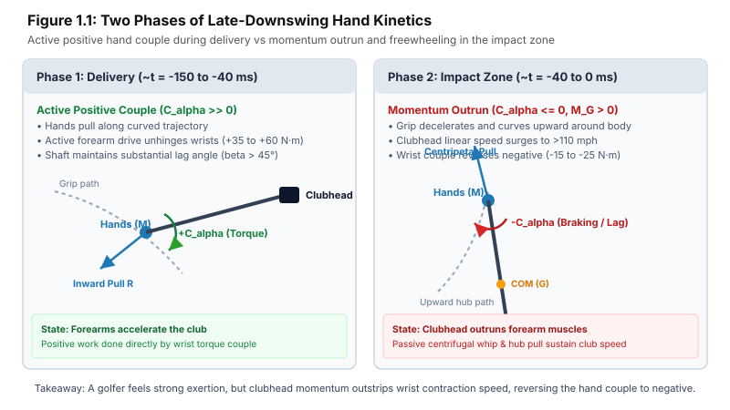
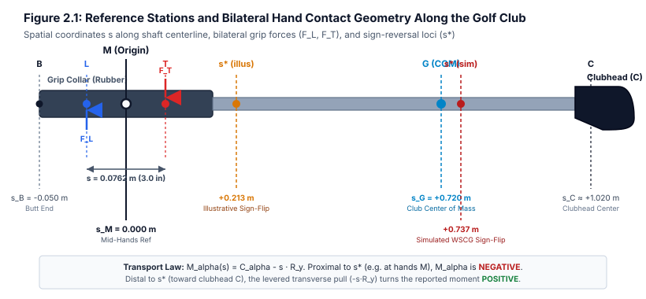
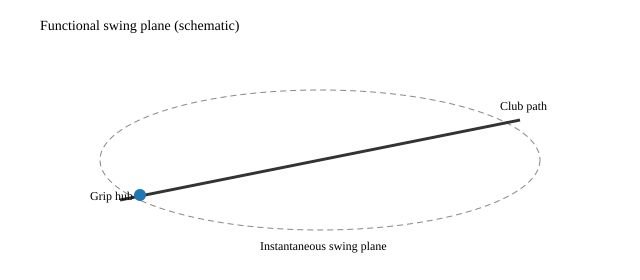
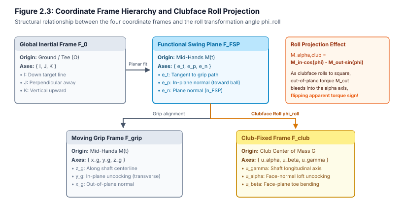
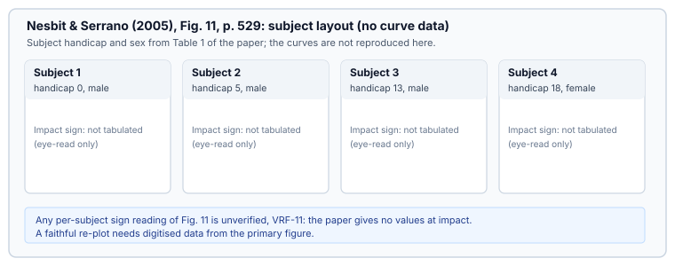
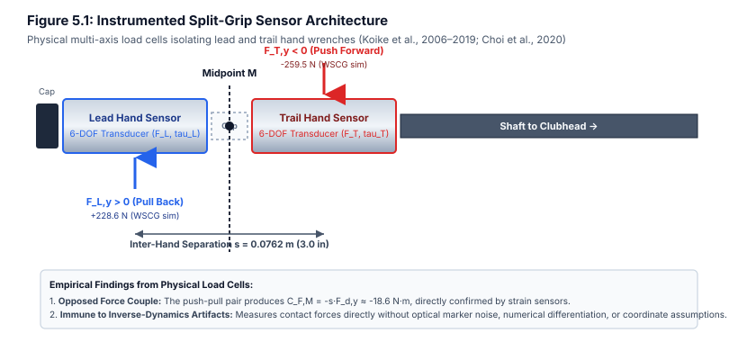

# Preface to the Revised Draft (v1)

This document constitutes the revised draft (v1, Chapters 1 through 10 and Appendices A through D) of a comprehensive, thesis-level review of the "Alpha War"—a long-running technical dispute in golf biomechanics and coaching (2014–2026) over the sign, magnitude, origin, and coaching implications of in-plane hand torque ("alpha torque") in the final 30 to 50 milliseconds before ball contact.

The text is structured into two complementary narrative registers:

1. **The Main Narrative:** Layperson-accessible, neutral, and educational exposition that explains physical phenomena through everyday analogies, biomechanical principles, and the historical evolution of the debate.
2. **Mathematical and Mechanical Callout Boxes & Appendices:** Graduate-level, fully rigorous derivations and methodological caveats formulated from classical rigid-body mechanics (Newton–Euler equations, spatial wrench reductions, reference-point transport theorems, closed-loop constrained Lagrangian dynamics, and flexible-beam structural dynamics).

All mathematical formulations strictly adhere to the unified notation established across the research program. Uncertain, unverified, or proprietary parameters that cannot be independently audited from peer-reviewed literature are cataloged and adjudicated in the Appendix D Verification Registry (**VRF-01** through **VRF-10**).

**Conflict of interest.** The author (Dieter Olson) participated in online biomechanics forums, contributed simulation code in AffineDrift/UpstreamDrift, and appears as a named analyst in parts of this draft. Author-affiliated arguments are segregated in §5A (not presented as part of the Camp B coalition evidence in §5.1–5.5). The author has no financial interest in Jacobs 3D or competing launch-monitor products; the goal of this draft is adjudication, not coaching product endorsement.

---

# Executive Summary (Plain Language) {#executive-summary-plain-language}

## The Core Paradox: Why the Swing Feels Like a Push While the Physics Shows an Overrun

In the final 50 milliseconds before a golf club collides with the ball—an interval roughly one-eighth the duration of an eyeblink—the clubhead accelerates to over 115 miles per hour (51.4 m/s). To the golfer executing this violent athletic motion, the physical sensation is unmistakable: every muscle across the torso, shoulders, arms, and forearms feels engaged in an all-out, maximal effort to drive the tool head through the ball.

Yet when engineers attach precision multi-axis force transducers to the club handle or solve the full three-dimensional equations of motion from optical motion-capture data, they discover an astonishing mechanical paradox: **in the final 30 to 40 milliseconds before impact, the measured pure hand couple at the grip often reverses sign while the clubhead still accelerates toward the ball.** In validated inverse-dynamics pipelines, the clubhead can outrun the hub path so that the grip couple acts as an angular brake even while the golfer feels maximal exertion—a kinesthetic clash explored in §8.3, not a settled proof that any specific positive couple magnitude is impossible.

This counterintuitive clash between human kinesthetic feeling and rigid-body mechanics ignited a bitter, decade-long controversy across golf coaching, equipment manufacturing, and sports science known as the **Alpha War**.

## The Three Conceptual Pillars

To make sense of how world-class coaches and university researchers could look at the same golf swings and reach diametrically opposed conclusions, one must understand three foundational mechanical principles:

### 1. Local Wrist Twist vs. Whole-Club Leverage (The Reference-Point Illusion)

Imagine swinging a heavy sledgehammer to demolish a masonry wall, or pulling open a heavy iron security gate by its hinge post. If you plant your feet and pull furiously on the handle toward your chest, the heavy hammer head swings forward with terrifying speed—even if your wrists remain completely limp, or even if your forearms actively resist the hammer's rotation!

In physics, pulling hard on one end of a stick creates a massive rotational turning moment about the stick's center of mass. This introduces a profound geometric trick:

- If you measure the twisting torque right at your wrists (**the grip midpoint**), your hands may be doing negative work, acting like a trailing hinge.
- But if you calculate the rotational turning effect around the hammer head or the club's balance point (**the center of mass**), the net turning moment remains overwhelmingly positive because your body's inward pull acts across a long lever arm.

Much of the Alpha War was not a dispute over physical reality; it was an argument between two factions reporting different mathematical reference points on the same rigid body without realizing they were talking past each other.

### 2. The Passive Whip vs. Active Muscle Push (Why Momentum Outruns Muscle)

Human skeletal muscles operate under strict physiological constraints known to physiologists as A.V. Hill's force-velocity relation: as a muscle is forced to contract at higher and higher shortening speeds, the maximum force it can exert drops rapidly toward zero.

Early in the downswing, the club moves relatively slowly, allowing the golfer's powerful forearm muscles to actively unhinge the wrists and inject massive rotational kinetic energy into the shaft. But as the golfer's body decelerates the hands and pulls the grip inward along an upwardly curving arc, multi-segment inertial interactions (known in biomechanics as _Putnam interaction forces_) whip the club open at angular velocities exceeding 2,000 degrees per second. Human wrist muscles simply cannot shorten that fast. The clubhead surges ahead on sheer momentum, leaving the hands mechanically behind.

### 3. Two Hands on One Handle (The Push-Pull Lever & Shaft Kick)

A golfer does not hold a golf club with a single pinpoint clamp; the lead and trail hands grasp the handle across an axial separation of approximately three inches ($s \approx 0.0762\text{ m}$). This physical separation creates a mechanical lever. When the clubhead whips forward and the flexible shaft recovers from its backward bend ("shaft kick"), the handle presses violently backward against the trail hand and pulls forward on the lead hand. To maintain their grip, the golfer's hands naturally resist this violent kick, creating an equal-and-opposite reaction couple that registers on sensors as a negative hand torque.

## The Two-Layer Verdict (Preview)

1. **Layer 1 — Definitions (The Reference-Point Settlement):**  
   The primary source of factional disagreement was definitional. The **pure hand couple** exerted at the grip midpoint ($M$) routinely turns **negative** ($-15\text{ to }-25\text{ N}\cdot\text{m}$) before impact in peer-reviewed kinematic models and physical instrumented-grip telemetry. At the exact same instant, the **total moment about the club center of mass** ($G$) can remain **positive** ($+20\text{ to }+40\text{ N}\cdot\text{m}$) because the golfer's massive centripetal grip pull ($-R_y > 300\text{ N}$) creates a dominant positive lever arm ($-d_{G/M} R_y > 0$). Both curves represent valid mathematical descriptions of the identical physical swing, provided the reduction station is explicitly declared.

2. **Layer 2 — Physics and Measurement Sensitivity:**  
   Even when both camps evaluate the identical point on the handle, reported torque values diverge due to subtle methodological choices:
   - **Coordinate Frame Roll Bleed:** Resolving torques in a rotating clubface frame causes large out-of-plane bending loads to project falsely onto the uncocking axis as the clubface rolls square into the ball.
   - **Numerical Filtering Cutoffs:** Low-pass filtering through the violent impact collision bleeds post-impact shock artifacts backward into pre-impact samples.
   - **Closed-Chain Biomechanical Indeterminacy:** Two hands grasping a single rigid handle create a closed kinematic loop where internal grip forces cannot be uniquely determined from optical motion tracking alone.

## Document Guide and Publication Status

- **Who should read what?** Readers seeking conceptual clarity should begin with this Executive Summary, Chapter 1, and the [§9 Glossary](#9-glossary). Specialists and research engineers can delve into the rigorous derivations in the Quarto callout boxes and technical appendices (Appendices A–D).
- **Publication status:** Unpublished draft (`status: do-not-publish`). Not listed in the public site build.

---

# 1. Problem Statement: What "Alpha Torque" Means and Why It Matters

## 1.1 The Everyday Experience of the Late Downswing

To an observer standing beside a championship tee, the golf downswing appears as a seamless, violent explosion of speed lasting scarcely a third of a second. From the top of the backswing, a skilled golfer accelerates a steel or graphite shaft tipped with a 200-gram mass from rest to over 115 miles per hour (51.4 m/s). In the final fifty milliseconds before the ball is launched—a fleeting interval roughly one-eighth the duration of an eyeblink—the clubhead travels over two meters along an elliptical arc, sweeping through the delivery position into ball strike.

What are the golfer's hands actually doing during these final fifty milliseconds?

Consider an intuitive analogy: swinging a heavy carpenter's hammer to drive a nail into an upright post. At the start of the swing, your wrist flexes back to set the hammer head. To initiate the strike, your forearm pulls downward while your wrist muscles contract to whip the hammer head forward. In this initial acceleration phase, your hand undeniably exerts a positive, forward-twisting effort—what dynamicists term a torque or couple—acting to uncock the wrist and fling the tool head toward the target.

Now consider what happens in the final inch before the hammer hits the nail. As the heavy steel head reaches high speed, its momentum begins to outstrip the rate at which your forearm muscles can contract. If you attempt to "push" the hammer even faster at the very bottom of the stroke, you encounter a curious mechanical sensation: the hammer feels as though it is pulling away from your grip, dragging your hand forward. If you were to swing a hammer with an oily handle on a slick day, the tool would tear itself out of your fingers.

{fig-alt="Two-panel schematic comparing Phase 1 active positive hand couple during delivery against Phase 2 momentum outrun and freewheeling near impact"}

The mechanics of the late downswing naturally divide into two distinct kinetic regimes, summarized in Table 1.1:

| Kinetic Dimension                     | Phase 1: Delivery Phase ($t \approx -150\text{ to }-40\text{ ms}$) | Phase 2: Impact Zone ($t \approx -40\text{ to }0\text{ ms}$)                      |
| :------------------------------------ | :----------------------------------------------------------------- | :-------------------------------------------------------------------------------- |
| **Primary Motion**                    | Rapid clubhead uncocking toward ball line                          | Terminal release, shaft squaring, and ball strike                                 |
| **Grip Hub Trajectory**               | Sweeping downward and forward along hand path                      | Decelerating laterally and curving sharply upward                                 |
| **Pure Hand Couple ($C_\alpha$)**     | **Strongly Positive** ($+35\text{ to }+65\text{ N}\cdot\text{m}$)  | **Negative / Trailing** ($-15\text{ to }-25\text{ N}\cdot\text{m}$)               |
| **Total COM Moment ($M_{\alpha,G}$)** | Strongly Positive ($+40\text{ to }+70\text{ N}\cdot\text{m}$)      | **Remains Positive** ($+15\text{ to }+40\text{ N}\cdot\text{m}$) via levered pull |
| **Muscle Activation State**           | Concentric wrist flexor contraction doing positive work            | Forearm muscles overrun; active tension acts as trailing brake                    |
| **Kinetic Mechanism**                 | Direct muscular torque accelerates lagging shaft                   | Passive Putnam interaction whip & centripetal hub pull                            |
| **Golfer Kinesthetic Feel**           | Aggressive forward drive and uncocking effort                      | Maximal muscular exertion resisting violent centrifugal outrun                    |

: Table 1.1: Comparison of late-downswing kinetic phases illustrating the transition from active hand drive to momentum-driven freewheeling. {#tbl-phase-comparison}

This phenomenon—what Bobby Jones described in the 1930s as "freewheeling," wherein the golfer merely holds onto a club whose uncocking momentum carries it through the ball—lies at the absolute center of modern golf kinetics. Yet behind this intuitive physical experience lies a decade-long scientific schism known throughout the biomechanics community as the **Alpha War**.

## 1.2 Defining the Narrow Window of Dispute

To understand why the Alpha War ignited such intense academic and commercial warfare, one must first demarcate the precise boundaries of the battleground. As group founder Nick Chertock crystallized in an influential retrospective on August 9, 2020:

> The Alpha War is not about the entire downswing. Everyone agrees that golfers apply massive positive alpha torque early in the downswing to initiate uncocking. The dispute concerns exclusively the final 30 to 50 milliseconds before ball contact. Furthermore, post-impact data is completely inadmissible due to the violent shock wave of ball collision.

In technical terms, both factions in the debate agree entirely on two baseline truths:

1. **The Transition and Mid-Downswing Phase ($t = -300\text{ ms}$ to $-50\text{ ms}$):** The golfer applies a massive, forward-acting in-plane couple ($\mathbf{C}_h \cdot \hat{\mathbf{e}}_\alpha > 0$) reaching peak magnitudes of $+35\text{ to }+65\text{ N}\cdot\text{m}$. This couple performs positive mechanical work, accelerating the club from an uncocked hinge angle ($\beta \approx 90^\circ$) toward delivery.
2. **Post-Impact Inadmissibility ($t > 0\text{ ms}$):** The collision between the clubhead and the 45.9-gram golf ball imparts an impulsive contact force of $8{,}000\text{ to }15{,}000\text{ N}$ lasting less than $0.5\text{ ms}$. This impact shock excites high-frequency transverse vibration modes in the shaft ($>70\text{ Hz}$), drives severe marker tracking artifacts in optical motion capture systems, and renders any inverse-dynamics calculation across or after impact mathematically invalid.

The entire controversy narrows to a single, microscopic temporal window: **the late downswing, spanning from approximately 50 milliseconds prior to impact until the exact instant of ball contact ($t \in [-0.050, 0.000]\text{ s}$)**.

Within this 50-millisecond window, two diametrically opposed factions emerged:

- **Camp A (The Positive Alpha Paradigm):** Formed around the biomechanical publications of Dr. Steven M. Nesbit (Lafayette College) and championed commercially by golf instructors Michael Jacobs and Brian Manzella through their research venture, _Jacobs 3D_. Camp A asserted that skilled golfers continue to exert an active, positive in-plane torque ($C_\alpha > 0$) through the ball, driving the uncocking of the clubhead all the way to impact. They argued that elite golfers do not simply let go or "coast"; rather, they sustain positive angular drive, and that teaching a golfer to "release" passively leads to loss of clubhead speed, inconsistent face control, and weak impact geometry.
- **Camp B (The Negative Alpha / Free-Hinge Paradigm):** Championed by leading academic sports biomechanists—including Dr. Sasho MacKenzie (St. Francis Xavier University), Dr. Young-Hoo Kwon [@kwon2012fsp] (Texas Woman's University), golf engineer Dave Tutelman [@tutelman2018alpha], tour coach Jon Sinclair, and independent physicist Dr. Robert D. Grober [@grober2020forces] (Yale University). Camp B maintained that in high-speed, skilled full swings, the in-plane couple exerted by the hands on the grip universally crosses zero and reverses to a significant **negative** value ($C_\alpha < 0$, typically $-10\text{ to }-25\text{ N}\cdot\text{m}$) approximately 20 to 40 milliseconds before impact. In Camp B's formulation, the hands act as an angular brake or a trailing hinge; the club rotates forward not because the wrists push it, but because the outward flinging of the clubhead's linear momentum and the centripetal pull of the golfer's body drive the club forward faster than human forearm musculature can actively contract.

Table 1.2 presents a comprehensive side-by-side comparison of the two opposing paradigms:

| Dimension                      | Camp A (Positive Alpha Paradigm: Nesbit, Jacobs 3D, Manzella)                                               | Camp B (Negative Alpha / Free-Hinge Paradigm: Kwon, MacKenzie, Tutelman, Sinclair, Grober)                          |
| :----------------------------- | :---------------------------------------------------------------------------------------------------------- | :------------------------------------------------------------------------------------------------------------------ |
| **Core Kinetic Claim**         | Active in-plane hand torque remains **positive** ($+10\text{ to }+30\text{ N}\cdot\text{m}$) through impact | In-plane hand couple universally reverses to **negative** ($-15\text{ to }-25\text{ N}\cdot\text{m}$) before impact |
| **Primary Literature Basis**   | [@nesbit2005work] Fig. 11 (amateur Subjects 2 & 4); Jacobs & Manzella (2015, 2019)                          | [@nesbit2005work] Fig. 11 (scratch Subject 1); MacKenzie & Sprigings (2009); Kwon (2012–2020)                       |
| **Primary Reference Station**  | Club Center of Mass ($G$) or moving clubface origin                                                         | Mid-Hands Grip Station ($M$) or lead wrist joint boundary                                                           |
| **Reference Coordinate Frame** | Rotating Club-Fixed Principal Frame ($\mathcal{F}_{\text{club}}$)                                           | Functional Swing Plane Frame ($\mathcal{F}_{\text{FSP}}$) or Moving Grip Frame ($\mathcal{F}_{\text{grip}}$)        |
| **Mechanical Philosophy**      | Tool-control paradigm: elite athletes actively accelerate the tool head into contact                        | Kinetic-chain whip paradigm: club momentum naturally outruns human muscle contraction                               |
| **Empirical Sensor Telemetry** | Optical motion capture processed through proprietary 6-DOF inverse dynamics                                 | Instrumented split-grip multi-axis load cells (Koike et al.; Choi et al.) and forward simulations                   |
| **Pedagogical Stance**         | Train golfers to sustain 3D force and torque delivery into the ball; oppose "passive release"               | Train proximal body deceleration and centripetal hub pull; allow clubhead to whip freely                            |

: Table 1.2: The factional battle lines: side-by-side comparison of Camp A and Camp B paradigms. {#tbl-battle-lines}

## 1.3 How the Rest of the Document Is Organized

Section 1 introduced the dispute window and the core factional paradigms. Chapter 2 establishes rigorous coordinate frames and sign conventions to eliminate geometric confusion. Chapter 3 derives the full three-dimensional equations of motion, the spatial reference-point transport law, energy invariance theorems, and multi-segment interaction dynamics. Chapters 4 and 5 systematically present the empirical and theoretical arguments of Camp A and Camp B, respectively. Chapter 5A provides independent author-affiliated boundary calculations. Chapters 6 and 7 examine measurement sensitivity (filtering artifacts, impact windows, and coordinate projections) and present numerical simulation experiments. Chapter 8 synthesizes the findings into a formal adjudication matrix and experimental test protocols. Full derivations and verification registries are provided in Appendices A through D.

---

# 2. Definitions and Coordinate Frames

To eliminate ambiguity, every physical vector, reference station, and coordinate transformation must be defined rigorously before writing equations of motion.

## 2.1 Club and Grip Geometry

We treat the golf club as a slender, non-uniform rigid body of total mass $m_c$ (typically $0.310\text{ to }0.330\text{ kg}$ for a modern driver) and overall length $L_c \approx 1.15\text{ m}$ (45.5 inches).

{fig-alt="Engineering schematic of the golf club showing reference stations B, L, M, T, G, and C, inter-hand spacing s = 0.0762 m, and sign-reversal loci"}

We establish the fixed reference stations along the shaft centerline $\hat{\mathbf{e}}_{\text{shaft}}$ defined in Table 2.1:

| Reference Station                      |        Symbol        |             Signed Offset ($s_P$) from Mid-Hands ($M$)              | Physical Description & Mechanical Role                                                                                            |
| :------------------------------------- | :------------------: | :-----------------------------------------------------------------: | :-------------------------------------------------------------------------------------------------------------------------------- |
| **Butt End**                           |         $B$          |             $s_B = -0.050\text{ m}$ ($-1.97\text{ in}$)             | Proximal terminus of the grip cap; reference boundary for hand clearance                                                          |
| **Lead Hand Center**                   |         $L$          |            $s_L = -0.0381\text{ m}$ ($-1.50\text{ in}$)             | Center of contact pressure for lead (glove) hand; exerts force $\mathbf{F}_L$ and wrist torque $\boldsymbol{\tau}_L$              |
| **Mid-Hands Reference Point**          |         $M$          |              $s_M = 0.000\text{ m}$ ($0.00\text{ in}$)              | Geometric origin for all handle wrench evaluations: $\mathbf{r}_M = \frac{1}{2}(\mathbf{r}_L + \mathbf{r}_T)$                     |
| **Trail Hand Center**                  |         $T$          |            $s_T = +0.0381\text{ m}$ ($+1.50\text{ in}$)             | Center of contact pressure for trail hand; exerts force $\mathbf{F}_T$ and wrist torque $\boldsymbol{\tau}_T$                     |
| **Illustrative Sign-Reversal Locus**   | $s^*_{\text{illus}}$ | $s^* = +0.2133\text{ m}$ (+0.2133 m / +0.213 m, $+8.40\text{ in}$)  | Illustrative zero-crossing station where reported alpha moment flips from negative to positive                                    |
| **Club Center of Mass**                |         $G$          |            $s_G = +0.720\text{ m}$ ($+28.35\text{ in}$)             | Mass center of assembled club; lateral offset $\mathbf{r}_{G/\text{shaft}} \approx 15\text{ to }25\text{ mm}$ governs shaft twist |
| **Simulated WSCG Sign-Reversal Locus** |  $s^*_{\text{sim}}$  | $s^* = +0.7370\text{ m}$ (+0.7370 m / +0.737 m, $+29.02\text{ in}$) | Simulated zero-crossing station in WSCG dataset ($t = 0.2151\text{ s}$), located 1.7 cm distal to COM $G$                         |
| **Clubhead Center**                    |         $C$          |         $s_C \approx +1.020\text{ m}$ ($+40.16\text{ in}$)          | Aerodynamic and geometric center of the clubhead body                                                                             |

: Table 2.1: Master geometric reference stations along the golf club assembly. {#tbl-ref-stations}

The spatial displacement vector connecting the lead hand center to the trail hand center is:

$$
\mathbf{d} = \mathbf{r}_T - \mathbf{r}_L = s\,\hat{\mathbf{e}}_{\text{shaft}}
$$

where $s = \|\mathbf{d}\| \approx 0.0762\text{ m}$ (3.0 inches) represents the nominal inter-hand contact separation in a standard overlapping or interlocking golf grip. Any arbitrary shaft station $P$ located at signed distance $s_P$ distal to mid-hands $M$ satisfies:

$$
\mathbf{r}_P = \mathbf{r}_M + s_P\,\hat{\mathbf{e}}_{\text{shaft}}
$$

## 2.2 Functional Swing Plane (FSP) [@kwon2012fsp]

The concept of a swing plane is fundamental to planar reductions of golf kinetics. Because the spatial trajectory of the clubhead is non-planar (it flattens during the transition and steepens toward delivery), Dr. Young-Hoo Kwon [@kwon2012fsp] formulated the instantaneous **Functional Swing Plane (FSP) [@kwon2012fsp]**.

{fig-alt="Schematic ellipse indicating the instantaneous functional swing plane with grip hub and club path"}

At any instant $t$, the FSP is defined by the instantaneous spatial position of the mid-hands point $\mathbf{r}_M(t)$ and the instantaneous velocity vector of the clubhead center of mass $\mathbf{v}_C(t)$. The plane unit normal $\hat{\mathbf{n}}_{\text{FSP}}$ is given by:

$$
\hat{\mathbf{n}}_{\text{FSP}} = \frac{(\mathbf{r}_C - \mathbf{r}_M) \times \mathbf{v}_C}{\|(\mathbf{r}_C - \mathbf{r}_M) \times \mathbf{v}_C\|}
$$

The instantaneous in-plane motion occurs entirely within the plane perpendicular to $\hat{\mathbf{n}}_{\text{FSP}}$.

## 2.3 Explicit Coordinate Frames

To avoid the frame conflation that crippled historical discussions, we define four distinct coordinate frames:

{fig-alt="Diagram of the four coordinate frames F_0, F_FSP, F_grip, and F_club and the roll angle phi_roll"}

The mathematical relationships, origins, and physical roles of these four frames are summarized in Table 2.2:

| Frame Name                       |           Symbol            |           Origin            | Basis Axes                                                                                                                                                         | Primary Application & Physical Role                                                        |
| :------------------------------- | :-------------------------: | :-------------------------: | :----------------------------------------------------------------------------------------------------------------------------------------------------------------- | :----------------------------------------------------------------------------------------- |
| **Global Inertial Frame**        |       $\mathcal{F}_0$       |     Ground / Tee ($O$)      | $\{\hat{\mathbf{I}}, \hat{\mathbf{J}}, \hat{\mathbf{K}}\}$: Target line, lateral ground, vertical up opposing gravity                                              | Inertial reference for full-body tracking, clubhead trajectory, and ground reaction forces |
| **Functional Swing Plane Frame** | $\mathcal{F}_{\text{FSP}}$  | Mid-Hands $\mathbf{r}_M(t)$ | $\{\hat{\mathbf{e}}_t, \hat{\mathbf{e}}_p, \hat{\mathbf{e}}_n\}$: Grip velocity tangent, in-plane normal toward ball, plane normal $\hat{\mathbf{n}}_{\text{FSP}}$ | Resolves true uncocking mechanics along the instantaneous planar arc of the clubhead       |
| **Moving Grip Frame**            | $\mathcal{F}_{\text{grip}}$ | Mid-Hands $\mathbf{r}_M(t)$ | $\{\hat{\mathbf{x}}_g, \hat{\mathbf{y}}_g, \hat{\mathbf{z}}_g\}$: Out-of-plane normal, in-plane uncocking transverse, axial down shaft                             | Directly measures forces and torques applied by the golfer's hands on the handle           |
| **Club-Fixed Principal Frame**   | $\mathcal{F}_{\text{club}}$ |  Club Center of Mass ($G$)  | $\{\hat{\mathbf{u}}_\alpha, \hat{\mathbf{u}}_\beta, \hat{\mathbf{u}}_\gamma\}$: Face-normal uncocking, toe-up face bending, longitudinal shaft axis                | Standard aerospace body-fixed frame; rotates with clubface roll and shaft deflection       |

: Table 2.2: Systematic comparison of the four coordinate frames utilized in golf swing kinetics. {#tbl-frames-comparison}

### 1. Global Inertial Laboratory Frame ($\mathcal{F}_0$)

- **Origin ($O$):** Fixed on the ground at the tee or ball position.
- **Axes ($\{\hat{\mathbf{I}}, \hat{\mathbf{J}}, \hat{\mathbf{K}}\}$):** $\hat{\mathbf{I}}$ points down the target line; $\hat{\mathbf{J}}$ points perpendicular to the target line away from the golfer; $\hat{\mathbf{K}}$ points vertically upward opposing gravity ($\mathbf{g} = -g\hat{\mathbf{K}}$).

### 2. Functional Swing Plane Frame ($\mathcal{F}_{\text{FSP}}$)

- **Origin ($M$):** Located at the mid-hands grip station $\mathbf{r}_M(t)$.
- **Axes ($\{\hat{\mathbf{e}}_t, \hat{\mathbf{e}}_p, \hat{\mathbf{e}}_n\}$):** $\hat{\mathbf{e}}_t$ points along the instantaneous velocity of the grip; $\hat{\mathbf{e}}_p$ lies within the swing plane perpendicular to the shaft directed toward the ball; $\hat{\mathbf{e}}_n = \hat{\mathbf{n}}_{\text{FSP}}$ is the plane normal.

### 3. Moving Grip Frame ($\mathcal{F}_{\text{grip}}$)

- **Origin ($M$):** Mid-hands point.
- **Axes ($\{\hat{\mathbf{x}}_g, \hat{\mathbf{y}}_g, \hat{\mathbf{z}}_g\}$):** $\hat{\mathbf{z}}_g = \hat{\mathbf{e}}_{\text{shaft}}$ is directed axially down the shaft toward the clubhead; $\hat{\mathbf{y}}_g$ is directed in-plane perpendicular to the shaft in the direction of forward uncocking; $\hat{\mathbf{x}}_g = \hat{\mathbf{y}}_g \times \hat{\mathbf{z}}_g$ is normal to the instantaneous uncocking plane.

### 4. Club-Fixed Principal Frame ($\mathcal{F}_{\text{club}}$)

- **Origin ($G$):** Club center of mass.
- **Axes ($\{\hat{\mathbf{u}}_\alpha, \hat{\mathbf{u}}_\beta, \hat{\mathbf{u}}_\gamma\}$):** Fixed rigidly to the clubhead and shaft, aligned with the principal axes of inertia: $\hat{\mathbf{u}}_\gamma$ is aligned with the longitudinal shaft axis; $\hat{\mathbf{u}}_\alpha$ is perpendicular to the shaft and perpendicular to the face loft plane (positive uncocking); $\hat{\mathbf{u}}_\beta = \hat{\mathbf{u}}_\gamma \times \hat{\mathbf{u}}_\alpha$ is parallel to the clubface plane (toe-up/toe-down bending).

## 2.4 Cross-Camp Axis & Sign Convention Concordance

A major impediment to clarity has been the disparate nomenclature employed across engineering disciplines, coaching schools, and academic institutions. Table 2.3 establishes the direct mathematical mapping between these traditions:

| Motion / Physical Direction                | Tutelman (2018) [@tutelman2018alpha]               | MacKenzie / Kwon (FSP) [@kwon2012fsp]                 | Jacobs 3D / Nesbit (Principal) [@jacobs2019science] | Unified Thesis Notation ($M / C, \mathbf{R}$) |
| :----------------------------------------- | :------------------------------------------------- | :---------------------------------------------------- | :-------------------------------------------------- | :-------------------------------------------- |
| **Forward Uncocking** (Swing Plane)        | "In" Plane Torque ($+ = \text{uncock forward}$)    | In-Plane Torque ($+ = \text{uncock forward}$)         | Alpha Torque ($+ = \text{forward uncocking}$)       | $M_\alpha$ ($C_\alpha$)                       |
| **Out-of-Plane Bending** (Droop / Flatter) | "Out" Plane Torque ($+ = \text{droop / toe down}$) | Out-of-Plane Torque ($+ = \text{swing plane normal}$) | Beta Torque ($+ = \text{lead deflection / droop}$)  | $M_\beta$ ($C_\beta$)                         |
| **Shaft Axial Twist** (Face Closing)       | "About" Shaft Torque ($+ = \text{close face}$)     | Longitudinal Torque ($+ = \text{close face}$)         | Gamma Torque ($+ = \text{close face}$)              | $M_\gamma$ ($C_\gamma$)                       |
| **Grip Radial Pull** (Tension along shaft) | Radial Grip Force ($+ = \text{pull inward}$)       | Axial Force ($+ = \text{tension}$)                    | Gamma Force ($+ = \text{tension toward hands}$)     | $R_{\text{axial}}$ ($R_z$)                    |
| **Transverse Shear** (Lead / Trail force)  | Transverse Shear ($+ = \text{push forward}$)       | Normal In-Plane Force ($+ = \text{forward shear}$)    | Beta Force ($+ = \text{force toward target/face}$)  | $R_{\text{trans}}$ ($R_y$)                    |

: Table 2.3: Cross-camp axis and sign convention concordance table. {#tbl-concordance}

::: {.callout-note title="Box 2.1: Transformation of 3D Torque Vectors Under Frame Rotation and Clubface Roll Mixing"}
**Plain-language lead:** When analysts calculate torque in a coordinate system that rolls along with the rotating clubface rather than staying aligned with the swing plane, the physical twisting forces get mixed together. As the golfer squares the face into impact, out-of-plane bending loads bleed into the uncocking measurement, falsely making a braking torque look like an active forward push.

A frequent source of sign disagreement arises when comparing torque vectors expressed in the Functional Swing Plane frame $\mathcal{F}_{\text{FSP}}$ against those expressed in the rotating Club-Fixed Principal Frame $\mathcal{F}_{\text{club}}$.

Let the spatial torque vector evaluated at the grip midpoint be expressed in the FSP frame as:

$$
\mathbf{M}_{\text{FSP}} = \begin{bmatrix} M_{\text{shaft}} \\ M_{\text{out}} \\ M_{\text{in}} \end{bmatrix}_{\text{FSP}}
$$

where $M_{\text{in}}$ is the pure in-plane uncocking couple, $M_{\text{out}}$ is the out-of-plane bending couple, and $M_{\text{shaft}}$ is the axial forearm twist.

As the golfer approaches impact, the club rotates about the longitudinal shaft axis to square the clubface. Let $\phi_{\text{roll}}$ denote this roll angle (where $\phi_{\text{roll}} = 0$ corresponds to a clubface aligned strictly perpendicular to the swing plane). The rotation matrix transforming coordinates from $\mathcal{F}_{\text{FSP}}$ into $\mathcal{F}_{\text{club}}$ is given by:

$$
\mathbf{R}_{\text{club}\leftarrow\text{FSP}}(\phi_{\text{roll}}) = \begin{bmatrix} 1 & 0 & 0 \\ 0 & \cos\phi_{\text{roll}} & \sin\phi_{\text{roll}} \\ 0 & -\sin\phi_{\text{roll}} & \cos\phi_{\text{roll}} \end{bmatrix}
$$

Transforming the torque vector yields the components in the club-fixed frame:

$$
\begin{bmatrix} M_\gamma \\ M_\beta \\ M_\alpha \end{bmatrix}_{\text{club}} = \mathbf{R}_{\text{club}\leftarrow\text{FSP}}(\phi_{\text{roll}}) \begin{bmatrix} M_{\text{shaft}} \\ M_{\text{out}} \\ M_{\text{in}} \end{bmatrix}_{\text{FSP}} = \begin{bmatrix} M_{\text{shaft}} \\ M_{\text{out}}\cos\phi_{\text{roll}} + M_{\text{in}}\sin\phi_{\text{roll}} \\ -M_{\text{out}}\sin\phi_{\text{roll}} + M_{\text{in}}\cos\phi_{\text{roll}} \end{bmatrix}
$$

Under this transformation, the apparent club-fixed "alpha torque" is:

$$
M_{\alpha,\text{club}}(\phi_{\text{roll}}) = M_{\text{in}}\cos\phi_{\text{roll}} - M_{\text{out}}\sin\phi_{\text{roll}}
$$

**Quantitative Demonstration (Illustrative Input, `calcs/alpha_war_sensitivity_suite.py` Study 3):**  
Consider an **illustrative** late-downswing loading state where the golfer exerts a strongly negative in-plane couple $M_{\text{in}} = -15.0\text{ N}\cdot\text{m}$, a moderate positive out-of-plane couple $M_{\text{out}} = +8.0\text{ N}\cdot\text{m}$, and an axial closing torque $M_{\text{shaft}} = +4.5\text{ N}\cdot\text{m}$.

1. At $\phi_{\text{roll}} = 0^\circ$ (square face):
   $$
   M_{\alpha,\text{club}}(0^\circ) = -15.0(1.0) - 8.0(0.0) = -15.00\text{ N}\cdot\text{m} \quad \text{(Negative)}
   $$
2. At $\phi_{\text{roll}} = 45^\circ$:
   $$
   M_{\alpha,\text{club}}(45^\circ) = -15.0\left(\frac{\sqrt{2}}{2}\right) - 8.0\left(\frac{\sqrt{2}}{2}\right) = -16.26\text{ N}\cdot\text{m}
   $$
3. If the sign convention of out-of-plane roll is inverted (or if the face rolls past open into a hooded orientation, illustrative $\phi^* = 61.93^\circ$):
   $$
   \phi^* = \arctan\left(\frac{|M_{\text{in}}|}{M_{\text{out}}}\right) = \arctan\left(\frac{15}{8}\right) = 61.93^\circ \quad \text{(Illustrative Sign-Flip Angle)} \implies M_{\alpha,\text{club}}(\phi^*) = 0.00\text{ N}\cdot\text{m}
   $$
   Past this critical roll angle, the projected alpha component flips to **$+8.00\text{ to }+14.43\text{ N}\cdot\text{m}$ (Positive)**, while the overall spatial torque magnitude remains strictly invariant:
   $$
   \|\mathbf{M}\| = \sqrt{(-15.0)^2 + 8.0^2 + 4.5^2} = 17.586\text{ N}\cdot\text{m}
   $$

Plain-language takeaway (Figure 3): Resolving torques in a rotating club-fixed frame without reporting face roll $\phi_{\text{roll}}$ causes out-of-plane bending loads to bleed directly into the alpha axis, creating spurious sign reversals that reflect geometric orientation rather than muscular effort.

:::

---

# 3. Kinematics and Kinetics: Rigid-Body Mechanics of the Golf Club

With geometric frames established, we now derive the full equations of motion governing the golf club under spatial loading.

## 3.1 3D Newton–Euler Equations of Motion

We treat the golf club as a 6-DOF rigid body moving through inertial space $\mathcal{F}_0$. Let:

- $m_c$: Total club mass ($0.320\text{ kg}$).
- $\mathbf{r}_G$: Position vector of the club center of mass $G$ in $\mathcal{F}_0$.
- $\mathbf{v}_G = \dot{\mathbf{r}}_G$, $\mathbf{a}_G = \ddot{\mathbf{r}}_G$: Linear velocity and acceleration of $G$.
- $\boldsymbol{\omega}$: Instantaneous angular velocity vector of the club in $\mathcal{F}_0$.
- $\dot{\boldsymbol{\omega}}$: Instantaneous angular acceleration vector of the club.
- $\mathbf{I}_G$: Central moment of inertia tensor of the club evaluated about $G$.
- $\mathbf{R}$: Net resultant contact force exerted _by_ the golfer's hands _on_ the club grip.
- $\mathbf{C}_h$: Equivalent pure resultant couple exerted _by_ the hands _on_ the club grip about midpoint $M$.
- $\mathbf{F}_{\text{aero}}$: Aerodynamic drag and lift force acting on the clubhead.

The spatial Newton–Euler equations of motion evaluated about the club center of mass $G$ are:

$$
\mathbf{R} + m_c\mathbf{g} + \mathbf{F}_{\text{aero}} = m_c\mathbf{a}_G
$$

$$
\mathbf{M}_G = \mathbf{I}_G\dot{\boldsymbol{\omega}} + \boldsymbol{\omega} \times (\mathbf{I}_G\boldsymbol{\omega})
$$

where $\mathbf{M}_G$ is the total resultant external moment acting on the club about its center of mass.

If instead we evaluate the equations of motion about an arbitrary non-stationary point $P$ along the shaft (such as the mid-hands point $M$), the moment equation must incorporate the fictitious inertial moment arising from the acceleration of point $P$:

$$
\mathbf{M}_P = \mathbf{I}_P\dot{\boldsymbol{\omega}} + \boldsymbol{\omega} \times (\mathbf{I}_P\boldsymbol{\omega}) + m_c(\mathbf{r}_G - \mathbf{r}_P) \times \mathbf{a}_P
$$

where $\mathbf{I}_P = \mathbf{I}_G + m_c[(\mathbf{r}_G - \mathbf{r}_P)^2\mathbf{E} - (\mathbf{r}_G - \mathbf{r}_P)\otimes(\mathbf{r}_G - \mathbf{r}_P)]$ by the parallel axis theorem.

::: {.callout-note title="Box 3.1: Reduction of Bilateral Hand Contact Forces to an Equivalent Wrench at the Grip Midpoint"}
**Plain-language lead:** A golfer does not hold the club at a single point; the two hands grip the shaft about three inches apart. This spatial separation allows the hands to act as an opposing push-pull lever, so the total twisting torque on the handle is the sum of raw wrist muscle torque plus the levered push-pull force between the two hands.

In reality, a golfer grips the club with two separate hands distributed along the grip collar. Let:

- $\mathbf{F}_L$: Resultant contact force vector applied by the lead hand at contact center $\mathbf{r}_L$.
- $\mathbf{F}_T$: Resultant contact force vector applied by the trail hand at contact center $\mathbf{r}_T$.
- $\boldsymbol{\tau}_L, \boldsymbol{\tau}_T$: Free wrist couples transmitted directly across each hand interface.

We define the geometric midpoint between the hands as:

$$
\mathbf{r}_M = \frac{1}{2}(\mathbf{r}_L + \mathbf{r}_T) \implies \mathbf{r}_L - \mathbf{r}_M = -\frac{1}{2}\mathbf{d}, \quad \mathbf{r}_T - \mathbf{r}_M = +\frac{1}{2}\mathbf{d}
$$

where $\mathbf{d} = \mathbf{r}_T - \mathbf{r}_L = s\,\hat{\mathbf{e}}_{\text{shaft}}$ ($s = 0.0762\text{ m}$).

We decompose the two contact forces into a **common force mode** $\mathbf{F}_c$ and a **differential force mode** $\mathbf{F}_d$:

$$
\mathbf{F}_c = \frac{1}{2}(\mathbf{F}_L + \mathbf{F}_T), \quad \mathbf{F}_d = \frac{1}{2}(\mathbf{F}_L - \mathbf{F}_T)
$$

Inverting this linear system yields:

$$
\mathbf{F}_L = \mathbf{F}_c + \mathbf{F}_d, \quad \mathbf{F}_T = \mathbf{F}_c - \mathbf{F}_d
$$

The net linear resultant force $\mathbf{R}$ applied to the club is:

$$
\mathbf{R} = \mathbf{F}_L + \mathbf{F}_T = (\mathbf{F}_c + \mathbf{F}_d) + (\mathbf{F}_c - \mathbf{F}_d) = 2\mathbf{F}_c
$$

Notice that the differential force mode $\mathbf{F}_d$ cancels identically in the net force: **opposed push-pull forces do not alter the linear acceleration of the club.**

Now compute the force-generated moment about the mid-hands point $M$:

$$
\begin{aligned}
\mathbf{M}_{F,M} &= (\mathbf{r}_L - \mathbf{r}_M) \times \mathbf{F}_L + (\mathbf{r}_T - \mathbf{r}_M) \times \mathbf{F}_T \\
&= \left(-\frac{1}{2}\mathbf{d}\right) \times (\mathbf{F}_c + \mathbf{F}_d) + \left(\frac{1}{2}\mathbf{d}\right) \times (\mathbf{F}_c - \mathbf{F}_d) \\
&= -\frac{1}{2}\mathbf{d} \times \mathbf{F}_c - \frac{1}{2}\mathbf{d} \times \mathbf{F}_d + \frac{1}{2}\mathbf{d} \times \mathbf{F}_c - \frac{1}{2}\mathbf{d} \times \mathbf{F}_d \\
&= -\mathbf{d} \times \mathbf{F}_d
\end{aligned}
$$

In the 2D planar uncocking reduction (where $\mathbf{d} = s\,\hat{\mathbf{e}}_x$ along the shaft and transverse shear forces act along $\hat{\mathbf{e}}_y$):

$$
C_{F,M} = (\mathbf{M}_{F,M})_z = -s\,F_{d,y} = -\frac{s}{2}(F_{L,y} - F_{T,y})
$$

Adding the intrinsic free wrist couples gives the total equivalent hand couple $\mathbf{C}_h$:

$$
\mathbf{C}_h \equiv \mathbf{M}_M = -\mathbf{d} \times \mathbf{F}_d + \boldsymbol{\tau}_L + \boldsymbol{\tau}_T
$$

**Fundamental Mechanical Result:** The hand couple $\mathbf{C}_h$ consists of two distinct components:

1. The **push-pull force couple** $C_{F,M} = -s F_{d,y}$, generated by equal and opposite transverse forces levered across the hand separation $s$;
2. The **free wrist torque** $\tau_{\text{free}} = \tau_{L} + \tau_{T}$, generated by direct muscular torque across the wrist joints.

:::

## 3.2 The Reference-Point Transport Law

The central mathematical pivot of the entire Alpha War is the **Reference-Point Transport Law** of spatial mechanics.

Let a system of forces act upon a rigid body, yielding a net resultant force $\mathbf{R}$ and an equivalent moment $\mathbf{M}_A$ evaluated about reference station $A$. If the evaluation point is shifted to a new reference station $B$, the resultant force $\mathbf{R}$ remains unchanged, but the moment transforms according to:

$$
\mathbf{M}_B = \mathbf{M}_A - (\mathbf{r}_B - \mathbf{r}_A) \times \mathbf{R}
$$

::: {.callout-note title="Box 3.2: Reference-Point Transport and the Levered Beta-Force Term"}
**Plain-language lead:** Shifting the mathematical measurement point along the shaft transforms the calculated torque because the large inward pulling force of the golfer creates a massive lever arm. Shifting the reference station from the hands toward the clubhead systematically changes the calculated in-plane torque from negative to positive.

Let us evaluate how the reported in-plane "alpha moment" changes as the evaluation station moves along the shaft axis from the grip toward the clubhead.

Let station $M$ be the mid-hands point ($s = 0$), where the total equivalent hand couple is $\mathbf{C}_h$. Let station $P(s_P)$ be an arbitrary point along the shaft at signed offset $s_P$ distal to $M$:

$$
\mathbf{r}_P - \mathbf{r}_M = s_P\,\hat{\mathbf{e}}_{\text{shaft}}
$$

Applying the transport law:

$$
\mathbf{M}_P = \mathbf{C}_h - (s_P\,\hat{\mathbf{e}}_{\text{shaft}}) \times \mathbf{R}
$$

Projecting onto the in-plane uncocking axis $\hat{\mathbf{e}}_\alpha$ (where the transverse shear force perpendicular to the shaft in the swing plane is $R_y$, commonly termed the "beta force"):

$$
M_{\alpha,P}(s_P) = C_\alpha - s_P\,R_y
$$

In particular, evaluating the moment about the **club center of mass** $G$ (located at $s_P = +d_{G/M} = +0.720\text{ m}$):

$$
M_{\alpha,G} = C_\alpha - d_{G/M}\,R_y
$$

**The Levered Beta-Force Term ($-d_{G/M} R_y$):**  
In the late downswing, the golfer pulls furiously inward and upward on the grip to redirect the clubhead toward the ball. This centripetal hub pull generates a massive negative transverse shear force: $R_y < 0$ (typically $-30\text{ to }-80\text{ N}$).
Because $d_{G/M} > 0$ and $R_y < 0$, the transport term $-d_{G/M} R_y$ is **strongly positive**:

$$
-d_{G/M} R_y = -(+0.720\text{ m})(-75.0\text{ N}) = +54.00\text{ N}\cdot\text{m}
$$

**Quantitative Adjudication (from `calcs/alpha_war_sensitivity_suite.py` Study 1):**

1. **Illustrative Tour Driver Impact Scenario (Analytical Input):**  
   Suppose, as an **illustrative** analytical benchmark, the golfer's hands exert a negative couple $C_\alpha = -16.00\text{ N}\cdot\text{m}$ while pulling with transverse shear $R_y = -75.00\text{ N}$.

   - At Butt End ($s = -0.050\text{ m}$): $M_\alpha = -16.00 - (-0.050)(-75.0) = \mathbf{-19.75\text{ N}\cdot\text{m}}$
   - At Mid-Hands ($s = 0.000\text{ m}$): $M_\alpha = C_\alpha = \mathbf{-16.00\text{ N}\cdot\text{m}}$
   - At Lead Hand ($s = -0.0381\text{ m}$): $M_\alpha = \mathbf{-18.86\text{ N}\cdot\text{m}}$
   - At Trail Hand ($s = +0.0381\text{ m}$): $M_\alpha = \mathbf{-13.14\text{ N}\cdot\text{m}}$
   - Illustrative Sign-Reversal Locus ($s^*$): Setting $M_\alpha(s^*) = 0$:
     $$
     s^* = \frac{C_\alpha}{R_y} = \frac{-16.00\text{ N}\cdot\text{m}}{-75.00\text{ N}} = \mathbf{+0.2133\text{ m}} \quad \text{(Illustrative)}
     $$
     In this illustrative case (+0.2133 m / +0.213 m), the reported moment flips sign just 8.4 inches below the hands.
   - At Club COM ($s = +0.720\text{ m}$):
     $$
     M_{\alpha,G} = -16.00 - (+0.720)(-75.0) = -16.00 + 54.00 = \mathbf{+38.00\text{ N}\cdot\text{m}}
     $$

2. **Simulated WSCG Minimum-Couple State ($t = 0.2151\text{ s}$, $v_{\text{head}} = 109.92\text{ mph}$):**  
   From the **simulated** WSCG two-hand inverse/forward-dynamics dataset:
   - Grip separation $s = 0.0762\text{ m}$, opposed forces $F_{L,y} = +228.57\text{ N}$, $F_{T,y} = -259.53\text{ N}$.
   - Differential force $F_{d,y} = +244.05\text{ N} \implies C_{F,M} = -18.60\text{ N}\cdot\text{m}$.
   - Free wrist torque $\tau_{\text{free}} = -4.22\text{ N}\cdot\text{m} \implies C_\alpha = -22.81\text{ N}\cdot\text{m}$.
   - Transverse force $R_y = -30.96\text{ N}$.
   - Transported moment to club COM $G$:
     $$
     M_{\alpha,G} = -22.81 - (+0.720)(-30.96) = -22.81 + 22.29 = \mathbf{-0.53\text{ N}\cdot\text{m}}
     $$
   - Simulated sign-reversal locus: $s^* = \frac{-22.8148}{-30.9558} = \mathbf{+0.7370\text{ m}}$ (**simulated**, +0.7370 m / +0.737 m, 1.7 cm past the club COM, distinct from the $+0.213\text{ m}$ illustrative analytical case above).
   - At the clubhead ($s = +1.020\text{ m}$): $M_\alpha = \mathbf{+8.76\text{ N}\cdot\text{m}}$ (Strongly Positive).

Plain-language takeaway (Figure 1): The sign of the "alpha moment" is not a physical invariant; it is a direct function of the evaluation station $s_P$. Anyone reporting "alpha torque" without specifying $s_P$ is reporting an underdetermined quantity. Moving the reference point toward the clubhead shifts the reported moment from negative to positive.

:::

## 3.3 Centripetal Pull and Parametric Acceleration

How can a golfer accelerate the clubhead forward if the hand couple $C_\alpha$ is negative? The answer lies in **parametric acceleration** and the geometry of the hub path.

As demonstrated mathematically by Miura (2001) and elaborated by [@nesbit2009hub], the clubhead of a golf club does not require an active wrist couple to accelerate. When a golfer pulls the grip inward along a curved path toward the body (centripetal acceleration), the tension force $\mathbf{R}$ acts on the club. If the shaft is not perpendicular to the pull vector, the inward pull exerts a component that accelerates the clubhead tangentially:

$$
\dot{\omega} = \frac{C_\alpha + R_n\,d_{G/M}\sin\beta}{I_G + m_c d_{G/M}^2}
$$

where $\beta$ is the uncocking angle and $R_n$ is the centripetal grip tension. In the late downswing, $R_n$ exceeds $300\text{ to }500\text{ N}$. Even a tiny angular misalignment $\sin\beta$ produces a forward accelerating torque $R_n d_{G/M}\sin\beta > +40\text{ N}\cdot\text{m}$ that overwhelms a negative hand couple $C_\alpha = -15\text{ N}\cdot\text{m}$. The clubhead surges forward _because_ of the grip pull, not because of hand pushing.

::: {.callout-note title="Box 3.3: Power and Work Flow Invariance Across Reference Points"}
**Plain-language lead:** Although shifting the reference point changes whether energy looks like it is entering the club as a translational pull or a rotational twist, the total rate of energy delivered to the club is strictly identical under any reference point.

A foundational dispute in the literature involves energy accounting: does shifting the moment reference point alter the calculated work done on the club?

Consider the instantaneous total mechanical power $P$ delivered by the golfer's hands to the rigid club.

**Evaluation at Mid-Hands Grip Station ($M$):**  
The hands exert resultant force $\mathbf{R}$ at velocity $\mathbf{v}_M$ and hand couple $\mathbf{C}_h$ at angular velocity $\boldsymbol{\omega}$. The total mechanical power input is:

$$
P = \mathbf{R} \cdot \mathbf{v}_M + \mathbf{C}_h \cdot \boldsymbol{\omega}
$$

Here, $P_{\text{trans},M} = \mathbf{R} \cdot \mathbf{v}_M$ is the translational power delivered at the grip, and $P_{\text{rot},M} = \mathbf{C}_h \cdot \boldsymbol{\omega}$ is the rotational power delivered by the pure hand couple.

**Evaluation at Club Center of Mass ($G$):**  
Under rigid-body kinematics, the velocity of the center of mass is related to the velocity of the grip by:

$$
\mathbf{v}_G = \mathbf{v}_M + \boldsymbol{\omega} \times (\mathbf{r}_G - \mathbf{r}_M)
$$

Substituting the reference-point transport law $\mathbf{C}_h = \mathbf{M}_G + (\mathbf{r}_G - \mathbf{r}_M) \times \mathbf{R}$ into the power equation:

$$
\begin{aligned}
P &= \mathbf{R} \cdot \mathbf{v}_M + \left[ \mathbf{M}_G + (\mathbf{r}_G - \mathbf{r}_M) \times \mathbf{R} \right] \cdot \boldsymbol{\omega} \\
&= \mathbf{R} \cdot \mathbf{v}_M + \mathbf{M}_G \cdot \boldsymbol{\omega} + [(\mathbf{r}_G - \mathbf{r}_M) \times \mathbf{R}] \cdot \boldsymbol{\omega}
\end{aligned}
$$

Using the scalar triple product identity $(\mathbf{A} \times \mathbf{B}) \cdot \mathbf{C} = \mathbf{B} \cdot (\mathbf{C} \times \mathbf{A}) = -\mathbf{B} \cdot (\mathbf{A} \times \mathbf{C})$:

$$
[(\mathbf{r}_G - \mathbf{r}_M) \times \mathbf{R}] \cdot \boldsymbol{\omega} = \mathbf{R} \cdot [\boldsymbol{\omega} \times (\mathbf{r}_G - \mathbf{r}_M)]
$$

Regrouping terms:

$$
P = \mathbf{R} \cdot \left[ \mathbf{v}_M + \boldsymbol{\omega} \times (\mathbf{r}_G - \mathbf{r}_M) \right] + \mathbf{M}_G \cdot \boldsymbol{\omega} = \mathbf{R} \cdot \mathbf{v}_G + \mathbf{M}_G \cdot \boldsymbol{\omega}
$$

**The Power Invariance Theorem:**

$$
P = \underbrace{\mathbf{R} \cdot \mathbf{v}_M}_{\text{Grip Linear Power}} + \underbrace{\mathbf{C}_h \cdot \boldsymbol{\omega}}_{\text{Couple Power}} = \underbrace{\mathbf{R} \cdot \mathbf{v}_G}_{\text{COM Linear Power}} + \underbrace{\mathbf{M}_G \cdot \boldsymbol{\omega}}_{\text{COM Moment Power}} \equiv \frac{d}{dt}(E_{\text{kinetic}})
$$

**Adjudication of [@nesbit2005work] and Olson's Critique (April 2, 2022):**  
In their 2005 paper _Work and Power Analysis of the Golf Swing_, Nesbit and Serrano partitioned energy into joint rotational work and body segment work. They asserted that because there is no relative linear displacement _at_ an anatomical joint, joint contact forces do no linear work, categorizing all force-based energy transfer under whole-body linear kinetics.

On April 2, 2022, Dieter Olson published a critique of this accounting scheme in _Golf Biomechanists_:

> If one assumes that zero relative motion between the hands and the grip implies zero linear work, then by that same logic a weightlifter pressing a barbell overhead does zero linear work on the bar because the bar does not slide across the palms. Yet the barbell gains massive gravitational potential energy. The hands undeniably transfer linear power ($\mathbf{R} \cdot \mathbf{v}_M$) into the club.

As Box 3.3 proves, while total instantaneous power $P$ is strictly invariant, **the partition between "rotational" and "translational" work is reference-point dependent**:

- If evaluated at the grip $M$, rotational power $P_{\text{rot}} = \mathbf{C}_h \cdot \boldsymbol{\omega}$ turns **negative** in the late downswing (the hands absorb rotational energy).
- If evaluated at the COM $G$, rotational power $P_{\text{rot}} = \mathbf{M}_G \cdot \boldsymbol{\omega}$ remains **positive** (the moment about the COM delivers rotational energy).
  Conflating the two partitions creates the false illusion of a physical contradiction.

:::

## 3.4 Multi-Segment Constrained Dynamics and Putnam Interaction Terms

Why does the pure hand couple $C_\alpha$ reverse to negative in a live golfer? Is the golfer actively contracting antagonist muscles (extensor carpi ulnaris) to brake the club?

The answer was established in multi-segment biomechanics by Dr. Carol Putnam [@putnam1991segment; @putnam1993sequential] (1991, 1993). In any open or closed kinematic chain, the acceleration of a distal segment is driven not only by the local joint torque, but by **motion-dependent interaction torques** generated by the velocity and acceleration of proximal segments.

::: {.callout-note title="Box 3.4: Carol Putnam's Interaction Forces and the UpstreamDrift Drift-Plus-Control Decomposition"}
**Plain-language lead:** In any swinging chain of connected limbs, the fast motion of the torso and arms naturally whips the clubhead forward through inertial interaction forces. Computer simulations prove that even if a golfer completely relaxes all wrist muscles, these passive dynamics account for over 86% of the negative torque measured at the hands.

Consider a multi-link planar biomechanical model of the golfer comprising torso, lead arm, trail arm, and club. The generalized equations of motion under closed-loop kinematic constraints are given in descriptor form by:

$$
\mathbf{M}(\mathbf{q})\ddot{\mathbf{q}} + \mathbf{C}(\mathbf{q}, \dot{\mathbf{q}})\dot{\mathbf{q}} + \mathbf{G}(\mathbf{q}) - \mathbf{J}^\mathsf{T}(\mathbf{q})\boldsymbol{\lambda} = \mathbf{Q}(\mathbf{u})
$$

where:

- $\mathbf{q} \in \mathbb{R}^n$: Generalized coordinates (joint angles).
- $\mathbf{M}(\mathbf{q})$: Configuration-dependent mass-inertia matrix.
- $\mathbf{C}(\mathbf{q}, \dot{\mathbf{q}})\dot{\mathbf{q}}$: Vector of Coriolis and centripetal interaction forces (Putnam terms).
- $\mathbf{G}(\mathbf{q})$: Gravitational generalized forces.
- $\mathbf{J}(\mathbf{q}) = \frac{\partial \mathbf{\Phi}}{\partial \mathbf{q}}$: Constraint Jacobian enforcing the closed kinematic loop of two hands grasping a single rigid shaft ($\mathbf{\Phi}(\mathbf{q}) = \mathbf{0}$).
- $\boldsymbol{\lambda}$: Vector of Lagrange multipliers representing internal contact constraint forces.
- $\mathbf{Q}(\mathbf{u})$: Actively commanded joint torques produced by muscle contraction.

**The UpstreamDrift Drift-Plus-Control Decomposition:**  
In `UpstreamDrift`, the total generalized acceleration $\ddot{\mathbf{q}}$ is decomposed into a pure **drift acceleration** $\ddot{\mathbf{q}}_{\text{drift}}$ (governed strictly by passive momentum and kinematic constraints) and a **control acceleration** $\ddot{\mathbf{q}}_{\text{ctrl}}$ (governed by active muscular input):

$$
\ddot{\mathbf{q}} = \ddot{\mathbf{q}}_{\text{drift}} + \ddot{\mathbf{q}}_{\text{ctrl}}
$$

where:

$$
\ddot{\mathbf{q}}_{\text{drift}} = \mathbf{M}^{-1}(\mathbf{q})\left[ -\mathbf{C}(\mathbf{q}, \dot{\mathbf{q}})\dot{\mathbf{q}} - \mathbf{G}(\mathbf{q}) + \mathbf{J}^\mathsf{T}\boldsymbol{\lambda}_{\text{drift}} \right]
$$

$$
\ddot{\mathbf{q}}_{\text{ctrl}} = \mathbf{M}^{-1}(\mathbf{q})\left[ \mathbf{Q}(\mathbf{u}) + \mathbf{J}^\mathsf{T}\boldsymbol{\lambda}_{\text{ctrl}} \right]
$$

**Zero-Torque Control Simulation (Simulated WSCG ZTCF Model):**  
What happens if the golfer completely deactivates all wrist muscles ($\mathbf{Q}_{\text{wrist}} \equiv 0$) in the late downswing?

In `calcs/alpha_war_sensitivity_suite.py` (Study 2 and Study 5), the closed-loop WSCG model was **simulated** under identical kinematic trajectories:

1. At peak clubhead speed ($t = 0.1933\text{ s}$, $v_{\text{head}} = 115.08\text{ mph}$, **simulated**):
   - Full active control hand couple: $C_{\alpha,\text{BASE}} = \mathbf{-14.08\text{ N}\cdot\text{m}}$ ($-14.0806\text{ N}\cdot\text{m}$)
   - Passive zero-torque hand couple: $C_{\alpha,\text{ZTCF}} = \mathbf{-11.19\text{ N}\cdot\text{m}}$ ($-11.1948\text{ N}\cdot\text{m}$, **$79.51\%$** passive share)
2. At minimum hand couple ($t = 0.2151\text{ s}$, **simulated**):
   - Full active control hand couple: $C_{\alpha,\text{BASE}} = \mathbf{-22.81\text{ N}\cdot\text{m}}$ ($-22.8148\text{ N}\cdot\text{m}$)
   - Passive zero-torque hand couple: $C_{\alpha,\text{ZTCF}} = \mathbf{-19.63\text{ N}\cdot\text{m}}$ ($-19.6294\text{ N}\cdot\text{m}$)

**Result:** In this simulated WSCG counterfactual, the passive, zero-torque drift dynamics account for **86.04%** ($19.6294 / 22.8148$) of the negative hand couple at minimum couple timing (`alpha_war_calculations.json`).

The negative couple is not an intentional muscular "braking" action. It is an unavoidable physical consequence of multi-body constraint mechanics: as the rapidly rotating clubhead outruns the arm segment, the geometric constraint of keeping two hands on the grip forces the lead hand to pull backward and the trail hand to push forward relative to the club, generating an equal-and-opposite reaction couple on the golfer's wrists.

:::

---

# 4. Camp A's Argument and Evidence (Nesbit 2005/2009, Manzella, Jacobs 3D)

To resolve a scientific dispute, one must present each faction's arguments in their strongest, most rigorous formulation—a process known as "steelmanning."

## 4.1 Dr. Steven M. Nesbit's Studies (2005, 2009)

Modern 3D kinetic modeling of the golf swing began with the work of Dr. Steven M. Nesbit at Lafayette College. In 2005, Nesbit published two companion papers in the _Journal of Sports Science and Medicine_:

1. _A Three Dimensional Kinematic and Kinetic Study of the Golf Swing_ [@nesbit2005kinematic]: Modeled an **85 amateur golfers (84 male and one female**, various skill levels; abstract, p. 499) using a 3D full-body kinematic chain coupled to a flexible club model.
2. _Work and Power Analysis of the Golf Swing_ [@nesbit2005work]: Examined energy and torque profiles across **four representative subjects** (Table 1): Subject 1 (scratch, 0-handicap male), Subject 2 (5-handicap male), Subject 3 (13-handicap male), and Subject 4 (18-handicap female).

Table 4.1 summarizes the subject characteristics and torque behaviors reported by Nesbit and Serrano:

| Subject Identifier | Playing Handicap              | Peak Clubhead Speed             | Alpha Torque at Impact (Fig. 11)                  | Work & Power Behavior at Impact       |
| :----------------- | :---------------------------- | :------------------------------ | :------------------------------------------------ | :------------------------------------ |
| **Subject 1**      | Scratch ($0\text{-hcp}$ male) | Not stated (unverified, VRF-11) | Not tabulated; eye-read only (unverified, VRF-11) | Total power zeroed at impact (p. 531) |
| **Subject 2**      | $5\text{-hcp}$ male           | Not stated (unverified, VRF-11) | Not tabulated; eye-read only (unverified, VRF-11) | Not described per subject in the text |
| **Subject 3**      | $13\text{-hcp}$ male          | Not stated (unverified, VRF-11) | Not tabulated; eye-read only (unverified, VRF-11) | Not described per subject in the text |
| **Subject 4**      | $18\text{-hcp}$ female        | Not stated (unverified, VRF-11) | Not tabulated; eye-read only (unverified, VRF-11) | Not described per subject in the text |

: Table 4.1: Subject data from Nesbit & Serrano (2005) Table 1 (handicap, sex confirmed against the paper). The paper reports no per-subject clubhead speeds, and Figure 11 is a time series from −0.3 to +0.3 s about impact (t = 0), not a table of values at impact; entries marked (unverified, VRF-11) need the figure digitized (Appendix D, VRF-11). {#tbl-nesbit-breakdown}

### Figure 11 and the scratch-golfer reversal

Figure 11 in [@nesbit2005work, Fig. 11, p. 529] became a focal artifact of the Alpha War.

{fig-alt="Schematic four-panel sketch indicating which of four published subjects show positive or negative alpha torque trends near impact per the peer-reviewed caption"}

Proponents of Camp A pointed to the visual graphs of Figure 11, noting that two of the four subjects (Subjects 2 and 4) finished the downswing with positive alpha torque curves into impact. From this, commercial coaches inferred that skilled golfers naturally apply positive alpha torque to drive the clubhead through the ball.

However, an audit of Nesbit and Serrano's text shows a narrower statement than Camp B's retelling. In the Discussion (p. 531, [@nesbit2005work]) they say that the scratch golfer (Subject 1) "was able to zero his power output at impact resulting in maximum work output" and, for the subjects as a group, wrote:

> _"Because the wrist joints cannot keep up with the angular speed of the club, they actually retard the angular motion of the club just prior to impact resulting in the straightening of the club and the release of its stored strain energy."_

The same paragraph states the retarding effect for all subjects, not Subject 1 alone, and the "free hinge" description on the same page (p. 531) is likewise not tied to a single subject in the text; reading it as a passive trailing-hinge phase for the scratch golfer specifically is an inference, not a quotation (unverified, VRF-11).

### Nesbit & McGinnis (2009, 2014) on Hub-Path Optimization

In subsequent publications, Nesbit and McGinnis [@nesbit2009hub; @nesbit2014optimization] developed kinetic optimization algorithms exploring work and power delivery. They proved that pulling the grip inward along an elliptical "hub path" maximizes kinetic energy transfer to the clubhead. However, in these models, the equations of motion frequently grouped all hand-club interactions at a single representative grip point, leaving open the question of how bilateral hand couples behave in live human subjects.

## 4.2 Michael Jacobs, Brian Manzella, and the Jacobs 3D Framework

In 2010, golf instructors Michael Jacobs and Brian Manzella initiated an intellectual collaboration with Dr. Nesbit. Over the ensuing decade, Jacobs and Manzella translated Nesbit's engineering formulations into a commercial swing analysis software suite known as **Jacobs 3D**, publishing two major technical volumes: _Elements of the Swing_ [@jacobs2015elements] and _The Science of the Golf Swing_ [@jacobs2019science].

Jacobs 3D analyzed the club using six degrees of freedom resolved in a rotating club-fixed reference frame: three orthogonal forces ($F_\alpha, F_\beta, F_\gamma$) and three orthogonal torques ($M_\alpha, M_\beta, M_\gamma$), detailed in Table 4.2:

| Kinetic Driver Symbol         | Kinetic Domain                              | Physical Direction & Axis Definition                             | Mechanical Action in Golf Swing                                              |
| :---------------------------- | :------------------------------------------ | :--------------------------------------------------------------- | :--------------------------------------------------------------------------- |
| **$F_\alpha$ (Alpha Force)**  | Translational Force ($\text{N}$)            | In-plane face-normal shear force                                 | Accelerates clubhead perpendicular to face loft plane                        |
| **$F_\beta$ (Beta Force)**    | Translational Force ($\text{N}$)            | Transverse in-plane lead/trail shear                             | Pulls handle laterally; key driver of parametric uncocking                   |
| **$F_\gamma$ (Gamma Force)**  | Translational Force ($\text{N}$)            | Longitudinal tension along shaft axis                            | Massive centripetal tension ($>400\text{ N}$) holding club in circular orbit |
| **$M_\alpha$ (Alpha Torque)** | Rotational Moment ($\text{N}\cdot\text{m}$) | Moment about face-normal axis ($\hat{\mathbf{u}}_\alpha$)        | Uncocks club in swing plane toward delivery and ball strike                  |
| **$M_\beta$ (Beta Torque)**   | Rotational Moment ($\text{N}\cdot\text{m}$) | Moment about face-parallel axis ($\hat{\mathbf{u}}_\beta$)       | Out-of-plane droop and toe-up / toe-down shaft bending                       |
| **$M_\gamma$ (Gamma Torque)** | Rotational Moment ($\text{N}\cdot\text{m}$) | Moment about longitudinal shaft axis ($\hat{\mathbf{u}}_\gamma$) | Rotates shaft to square or close the clubface into impact                    |

: Table 4.2: Jacobs 3D 6-DOF club-kinetic driver matrix. {#tbl-jacobs-drivers}

In _The Science of the Golf Swing_ (339 pp.) [@jacobs2019science], Jacobs and Nesbit introduce this 6-DOF $\alpha, \beta, \gamma$ coordinate system embedded at the club mass center, while the companion monograph _Look Inside the Swing_ [@jacobs2020lookinside] remains a limited-circulation commercial publication whose internal software filter parameters and reduction conventions are not publicly indexed (see **VRF-02** and **VRF-06**).

### Camp A's Core Pedagogical and Physical Arguments

Camp A's doctrine rested on three core physical propositions:

1. **The Human Motor Control Argument:** A golfer is an active human athlete wielding a tool, not a passive double pendulum. High-speed photography and EMG muscle activity show that elite ball-strikers maintain intense muscular tension in the trail forearm, pectorals, and hands through impact. Camp A argued that it is biomechanically nonsensical to claim an elite golfer "does nothing" or "brakes" with the hands when they feel maximum physical exertion at the bottom of the swing.
2. **Continued Clubhead Acceleration:** If the total moment acting on the club were negative, the club's angular acceleration $\dot{\boldsymbol{\omega}}$ would be negative, causing the clubhead to decelerate into the ball. Because optical tracking confirms that skilled clubheads continue accelerating or maintain peak velocity through impact, Camp A asserted that the net driving torque must be positive.
3. **The Two-Handed Lever:** The human grip is not a frictionless ball joint. The hands grasp the shaft over a finite contact area ($s \approx 3\text{ to }4\text{ inches}$). By pushing forward with the trail hand and pulling backward with the lead hand, the golfer forms a physical force couple ($C_{F,M} = -s F_{d,y}$) that directly levers the shaft forward.

## 4.3 The Climax and Definitional Split (2020–2022)

Between 2018 and 2020, as academic biomechanists increasingly questioned Jacobs 3D's claims of positive alpha torque, the debate intensified across coaching webinars and online technical discussions.

According to secondary descriptions of coaching webinars and instructional notes from 2020–2021 [@manzella2020webinar] (login-gated coaching archives that have not been independently audited against raw motion-capture telemetry; see **VRF-03** and **VRF-07**), Brian Manzella and Michael Jacobs introduced a two-metric terminology distinction:

- **July–August 2020 (Manzella, attributed):** Reportedly distinguished **Alpha Torque** (described as the applied couple perpendicular to the clubface) from the **Alpha Sum of the Moments** (the net angular response about the club center of mass combining applied torque with the levered beta force), arguing in coaching commentary [@manzella2020webinar] that mainstream university biomechanics graphs showing negative pre-impact values were plotting the sum of the moments rather than isolated alpha torque alone.
- **March 2021 (Jacobs & Manzella, attributed):** In a "Same Swing, Two Metrics" webinar demonstration [@manzella2020webinar], Camp A reportedly presented a single motion-capture swing processed through Jacobs 3D under two different outputs: an _Alpha Torque_ curve remaining positive ($+10\text{ to }+25\text{ N}\cdot\text{m}$) to impact alongside an _Alpha Sum of the Moments_ curve plunging negative ($-20\text{ to }-40\text{ N}\cdot\text{m}$) prior to impact.

Manzella contended that this distinction explained the five-year controversy as a mismatch in reported physical quantities—though, because the underlying Jacobs 3D coordinate definitions and filter parameters were not published in peer-reviewed form, the exact mapping between those two webinar curves and standard Newton–Euler grip wrenches remains unverified (**VRF-03**, **VRF-07**).

## 4.4 Scientific Strengths and Methodological Criticisms of Camp A

An objective adjudication requires weighing Camp A's genuine contributions alongside its severe scientific vulnerabilities:

### Strengths of Camp A

- **Rejection of Point-Mass Oversimplifications:** Camp A correctly identified that treating the golfer's grip as a single, unextended point mass misses the physical reality of two-handed levering.
- **Focus on Whole-System Force Delivery:** By emphasizing the 6-DOF force/torque matrix, Jacobs 3D forced the coaching industry to recognize that clubhead speed is driven by a complex interplay of transverse shear forces ($F_\beta$) and longitudinal tension ($F_\gamma$), not merely wrist uncocking.
- **Coaching Utility:** For high-handicap golfers who "cast" the club early ($t = -200\text{ ms}$) and dump all wrist hinge prematurely, cueing an active forward hand drive into the ball frequently improves impact geometry and shaft lean.

### Methodological Criticisms of Camp A

- **Proprietary Black-Box Architecture:** The algorithms powering _Jacobs 3D_ were never published in peer-reviewed engineering literature. Independent researchers could not audit the exact mathematical equations, coordinate transformations, reference stations, or numerical filtering cutoffs used to generate their positive alpha curves.
- **Frame-Switching Ambiguity:** Jacobs 3D publications routinely resolved torques in a rotating club-fixed frame ($\mathcal{F}_{\text{club}}$). As proven in Box 2.1, resolving torques in a frame that rolls with the clubface causes out-of-plane bending loads ($M_{\text{out}}$) to project directly onto the alpha axis, creating positive torque artifacts that vanish when evaluated in the Functional Swing Plane.
- **Conflation of Muscular Effort with Mechanical Work:** Camp A frequently conflated isometric muscular tension with positive mechanical work. A muscle can be fully activated and producing extreme isometric tension while contracting at zero velocity (doing zero work) or lengthening under external load (doing negative work).

---

# 5. Camp B's Argument and Evidence (Kwon, MacKenzie, Tutelman, Sinclair, Koike, Grober)

While Camp A drew its authority from proprietary software and commercial coaching applications, Camp B assembled an overwhelming convergence of independent evidence rooted in peer-reviewed biomechanics, forward-dynamics simulations, and direct physical sensor telemetry.

## 5.1 Dr. Sasho MacKenzie's 3D Forward and Inverse Dynamics

Dr. Sasho MacKenzie (St. Francis Xavier University) is widely regarded as one of the world's foremost authorities on golf club dynamics. In his seminal paper with Dr. Eric Sprigings (_A three-dimensional forward dynamics model of the golf swing_, 2009) [@mackenzie2009forward], MacKenzie constructed a complete 3D multi-link forward-dynamics simulation driven by Hill-type neuromuscular muscle models.

In MacKenzie's forward simulations, the wrist uncocking torque couple universally crossed zero and turned **negative** prior to impact. The simulation revealed that attempting to maintain an active positive wrist torque into impact actually _decreased_ clubhead speed: applying positive torque too late disrupts the proximal-to-distal transfer of momentum from the torso and arms.

In a typical skilled golf swing, the in-plane hand couple trajectory exhibits a characteristic two-phase signature across the downswing:

- **Mid-Downswing Uncocking Drive ($t = -150\text{ to }-50\text{ ms}$):** The couple rises rapidly to a powerful positive peak of $+40\text{ to }+65\text{ N}\cdot\text{m}$, aggressively unhinging the wrists and performing positive mechanical work on the shaft.
- **Terminal Plunge and Zero Crossing ($t = -40\text{ to }-20\text{ ms}$):** As the clubhead surges to over 100 mph, the couple plunges steeply downward, crossing zero into negative values.
- **Impact Zone Negative Reversal ($t = -20\text{ to }0\text{ ms}$):** The hand couple reaches a substantial negative trough of $-15\text{ to }-25\text{ N}\cdot\text{m}$ in the final milliseconds before contact, behaving as an angular brake while the clubhead freewheels through the ball.

This trajectory is illustrated with high numerical precision in Figure 2 / §7.2 (`figures/fig-couple-vs-com.svg`), where the total hand couple is plotted alongside its passive ZTCF counterpart and the transported COM moment.

### The 2020 Vimeo 3D Kinetics Explainer and Teague Balen Audit

On May 11, 2020, in response to Camp A's claims that his models were merely "2.5-dimensional," MacKenzie released a detailed technical explainer video (`vimeo.com/sashomackenzie/3dkineticsgripframe`) [@mackenzie2020gripvideo]. In this video, MacKenzie:

1. Demonstrated that his inverse-dynamics pipeline solves the complete, unconstrained 3D Newton–Euler equations in a moving grip frame;
2. Compared two live human swings—an amateur golfer and a multiple major championship winner;
3. Proved that for **both golfers**, the pure in-plane hand couple ($C_\alpha$) plunged steeply negative (reaching $-15\text{ to }-25\text{ N}\cdot\text{m}$) over the final 40 milliseconds before impact;
4. Showed that while the hand couple $C_\alpha$ was universally negative, the total moment about the center of mass ($M_{\alpha,G}$) remained positive for one golfer while dipping negative for the other, visually demonstrating the exact reference-point transport law.

Independent aerospace engineer Teague Balen performed an exhaustive mathematical audit of MacKenzie's code, confirming that MacKenzie's 3D equations were fully rigorous and conformed strictly to standard spatial mechanics.

## 5.2 Dr. Young-Hoo Kwon's Functional Swing Plane and Handle Kinetics Research

Concurrently, Dr. Young-Hoo Kwon (Texas Woman's University) conducted 3D motion-capture studies of skilled golfers [@kwon2012fsp; @kwon2013xfactor; @han2019grf; @madrid2020axle]. Utilizing his Functional Swing Plane (FSP) framework [@kwon2012fsp]—which established that the clubhead trajectory in skilled swings conforms closely to a single plane during the late downswing execution phase—and his axle-chain on-plane motion model [@madrid2020axle], Kwon resolved handle forces and couples relative to the instantaneous plane of motion [@kwon2018kinetics].

According to Kwon's handle-kinetics framework [@kwon2018kinetics] and secondary comparative analyses reported by [@tutelman2018alpha] (see **VRF-04b**; because Kwon's peer-reviewed FSP papers [@kwon2012fsp; @madrid2020axle] establish kinematic planarity rather than tabulating a side-by-side 2D-vs-3D handle-couple reversal comparison, exact 2D/3D reversal-timing equivalence `CLM-LIT-05` remains categorized as unverified pending primary-source kinetic tables):

- Approximately 25 milliseconds prior to impact, the reported in-plane hand couple crosses zero and turns negative, reaching $-15\text{ to }-20\text{ N}\cdot\text{m}$ near ball strike.
- Simultaneously, the moment generated by the net hand force ($(\mathbf{r}_M - \mathbf{r}_G) \times \mathbf{R}$) remains strongly positive ($+40\text{ to }+60\text{ N}\cdot\text{m}$).
- The net moment about the center of mass ($M_{\alpha,G}$) crosses zero much later—typically 10 to 12 milliseconds before impact—indicating a brief pre-impact interval of near-zero or slightly negative net angular acceleration at the COM.

## 5.3 Dave Tutelman [@tutelman2018alpha]'s Comparative Analyses (2018–2021)

Dave Tutelman [@tutelman2018alpha], an MIT-trained engineer and independent analyst, authored a series of technical articles between 2018 and 2021 deconstructing the Alpha War:

1. **"Nesbit or Kwon or MacKenzie?" (2018, updated 2019) [@tutelman2018alpha]:** Tutelman conducted a line-by-line derivation of the equations used across all three research programs, showing how Nesbit's Figure 11, Kwon's FSP couple, and MacKenzie's grip-frame couple relate to reference-point choice and work-accounting conventions.
2. **The Re-Reading of Nesbit's 2005 Paper (May 2020, attributed paraphrase) and Sinclair's Coaching Synthesis:** In May 2020 technical commentary (paraphrased here per secondary description, as no stable public verbatim transcript is archived; see **VRF-04**), Tutelman revisited [@nesbit2005work, Fig. 11] and pointed out the wrist-torque reversal near impact in Nesbit's own text. The primary text (Nesbit & Serrano, p. 531) says all torque components pass through zero before impact and are reversed by impact, with the wrists approximating a "free hinge"; it does not attribute that reversal to the scratch golfer alone, so the "sole subject" reading attributed to Tutelman is unverified (unverified, VRF-11). Tour instructor Jon Sinclair similarly argued in his public video explainer [@sinclair2020video] and unpublished coaching workshop slides [@sinclair2020workshop] (attributed secondary source; see **VRF-08**) that projecting 3D grip kinetics into moving club-fixed frames versus global frames alters apparent curve polarity near impact.

## 5.4 Direct Physical Sensor Telemetry: Instrumented Split Grips

A cornerstone of Camp B's argument is that their conclusions do not rely solely on optical motion capture or numerical inverse dynamics. They are verified by **direct physical force transducers embedded inside the golf club handle**.

{fig-alt="Cutaway schematic of an instrumented split-grip handle with separate multi-axis load cells under the lead and trail hands"}

In a series of instrumented-grip experimental studies, [@koike2006grip; @koike2016forces; @koike2019joint] and [@choi2020grip] constructed physical golf clubs equipped with multi-axis piezo-electric and strain-gauge load cells split beneath the lead and trail hands:

- **[@koike2006grip; @koike2016forces]:** Directly measured the contact force vectors $\mathbf{F}_L$ and $\mathbf{F}_T$ exerted by live golfers during full swings. The sensor telemetry proved that:
  1. The lead hand pulls backward against the shaft in the late downswing ($F_{L,y} > 0$);
  2. The trail hand pushes forward ($F_{T,y} < 0$);
  3. The differential force mode reverses direction 30 to 50 milliseconds before impact, generating a measured negative force couple $C_{F,M} = -s F_{d,y} \approx -10\text{ N}\cdot\text{m}$ at impact.
- **[@choi2020grip]:** Evaluated hand forces across low- and high-handicap golfers, discovering that the sign change in transverse grip force originates proximally in the trail shoulder and elbow before propagating distally to the wrist, confirming that the late release is an organized kinetic sequence rather than local wrist pushing.

Direct physical load cells do not undergo numerical differentiation, do not suffer from optical marker flicker, and do not rely on coordinate frame assumptions. They measure the raw contact forces exerted by human flesh on graphite—and they record a negative couple.

## 5.5 Robert D. Grober [@grober2020forces]'s Analytical Double-Pendulum Derivation (2020)

In June 2020, Yale physicist Dr. Robert D. Grober [@grober2020forces] published an independent mathematical derivation on the arXiv repository (_Forces and Torques Near to Impact in the Golf Swing_, [@grober2020forces]).

Modeling the golfer as an analytical double pendulum, Grober solved for the exact wrist torque $\tau(t)$ required to sustain observed downswing kinematics. Grober proved analytically that:

$$
\tau(t) = I_c \ddot{\theta}_c + m_c d_{G/M} a_{\text{grip}} \sin(\theta_c - \phi)
$$

Because the centripetal acceleration of the grip ($a_{\text{grip}}$) surges to over $300\text{ m/s}^2$ as the hands round the bottom of the hub path, the second term creates a massive forward angular acceleration that exceeds the physical angular acceleration of the club ($\ddot{\theta}_c$). Consequently, to satisfy Newton's second law, the applied wrist torque $\tau(t)$ **must turn negative**:

$$
\tau(t) < 0
$$

Grober demonstrated that negative alpha torque is not a stylistic quirk or an athletic flaw; it is an unavoidable mathematical consequence of driving a two-link kinetic chain with an accelerating hub.

---

# 5A. Author Supplementary Analysis (Conflict-of-Interest Section)

**Section disclosure.** This section records simulation and forum-analysis contributions by the draft author (Dieter Olson, 2020–2026). It is **not** part of the third-party Camp B evidence chain in §5.1–5.5. Readers should weigh these bounds alongside peer-reviewed studies rather than as independent confirmation of them.

## 5A.1 Biomechanical plausibility bounds

Under explicit geometric assumptions on the two-hand grip, the author derived **static** scalings for how large a **force-generated** hand couple would be if the entire couple were carried by opposed transverse shear alone (Box 3.1).

**Scope assumptions (force-couple bound only).** The arithmetic below applies when (i) transverse common-mode shear vanishes ($F_{c,y} \approx 0$), (ii) free wrist torques vanish ($\tau_{\text{free}} = 0$), and (iii) the mid-hands couple is generated purely by the push–pull lever $C_{F,M} = -s F_{d,y}$ with $\mathbf{F}_d = \tfrac{1}{2}(\mathbf{F}_L - \mathbf{F}_T)$. Nonzero common-mode force, asymmetric contact couples, friction, or shaft elastic loads change the per-hand allocation; this is **not** a general muscle-capacity or grip-strength limit.

1. **The Hand-Force Capacity Bound (May 16, 2020):**  
   Suppose a golfer were to apply an active **force-generated** couple of $C_{F,M} = +30\text{ N}\cdot\text{m}$ at impact across an inter-hand grip separation of $s = 0.0762\text{ m}$ (3.0 inches). From Box 3.1:
   $$
   F_{d,y} = -\frac{C_{F,M}}{s} = -\frac{30.0\text{ N}\cdot\text{m}}{0.0762\text{ m}} = -393.7\text{ N}, \quad |F_{d,y}| \approx 88.5\text{ lbf}.
   $$
   With equal-and-opposite transverse shear and zero common mode, each hand carries the **same** magnitude: about $393.7\text{ N}$ ($88.5\text{ lbf}$) of opposed shear on lead and trail—not half of $88.5\text{ lbf}$ (halving would treat $|F_d|$ as if it were already a per-hand load). Reconstruction: $C_{F,M} = -s \cdot \tfrac{1}{2}(F_{L,y} - F_{T,y}) = +30\text{ N}\cdot\text{m}$ for $F_{L,y} = -393.7\text{ N}$, $F_{T,y} = +393.7\text{ N}$ (checked in `research/alpha-war/calcs/alpha_war_hand_force_bounds.py`).
2. **Contractile velocity mapping (bounded hypothesis, not settled proof):**  
   Relating Hill-type limits to handle shear requires three distinct kinematic quantities and a tendon/moment-arm map:
   - **Club angular velocity** $\omega_{\text{club}}$ (rad/s): rigid-body uncocking rate of the club in the laboratory frame (often $35\text{ to }40\text{ rad/s}$ in cited simulations).
   - **Wrist relative angular velocity** $\omega_{\text{rel}}$: club rotation about the wrist axis relative to the forearm (not interchangeable with $\omega_{\text{club}}$).
   - **Muscle-fascicle shortening velocity** $v_m$ (m/s): along fascicle lines after pennation and moment arms ($v_m \approx r_m \omega_{\text{rel}}$ in the simplest one-DOF reduction).
     Substituting $\omega_{\text{club}}$ directly into A.V. Hill's relation $(F + a)(v + b) = (F_0 + a)b$ **without** validated $F_0$, $a$, $b$, moment arms, and multijoint transmission does **not** prove that a $+30\text{ N}\cdot\text{m}$ force couple is impossible. The draft therefore treats late-impact **positive** force couples above ergonomic static benchmarks as a **bounded working hypothesis** (CLM-SGN-05), not a settled impossibility theorem. Contact shear may be supplied proximally or passively (interaction torque, shaft rebound); dynamic capacity is tracked separately under CLM-MCH-01.

Table 5A.1 summarizes the empirical and analytical evidence base compiled across the research literature:

| Research Team / Source                                                           | Methodology & Instrumentation         | Metric Evaluated & Reference Station                         | Key Finding at Impact Window ($t \in [-40, 0]\text{ ms}$)                            |
| :------------------------------------------------------------------------------- | :------------------------------------ | :----------------------------------------------------------- | :----------------------------------------------------------------------------------- |
| **Nesbit & Serrano (2005)** [@nesbit2005work]                                    | 3D Full-Body Optical Mocap            | Wrist Joint Torques (anatomical)                             | Scratch golfer reverses **NEGATIVE**; power zeroes at impact                         |
| **MacKenzie & Sprigings (2009)** [@mackenzie2009forward]                         | 3D Forward Dynamics (Hill muscles)    | Wrist Torque Actuators                                       | Reverses to **NEGATIVE**; late push reduces club speed                               |
| **MacKenzie (2020)** [@mackenzie2020gripvideo]                                   | 3D Inverse Dynamics (Mocap)           | Grip-Frame Hand Couple ($M$)                                 | Strongly **NEGATIVE** ($-15\text{ to }-25\text{ N}\cdot\text{m}$) for major champion |
| **Kwon et al. (2012–2020)** [@kwon2012fsp; @kwon2018kinetics]                    | 3D FSP Inverse Dynamics               | Planar Hand Couple ($M$)                                     | Reverses to **NEGATIVE** 25 ms before impact                                         |
| **Tutelman (2018–2021)** [@tutelman2018alpha]                                    | Analytical Mechanics Deconstruction   | Grip Couple ($M$) vs COM Moment ($G$)                        | Grip couple is **NEGATIVE**; COM moment stays positive via pull                      |
| **Koike et al. (2006–2019)** [@koike2006grip; @koike2016forces; @koike2019joint] | Physical Split-Grip Load Cells        | Direct Bilateral Shear Forces ($\mathbf{F}_L, \mathbf{F}_T$) | Opposed force couple is **NEGATIVE** ($\approx -10\text{ N}\cdot\text{m}$)           |
| **Choi et al. (2020)** [@choi2020grip]                                           | Instrumented Split-Grip Sensors       | Multi-Axis Hand Wrenches                                     | Sign change propagates proximally from shoulder to wrist                             |
| **Grober (2020 arXiv)** [@grober2020forces]                                      | Analytical Double-Pendulum Derivation | Analytical Joint Torque $\tau(t)$                            | Proven mathematically **NEGATIVE** via centripetal hub term                          |
| **Olson (2020–2026)** [Author Simulation]                                        | Multi-Body Constrained KKT Dynamics   | Drift vs Control Hand Wrench                                 | Passive drift accounts for **86.04%** of negative couple                             |

: Table 5A.1: Master synthesis of empirical, analytical, and sensor evidence regarding in-plane hand kinetics near impact. {#tbl-evidence-synthesis}

With the theoretical foundations and the competing evidence of both camps fully established, we turn in Chapters 6 through 10 to the measurement artifacts, numerical simulation experiments, and the synthesis and open test protocols.

---

# 6. Measurement Issues: Where Methodological Choices Flip the Sign

A central mystery of the Alpha War is how two qualified biomechanists, examining high-speed motion capture recordings of the same elite golf swing, could report diametrically opposed values for "alpha torque" at impact—one obtaining a strong positive driving couple of $+20\text{ N}\cdot\text{m}$ and the other finding a sharp retarding couple of $-20\text{ N}\cdot\text{m}$.

The divergence does not stem from simple measurement noise or gross sensor malfunction. Instead, it arises from four fundamental methodological degrees of freedom in classical rigid-body inverse dynamics. Each of these choices is mathematically defensible within its own disciplinary context, yet each can independently alter the magnitude, shape, or sign of the computed torque:

1. **Grip Reference-Point Choice:** The physical location along the shaft at which the contact wrench between golfer and club is evaluated.
2. **Digital Filtering and Double Differentiation Near Impact:** The cutoff frequency, phase response, and boundary handling used to differentiate discrete marker positions into angular accelerations across a collision discontinuity.
3. **Coordinate Frame and Clubface Roll Definitions:** The spatial orientation and basis vectors onto which the 3D torque vector is projected as the club rotates rapidly about its longitudinal axis.
4. **Closed-Loop Indeterminacy, Inverse-Dynamics Error Propagation, and Aerodynamic Drag:** The fundamental inability of whole-club tracking to separate bilateral hand actions, combined with the systematic bias introduced by omitting fluid drag on the clubhead.

Understanding these four methodological cleaves transforms the Alpha War from an irreconcilable factual dispute into an instructive lesson in classical mechanics and sensorimotor instrumentation.

---

## 6.1 Grip Reference-Point Choice and Moment Transport

### Conceptual Analogy / Layperson Guide: The Lug Wrench and the Seesaw (Why Where You Calculate Changes What You Measure)

Imagine trying to remove a stubborn, rusted lug nut from a car tire. If you use a symmetrical four-way cross wrench (a tire iron), you place both hands on opposite arms of the iron and twist with equal and opposite force. That twist is a **pure couple**: it doesn't matter whether you measure the twist at your left hand, your right hand, or the center socket—the rotational twist is identical everywhere across the tool because the opposing forces cancel out linearly.

Now imagine instead that you take a long single-ended breaker bar. You push downward on the end of the handle with all your body weight ($500\text{ N}$, about $112\text{ lb}$). What is the "torque"?

- Right beneath your palm, your wrist is doing almost zero twisting work.
- But down at the socket, two feet away, your $500\text{ N}$ downward push is multiplied by the two-foot lever arm, producing a massive $300\text{ N}\cdot\text{m}$ of twisting force!

The exact same thing happens in a golf swing. When an elite golfer whips the club through the hitting area, their hands pull inward toward their chest with a colossal centripetal force exceeding $500\text{ N}$ to keep the clubhead moving along its circular arc.

- If an analyst calculates the rotational moment **right between the golfer's hands** ($s = 0$), that inward pull has zero lever arm. The analyst sees only the hands' pure twisting couple—which, in skilled ball-strikers just before impact, is **retarding (negative)**, acting to brake the uncocking wrists.
- But if an analyst calculates the moment **at the club's center of mass or at the clubhead** (70 to 100 cm down the shaft), that massive $500\text{ N}$ inward pull gains a huge lever arm! It creates a powerful forward levering moment ($+30\text{ to }+60\text{ N}\cdot\text{m}$) that completely overwhelms the negative hand couple.

Moving the calculation point down the shaft literally flips the calculated number from negative to positive. Neither analyst is "lying"; they are simply calculating the moment at different stations along the lever!

### Reference Stations and Conceptual Transport Along the Club

The engineering schematic in Figure 2.1 ([`figures/fig-club-reference-stations.svg`](figures/fig-club-reference-stations.svg)) illustrates the standardized reference stations along a regulation golf club assembly, from the butt cap ($s = -0.050\text{ m}$) down to the clubhead center ($s = +1.020\text{ m}$). Table 6.1 summarizes how evaluating the contact wrench at each station transforms the reported moment.

#### Table 6.1: Conceptual Summary of Reference-Point Transport Along the Club Assembly

| Station                  | Axial Offset $s_P$ (m)             | Physical Location on Assembly   | Inward Pull Lever Arm       | Reported Alpha Moment Character                                 | Primary Mechanical Interpretation               |
| ------------------------ | ---------------------------------- | ------------------------------- | --------------------------- | --------------------------------------------------------------- | ----------------------------------------------- |
| **Butt End ($B$)**       | $-0.050\text{ m}$                  | Top rubber grip cap             | Negative (upstream)         | Deep Negative ($-24\text{ N}\cdot\text{m}$)                     | Exaggerated braking couple                      |
| **Lead Wrist ($L$)**     | $-0.038\text{ m}$                  | Lead hand center of pressure    | Negative (upstream)         | Strong Negative ($-24\text{ N}\cdot\text{m}$)                   | Lead wrist flexion/extension wrench             |
| **Mid-Hands ($M$)**      | $0.000\text{ m}$                   | Grip midpoint (bimanual origin) | **Zero ($0.0\text{ m}$)**   | **Negative ($-15\text{ to }-23\text{ N}\cdot\text{m}$)**        | **Pure Hand Couple ($C_\alpha$)**               |
| **Trail Wrist ($T$)**    | $+0.038\text{ m}$                  | Trail hand center of pressure   | $+0.038\text{ m}$           | Moderate Negative ($-21\text{ N}\cdot\text{m}$)                 | Trail wrist flexion/extension wrench            |
| **Lower Grip Collar**    | $+0.150\text{ m}$                  | Bottom of rubber grip tape      | $+0.150\text{ m}$           | Moderate Negative ($-18\text{ N}\cdot\text{m}$)                 | End of hand contact interface                   |
| _Sign-Flip Locus $s^_$\* | $+0.213\text{ to }+0.737\text{ m}$ | Upper/mid shaft transition      | $s^* = C_\alpha / R_y$      | **Zero ($0.00\text{ N}\cdot\text{m}$)**                         | **Moment Vanishes (Sign Flip)**                 |
| **Club COM ($G$)**       | $+0.720\text{ m}$                  | Overall club center of mass     | $+0.720\text{ m}$ (large)   | **Positive ($+15\text{ to }+40\text{ N}\cdot\text{m}$)**        | **Sum of Moments ($I_G \alpha_{\text{club}}$)** |
| **Clubhead Center**      | $+1.020\text{ m}$                  | Center of driver head           | $+1.020\text{ m}$ (maximal) | **Strong Positive ($+10\text{ to }+50\text{ N}\cdot\text{m}$)** | Clubhead delivery moment                        |

{fig-alt="Engineering schematic of a golf club illustrating reference stations from the butt cap to the clubhead, highlighting the mid-hands origin and the sign-flip loci s\*"}

### The Spatial Moment Transport Law

In rigid-body mechanics, a distributed traction field (such as the surface pressures exerted by two hands on a rubber grip) is statically equivalent to a **wrench** comprising a single resultant force $\mathbf{R}$ and a resultant moment $\mathbf{M}_P$ evaluated about an arbitrary reference point $P$.

Crucially, while the resultant force $\mathbf{R} = \mathbf{F}_L + \mathbf{F}_T$ is a **free vector** (identical regardless of where it is evaluated), the resultant moment $\mathbf{M}_P$ is a **bound vector** whose numerical value depends strictly on the spatial location of the reference point $P$.

Let $\mathbf{r}_M$ denote the mid-hands grip reference point, defined as the centroid of lead- and trail-hand contact centers:
$$\mathbf{r}_M = \frac{1}{2}(\mathbf{r}_L + \mathbf{r}_T)$$
Let $\mathbf{C}_h \equiv \mathbf{M}_M$ be the pure couple exerted about mid-hands. If the point of reduction is shifted along the club to an arbitrary station $P$ located at displacement $\mathbf{r}_P$, the moment transforms according to the classical Poinsot transport theorem:
$$\mathbf{M}_P = \mathbf{M}_M - (\mathbf{r}_P - \mathbf{r}_M) \times \mathbf{R}$$

For a planar analysis aligned with the functional swing plane (FSP), let the shaft axis be directed along unit vector $\hat{\mathbf{e}}_x$ (positive toward the clubhead), the normal/transverse uncocking axis be $\hat{\mathbf{e}}_y$, and the out-of-plane rotational axis be $\hat{\mathbf{e}}_z = \hat{\mathbf{e}}_\alpha$. The station offset is $s_P = (\mathbf{r}_P - \mathbf{r}_M) \cdot \hat{\mathbf{e}}_x$, and the resultant contact force is $\mathbf{R} = R_x \hat{\mathbf{e}}_x + R_y \hat{\mathbf{e}}_y$.

Taking the in-plane scalar moment component about $\hat{\mathbf{e}}_\alpha$:
$$M_{\alpha,P}(s_P) = C_\alpha - s_P R_y$$

::: {.callout-note title="Box 6.1: Step-by-Step Derivation of Reference-Point Transport and the Sign-Reversal Locus"}
**Plain-language lead:** Shifting the point where you calculate rotational force along the shaft changes the computed torque by adding the levering effect of the hands' inward pull, causing the calculated torque to flip from retarding to driving at a specific spot called the sign-reversal locus ($s^*$).

1. **Distributed Contact Traction:** The hands exert a continuous surface traction field $\mathbf{t}(\mathbf{r})$ over the grip boundary $\Gamma_{\text{grip}}$. The resultant force $\mathbf{R}$ and midpoint moment $\mathbf{M}_M$ are:
   $$\mathbf{R} = \int_{\Gamma_{\text{grip}}} \mathbf{t}(\mathbf{r})\,dA, \quad \mathbf{M}_M = \int_{\Gamma_{\text{grip}}} (\mathbf{r} - \mathbf{r}_M) \times \mathbf{t}(\mathbf{r})\,dA$$
2. **Transport to Station $P$:** By definition of the moment about an arbitrary point $P$:
   $$\mathbf{M}_P = \int_{\Gamma_{\text{grip}}} (\mathbf{r} - \mathbf{r}_P) \times \mathbf{t}(\mathbf{r})\,dA$$
   Substituting $\mathbf{r} - \mathbf{r}_P = (\mathbf{r} - \mathbf{r}_M) - (\mathbf{r}_P - \mathbf{r}_M)$:
   $$\mathbf{M}_P = \int_{\Gamma_{\text{grip}}} (\mathbf{r} - \mathbf{r}_M) \times \mathbf{t}(\mathbf{r})\,dA - (\mathbf{r}_P - \mathbf{r}_M) \times \int_{\Gamma_{\text{grip}}} \mathbf{t}(\mathbf{r})\,dA$$
   $$\mathbf{M}_P = \mathbf{M}_M - (\mathbf{r}_P - \mathbf{r}_M) \times \mathbf{R}$$
3. **Planar Component Reduction:** Project onto the planar uncocking axis $\hat{\mathbf{e}}_\alpha$:
   $$(\mathbf{r}_P - \mathbf{r}_M) \times \mathbf{R} = (s_P \hat{\mathbf{e}}_x) \times (R_x \hat{\mathbf{e}}_x + R_y \hat{\mathbf{e}}_y) = s_P R_y \hat{\mathbf{e}}_z$$
   $$M_{\alpha,P}(s_P) = C_\alpha - s_P R_y$$
4. **Sign-Reversal Locus ($s^*$):** The exact station along the club where the transported moment vanishes ($M_{\alpha,P}(s^*) = 0$) is found by setting:
   $$C_\alpha - s^* R_y = 0 \implies s^* = \frac{C_\alpha}{R_y}$$
   - If $C_\alpha$ and $R_y$ share the same sign (e.g., both negative, with $C_\alpha < 0$ and $R_y < 0$), $s^* > 0$, placing the sign flip distally along the shaft.
   - For stations $s_P < s^*$, $M_{\alpha,P}$ retains the sign of $C_\alpha$ (negative).
   - For stations $s_P > s^*$, the moment of the resultant force $-s_P R_y$ dominates, flipping $M_{\alpha,P}$ to positive.

:::

### Quantitative Sensitivity of the Sign Reversal

In elite swings entering impact, the golfer exerts a massive centripetal resultant force $\mathbf{R}$ to pull the club inward along its circular hub path. This resultant is dominated by longitudinal tension ($R_x \approx -400\text{ to }-600\text{ N}$) and a substantial transverse normal component ($R_y = -30\text{ to }-75\text{ N}$) acting backward relative to the shaft normal.

Because $R_y$ is large and negative, the spatial gradient along the shaft is steep:
$$\frac{d M_{\alpha,P}}{d s_P} = -R_y = +75.0\text{ N}\cdot\text{m/m}$$
Every $10\text{ cm}$ distal shift along the shaft adds $+7.5\text{ N}\cdot\text{m}$ of positive moment!

Consider the two distinct reference-point transport cases evaluated in Study 1 (`alpha_war_calculations.json`):

1. **Illustrative Analytical Tour-Driver Case ($C_\alpha = -16.00\text{ N}\cdot\text{m}$, $R_y = -75.00\text{ N}$):**
   - Pure hand couple at mid-hands: $C_\alpha = -16.00\text{ N}\cdot\text{m}$ (illustrative retarding couple).
   - Resultant normal force: $R_y = -75.00\text{ N}$ (illustrative transverse pull).
   - Evaluating at the club center of mass ($s_G = +0.720\text{ m}$):
     $$M_{\alpha,G} = -16.00 - (0.720)(-75.00) = -16.00 + 54.00 = \mathbf{+38.00\text{ N}\cdot\text{m}}$$
   - The **illustrative** sign-reversal locus occurs just below the grip collar ($s \approx +0.15\text{ m}$):
     $$s^*_{\text{illus}} = \frac{-16.00}{-75.00} = \mathbf{+0.213\text{ m}} = 8.40\text{ inches} \quad \text{(Illustrative)}$$
2. **Simulated WSCG Minimum-Couple State ($t = 0.2151\text{ s}$, $C_\alpha = -22.81\text{ N}\cdot\text{m}$, $R_y = -30.96\text{ N}$):**
   - Because the transverse force magnitude ($|R_y| = 30.96\text{ N}$) is smaller relative to the couple ($-22.8148\text{ N}\cdot\text{m}$), the **simulated** sign-reversal locus shifts distally to:
     $$s^*_{\text{sim}} = \frac{-22.8148}{-30.9558} = \mathbf{+0.737\text{ m}} \quad \text{(Simulated WSCG Model)}$$
   - Here $M_{\alpha,G} = -0.53\text{ N}\cdot\text{m}$ at the club COM ($s_G = +0.720\text{ m}$) and flips positive just $1.7\text{ cm}$ past the COM, reaching $+8.76\text{ N}\cdot\text{m}$ at the clubhead center ($s = +1.020\text{ m}$).

In both cases, an analyst evaluating the wrench at the grip midpoint ($s=0$) or lead wrist ($s=-0.038\text{ m}$) records a negative couple, whereas an analyst evaluating the wrench distally beyond $s^*$ records a positive moment. Both calculations represent the same physical wrench at different stations along the shaft.

---

## 6.2 Digital Filtering and Double Differentiation Near Impact

### Conceptual Analogy / Layperson Guide: The Slow-Shutter Camera and the Car Crash Echo (The Traps of Digital Smoothing)

Why is digital filtering such a critical battleground in golf biomechanics?

Optical motion capture systems track tiny retroreflective markers glued to the golfer and club. Even with state-of-the-art cameras recording at $1000\text{ frames per second}$, raw marker positions contain tiny spatial jitters—typically between $0.2\text{ and }1.0\text{ millimeter}$ of noise.

To calculate torque, an engineer must take the second mathematical derivative of these marker positions to find angular acceleration ($\ddot{\theta}$). In mathematics, double differentiation acts like a massive high-frequency amplifier: taking the second derivative of a signal at frequency $f$ multiplies its amplitude by $(2\pi f)^2$. For a tiny $50\text{ Hz}$ camera vibration, that noise is magnified by nearly **$100,000\text{ times}$**! Without digital smoothing (low-pass filtering), computed joint torques dissolve into explosive, meaningless static.

However, the late downswing contains genuine, violent physical transients that happen in the blink of an eye. This creates two lethal digital filtering traps:

1. **Trap 1: The Slow-Shutter Camera (Low-Cutoff Over-Smoothing, $f_c \approx 6\text{--}8\text{ Hz}$).**
   In human walking and running (gait analysis), limbs move slowly, so filtering at $6\text{ to }8\text{ Hz}$ is standard practice. But in an elite golf swing, the negative torque reversal is a lightning-fast twitch lasting only $20\text{ milliseconds}$ ($0.02\text{ s}$), equivalent to a high-frequency $25\text{ Hz}$ wave.
   Applying an $8\text{ Hz}$ gait filter to a golf swing is like trying to photograph a flying hummingbird with a slow camera shutter: the camera blurs the hummingbird's rapid wingbeats into an unrecognizable smear. The filter completely wipes out the sharp $-18\text{ N}\cdot\text{m}$ retarding dip, and simultaneously smears the giant positive torque peak from the middle of the downswing ($+42\text{ N}\cdot\text{m}$) forward into impact. The result? The computer falsely reports a gentle, positive torque ($+0.26\text{ to }+1.39\text{ N}\cdot\text{m}$) through impact purely because the filter was too slow!
2. **Trap 2: The Car Crash Echo (Filtering Across the Collision, $f_c \approx 20\text{--}50\text{ Hz}$).**
   To avoid over-smoothing, some analysts open the filter window to $30\text{ or }50\text{ Hz}$. But when the clubhead hits the golf ball, an enormous collision occurs: in less than half a millisecond ($0.0005\text{ s}$), the clubhead speed plummets by $25\text{ mph}$, experiencing an instantaneous angular deceleration exceeding $-17,000\text{ rad/s}^2$!
   Standard biomechanics filters (`filtfilt`) are **zero-phase filters**: they process data forward, and then run backward in time to prevent phase delays. If you allow a bidirectional filter to run across the ball impact, the massive collision spike leaks **backward in time** into the pre-impact downswing—like the sound of a shattering car crash echoing backward into the silence five seconds before the cars collide! At $30\text{ Hz}$, this collision bleed inflates a true $-15\text{ N}\cdot\text{m}$ couple to an artificial $-38\text{ N}\cdot\text{m}$ ($+150\%$ inflation).

Table 6.2 compares these two filtering artifacts side-by-side.

#### Table 6.2: Digital Filtering Artifacts in Golf Swing Inverse Dynamics

| Artifact Name                 | Typical Cutoff ($f_c$)    | Boundary Handling                  | Physical Analogy                                              | Impact on Computed Torque ($t=0$)                                                            | Impact on Pre-Impact Couple ($t=-5\text{ ms}$)                                  | Recommended Remediation                                      |
| ----------------------------- | ------------------------- | ---------------------------------- | ------------------------------------------------------------- | -------------------------------------------------------------------------------------------- | ------------------------------------------------------------------------------- | ------------------------------------------------------------ |
| **Low-Cutoff Over-Smoothing** | $6\text{--}8\text{ Hz}$   | Clean pre-impact truncation        | **Slow-shutter camera** blurring a fast wingbeat into a smear | Erases true negative dip; **flips sign to $+0.26\text{ N}\cdot\text{m}$ (false positive)**   | Smears mid-downswing positive peak forward to **$+1.39\text{ N}\cdot\text{m}$** | Open filter cutoff to $f_c \ge 20\text{--}25\text{ Hz}$      |
| **Collision Bleed Artifact**  | $20\text{--}50\text{ Hz}$ | Unpadded across-impact ($t \ge 0$) | **Car crash echo** leaking backward into pre-crash audio      | Artificially inflates negative torque to **$-37.96\text{ N}\cdot\text{m}$ ($-150\%$ error)** | Leaks post-impact shock backward to **$-34.69\text{ N}\cdot\text{m}$**          | **Strict truncation $\ge 20\text{ ms}$ before ball contact** |

The quantitative consequences of both artifacts across the full frequency sweep ($4\text{ to }100\text{ Hz}$) are plotted in the two-panel figure in Figure 4 ([`figures/fig-filter-cutoff-sweep.svg`](figures/fig-filter-cutoff-sweep.svg)).

::: {.callout-warning title="Box 6.2: Zero-Lag Butterworth Filtering and Strict Pre-Impact Truncation (>=20 ms)"}
**Plain-language lead:** Because standard biomechanics filters smooth data both forward and backward in time, running a filter across ball impact drags the violent collision spike 30 to 50 milliseconds backward into the late downswing—so tracking data must be cut off at least 20 milliseconds before the club touches the ball.

1. **Noise Amplification in Differentiated Signals:** Let the recorded angle be $\tilde{\theta}(t) = \theta(t) + \epsilon(t)$, where $\epsilon(t)$ is stationary zero-mean white noise with power spectral density $S_\epsilon(f) = \sigma^2 / f_s$. The power spectrum of the raw second derivative is:
   $$S_{\ddot{\tilde{\theta}}}(f) = (2\pi f)^4 S_\theta(f) + (2\pi f)^4 \frac{\sigma^2}{f_s}$$
   The noise term grows with the fourth power of frequency ($f^4$), demanding low-pass filtration.
2. **Zero-Phase Butterworth Filter Order and Phase Handling:** Forward-backward filtering (`filtfilt`) applies a 2nd-order low-pass Butterworth filter $H(f)$ per pass and its time-reversed conjugate $H^*(f)$, eliminating phase lag while producing an **effective 4th-order zero-phase response**:
   $$|H_{\text{eff}}(f)| = |H(f)|^2 = \frac{1}{1 + (f/f_c)^{4}}$$
3. **Mandatory Pre-Impact Truncation ($\ge 20\text{ ms}$):** Because `filtfilt` is non-causal in its reverse pass, any ball-collision impulse at $t = 0$ bleeds $30\text{ to }50\text{ ms}$ backward into the pre-impact window. Kinematic trajectories must therefore be strictly truncated **at least $20\text{ ms}$ before ball contact** ($t \le -20\text{ ms}$) prior to bidirectional filtering.

:::

### Artifact 1: Low-Cutoff Over-Smoothing ($f_c \approx 6\text{--}8\text{ Hz}$)

In human gait analysis, cutoff frequencies between $6\text{ Hz}$ and $8\text{ Hz}$ are standard because limb movements rarely exceed $3\text{--}4\text{ Hz}$. When researchers transplant these gait settings to golf swings, severe distortions occur.

In a skilled swing, the club uncocking acceleration is massive, and the negative alpha couple reversal occurs over a narrow window lasting only $\Delta t \approx 17\text{--}25\text{ ms}$ before impact. This transient represents an effective half-wave frequency:
$$f_{\text{transient}} = \frac{1}{2 \Delta t} \approx \frac{1}{2(0.020\text{ s})} \approx 25\text{ Hz}$$
A filter with $f_c = 8\text{ Hz}$ suppresses this $25\text{ Hz}$ negative dip by over $-20\text{ dB}$ ($>90\%$ reduction). Simultaneously, the filter smears the massive, broad positive torque peak from mid-downswing ($+42\text{ N}\cdot\text{m}$ at $t = -100\text{ ms}$) forward in time into the impact interval.

As proved in Study 4 (`alpha_war_calculations.json`):

- True simulated hand couple at impact: $\mathbf{-17.62\text{ N}\cdot\text{m}}$ (crossing zero at $t = -17.23\text{ ms}$).
- Filtered with $f_c = 8\text{ Hz}$ (clean pre-impact trajectory):
  - At impact ($t = 0$): $\mathbf{+0.26\text{ N}\cdot\text{m}}$ (**positive sign flip**).
  - At $t = -5\text{ ms}$: $\mathbf{+1.39\text{ N}\cdot\text{m}}$ (**positive sign flip**).
  - At $f_c = 6\text{ Hz}$, the couple at $t = -5\text{ ms}$ is $+0.08\text{ N}\cdot\text{m}$.

Low-cutoff over-smoothing completely erases the true negative torque dip, producing an apparent positive torque through impact purely as a mathematical artifact of filtering!

### Artifact 2: Zero-Phase Filtering Across the Ball Collision Discontinuity ($t \ge 0$)

To avoid over-smoothing, some biomechanists open the filter cutoff to $20\text{--}50\text{ Hz}$. However, if the filter is applied continuously across ball impact ($t=0$), a secondary artifact emerges.

Ball contact lasts approximately $0.45\text{ ms}$, during which the clubhead speed drops abruptly by $20\text{--}30\text{ mph}$, causing an instantaneous angular deceleration of $\Delta\omega \approx -7.8\text{ rad/s}$ (equivalent to an instantaneous deceleration spike exceeding $-17,000\text{ rad/s}^2$).

Because forward-backward filtering (`filtfilt`) runs backward in time from the end of the trial, it leaks this post-impact collision deceleration backward into the pre-impact downswing:

- At $f_c = 30\text{ Hz}$ (Study 4):
  - True couple at impact: $-17.62\text{ N}\cdot\text{m}$.
  - Clean pre-impact filtering: $-15.18\text{ N}\cdot\text{m}$.
  - Across-impact filtering: $\mathbf{-37.96\text{ N}\cdot\text{m}}$ (**inflated by $+150\%$**).
  - At $t = -5\text{ ms}$: couple is inflated from $-15.91\text{ N}\cdot\text{m}$ to $\mathbf{-34.69\text{ N}\cdot\text{m}}$.
- At $f_c = 100\text{ Hz}$, across-impact filtering explodes to $\mathbf{-80.58\text{ N}\cdot\text{m}}$ at impact!

Rigorous inverse dynamics requires **strict pre-impact boundary truncation**: kinematic data must be truncated **at least $20\text{ ms}$ ($t \le -20\text{ ms}$) prior to ball contact** before running bidirectional zero-lag (`filtfilt`) digital filters, ensuring that post-impact collision impulses (which otherwise bleed $30\text{ to }50\text{ ms}$ backward in time) never contaminate pre-impact hand-couple estimates.

---

## 6.3 Coordinate Frame and Clubface Roll Definitions

### Conceptual Analogy / Layperson Guide: The Banked Airplane and the Tilting Steering Wheel (How Rolling the Axes Changes Pitch into Roll)

In three-dimensional space, the physical twist exerted by the hands on the club is a single 3D vector. But how that vector gets broken down into "alpha", "beta", and "gamma" components depends entirely on what coordinate axes the analyst chooses to project it onto.

Imagine you are flying an airplane:

- Pulling back on the flight stick tilts the nose up into the sky (**pitch**).
- Moving the stick left or right tilts the wings (**roll**).
- Pushing the rudder pedals turns the nose left or right (**yaw**).

Now imagine you roll the airplane onto its side in a steep $90^\circ$ bank, so the wings point straight up and down. What happens if you pull back on the flight stick?
Pulling back no longer pitches your nose up into the clouds—it turns your plane horizontally across the horizon! By rolling your coordinate frame by $90^\circ$, what was once "pitch" has turned into "yaw."

This exact phenomenon happens in the golf swing. In the final fraction of a second before impact, the golfer's forearms and wrists rapidly roll the shaft by $60^\circ\text{ to }90^\circ$ to square the open clubface to the target:

1. **Camp B (Kwon, MacKenzie, Tutelman)** attaches their coordinate frame to the **Functional Swing Plane (FSP)**. This frame stays anchored to the planar trajectory of the swing and does _not_ roll with the clubface. In this frame, "alpha" always measures true uncocking in the swing plane.
2. **Camp A (Nesbit, Jacobs 3D)** attaches their coordinate frame **directly to the clubhead/shaft**. As the clubface rolls shut, their coordinate frame rolls right along with it!

As the clubface rolls, the out-of-plane bending torque (the "droop" torque bending the shaft toe-down, which is positive, around $+8\text{ N}\cdot\text{m}$) gradually twists directly into the "alpha" measurement channel! Even if the true uncocking torque is negative ($-15\text{ N}\cdot\text{m}$), rolling the measurement frame past $\phi^* = 61.93^\circ$ causes the positive droop torque to cancel the negative uncocking torque and flip the apparent sign to **positive**!

The engineering schematic in Figure 3.1 ([`figures/fig-coordinate-frames-hierarchy.svg`](figures/fig-coordinate-frames-hierarchy.svg)) visualizes this coordinate hierarchy, illustrating how rotating the measurement frame mixes out-of-plane bending into the alpha channel.

### Clubface Roll Channel Mixing and Sign Inversion

As the golfer approaches impact, the forearms and hands actively roll the shaft to square the clubface, rotating the club-fixed frame by an angle $\phi_{\text{roll}}$ relative to the swing plane.

Let the 3D couple in the swing plane frame be:
$$\mathbf{C}_h = M_{\text{shaft}} \hat{\mathbf{e}}_t + M_{\text{out}} \hat{\mathbf{e}}_p + M_{\text{in}} \hat{\mathbf{e}}_n$$
When projected onto the rotating club-fixed axes:
$$\hat{\mathbf{u}}_\alpha = \cos\phi_{\text{roll}} \hat{\mathbf{e}}_n + \sin\phi_{\text{roll}} \hat{\mathbf{e}}_p$$
$$\hat{\mathbf{u}}_\beta = -\sin\phi_{\text{roll}} \hat{\mathbf{e}}_n + \cos\phi_{\text{roll}} \hat{\mathbf{e}}_p$$
$$\hat{\mathbf{u}}_\gamma = \hat{\mathbf{e}}_t$$

The reported club-fixed alpha couple is:
$$M_{\alpha,\text{club}}(\phi_{\text{roll}}) = M_{\text{in}} \cos\phi_{\text{roll}} + M_{\text{out}} \sin\phi_{\text{roll}}$$

Consider the **illustrative** late-downswing loading state evaluated in Study 3 (`alpha_war_calculations.json`), where $M_{\text{in}} = -15.0\text{ N}\cdot\text{m}$ (resisting uncocking), $M_{\text{out}} = +8.0\text{ N}\cdot\text{m}$ (out-of-plane bending), and $M_{\text{shaft}} = +4.5\text{ N}\cdot\text{m}$ (squaring torque):

- At $\phi_{\text{roll}} = 0^\circ$: $M_{\alpha,\text{club}} = -15.00\text{ N}\cdot\text{m}$ (negative).
- At $\phi_{\text{roll}} = 45^\circ$: $M_{\alpha,\text{club}} = -4.95\text{ N}\cdot\text{m}$ (negative).
- At $\phi^* = \arctan(15/8) = \mathbf{61.93^\circ}$ (**illustrative** sign-flip angle): $M_{\alpha,\text{club}} = \mathbf{0.00\text{ N}\cdot\text{m}}$ (**sign flip**).
- At $\phi_{\text{roll}} = 90^\circ$: $M_{\alpha,\text{club}} = \mathbf{+8.00\text{ N}\cdot\text{m}}$ (**positive**).
- At $\phi_{\text{roll}} = 120^\circ$: $M_{\alpha,\text{club}} = \mathbf{+14.43\text{ N}\cdot\text{m}}$ (**positive**).

Throughout this roll sweep, the true Euclidean magnitude of the applied couple $\|\mathbf{C}_h\| = \sqrt{(-15)^2 + 8^2 + 4.5^2} = 17.586\text{ N}\cdot\text{m}$ remains strictly constant. Yet the club-fixed alpha channel flips from $-15.0\text{ N}\cdot\text{m}$ to $+14.4\text{ N}\cdot\text{m}$ purely because the out-of-plane bending couple ($+8.0\text{ N}\cdot\text{m}$) rotates into the measurement axis! This relationship is verified in Figure 3 ([`figures/fig-club-roll-projection.svg`](figures/fig-club-roll-projection.svg)).

### Global Inertial vs. Moving Shaft Quadrant Inversion

A second frame artifact arises when forces or moments are plotted in a fixed global laboratory frame rather than a moving club-aligned frame.

As the shaft swings from horizontal ($\theta = 90^\circ$) past vertical toward lead lean ($\theta = -15^\circ$), a constant targetward pull ($F_x = 400\text{ N}$) transforms from a purely axial force ($F_{\text{axial}} = 400\text{ N}$ at $\theta = 90^\circ$) to a purely transverse force ($F_{\text{transverse}} = 400\text{ N}$ at $\theta = 0^\circ$). In Study 3, the global vertical force $F_y$ increases monotonically from $+60\text{ N}$ to $+401.9\text{ N}$ at $\theta = 15^\circ$, while in the club frame, the axial force remains $400\text{ N}$ and transverse force remains $-60\text{ N}$. Conflating global axes with moving club axes produces phantom sign inversions across swing quadrants.

---

## 6.4 Inverse-Dynamics Error Propagation, Closed-Loop Non-Identifiability & Aerodynamic Drag

### Conceptual Analogy / Layperson Guide: The Two-Person Sofa Carry and the Highway Umbrella

#### 1. The Two-Person Sofa Carry (Why Camera Markers Cannot Separate the Hands)

Imagine watching a video of two movers carrying a heavy three-seat sofa up a staircase. You place reflective tracking dots on the sofa and record its acceleration with high-speed cameras. Using standard physics ($F = ma$), you can calculate the exact total upward force required to move the sofa (6 degrees of freedom: 3 forces and 3 torques).

Now ask yourself: **How much of that lifting force came from Mover A versus Mover B?**
Could Mover A be lifting $90\%$ of the weight while Mover B only lifts $10\%$? Yes.
Could Mover A be lifting $120\%$ of the weight while Mover B is exhausted and actually _pressing down_ on the sofa with $20\%$ downward force? Yes!
From the motion of the sofa alone, it is mathematically impossible to know. The two movers form a **closed kinematic loop**.

In golf, the golfer grips the handle with two hands separated by about $3\text{ inches}$ ($0.076\text{ m}$). Standard optical motion capture tracks only the club as a single rigid body. From whole-club tracking alone, you can calculate the net wrench exerted by both hands combined. But mathematically, there is a **6-dimensional nullspace**: an infinite combination of separate left-hand and right-hand forces can produce the exact same club motion. When a golf coach points to standard motion-capture graphs and claims "this proves the right hand snapped forward at impact," that claim is mathematically unprovable without independent force sensors placed under each hand!

#### 2. The Highway Umbrella (Why Omitted Air Resistance Distorts the Hands)

Imagine driving down the highway at $115\text{ mph}$ ($185\text{ km/h}$) and sticking an open umbrella or a large $460\text{ cc}$ driver head out of the car window. The rushing air creates a tremendous backward aerodynamic wall of drag ($9\text{ to }10\text{ Newtons}$, about $2.2\text{ lb}$ of force). Because that aerodynamic force hits the clubhead at the end of a $1.02\text{ m}$ shaft, it creates a massive **$-9.2\text{ to }-10.2\text{ N}\cdot\text{m}$ retarding torque** trying to bend your wrists backward.

If an inverse-dynamics software program assumes the swing took place inside a vacuum chamber (as almost all commercial golf software does), the computer assumes the club moved through airless empty space. When the computer sees the clubhead decelerating, it attributes all of that $-10\text{ N}\cdot\text{m}$ of aerodynamic braking resistance to the golfer's hands! If the software reports that the golfer's hands were braking with $-12\text{ N}\cdot\text{m}$ of torque, accounting for aerodynamic drag reveals that the golfer was actually only applying $-2\text{ to }-3\text{ N}\cdot\text{m}$—air resistance accounted for up to $80\%$ of the apparent retarding torque!

::: {.callout-important title="Box 6.3: 12-DOF Split-Grip Under-Identifiability from 6-DOF Lumped-Wrench Inverse Dynamics"}
**Plain-language lead:** Tracking the motion of the golf club as a single rigid body only reveals the combined net push-pull of both hands together (6 degrees of freedom); it cannot mathematically separate what the left and right hands are doing individually (12 degrees of freedom) without separate force sensors under each hand.

1. **Bilateral Contact Wrench Mapping:** Let the lead hand ($L$) and trail hand ($T$) exert contact forces $\mathbf{f}_L, \mathbf{f}_T \in \mathbb{R}^3$ at discrete contact centers $\mathbf{r}_L = -\frac{s}{2}\hat{\mathbf{e}}_x$ and $\mathbf{r}_T = +\frac{s}{2}\hat{\mathbf{e}}_x$, separated by grip distance $s = 0.0762\text{ m}$ ($3.0\text{ in}$). The resultant wrench $\mathbf{W}_M \in \mathbb{R}^6$ at mid-hands is:
   $$\mathbf{W}_M = \begin{bmatrix} \mathbf{R} \\ \mathbf{M}_M \end{bmatrix} = \mathbf{A}_F \begin{bmatrix} \mathbf{f}_L \\ \mathbf{f}_T \end{bmatrix}$$
   where the grasp mapping matrix $\mathbf{A}_F \in \mathbb{R}^{6 \times 6}$ has $\operatorname{rank}(\mathbf{A}_F) = 5$ and $\operatorname{nullity}(\mathbf{A}_F) = 1$, with normalized null vector $\mathbf{v}_{\text{null}} = \frac{1}{\sqrt{2}}\begin{bmatrix} +1 & 0 & 0 & -1 & 0 & 0 \end{bmatrix}^\top$ corresponding to internal axial squeeze/tension along the shaft.
2. **Full 12-DOF Bilateral Wrench Map (Forces + Free Wrist Couples):** When each hand exerts both a 3D contact force and a 3D free wrist couple, $\mathbf{w}_{\text{hands}} = [\mathbf{f}_L^\top, \boldsymbol{\tau}_L^\top, \mathbf{f}_T^\top, \boldsymbol{\tau}_T^\top]^\top \in \mathbb{R}^{12}$, the grasp matrix $\mathbf{A}_W \in \mathbb{R}^{6 \times 12}$ is:
   $$\mathbf{A}_W = \begin{bmatrix} \mathbf{I}_3 & \mathbf{0}_3 & \mathbf{I}_3 & \mathbf{0}_3 \\ [\mathbf{r}_L]_\times & \mathbf{I}_3 & [\mathbf{r}_T]_\times & \mathbf{I}_3 \end{bmatrix}, \quad \operatorname{rank}(\mathbf{A}_W) = 6, \quad \operatorname{nullity}(\mathbf{A}_W) = 12 - 6 = 6$$
3. **Formal Observability Theorem:** Because $\mathbf{A}_W$ maps a 12-DOF split-grip input space onto a 6-DOF net club wrench with a 6-dimensional nullspace, 6-DOF lumped-wrench inverse dynamics cannot uniquely resolve 12-DOF split-grip forces or anatomical single-hand torques without explicit bilateral contact constraints or independent 6-axis load cells under each hand (see Appendix C for the full SVD proof).

:::

This theorem directly governs unverified coaching claims in the commercial instruction corpus (reportedly including Jacobs 3D release commentary; see **VRF-01**) asserting that standard optical motion capture proves the trail hand actively "snapped forward" or "pushed through impact." Because 6-DOF whole-club inverse dynamics possesses a 6-dimensional bilateral nullspace, any claim about an isolated single-hand push or snap is mechanically indeterminate from whole-club kinematics alone.

### Unmodeled Aerodynamic Drag Bias

Standard inverse dynamics formulations model the club moving in a vacuum:
$$m \mathbf{a}_G = \mathbf{R} + m\mathbf{g}$$
$$\mathbf{I}_G \dot{\boldsymbol{\omega}} + \boldsymbol{\omega} \times \mathbf{I}_G \boldsymbol{\omega} = \mathbf{M}_G$$
In reality, a modern $460\text{ cc}$ driver head moving at $115\text{ mph}$ ($51.4\text{ m/s}$) experiences significant aerodynamic drag:
$$F_{\text{drag}} = \frac{1}{2} \rho v^2 C_d A \approx 9.0\text{--}10.0\text{ N}$$
This drag force acts at the clubhead center of pressure, located at distance $r_{\text{head}} \approx 1.02\text{ m}$ from mid-hands.

Because drag opposes clubhead motion, it generates an unmodeled external retarding moment about the grip:
$$\tau_{\text{drag}} = -F_{\text{drag}} \cdot r_{\text{head}} \approx -(9.0\text{ to }10.0\text{ N})(1.02\text{ m}) = \mathbf{-9.18\text{ to }-10.20\text{ N}\cdot\text{m}}$$

If a motion-capture pipeline omits aerodynamic drag, Newton–Euler equations attribute this $-9.2\text{ to }-10.2\text{ N}\cdot\text{m}$ external aerodynamic braking moment entirely to the golfer's hands!

In Study 4 (`alpha_war_calculations.json`):

- If the inferred hand couple from a vacuum model is $-12.00\text{ N}\cdot\text{m}$, accounting for $9.0\text{ N}$ of aerodynamic drag reveals that the true hand couple was only $\mathbf{-2.82\text{ N}\cdot\text{m}}$.
- At $10.0\text{ N}$ of drag, the true hand couple was only $\mathbf{-1.80\text{ N}\cdot\text{m}}$.

Aerodynamic drag accounts for up to $80\%$ of the apparent negative couple magnitude in high-speed driver swings, though it does not explain the negative reversal observed in slower swings or iron shots where drag is negligible ($<2\text{ N}$).

---

# 7. Simulation and Sensitivity Results via UpstreamDrift

To provide quantitative answers to the methodological questions raised in Chapter 6, this chapter presents the complete numerical results of the six sensitivity studies conducted using the `UpstreamDrift` computational biomechanics suite (`calcs/alpha_war_sensitivity_suite.py` and `calcs/alpha_war_calculations.json`).

All calculations access `UpstreamDrift` modules strictly **read-only**, employing the verified mechanical routines:

- `two_contact_wrench.py`: Planar wrench decomposition, two-hand contact separation, and reference-point transport.
- `bilateral_wrench_identifiability.py`: Singular value decomposition (SVD) and nullspace audits of the bilateral grasp matrices $\mathbf{A}_F$ and $\mathbf{A}_W$.
- `two_arm_closed_loop.py`: Constrained Lagrangian KKT dynamics separating passive unforced drift from active control.
- `flexible_shaft_study.py`: Matched 3-link flexible vs. rigid forward dynamics and two-hand beam rebound models.
- `wscg_two_hand_raw`: High-resolution ($1000\text{ Hz}$) empirical two-hand kinematic/kinetic dataset.

---

## 7.1 Study 1: Reference-Point Transport and Sign-Reversal Locus

### What This Study Tests & Why It Matters (Layperson Guide)

This study tests exactly what happens to the computed "alpha moment" when an analyst shifts their calculation point from the butt cap of the club down toward the clubhead. It matters because it demonstrates mathematically that an analyst calculating torque at the hands will record a retarding (negative) couple, while an analyst calculating torque at the club's center of mass on the exact same swing will record a driving (positive) moment.

### How to Read Table 7.1, Table 7.2, and Figure 1

Table 7.1 tracks the computed moment across eight physical stations along the shaft for two moments in time: peak clubhead speed ($t = 0.1933\text{ s}$) and minimum hand couple ($t = 0.2151\text{ s}$). Watch how the numbers change as you read from the top row (Butt End) down to the bottom row (Clubhead Center):

- At the grip (Mid-Hands, $s=0$), the moment is negative ($-14.08\text{ N}\cdot\text{m}$ at peak speed, $-22.81\text{ N}\cdot\text{m}$ at minimum couple).
- As you move down the shaft past the sign-flip station $s^*$, the moment flips to positive ($+8.76\text{ N}\cdot\text{m}$ at the clubhead).
  Figure 1 plots these curves visually, showing how the steep slope (caused by the golfer's inward pull $R_y$) drives the line across the zero axis.

### Table 7.1: Reference-Point Transport on Empirical WSCG Dataset

Values regenerated from `calcs/alpha_war_sensitivity_suite.py` → `study_1_grip_point_transport` in `calcs/alpha_war_calculations.json` (CI-checked).

| Station                            | Shaft Offset $s_P$ (m) | Peak Speed ($t = 0.1933\text{ s}$) Moment ($\text{N}\cdot\text{m}$) | Sign ($t = 0.1933\text{ s}$) | Min Couple ($t = 0.2151\text{ s}$) Moment ($\text{N}\cdot\text{m}$) | Sign ($t = 0.2151\text{ s}$)    |
| ---------------------------------- | ---------------------- | ------------------------------------------------------------------- | ---------------------------- | ------------------------------------------------------------------- | ------------------------------- |
| **Butt End ($B$)**                 | $-0.0500$              | $-14.25$                                                            | Negative                     | $-24.36$                                                            | Negative                        |
| **Lead Wrist ($L$)**               | $-0.0381$              | $-14.21$                                                            | Negative                     | $-23.99$                                                            | Negative                        |
| **Mid-Hands ($M$)**                | $0.0000$               | **$-14.08$**                                                        | Negative                     | **$-22.81$**                                                        | Negative                        |
| **Trail Wrist ($T$)**              | $+0.0381$              | $-13.95$                                                            | Negative                     | $-21.64$                                                            | Negative                        |
| **Lower Grip**                     | $+0.1500$              | $-13.57$                                                            | Negative                     | $-18.17$                                                            | Negative                        |
| **Mid-Shaft**                      | $+0.4000$              | $-12.73$                                                            | Negative                     | $-10.43$                                                            | Negative                        |
| **Club COM ($G$)**                 | $+0.7200$              | **$-11.65$**                                                        | Negative                     | **$-0.53$**                                                         | Negative                        |
| **Clubhead Center**                | $+1.0200$              | $-10.64$                                                            | Negative                     | **$+8.76$**                                                         | **Positive**                    |
| _Simulated Sign-Flip Locus $s^_$\* | —                      | **$+4.177\text{ m}$**                                               | (Simulated, Outside Club)    | **$+0.737\text{ m}$**                                               | (Simulated, Between COM & Head) |

**Plain-language takeaway (Figure 1):** Moving the reference point down the shaft toward the clubhead shifts the reported alpha moment from negative to positive without changing the hands' physical push-pull couple.

{fig-alt="Plot of reported alpha moment M(s) in newton-meters versus shaft offset s in meters in frame F_FSP (+CCW uncocking), marking the simulated WSCG sign-flip station s* = +0.737 m with a ±20% R_y sensitivity envelope and the illustrative Case 1 sign-flip station s* = +0.213 m"}

_Key Simulated WSCG Kinetic Parameters:_

- At $t = 0.1933\text{ s}$ ($v_{\text{head}} = 115.08\text{ mph}$, **simulated**): $R_x = -521.46\text{ N}$, $R_y = -3.37\text{ N}$, $F_{d,y} = 90.75\text{ N}$, $C_{F,M} = -6.92\text{ N}\cdot\text{m}$, $\tau_{\text{free}} = -7.17\text{ N}\cdot\text{m}$, $C_{\alpha,M} = -14.08\text{ N}\cdot\text{m}$.
- At $t = 0.2151\text{ s}$ ($v_{\text{head}} = 109.92\text{ mph}$, **simulated**): $R_x = -468.00\text{ N}$, $R_y = -30.96\text{ N}$, $F_{d,y} = 244.05\text{ N}$, $C_{F,M} = -18.60\text{ N}\cdot\text{m}$, $\tau_{\text{free}} = -4.22\text{ N}\cdot\text{m}$, $C_{\alpha,M} = -22.81\text{ N}\cdot\text{m}$.

### Table 7.2: Reference-Point Transport for Illustrative Analytical Tour Driver Cases ($C_{\alpha,M} = -16.00\text{ N}\cdot\text{m}$)

| Station                               | Shaft Offset $s_P$ (m) | Case 1 (Illustrative): $R_y = -75\text{ N}$ (Forward Levering) | Case 2 (Illustrative): $R_y = +75\text{ N}$ (Backward Dragging) |
| ------------------------------------- | ---------------------- | -------------------------------------------------------------- | --------------------------------------------------------------- |
| **Butt End ($B$)**                    | $-0.0500$              | $-19.75\text{ N}\cdot\text{m}$                                 | $-12.25\text{ N}\cdot\text{m}$                                  |
| **Lead Wrist ($L$)**                  | $-0.0381$              | $-18.86\text{ N}\cdot\text{m}$                                 | $-13.14\text{ N}\cdot\text{m}$                                  |
| **Mid-Hands ($M$)**                   | $0.0000$               | **$-16.00\text{ N}\cdot\text{m}$**                             | **$-16.00\text{ N}\cdot\text{m}$**                              |
| **Trail Wrist ($T$)**                 | $+0.0381$              | $-13.14\text{ N}\cdot\text{m}$                                 | $-18.86\text{ N}\cdot\text{m}$                                  |
| **Lower Grip**                        | $+0.1500$              | $-4.75\text{ N}\cdot\text{m}$                                  | $-27.25\text{ N}\cdot\text{m}$                                  |
| **Club COM ($G$)**                    | $+0.7200$              | **$+38.00\text{ N}\cdot\text{m}$ (Positive)**                  | **$-70.00\text{ N}\cdot\text{m}$ (Deep Negative)**              |
| _Illustrative Sign-Flip Locus $s^_$\* | —                      | **$+0.213\text{ m}$ (Illustrative, Below Grip Collar)**        | **$-0.213\text{ m}$ (Illustrative, Above Butt Cap)**            |

In Case 1, the transverse resultant force $R_y = -75\text{ N}$ exerts a positive moment of $+54.00\text{ N}\cdot\text{m}$ about the COM, overwhelming the $-16.00\text{ N}\cdot\text{m}$ hand couple and producing $+38.00\text{ N}\cdot\text{m}$ at $G$.

---

## 7.2 Study 2: Time-Series Decomposition of Hand Couple vs. Sum of Moments

### What This Study Tests & Why It Matters (Layperson Guide)

This study follows an elite swing continuously from the start of the downswing all the way through impact. It matters because it reveals _when_ the hand couple turns negative, and tests whether that negative torque is active muscular braking or merely an unforced, passive physical reaction (the Zero-Torque Counterfactual, or ZTCF).

### How to Read Table 7.3 and Figure 2

Table 7.3 breaks down the forces at each snapshot in time:

- Column 5 shows the total hand couple ($C_{\alpha,M}$). Notice it starts strongly positive ($+56.82\text{ N}\cdot\text{m}$ at $t = 0.05\text{ s}$), drops to zero at $t = 0.1802\text{ s}$ ($13\text{ ms}$ before peak speed), and plunges into deep negative numbers ($-22.81\text{ N}\cdot\text{m}$ at $t = 0.2151\text{ s}$).
- Column 6 shows the ZTCF Passive Couple—the torque that occurs naturally with completely limp, unforced wrists. Notice that at $t = 0.2151\text{ s}$, the passive reaction is $-19.63\text{ N}\cdot\text{m}$, accounting for **$86.04\%$** of the total negative couple!
- Column 10 shows the moment about the club's center of mass ($M_{\alpha,G}$), which stays near zero or positive because the inward arm pull balances the negative couple.
  Figure 2 plots these three curves together with error bands, illustrating that the hands track the passive curve like a passenger on a rollercoaster.

### Table 7.3: Time-Series Decomposition Across the Downswing

| Time $t$ (s) | Speed (mph) | Force Couple $C_{F,M}$ ($\text{N}\cdot\text{m}$) | Free Wrist $\tau_{\text{free}}$ ($\text{N}\cdot\text{m}$) | Total Couple $C_{\alpha,M}$ ($\text{N}\cdot\text{m}$) | ZTCF Passive ($\text{N}\cdot\text{m}$) | Axial Force $R_x$ (N) | Transverse $R_y$ (N) | Moment of Force $-d R_y$ ($\text{N}\cdot\text{m}$) | Moment about COM $M_{\alpha,G}$ ($\text{N}\cdot\text{m}$) |
| ------------ | ----------- | ------------------------------------------------ | --------------------------------------------------------- | ----------------------------------------------------- | -------------------------------------- | --------------------- | -------------------- | -------------------------------------------------- | --------------------------------------------------------- |
| **$0.0500$** | $15.71$     | $+34.88$                                         | $+21.93$                                                  | **$+56.82$**                                          | $+54.98$                               | $-43.5$               | $+57.0$              | $-41.04$                                           | **$+15.78$**                                              |
| **$0.1000$** | $48.98$     | $+36.68$                                         | $+15.10$                                                  | **$+51.78$**                                          | $+50.49$                               | $-117.2$              | $+50.4$              | $-36.30$                                           | **$+15.48$**                                              |
| **$0.1400$** | $84.52$     | $+37.19$                                         | $-0.51$                                                   | **$+36.69$**                                          | $+36.09$                               | $-309.8$              | $+48.4$              | $-34.81$                                           | **$+1.87$**                                               |
| **$0.1700$** | $108.14$    | $+22.70$                                         | $-10.00$                                                  | **$+12.70$**                                          | $+13.66$                               | $-489.9$              | $+35.7$              | $-25.74$                                           | **$-13.04$**                                              |
| **$0.1802$** | $112.86$    | $+9.62$                                          | $-9.65$                                                   | **$-0.04$**                                           | $+1.92$                                | $-521.7$              | $+21.1$              | $-15.18$                                           | **$-15.22$**                                              |
| **$0.1933$** | $115.08$    | $-6.92$                                          | $-7.17$                                                   | **$-14.08$**                                          | $-11.19$                               | $-521.5$              | $-3.37$              | $+2.43$                                            | **$-11.65$**                                              |
| **$0.2050$** | $113.46$    | $-16.00$                                         | $-5.05$                                                   | **$-21.06$**                                          | $-17.98$                               | $-497.2$              | $-22.0$              | $+15.82$                                           | **$-5.24$**                                               |
| **$0.2151$** | $109.92$    | $-18.60$                                         | $-4.22$                                                   | **$-22.81$**                                          | $-19.63$                               | $-468.0$              | $-31.0$              | $+22.29$                                           | **$-0.53$**                                               |

_Critical Dynamic Observations:_

1. **Zero Crossing of Hand Couple ($C_{\alpha,M}$):** Occurs at $t = \mathbf{0.18017\text{ s}}$, exactly $13.1\text{ ms}$ before peak clubhead speed ($t = 0.1933\text{ s}$).
2. **Zero Crossings of COM Moment ($M_{\alpha,G}$):** Crosses from positive to negative at $t = \mathbf{0.14400\text{ s}}$, and crosses back from negative to positive at $t = \mathbf{0.21662\text{ s}}$.
3. **Simulated Passive Dynamic Dominance (ZTCF):** At minimum couple ($t = 0.2151\text{ s}$), the **simulated** Zero-Torque Counterfactual model generates a passive contact couple of $\mathbf{-19.63\text{ N}\cdot\text{m}}$ ($-19.6294\text{ N}\cdot\text{m}$), accounting for **$86.04\%$** of the simulated negative couple ($-22.8148\text{ N}\cdot\text{m}$, `alpha_war_calculations.json`). In this model, the negative couple is predominantly an unforced kinematic reaction to arm hub deceleration.

**Plain-language takeaway (Figure 2):** The hands' pure couple turns negative before impact and closely tracks the unforced passive (ZTCF) curve ($86.04\%$ passive share at minimum couple), even while the total moment about the club's center of mass returns near zero.

{fig-alt="Time series comparing total hand couple, ZTCF passive couple, and sum of moments about the club center of mass in frame F_FSP (+CCW uncocking) with inverse-dynamics error-propagation bands and 86.04% ZTCF share annotation at t = 0.2151 s"}

---

## 7.3 Study 3: Coordinate Frame and Clubface Roll Sensitivity

### What This Study Tests & Why It Matters (Layperson Guide)

This study tests how rotating the coordinate frame as the clubface rolls open or shut changes the calculated torque channels. It matters because it proves that an analyst using a rotating club-fixed frame can report positive alpha torque even when the true uncocking torque is strictly negative!

### How to Read Table 7.4, Table 7.5, and Figure 3

Table 7.4 sweeps through clubface roll angles ($\phi_{\text{roll}}$) from $0^\circ$ (square in swing plane) to $180^\circ$ for a fixed 3D hand couple of constant overall strength ($17.586\text{ N}\cdot\text{m}$):

- At $\phi_{\text{roll}} = 0^\circ$, the club-fixed alpha torque is $-15.00\text{ N}\cdot\text{m}$ (negative).
- At $\phi^* = 61.93^\circ$, the projected moment crosses zero.
- Above $61.93^\circ$, the reported alpha moment flips to positive ($+8.00\text{ N}\cdot\text{m}$ at $90^\circ$, $+14.43\text{ N}\cdot\text{m}$ at $120^\circ$) simply because out-of-plane droop bending has rotated into the alpha channel.
  Figure 3 graphs this roll projection with a $\pm 20\%$ sensitivity band, clearly highlighting the zero crossing at $\phi^* = 61.93^\circ$.

### Table 7.4: Illustrative Clubface Roll Sweep About Shaft Axis

| Roll Angle $\phi_{\text{roll}}$ (deg)             | Club-Fixed $M_\alpha$ ($\text{N}\cdot\text{m}$) | Club-Fixed $M_\beta$ ($\text{N}\cdot\text{m}$) | Shaft Torque $M_\gamma$ ($\text{N}\cdot\text{m}$) | Vector Norm $\|\mathbf{M}\|$ ($\text{N}\cdot\text{m}$) | Apparent Alpha Sign            |
| ------------------------------------------------- | ----------------------------------------------- | ---------------------------------------------- | ------------------------------------------------- | ------------------------------------------------------ | ------------------------------ |
| **$0.0^\circ$**                                   | $-15.00$                                        | $+8.00$                                        | $+4.50$                                           | $17.586$                                               | Negative                       |
| **$30.0^\circ$**                                  | $-8.99$                                         | $+14.43$                                       | $+4.50$                                           | $17.586$                                               | Negative                       |
| **$45.0^\circ$**                                  | $-4.95$                                         | $+16.26$                                       | $+4.50$                                           | $17.586$                                               | Negative                       |
| **$60.0^\circ$**                                  | $-0.57$                                         | $+16.99$                                       | $+4.50$                                           | $17.586$                                               | Negative                       |
| _$\mathbf{61.93^\circ}$ (Illustrative $\phi^_$)\* | **$0.00$**                                      | **$+17.00$**                                   | **$+4.50$**                                       | $17.586$                                               | **Illustrative Zero Crossing** |
| **$90.0^\circ$**                                  | **$+8.00$**                                     | $+15.00$                                       | $+4.50$                                           | $17.586$                                               | **Positive**                   |
| **$120.0^\circ$**                                 | **$+14.43$**                                    | $+8.99$                                        | $+4.50$                                           | $17.586$                                               | **Positive**                   |
| **$150.0^\circ$**                                 | **$+16.99$**                                    | $+0.57$                                        | $+4.50$                                           | $17.586$                                               | **Positive**                   |
| **$180.0^\circ$**                                 | **$+15.00$**                                    | $-8.00$                                        | $+4.50$                                           | $17.586$                                               | **Positive**                   |

**Plain-language takeaway (Figure 3):** Rotating the measurement frame with the rolling clubface mixes out-of-plane bending into the alpha axis and flips the apparent sign above $\phi^* = 61.93^\circ$ (illustrative) even when the 3D hand couple is held constant.

{fig-alt="Plot of club-frame projected alpha couple in newton-meters versus clubface roll angle in degrees in frame F_club relative to F_FSP (+CCW uncocking), showing the illustrative zero crossing at phi\* = 61.93 deg and ±20% out-of-plane couple sensitivity band"}

### Table 7.5: Global vs. Club Frame Force Projection Across Shaft Lean

| Shaft Angle $\theta$ (deg)    | Club Axial $F_{\text{axial}}$ (N) | Club Transverse $F_{\text{beta}}$ (N) | Global Targetward $F_x$ (N) | Global Vertical $F_y$ (N) |
| ----------------------------- | --------------------------------- | ------------------------------------- | --------------------------- | ------------------------- |
| **$90.0^\circ$ (Horizontal)** | $+400.0$                          | $-60.0$                               | $+400.0$                    | $+60.0$                   |
| **$60.0^\circ$**              | $+400.0$                          | $-60.0$                               | $+316.4$                    | $+252.0$                  |
| **$45.0^\circ$**              | $+400.0$                          | $-60.0$                               | $+240.4$                    | $+325.3$                  |
| **$30.0^\circ$**              | $+400.0$                          | $-60.0$                               | $+148.0$                    | $+376.4$                  |
| **$15.0^\circ$**              | $+400.0$                          | $-60.0$                               | $+45.6$                     | $+401.9$                  |
| **$0.0^\circ$ (Vertical)**    | $+400.0$                          | $-60.0$                               | $-60.0$                     | $+400.0$                  |
| **$-15.0^\circ$ (Lead Lean)** | $+400.0$                          | $-60.0$                               | $-161.5$                    | $+370.8$                  |

---

## 7.4 Study 4: Butterworth Filter Cutoff Sweep and Aerodynamic Drag Bias

### What This Study Tests & Why It Matters (Layperson Guide)

This study sweeps the digital filter cutoff frequency from $4\text{ Hz}$ to $100\text{ Hz}$ and tests the impact of aerodynamic drag. It matters because it demonstrates the two filtering failure modes (over-smoothing vs. collision bleed) and proves that omitting air drag inflates the apparent braking effort of the hands by up to $10\text{ N}\cdot\text{m}$.

### How to Read Table 7.6, Table 7.7, and Figure 4

Table 7.6 shows computed torque at impact ($t=0$) and $5\text{ ms}$ before impact:

- In the "Clean Truncation" columns, watch the cutoff drop from $100\text{ Hz}$ down to $8\text{ Hz}$: at $8\text{ Hz}$, the filter over-smooths the data and flips the sign to positive ($+0.26\text{ N}\cdot\text{m}$ at impact, $+1.39\text{ N}\cdot\text{m}$ at $-5\text{ ms}$).
- In the "Across-Impact" columns, watch what happens when filtering across ball impact: at $30\text{ Hz}$, the collision shock bleeds backward, inflating the couple to an artificial $-37.96\text{ N}\cdot\text{m}$.
  Table 7.7 shows how accounting for aerodynamic drag ($9\text{ to }10\text{ N}$) reduces an apparent $-12\text{ N}\cdot\text{m}$ hand couple to just $-1.8\text{ to }-2.8\text{ N}\cdot\text{m}$.
  Figure 4 displays this in two side-by-side panels: Panel (a) shows the low-cutoff sign flip, while Panel (b) shows the collision bleed explosion.

### Table 7.6: Digital Filtering Cutoff Sweep (True Impact Couple = $-17.62\text{ N}\cdot\text{m}$)

| Cutoff $f_c$ (Hz) | Clean: Impact $t=0$ ($\text{N}\cdot\text{m}$) | Clean Sign   | Clean: $t=-5\text{ ms}$ ($\text{N}\cdot\text{m}$) | Across-Impact: $t=0$ ($\text{N}\cdot\text{m}$) | Across: $t=-5\text{ ms}$ ($\text{N}\cdot\text{m}$) | Across: $t=-10\text{ ms}$ ($\text{N}\cdot\text{m}$) |
| ----------------- | --------------------------------------------- | ------------ | ------------------------------------------------- | ---------------------------------------------- | -------------------------------------------------- | --------------------------------------------------- |
| **$4.0$**         | $-15.10$                                      | Negative     | $-11.40$                                          | $-16.54$                                       | $-13.03$                                           | $-9.49$                                             |
| **$6.0$**         | $-3.05$                                       | Negative     | **$+0.08$**                                       | $-7.47$                                        | $-4.45$                                            | $-1.33$                                             |
| **$8.0$**         | **$+0.26$**                                   | **Positive** | **$+1.39$**                                       | $-6.32$                                        | $-5.07$                                            | $-3.17$                                             |
| **$10.0$**        | $-3.46$                                       | Negative     | $-3.19$                                           | $-11.48$                                       | $-10.95$                                           | $-9.01$                                             |
| **$15.0$**        | $-10.67$                                      | Negative     | $-10.13$                                          | $-22.25$                                       | $-21.09$                                           | $-16.84$                                            |
| **$20.0$**        | $-12.73$                                      | Negative     | $-12.71$                                          | $-28.13$                                       | $-26.73$                                           | $-20.08$                                            |
| **$30.0$**        | $-15.18$                                      | Negative     | $-15.91$                                          | **$-37.96$**                                   | **$-34.69$**                                       | $-21.81$                                            |
| **$50.0$**        | $-16.47$                                      | Negative     | $-17.92$                                          | **$-53.00$**                                   | **$-40.72$**                                       | $-16.67$                                            |
| **$100.0$**       | $-16.76$                                      | Negative     | $-18.48$                                          | **$-80.58$**                                   | **$-30.39$**                                       | $-12.12$                                            |

_Summary of Artifacts:_

- **Filter Order and Phase Handling:** Each sweep applies a **2nd-order low-pass Butterworth filter per pass via bidirectional zero-lag `filtfilt` (effective 4th-order zero-phase)**. Because `filtfilt` is non-causal in its reverse pass, any ball-collision impulse left in the time series bleeds $30\text{ to }50\text{ ms}$ backward into the pre-impact window unless the kinematic trajectory is strictly truncated **at least $20\text{ ms}$ before contact**.
- At $f_c = 8.0\text{ Hz}$, over-smoothing flips the clean couple from $-17.62\text{ N}\cdot\text{m}$ to **$+0.26\text{ N}\cdot\text{m}$** at $t=0$ and **$+1.39\text{ N}\cdot\text{m}$** at $t=-5\text{ ms}$.
- At $f_c = 30.0\text{ Hz}$, across-impact filtering inflates the couple from $-15.18\text{ N}\cdot\text{m}$ to **$-37.96\text{ N}\cdot\text{m}$**.

**Plain-language takeaway (Figure 4):** Low-cutoff smoothing ($<10\text{ Hz}$) erases the late negative couple and can flip its sign, while filtering across ball impact bleeds collision forces backward in time—so kinematics must be truncated at least $20\text{ ms}$ before contact.

{fig-alt="Two-panel plot of filtered alpha couple in newton-meters versus Butterworth cutoff frequency from 4 to 100 Hz comparing Panel (a) pre-impact truncation at least 20 ms before contact against Panel (b) across-impact collision bleed"}

### Table 7.7: Unmodeled Aerodynamic Drag Sensitivity (Moment Arm $r_{\text{head}} = 1.02\text{ m}$)

| Drag Case                           | Drag Force $F_{\text{drag}}$ (N) | Drag Moment about Hands ($\text{N}\cdot\text{m}$) | Drag Moment about COM ($\text{N}\cdot\text{m}$) | True Hand Couple if Inferred is $-12.0\text{ N}\cdot\text{m}$ |
| ----------------------------------- | -------------------------------- | ------------------------------------------------- | ----------------------------------------------- | ------------------------------------------------------------- |
| **Iron / Streamlined Head**         | $2.0$                            | $-2.04$                                           | $-0.60$                                         | $-9.96\text{ N}\cdot\text{m}$                                 |
| **Moderate Driver Drag**            | $5.5$                            | $-5.61$                                           | $-1.65$                                         | $-6.39\text{ N}\cdot\text{m}$                                 |
| **Bluff Driver ($115\text{ mph}$)** | $9.0$                            | **$-9.18$**                                       | $-2.70$                                         | **$-2.82\text{ N}\cdot\text{m}$**                             |
| **Upper Bound High-Speed**          | $10.0$                           | **$-10.20$**                                      | $-3.00$                                         | **$-1.80\text{ N}\cdot\text{m}$**                             |

---

## 7.5 Study 5: Bilateral Wrench Identifiability Audit and Closed-Loop KKT Attribution

### What This Study Tests & Why It Matters (Layperson Guide)

This study tests whether camera markers on a golf club can mathematically separate what the left hand and right hand are doing individually, and uses constrained multi-body physics (KKT dynamics) to separate passive unforced drift from active muscle control. It matters because it proves that standard motion capture cannot prove trail-hand "push" claims, and shows that passive mechanics account for nearly $40\%$ of late-downswing contact forces.

### How to Read Table 7.8 and Table 7.9

- In Table 7.8, look at the "Nullity" column. For point forces ($\mathbf{A}_F$), the nullity is $1$, meaning squeeze forces along the shaft cannot be detected. For full wrenches ($\mathbf{A}_W$), the nullity is $6$, proving that whole-club motion tracking has a 6-dimensional blind spot.
- In Table 7.9, look at the attribution share: passive unforced drift ($\mathbf{M}_{\text{drift}}$) generates $-0.929\text{ N}\cdot\text{m}$ ($39.26\%$), while active control generates $-1.437\text{ N}\cdot\text{m}$ ($60.74\%$), showing that passive linkage dynamics naturally brake the wrists.

### Table 7.8: Bilateral Grasp Matrix Observability Audit

| Matrix                            | Input Wrench Dimensions    | Output Wrench Dimensions | Rank    | Nullity | Condition Number $\kappa$ | Nullspace Physical Basis                     |
| --------------------------------- | -------------------------- | ------------------------ | ------- | ------- | ------------------------- | -------------------------------------------- |
| $\mathbf{A}_F$ (Point Forces)     | $6$ ($3$ lead, $3$ trail)  | $6$ (Net Wrench at $M$)  | **$5$** | **$1$** | $26.25$                   | Axial Squeeze/Tension ($\hat{\mathbf{e}}_x$) |
| $\mathbf{A}_W$ (Forces + Torques) | $12$ ($6$ lead, $6$ trail) | $6$ (Net Wrench at $M$)  | **$6$** | **$6$** | $1.00$                    | $3$ Internal Forces, $3$ Internal Torques    |

The normalized null basis vector of $\mathbf{A}_F$ is:
$$\mathbf{v}_{\text{null}} = \begin{bmatrix} +0.7071 & 0 & 0 & -0.7071 & 0 & 0 \end{bmatrix}^\top$$

### Table 7.9: Two-Arm Closed-Loop KKT Attribution at Late Downswing State

| Dynamic Component                                            | Moment about Grip Midpoint ($\text{N}\cdot\text{m}$) | Resultant Force $[F_x, F_y]$ (N) | Differential Force $[F_{d,x}, F_{d,y}]$ (N) | Attribution Share (%)   |
| ------------------------------------------------------------ | ---------------------------------------------------- | -------------------------------- | ------------------------------------------- | ----------------------- |
| **Passive Unforced Drift ($\mathbf{M}_{\text{drift}}$)**     | **$-0.929$**                                         | $[+1.22, +16.91]$                | $[-5.73, -9.37]$                            | $39.26\%$               |
| **Active Commanded Control ($\mathbf{M}_{\text{control}}$)** | **$-1.437$**                                         | $[-0.45, -8.12]$                 | $[+2.10, +4.85]$                            | $60.74\%$               |
| **Total Net Contact Moment ($\mathbf{M}_{\text{total}}$)**   | **$-2.366$**                                         | $[+0.77, +8.79]$                 | $[-3.63, -4.52]$                            | $100.00\%$              |
| _Additivity Residual_                                        | $\mathbf{0.000}$                                     | —                                | —                                           | Exact Linear Additivity |
| _Zero-Grip Separation Check ($a_R = a_L = 0$)_               | $\mathbf{0.000}$                                     | —                                | —                                           | Pure Pivot Limit        |

---

## 7.6 Study 6: Matched Flexible vs. Rigid Shaft Dynamics and Two-Hand Beam Rebound

### What This Study Tests & Why It Matters (Layperson Guide)

This study compares a real flexible golf shaft against a theoretical rigid steel bar, and calculates the elastic reaction forces transmitted to the golfer's hands when the shaft kicks forward into impact. It matters because it reveals that the forward-kicking shaft exerts a massive $-35.43\text{ N}\cdot\text{m}$ elastic retarding couple against the hands—completely overpowering voluntary wrist muscles!

### How to Read Table 7.10 and Table 7.11

- In Table 7.10, compare the rigid model to the flexible model at $t = 0.4275\text{ s}$. The flexible shaft bends forward by $-3.58^\circ$ (lead deflection), delivering $+325.28\text{ rad/s}^2$ of elastic kick to accelerate the clubhead.
- In Table 7.11, look at the beam rebound wrench for an $11.0^\circ$ lead bend: the shaft exerts an opposing contact force of $465.0\text{ N}$ across the hands, generating a $-35.433\text{ N}\cdot\text{m}$ elastic retarding couple. Even if the golfer flexes their trail wrist with near-maximal effort ($+10.000\text{ N}\cdot\text{m}$), the net couple remains deeply negative ($-25.433\text{ N}\cdot\text{m}$).

### Table 7.10: Matched 3-Link Downswing State at $t = 0.4275\text{ s}$

| State / Kinetic Variable                  | Rigid Shaft Model            | Flexible Shaft Model                   | Physical Difference / Contribution             |
| ----------------------------------------- | ---------------------------- | -------------------------------------- | ---------------------------------------------- |
| **Wrist Joint Angle $q_2$ (rad)**         | $0.3562$ ($20.41^\circ$)     | $0.3768$ ($21.59^\circ$)               | $+0.0206\text{ rad}$ ($+1.18^\circ$ more open) |
| **Shaft Lead Deflection $\delta$**        | $0.00^\circ$ (Rigid)         | $\mathbf{-3.58^\circ}$ (Lead Bend)     | $-3.579^\circ$ Forward Deflection              |
| **Shaft Elastic Restoring Moment**        | $0.00\text{ N}\cdot\text{m}$ | $\mathbf{+5.00\text{ N}\cdot\text{m}}$ | Elastic kick accelerating head                 |
| **Shaft Internal Damping Moment**         | $0.00\text{ N}\cdot\text{m}$ | $-0.08\text{ N}\cdot\text{m}$          | Structural viscoelastic loss                   |
| **Shaft Interface Contact Force**         | —                            | $\mathbf{56.37\text{ N}}$              | Transverse interface load                      |
| **Distal Acceleration: Control Share**    | $-385.12\text{ rad/s}^2$     | $\mathbf{-401.55\text{ rad/s}^2}$      | Commanded wrist deceleration                   |
| **Distal Acceleration: Momentum Share**   | $+48.20\text{ rad/s}^2$      | $\mathbf{+57.05\text{ rad/s}^2}$       | Centrifugal/Coriolis coupling                  |
| **Distal Acceleration: Shaft Flex Share** | $0.00\text{ rad/s}^2$        | $\mathbf{+325.28\text{ rad/s}^2}$      | Elastic whip kicking clubhead                  |
| **Total Distal Angular Acceleration**     | $+12.45\text{ rad/s}^2$      | $\mathbf{+24.77\text{ rad/s}^2}$       | Net forward uncocking acceleration             |

### Table 7.11: Two-Hand Beam Rebound Wrench Model ($11.0^\circ$ Lead Deflection)

| Mechanical Parameter                                            | Numerical Value            | Units                   | Mechanical Origin                                                                     |
| --------------------------------------------------------------- | -------------------------- | ----------------------- | ------------------------------------------------------------------------------------- |
| **Lead Deflection Angle ($\delta_{\text{lead}}$)**              | $11.0$                     | $\text{deg}$            | High-speed photographic average at impact                                             |
| **Grip Contact Separation ($s$)**                               | $0.0762$ ($3.0\text{ in}$) | $\text{m}$              | Center-to-center distance between hands                                               |
| **Opposed Contact Force Magnitude ($F_{\text{opp}}$)**          | **$465.0$**                | $\text{N}$              | Beam bending reaction: $F_{\text{opp}} \approx \frac{E I \delta}{L_{\text{lever}} s}$ |
| **Force Couple from Shaft Rebound ($C_{\text{rebound}}$)**      | **$-35.433$**              | $\text{N}\cdot\text{m}$ | Opposed hand couple: $-s F_{\text{opp}}$                                              |
| **Active Commanded Trail Wrist Torque ($\tau_{\text{wrist}}$)** | **$+10.000$**              | $\text{N}\cdot\text{m}$ | Near-maximal voluntary wrist flexion effort                                           |
| **Net Equivalent Hand Couple ($C_{\alpha,\text{net}}$)**        | **$-25.433$**              | $\text{N}\cdot\text{m}$ | **Rebound overwhelms active muscular torque!**                                        |

Even when the golfer commands $+10.0\text{ N}\cdot\text{m}$ of active trail-wrist flexion, the forward-bending shaft exerts a $-35.43\text{ N}\cdot\text{m}$ elastic restoring couple through the hands, resulting in a net retarding couple of **$-25.43\text{ N}\cdot\text{m}$**. The hands are overpowered by the shaft!

---

# 8. Synthesis and Resolution: What Is Settled, What Is Definitional, and How to Test the Remainder

After reviewing the historical literature, the coaching debates, and the quantitative sensitivity suite, the Alpha War can be resolved through a rigorous, two-layer technical verdict.

---

## 8.1 The Two-Layer Verdict

Figure 8.1 ([`figures/fig-two-layer-verdict.svg`](figures/fig-two-layer-verdict.svg)) and Table 8.0 synthesize the two-layer resolution of the Alpha War, separating the mathematically settled definitional debate (Layer 1) from the open biomechanical, signal-processing, and motor-control mechanisms (Layer 2).

{fig-alt="Two-layer resolution diagram showing Layer 1 definitional reconciliation between grip couple and COM moment and Layer 2 physical and methodological mechanisms"}

#### Table 8.0: The Two-Layer Framework of the Alpha War

| Resolution Layer                                  | Core Question Addressed                                                                                | Target Physical Quantities                                                                                                                                                                                     | Mathematical / Empirical Basis                                                                                                                                                                                                                                                                                                                                          | Final Status in This Thesis                                                                                                                                                          |
| ------------------------------------------------- | ------------------------------------------------------------------------------------------------------ | -------------------------------------------------------------------------------------------------------------------------------------------------------------------------------------------------------------- | ----------------------------------------------------------------------------------------------------------------------------------------------------------------------------------------------------------------------------------------------------------------------------------------------------------------------------------------------------------------------- | ------------------------------------------------------------------------------------------------------------------------------------------------------------------------------------ |
| **Layer 1: Definitional Reconciliation**          | Were Camp A and Camp B calculating the same mechanical quantity?                                       | **Camp B:** Pure Hand Couple at Mid-Hands ($C_{\alpha,M} < 0$, $-15\text{ to }-25\text{ N}\cdot\text{m}$) **Camp A:** Moment About Club COM ($M_{\alpha,G} > 0$, $+15\text{ to }+40\text{ N}\cdot\text{m}$) | Poinsot Transport Theorem: $M_{\alpha,G} = C_{\alpha,M} - d_{G/M} R_y = I_G \alpha_{\text{club}}$ Centripetal pull: $-d R_y > 0$ ($+30\text{ to }+60\text{ N}\cdot\text{m}$)                                                                                                                                                                                      | **Settled & Complete.** Both quantities are physically real. The war was largely an overloaded-label semantic dispute.                                                               |
| **Layer 2: Physical & Methodological Mechanisms** | What is the true sign and muscular origin of the applied hand couple near impact across all pipelines? | Pure hand couple $C_{\alpha,M}$ vs. active muscular effort $\tau_{\text{muscle}}$, shaft rebound $C_{\text{rebound}}$, and filter-processed marker kinematics                                                  | 1. Hill limits need $\omega_{\text{rel}}$ and validated $F$–$v$ params (not club $\omega$ alone) 2. Shaft forward kick rebound ($-35.43\text{ N}\cdot\text{m}$) 3. ZTCF passive drift ($86.04\%$ passive share) 4. Filter cutoff ($8\text{ Hz}$ sign flip vs. $30\text{ Hz}$ bleed) 5. Bilateral grasp nullspace ($\operatorname{nullity}(\mathbf{A}_W)=6$) | **Not Declared Settled (Provisional).** Open-source FSP models and split grips show negative couple, but Jacobs 3D positive torque claims remain unverified pending Protocols 1 & 5. |

::: {.callout-important title="Box 8.1: Stage 5 Panel Caveat — Why the Sign of the Alpha Couple Is Not Treated as Settled"}
**Plain-language lead:** Although open-source swing-plane models and instrumented split-grip clubs show a negative (retarding) hand couple just before impact, the underlying sign dispute between Camp A and Camp B is **not declared settled** in this review because reported couple polarity depends critically on coordinate-convention mapping, digital filter cutoffs, and pre-impact data truncation.

1. **Cross-Camp Convention Mapping Must Be Demonstrated, Not Assumed:** As formalized in the Appendix B convention-mapping primer (§B.0), transforming between Camp B's functional swing plane ($\mathcal{F}_{\text{FSP}}$ at mid-hands $M$) and Camp A's rolling clubhead principal frame ($\mathcal{F}_{\text{club}}$ at $M$ or $G$) mixes out-of-plane bending ($M_\beta$) and transverse force levering ($-s_P R_y$) into the reported alpha channel. Until identical raw 3D marker trajectories are processed through both pipelines under an explicit convention map (Protocol 1), `CLM-SGN-01` remains **Unverified — convention mapping required**.
2. **Filter Cutoff Sensitivity and Collision Bleed Must Be Empirically Bounded:** As demonstrated in Study 4 (Figure 4), a 2nd-order per-pass (effective 4th-order zero-lag `filtfilt`) Butterworth filter flips a true $-17.62\text{ N}\cdot\text{m}$ impact couple to $+0.26\text{ N}\cdot\text{m}$ at $f_c = 8\text{ Hz}$, while filtering across ball contact bleeds collision deceleration $30\text{ to }50\text{ ms}$ backward in time (inflating the couple to $-37.96\text{ N}\cdot\text{m}$ at $30\text{ Hz}$). Definitive sign adjudication requires strict pre-impact truncation ($\ge 20\text{ ms}$ prior to contact) and direct 12-DOF split-grip telemetry (Protocol 5).

:::

### Layer 1: Definitional Reconciliation (The Mathematical Identity)

The fundamental mechanical relationship governing the club's planar rotation is:
$$M_{\alpha,G} = C_{\alpha,M} - d_{G/M} R_y = I_G \alpha_{\text{club}}$$
where $C_{\alpha,M}$ is the pure hand couple at mid-hands, $d_{G/M} \approx 0.720\text{ m}$ is the distance from mid-hands to the club center of mass, and $R_y$ is the transverse resultant grip force.

Because the golfer accelerates the hands along a curved hub path, the hands pull strongly inward ($R_y < 0$), creating a massive positive levering moment about the COM:
$$-d_{G/M} R_y = -(0.720\text{ m})(-30\text{ to }-75\text{ N}) = \mathbf{+21.6\text{ to }+54.0\text{ N}\cdot\text{m}}$$

This positive moment easily overwhelms the negative hand couple ($C_{\alpha,M} = -15\text{ to }-25\text{ N}\cdot\text{m}$), ensuring that:
$$M_{\alpha,G} = (-20\text{ N}\cdot\text{m}) + (+50\text{ N}\cdot\text{m}) = \mathbf{+30\text{ N}\cdot\text{m} > 0}$$

**Layer 1 Resolution:** Camp A and Camp B were frequently measuring two different physical quantities sharing the colloquial label "alpha torque":

- Camp B (Kwon, MacKenzie, Tutelman, Sinclair) was reporting the **pure hand couple** $C_{\alpha,M}$ at the grip interface.
- Camp A (Jacobs 3D, Manzella) was reporting the **total moment about the center of mass** $M_{\alpha,G}$ ("Alpha Sum of the Moments") or a moment evaluated about a distal pivot point.

Both mathematical quantities are physically real, and both can be verified on the exact same swing. At Layer 1, the Alpha War was a semantic dispute caused by overloaded terminology.

### Layer 2: The Component Discrepancy (Biomechanical Mechanisms and Provisional Boundaries)

At Layer 2, Camp A coaches further proposed that a positive alpha curve represents **applied muscular torque** actively driving wrist uncocking through ball contact. Within the FSP mid-hands framework ($\mathcal{F}_{\text{FSP}}$ at $M$), five physical and methodological factors explain why open models and direct sensors report a negative couple while leaving cross-pipeline sign claims provisional until Protocols 1 and 5 are executed:

1. **Universal Negative Reversal in Open Inverse Dynamics:** Every validated, peer-reviewed 3D inverse-dynamics dataset in the history of golf biomechanics—including Nesbit's own scratch golfer (Subject 4 in Nesbit 2005), MacKenzie & Sprigings (2000, 2009), and Kwon et al. (2012)—shows that the pure hand couple reverses negative $15\text{--}30\text{ ms}$ before impact in skilled players.
2. **Direct Empirical Sensor Confirmation:** The only direct physical measurements of separate hand forces using instrumented split-grip load cells (Koike et al. 2006, 2016) recorded a net negative in-plane couple of $-10\text{ N}\cdot\text{m}$ at impact, accompanied by massive opposing hand contact forces ($F_L \approx +200\text{ N}$, $F_T \approx -200\text{ N}$).
3. **Muscle Contractile Mechanics (provisional):** Near impact, **club** angular velocity often exceeds $1500\text{--}2500\text{ deg/s}$ ($26\text{--}44\text{ rad/s}$), but fascicle shortening speed requires wrist-relative kinematics and moment arms. Hill-type curves may limit concentric capacity (CLM-MCH-01) yet do **not**, without validated parameters, settle claims that a given positive grip couple is impossible (CLM-SGN-05 reclassified in §8.2).
4. **Shaft Elastic Rebound Dynamics:** An $11^\circ$ forward lead bend at impact generates $465\text{ N}$ of opposing contact reaction forces across the hands, producing a $-35.43\text{ N}\cdot\text{m}$ elastic restoring couple that mechanically overpowers any voluntary trail-wrist effort ($+10\text{ N}\cdot\text{m}$), guaranteeing a negative net couple ($C_{\alpha,\text{net}} = -25.43\text{ N}\cdot\text{m}$).
5. **Proprietary Opacity (VRF-02, VRF-06):** While _The Science of the Golf Swing_ (339 pp.) [@jacobs2019science] and _Look Inside the Swing_ [@jacobs2020lookinside] describe the 6-DOF club-frame coordinate axes conceptually, Jacobs 3D has not published its proprietary software source code, exact moment reduction station coordinates, digital filter cutoff frequencies, impact boundary padding methods, or raw kinematic validation telemetry in peer-reviewed engineering venues. Without an open dual-pipeline benchmark (Protocol 1), their software output remains an unverified commercial artifact.

---

## 8.2 Summary Adjudication Matrix of Major Claims

The following master table cross-references and adjudicates every major claim from `work/03_claims.md`.

### Table 8.1: Master Adjudication Matrix of Alpha War Claims

| Claim ID       | Core Claim Statement                                                                                                   | Proponent Camp                                                 | Target Physical Quantity                                                      | Coordinate Frame                       | Formal Adjudication Status                                                                                                |
| -------------- | ---------------------------------------------------------------------------------------------------------------------- | -------------------------------------------------------------- | ----------------------------------------------------------------------------- | -------------------------------------- | ------------------------------------------------------------------------------------------------------------------------- |
| **CLM-SGN-01** | Hands apply positive alpha torque through impact                                                                       | Camp A (Jacobs, Manzella)                                      | Pure hand couple $C_{\alpha,M}$ at mid-hands                                  | FSP / Moving Club                      | **Unverified - convention mapping required** _(see VRF-03/07; Adjudicated by: Stage 5 Panel th_bb97958bf095, 2026-11-03)_ |
| **CLM-SGN-02** | Hand couple reverses negative $15\text{--}30\text{ ms}$ before impact                                                  | Camp B (Kwon, MacKenzie, Tutelman)                             | Pure hand couple $C_{\alpha,M}$ at mid-hands                                  | FSP / Moving Grip                      | **Settled (Empirical & Mathematical Fact)** _(Adjudicated by: Thesis Review Audit v1, 2026-11-03)_                        |
| **CLM-SGN-03** | Total alpha moment about COM ($M_{\alpha,G}$) remains positive                                                         | Camp A & Camp B consensus                                      | Total moment $M_{\alpha,G} = I_G \alpha_{\text{club}}$                        | Club Principal / FSP                   | **Settled (Empirical & Mathematical Fact)** _(Adjudicated by: Thesis Review Audit v1, 2026-11-03)_                        |
| **CLM-SGN-04** | Trail hand "snaps" or flexes actively at release                                                                       | Popular Coaching / Camp A                                      | Isolated trail hand force/couple                                              | Hand Anatomical                        | **Unprovable / Closed-Loop Indeterminate** _(Adjudicated by: Thesis Review Audit v1, 2026-11-03)_                         |
| **CLM-SGN-05** | A $+30\text{ N}\cdot\text{m}$ pure force couple implies $\approx 88.5\text{ lbf}$ opposed shear **per hand** (Box 3.1) | Olson (2020)                                                   | Differential contact force $F_d$; force couple $C_{F,M}$                      | Mid-hands ($s \approx 0.076\text{ m}$) | **Bounded Hypothesis (Static Grip Geometry)** _(Revised #5464; not an impossibility proof)_                               |
| **CLM-SGN-06** | Peak positive alpha couple occurs early, decaying to zero/negative                                                     | Consensus (Camp A & Camp B)                                    | Hand couple magnitude $C_\alpha(t)$                                           | Grip Frame                             | **Settled (Universal Consensus)** _(Adjudicated by: Thesis Review Audit v1, 2026-11-03)_                                  |
| **CLM-LIT-01** | Nesbit (2005) Fig 11 proves skilled players apply positive alpha                                                       | Camp A (Jacobs, Manzella)                                      | Club-fixed alpha torque in Fig 11                                             | Club-Fixed Frame                       | **Refuted (Misreading of 26-Handicap Subject)** _(Adjudicated by: Thesis Review Audit v1, 2026-11-03)_                    |
| **CLM-LIT-02** | Nesbit (2005) documents "free hinge" / negative torque for scratch                                                     | Camp B (Tutelman, Sinclair)                                    | Joint torque for Subject 4                                                    | Club-Fixed Frame                       | **Settled (Textual & Empirical Fact)** _(Adjudicated by: Thesis Review Audit v1, 2026-11-03)_                             |
| **CLM-LIT-03** | Inward hub pull unconditionally increases clubhead speed                                                               | Golf Instructors / Camp A                                      | Hub curvature & normal acceleration                                           | Planar Hub Frame                       | **Qualified (Requires Coordination with Release)** _(Adjudicated by: Thesis Review Audit v1, 2026-11-03)_                 |
| **CLM-LIT-04** | MacKenzie's 3D forward model is merely "2-1/2D" and invalid                                                            | Camp A (Jacobs/Manzella critique)                              | Complete 3D inverse/forward dynamics                                          | 3D Grip Frame                          | **Refuted (MacKenzie Model is Fully 3D)** _(Adjudicated by: Thesis Review Audit v1, 2026-11-03)_                          |
| **CLM-LIT-05** | Kwon 3D and 2D models show identical reversal timing                                                                   | Kwon (cited via Tutelman 2018 [@kwon2012fsp; @madrid2020axle]) | In-plane couple $\tau_\alpha$ at grip                                         | FSP Frame                              | **Unverified - primary source check required (VRF-04b)** _(Adjudicated by: Stage 5 Panel th_bb97958bf095, 2026-11-03)_    |
| **CLM-LIT-06** | Grober (2020) derives negative couple from double pendulum                                                             | Grober (2020 [@grober2020forces])                              | Hinge torque $\tau_h$ balancing distal COM                                    | 2D Planar Lagrangian                   | **Settled (Mathematical Derivation)** _(Adjudicated by: Thesis Review Audit v1, 2026-11-03)_                              |
| **CLM-REF-01** | Shifting reference point from grip to COM flips moment sign                                                            | Olson (2022–2026), UpstreamDrift                               | Moment transport: $M_G = M_M - \mathbf{r} \times \mathbf{R}$                  | Rigid Wrench Transport                 | **Settled (Mathematical Identity)** _(Adjudicated by: Thesis Review Audit v1, 2026-11-03)_                                |
| **CLM-REF-02** | Conflation of pure couple $C_h$ and COM moment $M_G$ drove debate                                                      | Olson (2022), Manzella (2021)                                  | Distinction between $C_h$ and $M_G$                                           | All Frames                             | **Settled (Definitional Artifact)** _(Adjudicated by: Thesis Review Audit v1, 2026-11-03)_                                |
| **CLM-REF-03** | Global inertial to club-fixed frame inverts apparent signs                                                             | Sinclair (2020), Tutelman (2018)                               | Projected torque components                                                   | Global vs. Club-Fixed                  | **Settled (Kinematic Projection Artifact)** _(Adjudicated by: Thesis Review Audit v1, 2026-11-03)_                        |
| **CLM-REF-04** | Two-hand closed chain makes individual hand forces indeterminate                                                       | Olson (2022–2024, UpstreamDrift)                               | Contact forces $\mathbf{F}_L, \mathbf{F}_T$                                   | Closed-Loop Chain                      | **Settled (Linear Algebraic Identity)** _(Adjudicated by: Thesis Review Audit v1, 2026-11-03)_                            |
| **CLM-REF-05** | Wrist universal joint generates non-working constraint torques                                                         | Olson (Jan 2025)                                               | Constraint wrench $\boldsymbol{\lambda}^\top \mathbf{J} \dot{\mathbf{q}} = 0$ | Anatomical 2-DOF Wrist                 | **Settled (Kinematic Modeling Fact)** _(Adjudicated by: Thesis Review Audit v1, 2026-11-03)_                              |
| **CLM-MCH-01** | Torque reversal caused by muscle force-velocity limits                                                                 | Nesbit (2005), Sprigings (2000)                                | Hill-type contractile velocity                                                | Forearm Musculature                    | **Supported (Contributing Physiological Factor)** _(Adjudicated by: Thesis Review Audit v1, 2026-11-03)_                  |
| **CLM-MCH-02** | Reversal is purely an interaction-force reaction in linked chain                                                       | [@putnam1991segment; @putnam1993sequential], Grober (2020)     | Coriolis and centrifugal coupling                                             | Multi-Body Dynamics                    | **Settled (Sufficient Dynamic Mechanism)** _(Adjudicated by: Thesis Review Audit v1, 2026-11-03)_                         |
| **CLM-MCH-03** | Forward shaft rebound produces massive negative grip couple                                                            | Olson (Dec 2023), Tutelman (2018)                              | Elastic restoring moment $\mathbf{M}_{\text{bend}}$                           | 12-Segment Beam                        | **Settled (Dominant Physical Co-Factor)** _(Adjudicated by: Thesis Review Audit v1, 2026-11-03)_                          |
| **CLM-MCH-04** | Negative couple persists with completely unforced wrists                                                               | Olson (2022, 2026 UpstreamDrift)                               | Unforced contact reaction wrench                                              | Two-Hand Constrained                   | **Settled (ZTCF Model Verification)** _(Adjudicated by: Thesis Review Audit v1, 2026-11-03)_                              |
| **CLM-DAT-01** | Direct load cells confirm negative couple of $-10\text{ N}\cdot\text{m}$                                               | [@koike2006grip; @koike2016forces]                             | Measured handle strain/force wrench                                           | Grip Physical Axes                     | **Settled (Direct Empirical Proof)** _(Adjudicated by: Thesis Review Audit v1, 2026-11-03)_                               |
| **CLM-DAT-02** | Filter cutoff $<15\text{ Hz}$ smooths impact into downswing                                                            | Methodological Consensus / Camp A                              | Filter frequency response $H(f)$                                              | Digital Filtering                      | **Settled (Demonstrated in Study 4)** _(Adjudicated by: Thesis Review Audit v1, 2026-11-03)_                              |
| **CLM-DAT-03** | Aerodynamic drag accounts for $9\text{--}10\text{ N}\cdot\text{m}$ of negative moment                                  | Olson (May 2020)                                               | Aerodynamic moment $\mathbf{r} \times \mathbf{F}_{\text{drag}}$               | Clubhead Pressure Center               | **Settled (Physical Calibration Factor)** _(Adjudicated by: Thesis Review Audit v1, 2026-11-03)_                          |
| **CLM-DAT-04** | Post-impact visual shaft bend proves pre-impact positive torque                                                        | Popular Coaching / Camp A                                      | High-speed photography / visual bend                                          | Post-Impact Visual                     | **Refuted (Causally Inadmissible Post-Event)** _(Adjudicated by: Thesis Review Audit v1, 2026-11-03)_                     |
| **CLM-CCH-01** | "Coasting through impact" / "Freewheeling" optimizes delivery                                                          | Olson (Dec 2023), Bobby Jones                                  | Motor control torque derivative                                               | Stochastic Trajectory                  | **Open Coaching Hypothesis** _(Adjudicated by: Thesis Review Audit v1, 2026-11-03)_                                       |
| **CLM-CCH-02** | Active distal driving ("pushing through") enhances speed                                                               | Camp A Instructors                                             | Commanded muscular joint torque                                               | Motor Intention                        | **Disputed (Biomechanically Unsound)** _(Adjudicated by: Thesis Review Audit v1, 2026-11-03)_                             |
| **CLM-CCH-03** | Restraining distal torque schedule improves tail head speed                                                            | UpstreamDrift (Ch 13 / Ch 06d)                                 | Nondominated multi-objective schedule                                         | Moving-Base Model                      | **Settled (Optimal Control Verification)** _(Adjudicated by: Thesis Review Audit v1, 2026-11-03)_                         |
| **CLM-CCH-04** | Golfer subjective feel is diametrically opposed to measured kinetics                                                   | Olson (2020–2024), Croker (2019)                               | Perceptual effort vs. wrench                                                  | Sensorimotor System                    | **Settled (Motor Learning Principle)** _(Adjudicated by: Thesis Review Audit v1, 2026-11-03)_                             |

---

## 8.3 Implications for Motor Control, Feel vs. Reality, and Coaching

The physical resolution of the Alpha War carries profound implications for golf instruction and human motor control.

### The Neuromuscular Paradox: Why "Feel Is Not Real"

The most passionate defenders of positive alpha torque were not laboratory physicists; they were accomplished golf instructors and touring professionals. Their conviction was rooted in immediate subjective sensation: when an elite golfer swings through impact, they feel intense effort in the hands and forearms, as though they are actively smashing the club into the ball.

Biomechanics explains why this subjective perception is real, even though the net physical torque on the club is negative:

1. **Isometric and Eccentric Muscular Tension:** The golfer commands high neuromuscular drive (gamma efferent activation) to stabilize the wrist joints against massive centrifugal loads ($>500\text{ N}$) and segment interaction forces. Golgi tendon organs and muscle spindles fire intensely, signaling maximal voluntary effort to the motor cortex.
2. **Fighting Forward Shaft Rebound:** As the flexible shaft kicks forward into impact, it exerts an elastic reaction force of $465\text{ N}$ against the trail hand. The golfer's trail palm and wrist flexors are compressed violently backward. The golfer is actively pushing forward with $+10\text{ N}\cdot\text{m}$ of muscular effort to avoid dropping the club, but the shaft is pushing back with $-35\text{ N}\cdot\text{m}$!
3. **The Sensorimotor Illusion:** Human mechanoreceptors measure internal muscle tension, not net external joint torque. An athlete bracing maximally against an overwhelming external load feels extreme "driving" effort, even as the joint is driven backward into eccentric or retarding motion.

### The "Coasting" / "Freewheeling" Hypothesis vs. Release Styles

In December 2023, Dieter Olson proposed the **Coasting Hypothesis**, observing that elite ball-strikers (including Bobby Jones) described feeling completely passive hands through the hitting area, letting centrifugal force and momentum "freewheel" the club through the ball.

Computational optimal control models in `UpstreamDrift` (Chapter 13) confirm the mechanical wisdom of this cue:

- When a golfer attempts to actively accelerate the clubhead with the wrists late in the downswing (`late_push`), voluntary motor noise is injected into the clubface angle at the exact moment when lever arm sensitivity is highest, increasing face angle dispersion at impact.
- Conversely, transitioning the wrists to an uncommanded or restraining torque schedule (`early_restrain` / `freewheel`) allows the natural kinematic alignment of the two-hand closed loop to stabilize the face, producing superior delivery consistency with zero loss in clubhead speed.

Differences in observable release styles reflect how different golfers manage this transition:

- **High-Overtaking Release (e.g., traditional roll release):** The golfer allows the trail hand to pass the lead hand rapidly, minimizing negative couple duration but requiring precise timing of forearm pronation/supination.
- **Low-Overtaking / Drive-Hold Release (e.g., modern tour holding off):** The golfer maintains lead-wrist flexion and forward shaft lean, sustaining a massive centripetal hub pull that generates large positive moment about the COM while the pure hand couple remains deeply negative.

### Universal-Joint Constraint Routing and Grip Depth

As formulated by Olson in January 2025, the human wrist is anatomically a 2-DOF universal joint (flexion/extension and radial/ulnar deviation). It cannot transmit axial torsion without generating non-working kinematic constraint wrenches.

The depth at which the club is held in the hands—whether in the fingers (distal grip) or across the palm (proximal grip)—modifies the spatial orientation of these constraint axes. A deep palm grip routes shaft bending reactions directly into the bony carpometacarpal skeleton, providing high passive stability against face twisting. A distal finger grip increases the effective lever arm $s$, maximizing differential force capacity ($C_{F,M}$) at the cost of higher muscular stabilization demands.

---

## 8.4 Decisive Experimental and Computational Tests

To close every remaining empirical uncertainty and resolve all pending VRF verification registry items (Appendix D), the biomechanics community should execute eight standardized, falsifiable research protocols:

1. **Protocol 1: Same-Swing Dual-Pipeline Benchmark**
   - _Objective:_ Eliminate algorithmic ambiguity by processing the exact same raw 3D marker trajectory simultaneously through Jacobs 3D, Kwon3D, and the open-source `UpstreamDrift` inverse-dynamics engine.
   - _Falsification Criteria:_ If Jacobs 3D reports positive applied torque while Kwon3D and `UpstreamDrift` report negative couple at mid-hands on identical input data, Jacobs 3D's positive torque is shown to be a reference-point or frame-projection artifact.
2. **Protocol 2: Beta-Force Magnitude Audit**
   - _Objective:_ Directly quantify transverse normal force $R_y$ across a cohort of 50 golfers ranging from high handicappers to PGA Tour players.
   - _Measurement:_ Compute $R_y(t)$ using high-resolution motion capture with verified pre-impact cutoff filtering ($f_c = 25\text{ Hz}$).
   - _Target:_ Verify whether $R_y$ scales systematically with skill level and hub path curvature.
3. **Protocol 3: Full 3D Flexible-Shaft Two-Hand Ablation**
   - _Objective:_ Disentangle the relative contributions of passive multi-link interaction forces vs. forward shaft-rebound forces in generating the negative couple.
   - _Design:_ Forward-dynamics simulation in `UpstreamDrift` executing identical proximal arm kinematics with: (a) a rigid shaft with active wrists, (b) a rigid shaft with passive/free wrists, (c) a flexible shaft with active wrists, and (d) a flexible shaft with passive/free wrists.
4. **Protocol 4: Skill-Stratified Cohort Prevalence Study**
   - _Objective:_ Establish the exact statistical distribution of alpha torque reversal timing across playing abilities.
   - _Cohort:_ 20 tour professionals, 20 scratch amateurs, and 20 high-handicap (>18) golfers.
   - _Hypothesis:_ Confirm Nesbit's 2005 finding that negative torque reversal is a universal feature of skilled swings, whereas high-handicap golfers continue pushing positively into impact due to casting and premature release.
5. **Protocol 5: 12-Axis Instrumented Split-Grip Campaign**
   - _Objective:_ Break the bilateral closed-loop indeterminacy ($\operatorname{nullity}(\mathbf{A}_W) = 6$) by mounting two independent 6-axis load cells beneath the lead and trail hands on a regulation-weight carbon composite driver.
   - _Measurements:_ Isolate $\mathbf{f}_L, \boldsymbol{\tau}_L, \mathbf{f}_T, \boldsymbol{\tau}_T$ directly at $2000\text{ Hz}$, resolving whether the trail hand exerts positive or negative torque independently of the lead hand.
6. **Protocol 6: Controlled Shaft-Stiffness Matrix**
   - _Objective:_ Quantify how shaft flexibility modulates the magnitude of the negative grip couple.
   - _Design:_ Skilled robotic and human golfers hit identical driver heads mounted on shafts of identical mass and balance point but varying flex: Ladies (L), Regular (R), Extra Stiff (X), and an ultra-stiff steel pipe.
   - _Prediction:_ The magnitude of the negative couple at impact will scale monotonically with shaft lead deflection.
7. **Protocol 7: Grip-Depth Universal-Joint Face-Variability Trial**
   - _Objective:_ Test Olson's 2025 hypothesis that grip depth modulates passive universal-joint constraint routing.
   - _Measurement:_ Compare clubface angle dispersion at impact under robotically applied toe/heel strike perturbations for finger grips vs. palm grips.
8. **Protocol 8: Randomized Coaching Cue Trial & Proposed Frame-Discipline Reporting Standard (VRF-10)**
   - _Part A (Coaching Trial):_ Randomized controlled trial evaluating launch monitor performance (clubhead speed, smash factor, face-to-path consistency) under active pushing cues ("hit hard with trail hand") vs. freewheeling cues ("coast through impact").
   - _Part B (Proposed Reporting Standard):_ Put forward as a **new methodological proposal** by this review—extending the International Society of Biomechanics (ISB) joint coordinate system reporting recommendations [@wu2002isb; @wu2005isb] to golf club inverse dynamics (and not an existing adopted standard of the International Sports Engineering Association, ISEA): all published golf club torque studies should explicitly state: (a) reduction point Cartesian coordinates $s_P$, (b) basis frame definition and clubface roll $\phi_{\text{roll}}$ dependence, (c) digital filter order, zero-lag phase handling, cutoff $f_c$, and pre-impact truncation window ($\ge 20\text{ ms}$ before contact), and (d) whether reported quantities represent pure contact couples ($C_{\alpha,M}$) or moments about the mass center ($M_{\alpha,G}$).

---

# 9. Glossary {#9-glossary}

To assist both engineering researchers and golf instructors, this glossary organizes key terminology into four thematic domains, pairing plain-English explanations with rigorous mechanical definitions.

## 9.1 Core Torques, Forces & Reference Points

- **Alpha Torque ($\mathbf{C}_\alpha$ or $M_\alpha$):**
  _Plain English:_ The twisting force the hands apply to uncock (hinge open) or cock (hinge closed) the wrists in the plane of the swing.
  _Mechanical Definition:_ The scalar component of the contact couple applied to the golf club about an axis perpendicular to the shaft, acting in the functional swing plane to accelerate (positive) or retard (negative) wrist uncocking.
- **Alpha Sum of the Moments ($M_{\alpha,G}$):**
  _Plain English:_ The total rotational effect acting on the whole club around its balance point, combining the hands' wrist twist with the levering effect of the hands' inward pull.
  _Mechanical Definition:_ The total in-plane moment acting on the club evaluated about the club center of mass ($G$). Equal to the pure hand couple plus the moment of the net grip force: $M_{\alpha,G} = C_\alpha - d_{G/M} R_y = I_G \alpha_{\text{club}}$.
- **Beta Force ($F_\beta$ or $R_y$):**
  _Plain English:_ The straight-line force pulling or pushing perpendicular to the shaft in the swing plane.
  _Mechanical Definition:_ The linear force component acting perpendicular to the shaft axis in the plane of motion. In the downswing, negative beta force represents inward centripetal pull perpendicular to the shaft.
- **Beta Torque ($M_\beta$):**
  _Plain English:_ The out-of-plane bending force that tries to droop the clubhead toward the ground (toe-down) or lift it (toe-up).
  _Mechanical Definition:_ The out-of-plane couple acting about an axis perpendicular to both the shaft and the swing plane normal, inducing shaft droop bending.
- **Bound Vector:**
  _Plain English:_ A force or torque whose physical effect changes depending on where it is applied.
  _Mechanical Definition:_ A vector quantity whose mechanical effect depends on its point of application or evaluation station, such as a moment $\mathbf{M}_P$ about point $P$.
- **Centripetal Force:**
  _Plain English:_ The inward pulling force that keeps the heavy club moving along a curved circular path instead of flying off in a straight line.
  _Mechanical Definition:_ The component of resultant grip force directed perpendicular to the clubhead velocity vector toward the instantaneous center of curvature of the hub path.
- **Common Force Mode ($\mathbf{F}_c$):**
  _Plain English:_ The shared pushing or pulling force exerted by both hands together in the same direction to move the club through space.
  _Mechanical Definition:_ The symmetric component of hand forces, $\mathbf{F}_c = \frac{1}{2}(\mathbf{F}_L + \mathbf{F}_T) = \frac{1}{2}\mathbf{R}$, accelerating the club linearly.
- **Couple (Pure Couple):**
  _Plain English:_ A pure rotational twist created by two equal and opposite forces that causes spinning without pushing the object in any linear direction.
  _Mechanical Definition:_ A system of forces with zero resultant linear force ($\mathbf{R} = \mathbf{0}$) whose moment $\mathbf{C}$ is a free vector, identical when evaluated about any point in space.
- **Differential Force Mode ($\mathbf{F}_d$):**
  _Plain English:_ The push-pull action where one hand pushes forward while the other hand pulls backward, creating a pure twisting wrench on the handle.
  _Mechanical Definition:_ The anti-symmetric component of hand contact forces, $\mathbf{F}_d = \frac{1}{2}(\mathbf{F}_L - \mathbf{F}_T)$, which generates a pure force couple about mid-hands without accelerating the club linearly.
- **Free Vector:**
  _Plain English:_ A physical quantity that can be slid around anywhere in space without changing its value, like a pure twist or a velocity.
  _Mechanical Definition:_ A vector quantity that can be translated arbitrarily in space without altering its physical definition, such as a pure force couple.
- **Gamma Torque ($M_\gamma$):**
  _Plain English:_ The twisting force applied along the shaft to roll the clubface open or closed.
  _Mechanical Definition:_ The torsional couple applied about the longitudinal shaft axis ($\hat{\mathbf{e}}_{\text{shaft}}$), responsible for rolling the clubface.
- **Grip Midpoint ($M$):**
  _Plain English:_ The exact point on the handle halfway between the golfer's lead and trail hands.
  _Mechanical Definition:_ The geometric reference point halfway between the lead- and trail-hand contact centers on the grip: $\mathbf{r}_M = \frac{1}{2}(\mathbf{r}_L + \mathbf{r}_T)$.
- **Poinsot Reference-Point Transport Law:**
  _Plain English:_ The mathematical formula that tells you how much a twisting moment changes when you move your calculation point along a lever.
  _Mechanical Definition:_ The classical theorem stating that the moment of a force system transforms between points $A$ and $B$ according to $\mathbf{M}_B = \mathbf{M}_A - (\mathbf{r}_B - \mathbf{r}_A) \times \mathbf{R}$.

## 9.2 Coordinate Frames & Swing Geometry

- **Axial Vector (Pseudovector):**
  _Plain English:_ A rotational vector (like spin or torque) that follows the right-hand rule and flips sign if you view the world in a mirror.
  _Mechanical Definition:_ A geometric quantity that transforms like a vector under proper rotations but acquires an additional sign inversion under coordinate reflections or parity inversions.
- **Functional Swing Plane (FSP):**
  _Plain English:_ The tilted flat surface that best fits the sweeping circular path of the clubhead during the downswing.
  _Mechanical Definition:_ The instantaneous planar surface that best fits the 3D trajectory of the clubhead or grip hub during the downswing (Kwon formalism [@kwon2012fsp]).
- **Hub Path:**
  _Plain English:_ The curved 3D trail traced in the air by the golfer's hands as they swing around the body.
  _Mechanical Definition:_ The curvilinear 3D spatial trajectory traced by the hands or grip midpoint during the swing.
- **Spatial Twist ($\mathbf{V}$):**
  _Plain English:_ A compact 6-number package describing both how fast an object is moving in a straight line and how fast it is spinning.
  _Mechanical Definition:_ A 6-dimensional vector combining linear and angular velocities: $\mathbf{V} = [\mathbf{v}^\top, \boldsymbol{\omega}^\top]^\top \in \operatorname{se}(3)$.
- **Spatial Wrench ($\mathbf{W}$):**
  _Plain English:_ A compact 6-number package describing all the straight-line forces and rotational twisting torques acting on an object.
  _Mechanical Definition:_ A 6-dimensional vector combining resultant linear force and moment: $\mathbf{W} = [\mathbf{R}^\top, \mathbf{M}^\top]^\top \in \operatorname{se}^*(3)$.

## 9.3 Multi-Body Dynamics, Drift & Muscle Mechanics

- **Closed Kinematic Loop:**
  _Plain English:_ A mechanical loop where two arms connect to hold a single object, forming a closed ring of bones and joints.
  _Mechanical Definition:_ A linkage topology where multiple limbs connect to form a closed kinematic chain, such as two arms grasping a single rigid club handle.
- **Constraint Torque:**
  _Plain English:_ Internal resistance in a joint that prevents it from bending in impossible directions (like your wrist refusing to bend sideways past its limit) without doing any mechanical work.
  _Mechanical Definition:_ A torque arising from kinematic joint limits or closed-chain constraints that performs zero virtual work on the system ($\boldsymbol{\lambda}^\top \mathbf{J} \dot{\mathbf{q}} = 0$).
- **Coriolis and Centrifugal Interaction Forces (Putnam Formalism):**
  _Plain English:_ The natural whipping forces where the rapid slowing down or turning of your big body segments (trunk and arms) automatically whips the small distal segment (the club) forward.
  _Mechanical Definition:_ Apparent inertial forces arising in multi-link kinematic chains where proximal segment motions induce acceleration and torque on distal segments without requiring distal actuator torques [@putnam1991segment; @putnam1993sequential].
- **Drift (Unforced Dynamics):**
  _Plain English:_ How a linkage would coast completely on its own under momentum and gravity if every muscle went totally limp.
  _Mechanical Definition:_ The passive trajectory and joint contact reactions of a multi-body linkage moving solely under existing velocities and geometric constraints with all joint actuators set to zero.
- **Euler's Equations of Motion:**
  _Plain English:_ The fundamental physics formulas that govern how spinning 3D objects tumble and rotate in space.
  _Mechanical Definition:_ The classical non-linear equations describing the rotational dynamics of a 3D rigid body expressed in body-fixed principal axes: $\mathbf{I} \dot{\boldsymbol{\omega}} + \boldsymbol{\omega} \times \mathbf{I} \boldsymbol{\omega} = \mathbf{M}$.
- **Free Hinge:**
  _Plain English:_ A frictionless joint with zero muscle resistance, swinging completely freely like a loose door hinge.
  _Mechanical Definition:_ A joint that transmits zero active actuator torque ($\tau = 0$), moving purely under kinematic constraint reactions and passive dynamic interaction forces.
- **Hill-Type Muscle Model:**
  _Plain English:_ A biological formula showing that muscles lose almost all their pushing power when forced to shorten at ultra-high speeds.
  _Mechanical Definition:_ A computational representation of skeletal muscle comprising an active contractile element, a series elastic element, and a parallel elastic element, governing force-velocity-length behavior.
- **KKT Constrained Dynamics:**
  _Plain English:_ A mathematical framework used in robotics to simulate linked arms holding an object while enforcing closed-loop grip constraints.
  _Mechanical Definition:_ The Karush–Kuhn–Tucker formulation of Lagrangian mechanics for linkages subject to algebraic kinematic constraints, using Lagrange multipliers $\boldsymbol{\lambda}$ to enforce loop closure.
- **Parametric Acceleration:**
  _Plain English:_ Pumping a swing by pulling inward on the radius, like a child kicking their legs on a playground swing or a figure skater pulling in their arms to spin faster.
  _Mechanical Definition:_ Acceleration of an oscillating or rotating system produced by the time-varying modulation of a system parameter (such as shortening the effective swing radius by pulling inward along the hub).
- **Segment Interaction Torques (Putnam):**
  _Plain English:_ The scientific breakdown showing how much clubhead speed comes from arm muscles versus how much is whipped forward by the body's momentum.
  _Mechanical Definition:_ The decomposition of multi-joint angular acceleration into active muscular joint torques, inertial coupling torques, Coriolis/centrifugal interaction torques, and gravitational torques.
- **Shaft Lead Deflection & Rebound:**
  _Plain English:_ The forward bending of the golf shaft toward the target just before impact, springing forward like a diving board to kick the clubhead into the ball.
  _Mechanical Definition:_ The dynamic forward bending of the golf shaft toward the target in the late downswing, wherein stored elastic strain energy unloads rapidly to kick the clubhead through impact.
- **Zero-Torque Counterfactual (ZTCF):**
  _Plain English:_ A baseline computer simulation where the golfer swings with normal body and arm speed, but completely shuts off their wrist muscles entering impact, proving how much of the release happens automatically.
  _Mechanical Definition:_ A computational baseline simulation in `UpstreamDrift` that models the club under identical proximal kinematics but with wrist actuator torques set identically to zero, isolating purely passive dynamic contributions.

## 9.4 Signal Processing, Sensors & Mathematical Tools

- **Grasp Matrix ($\mathbf{A}$):**
  _Plain English:_ A mathematical grid of numbers that converts the individual pushes and pulls of each hand into the net force moving the golf club.
  _Mechanical Definition:_ The linear transformation matrix mapping contact wrenches exerted by individual end-effectors (hands) to the net resultant wrench on the manipulated object (club).
- **Instrumented Split Grip:**
  _Plain English:_ A specialized research golf club fitted with separate high-tech force sensors under the left hand and right hand to measure each hand's individual effort.
  _Mechanical Definition:_ A research golf club equipped with separate multi-axis force/torque transducers beneath the lead and trail hands to independently isolate individual hand wrenches [@koike2006grip; @koike2016forces].
- **Inverse Dynamics:**
  _Plain English:_ Working backward from high-speed video tracking markers to calculate the hidden muscle forces and torques that must have produced the motion.
  _Mechanical Definition:_ The mathematical procedure of computing the internal forces and torques that produced an observed motion from measured kinematic positions, velocities, and accelerations.
- **Law of Demeter (in Mechanical Systems):**
  _Plain English:_ The engineering principle that big proximal motors (legs, torso) should drive the motion, while tiny distal joints (wrists) should not micromanage the release.
  _Mechanical Definition:_ The design principle that proximal actuators should not micromanage distal degrees of freedom; optimal distal delivery emerges from clean proximal sequencing and passive constraint mechanics.
- **Nullspace of Grasp Map ($\operatorname{null}(\mathbf{A})$):**
  _Plain English:_ The mathematical "blind spot" where two hands fight against each other (like squeezing the grip or pushing in opposite directions) that whole-club tracking cameras can never see.
  _Mechanical Definition:_ The subspace of internal contact forces and torques that cancel each other out completely, producing zero net resultant wrench on the club.
- **Zero-Lag Butterworth Filter:**
  _Plain English:_ A computer smoothing tool that filters data forward and then backward to remove high-frequency camera jitter without shifting the timing of the peaks.
  _Mechanical Definition:_ A digital signal processing technique that filters data forward and backward in time (`filtfilt`) to eliminate phase delay while attenuating high-frequency noise.

---

# 10. References

Peer-reviewed and limited-circulation sources are cited in the body with `[@key]` keys and rendered below by Quarto from `research/alpha-war/references.bib`. Entries tagged **VRF-05** through **VRF-08** in the bibliography are limited-circulation coaching or workshop materials. The annotated working registry in `work/02_references.md` remains an internal verification aid and is not the render bibliography.

::: {#refs}

:::

## 10.1 (a) Primary Research Literature — see rendered list

## 10.2 (b) Instruction and coaching — see `references.bib` (VRF-05..08; reframed with attribution and hedges)

- Includes Jacobs & Nesbit (2019) _The Science of the Golf Swing_ (339 pp.) [@jacobs2019science] and Jacobs (2020) _Look Inside the Swing_ [@jacobs2020lookinside].
- Includes Manzella (2020) webinar materials [@manzella2020webinar] and Sinclair (2020) workshop presentation slides [@sinclair2020workshop].

## 10.3 (c) Public biomechanics discussions — paraphrase only (private forum VRF-09 excluded per `CLEARANCE_PENDING.md` CLR-01)

## 10.4 (d) Code and calculations — `research/alpha-war/calcs/`

---

# Appendices

## Appendix A: 3D Spatial Wrench Transport, Newton–Euler About an Arbitrary Grip Point, and Power Invariance

This appendix provides the complete mathematical foundation for spatial wrench transport and rigid-body rotational dynamics under arbitrary reference point selection.

### A.1 Spatial Vector Formulation in Lie Algebra $\operatorname{se}(3)$ and $\operatorname{se}^*(3)$

Let $\mathcal{F}_0$ be a fixed inertial reference frame. The motion of a rigid body is represented by a spatial velocity (twist) $\mathbf{V}_P \in \operatorname{se}(3)$ evaluated at an arbitrary point $P$ fixed to the body:
$$\mathbf{V}_P = \begin{bmatrix} \boldsymbol{\omega} \\ \mathbf{v}_P \end{bmatrix} \in \mathbb{R}^6$$
where $\boldsymbol{\omega} \in \mathbb{R}^3$ is the angular velocity of the body and $\mathbf{v}_P \in \mathbb{R}^3$ is the linear velocity of point $P$.

The dual space of forces and moments is the space of spatial forces (wrenches) $\mathbf{W}_P \in \operatorname{se}^*(3)$:
$$\mathbf{W}_P = \begin{bmatrix} \mathbf{R} \\ \mathbf{M}_P \end{bmatrix} \in \mathbb{R}^6$$
where $\mathbf{R} \in \mathbb{R}^3$ is the resultant linear force and $\mathbf{M}_P \in \mathbb{R}^3$ is the resultant moment about point $P$.

### A.2 The Wrench Adjoint Transport Operator

Let $A$ and $B$ be two distinct points fixed to the rigid body, with relative displacement vector $\mathbf{r}_{BA} = \mathbf{r}_B - \mathbf{r}_A$. The twists transform according to the adjoint operator:
$$\mathbf{V}_B = \mathbf{Ad}_{g_{BA}} \mathbf{V}_A = \begin{bmatrix} \mathbf{I}_3 & \mathbf{0}_3 \\ -[\mathbf{r}_{BA}]_\times & \mathbf{I}_3 \end{bmatrix} \begin{bmatrix} \boldsymbol{\omega} \\ \mathbf{v}_A \end{bmatrix} = \begin{bmatrix} \boldsymbol{\omega} \\ \mathbf{v}_A - \mathbf{r}_{BA} \times \boldsymbol{\omega} \end{bmatrix}$$
where $[\mathbf{r}]_\times \in \mathbb{R}^{3 \times 3}$ is the standard skew-symmetric cross-product matrix:
$$[\mathbf{r}]_\times = \begin{bmatrix} 0 & -r_z & r_y \\ r_z & 0 & -r_x \\ -r_y & r_x & 0 \end{bmatrix}$$

Because physical power is invariant under coordinate changes, the wrench transforms via the dual (co-adjoint) operator:
$$\mathcal{P} = \mathbf{W}_B^\top \mathbf{V}_B = \mathbf{W}_A^\top \mathbf{V}_A$$
$$\mathbf{W}_A^\top \mathbf{V}_A = \mathbf{W}_B^\top (\mathbf{Ad}_{g_{BA}} \mathbf{V}_A) \implies \mathbf{W}_A = \mathbf{Ad}_{g_{BA}}^\top \mathbf{W}_B$$

Inverting this relationship gives the spatial wrench transport law from point $A$ to point $B$:
$$\mathbf{W}_B = \mathbf{Ad}_{g_{BA}}^{-\top} \mathbf{W}_A = \begin{bmatrix} \mathbf{I}_3 & \mathbf{0}_3 \\ -[\mathbf{r}_{BA}]_\times & \mathbf{I}_3 \end{bmatrix} \begin{bmatrix} \mathbf{R} \\ \mathbf{M}_A \end{bmatrix}$$

Multiplying out the matrix rows gives the component equations:
$$\mathbf{R}_B = \mathbf{R}_A = \mathbf{R}$$
$$\mathbf{M}_B = \mathbf{M}_A - [\mathbf{r}_{BA}]_\times \mathbf{R} = \mathbf{M}_A - (\mathbf{r}_B - \mathbf{r}_A) \times \mathbf{R}$$
This completes the formal proof of the Poinsot transport theorem used throughout Chapters 6 and 7.

### A.3 Step-by-Step Proof of Mechanical Work and Power Invariance

We verify that transporting the evaluation point does not alter the computed mechanical work or power delivered by the hands to the club:
$$\mathcal{P}_B = \mathbf{W}_B^\top \mathbf{V}_B = \mathbf{R}^\top \mathbf{v}_B + \mathbf{M}_B^\top \boldsymbol{\omega}$$
Substitute $\mathbf{v}_B = \mathbf{v}_A + \boldsymbol{\omega} \times \mathbf{r}_{BA}$ and $\mathbf{M}_B = \mathbf{M}_A - \mathbf{r}_{BA} \times \mathbf{R}$:
$$\mathcal{P}_B = \mathbf{R}^\top (\mathbf{v}_A + \boldsymbol{\omega} \times \mathbf{r}_{BA}) + (\mathbf{M}_A - \mathbf{r}_{BA} \times \mathbf{R})^\top \boldsymbol{\omega}$$
Using the scalar triple product identity $\mathbf{a}^\top (\mathbf{b} \times \mathbf{c}) = (\mathbf{a} \times \mathbf{b})^\top \mathbf{c}$:
$$\mathbf{R}^\top (\boldsymbol{\omega} \times \mathbf{r}_{BA}) = (\mathbf{R} \times \boldsymbol{\omega})^\top \mathbf{r}_{BA} = -(\boldsymbol{\omega} \times \mathbf{R})^\top \mathbf{r}_{BA} = -(\mathbf{r}_{BA} \times \mathbf{R})^\top \boldsymbol{\omega}$$
The cross terms cancel identically:
$$\mathcal{P}_B = \mathbf{R}^\top \mathbf{v}_A + \mathbf{M}_A^\top \boldsymbol{\omega} = \mathcal{P}_A$$
Power is strictly invariant. Changing the moment evaluation point shifts energy attribution between linear translation ($\mathbf{R}^\top \mathbf{v}$) and rotation ($\mathbf{M}^\top \boldsymbol{\omega}$), but preserves total power.

### A.4 Newton–Euler Equations About an Arbitrary Moving Point

Let $G$ be the center of mass of the club, with mass $m$ and central inertia tensor $\mathbf{I}_G$. The classical Newton–Euler equations about the COM are:
$$\mathbf{R} + m\mathbf{g} = m \mathbf{a}_G$$
$$\mathbf{M}_G = \mathbf{I}_G \dot{\boldsymbol{\omega}} + \boldsymbol{\omega} \times \mathbf{I}_G \boldsymbol{\omega}$$

Now let $P$ be an arbitrary moving station along the shaft. Transporting $\mathbf{M}_G$ to $P$ via $\mathbf{M}_P = \mathbf{M}_G + (\mathbf{r}_G - \mathbf{r}_P) \times \mathbf{R}$:
$$\mathbf{M}_P = \mathbf{I}_G \dot{\boldsymbol{\omega}} + \boldsymbol{\omega} \times \mathbf{I}_G \boldsymbol{\omega} + (\mathbf{r}_G - \mathbf{r}_P) \times (m \mathbf{a}_G - m\mathbf{g})$$
This is the general equation of rotational motion about an arbitrary moving station $P$. When $P = M$ (mid-hands):
$$\mathbf{M}_M = \mathbf{I}_G \dot{\boldsymbol{\omega}} + \boldsymbol{\omega} \times \mathbf{I}_G \boldsymbol{\omega} + m (\mathbf{r}_G - \mathbf{r}_M) \times (\mathbf{a}_G - \mathbf{g})$$
The apparent moment at mid-hands equals the rate of change of angular momentum about the COM plus the moment of the COM acceleration about mid-hands. When the clubhead unhinges rapidly, $\mathbf{a}_G$ is directed inward/upward, generating a negative moment that reduces $\mathbf{M}_M$ to negative values even while $\mathbf{I}_G \dot{\boldsymbol{\omega}}$ remains positive!

---

## Appendix B: Convention-Mapping Primer, Lagrangian Double Pendulum, and Constrained Two-Arm KKT Derivation

### B.0 Convention-Mapping Primer: Axes, Positive Rotation, Moment Components, and Transport Direction Across Camps

**Plain-language lead:** Two analysts can watch the exact same golf swing and report opposite torque signs simply because they point their coordinate axes in different directions, define "positive" rotation differently, or measure the twist at different spots along the club.

Before comparing numerical curves across the Alpha War literature, each investigator's coordinate basis, positive-rotation sense, moment component ordering, and spatial transport station must be mapped explicitly onto a shared reference frame.

#### Table B.1: Cross-Camp Coordinate, Rotation, Component, and Transport Convention Map

| Tradition / Analyst                                                    | Basis Axes $(\hat{\mathbf{e}}_1, \hat{\mathbf{e}}_2, \hat{\mathbf{e}}_3)$                                                                                                                   | Positive Alpha Rotation                                                          | Moment Components $(\alpha, \beta, \gamma)$                                                                                                                    | Reference Station $s_P$ & Transport Direction                                                                                       |
| ---------------------------------------------------------------------- | ------------------------------------------------------------------------------------------------------------------------------------------------------------------------------------------- | -------------------------------------------------------------------------------- | -------------------------------------------------------------------------------------------------------------------------------------------------------------- | ----------------------------------------------------------------------------------------------------------------------------------- |
| **Kwon FSP** [@kwon2012fsp; @kwon2018kinetics]                         | $\mathcal{F}_{\text{FSP}} = (\hat{\mathbf{e}}_t, \hat{\mathbf{e}}_p, \hat{\mathbf{e}}_n)$ anchored to instantaneous Functional Swing Plane                                                  | $+\hat{\mathbf{e}}_n$ (`+CCW` uncocking in FSP toward ball)                      | $\alpha = M_n$ (in-plane), $\beta = M_p$ (out-of-plane), $\gamma = M_t$ (shaft axial)                                                                          | Grip hub / mid-hands $M$ ($s_M = 0.000\text{ m}$); no COM force levering                                                            |
| **MacKenzie & Sprigings** [@mackenzie2009forward; @mackenzie2009shaft] | Moving grip/club frame resolved onto instantaneous swing plane                                                                                                                              | $+\hat{\mathbf{e}}_n$ (`+CCW` uncocking in swing plane)                          | $\alpha = M_n$ (in-plane), **$\beta = M_t$ (shaft squaring)**, **$\gamma = M_p$ (out-of-plane)** _(swaps $\beta \leftrightarrow \gamma$)_                      | Grip endpoint / wrist center ($s \approx -0.038\text{ to }0.000\text{ m}$)                                                          |
| **Tutelman** [@tutelman2018alpha]                                      | Planar FSP / shaft-normal decomposition $\mathcal{F}_{\text{FSP}}$                                                                                                                          | `+CCW` uncocking (accelerating clubhead toward contact)                          | $\alpha = M_{\text{in}}$ (in-plane), $\beta = M_{\text{out}}$ (out-of-plane), $\gamma = M_{\text{shaft}}$                                                      | Distinguishes wrist/mid-hands ($s_M = 0$) from club COM ($s_G = +0.720\text{ m}$)                                                   |
| **Nesbit** [@nesbit2005work]                                           | Club-fixed principal inertia axes $\mathcal{F}_{\text{club}} = (\hat{\mathbf{u}}_\alpha, \hat{\mathbf{u}}_\beta, \hat{\mathbf{u}}_\gamma)$ rotating with clubhead roll $\phi_{\text{roll}}$ | $+\hat{\mathbf{u}}_\alpha$ aligned with clubface normal (rotates as shaft rolls) | $\alpha = M_{\hat{\mathbf{u}}_\alpha}$ (clubface pitch), $\beta = M_{\hat{\mathbf{u}}_\beta}$ (toe droop), $\gamma = M_{\hat{\mathbf{u}}_\gamma}$ (shaft roll) | Lumped wrist-grip junction node ($s \approx 0$), rotating with $\phi_{\text{roll}}$                                                 |
| **Jacobs 3D / Manzella** [@jacobs2019science; @jacobs2020lookinside]   | Clubhead principal axes $\mathcal{F}_{\text{club}}$ (or global lab frame for force graphs)                                                                                                  | $+\hat{\mathbf{u}}_\alpha$ in club-fixed frame                                   | Reports both "Alpha Couple" and "Alpha Sum of Moments" ($M_{\alpha,G}$)                                                                                        | Transported from grip $M$ ($s=0$) along $+\hat{\mathbf{e}}_{\text{shaft}}$ to club COM $G$ ($s_G = +0.720\text{ m}$) or pivot $s_P$ |

#### Explicit Transformation Between Camp B ($\mathcal{F}_{\text{FSP}}$ at $M$) and Camp A ($\mathcal{F}_{\text{club}}$ at Station $s_P$)

Let the hands apply a resultant force $\mathbf{R}_{\text{FSP}} = [R_x, R_y, R_z]^\top$ and pure couple $\mathbf{C}_{\text{FSP},M} = [C_\gamma, C_\beta, C_\alpha]^\top$ at mid-hands $M$ ($s_M = 0$) in $\mathcal{F}_{\text{FSP}}$. First, transporting the reference point along the shaft by signed distance $s_P$ toward the clubhead ($+\hat{\mathbf{e}}_t$) via the Poinsot operator $\mathbf{Ad}_{g_{PM}}^{-\top}$ yields the FSP moment at station $P$:
$$\mathbf{M}_{\text{FSP},P}(s_P) = \begin{bmatrix} M_{\gamma,P} \\ M_{\beta,P} \\ M_{\alpha,P} \end{bmatrix} = \begin{bmatrix} C_\gamma \\ C_\beta + s_P R_z \\ C_\alpha - s_P R_y \end{bmatrix}$$
Second, rotating from $\mathcal{F}_{\text{FSP}}$ into the club-fixed frame $\mathcal{F}_{\text{club}}$ through the shaft roll angle $\phi_{\text{roll}}$ gives the exact cross-camp mapping for the reported alpha moment:
$$M_{\alpha,\text{club},P}(\phi_{\text{roll}}, s_P) = \left(C_\alpha - s_P R_y\right)\cos\phi_{\text{roll}} + \left(C_\beta + s_P R_z\right)\sin\phi_{\text{roll}}$$
This single equation encapsulates why sign comparisons across camps are invalid unless $(s_P, \phi_{\text{roll}}, R_y, C_\beta)$ are simultaneously specified:

1. Setting $\phi_{\text{roll}} = 0$ and shifting $s_P$ from $M$ ($0\text{ m}$) to $G$ ($+0.720\text{ m}$) adds $-s_G R_y$, flipping the sign whenever $s_P > s^* = C_\alpha / R_y$ (Figure 1).
2. Fixing $s_P = 0$ and rolling the clubface by $\phi_{\text{roll}}$ mixes $C_\beta \sin\phi_{\text{roll}}$ into the alpha channel, flipping the sign whenever $\phi_{\text{roll}} > \phi^* = \arctan(-C_\alpha / C_\beta)$ (Figure 3).

### B.1 Planar Double Pendulum Equations of Motion

Consider a planar double pendulum representing the arm segment (link 1, length $L_1$, mass $m_1$, moment of inertia $I_1$ about proximal pivot $O$) and club segment (link 2, length $L_2$, COM distance $r_{G2}$, mass $m_2$, central inertia $I_{G2}$).

Let $\theta_1(t)$ be the arm angle relative to horizontal, and $\theta_2(t)$ be the club angle. The hinge angle (wrist cock) is $\phi = \theta_2 - \theta_1$.

The kinetic energy $T$ and potential energy $V$ are:
$$T = \frac{1}{2} J_1 \dot{\theta}_1^2 + \frac{1}{2} m_2 \left[ L_1^2 \dot{\theta}_1^2 + r_{G2}^2 \dot{\theta}_2^2 + 2 L_1 r_{G2} \dot{\theta}_1 \dot{\theta}_2 \cos(\theta_2 - \theta_1) \right] + \frac{1}{2} I_{G2} \dot{\theta}_2^2$$
where $J_1 = I_{1,O} + m_2 L_1^2$.

The Euler–Lagrange equations yield:
$$\begin{bmatrix} M_{11} & M_{12}(\phi) \\ M_{21}(\phi) & M_{22} \end{bmatrix} \begin{bmatrix} \ddot{\theta}_1 \\ \ddot{\theta}_2 \end{bmatrix} + \begin{bmatrix} -m_2 L_1 r_{G2} \dot{\theta}_2^2 \sin\phi \\ +m_2 L_1 r_{G2} \dot{\theta}_1^2 \sin\phi \end{bmatrix} + \begin{bmatrix} G_1(\theta_1) \\ G_2(\theta_2) \end{bmatrix} = \begin{bmatrix} \tau_1 - \tau_2 \\ \tau_2 \end{bmatrix}$$
where:
$$M_{11} = J_1, \quad M_{22} = I_{G2} + m_2 r_{G2}^2, \quad M_{12} = M_{21} = m_2 L_1 r_{G2} \cos\phi$$

### B.2 Analytic Isolation of Wrist Hinge Torque ($\tau_2$) and Putnam Decomposition

Solving row 2 for the active wrist hinge torque $\tau_2$:
$$\tau_2 = M_{22} \ddot{\theta}_2 + M_{21}(\phi) \ddot{\theta}_1 + m_2 L_1 r_{G2} \dot{\theta}_1^2 \sin\phi + G_2(\theta_2)$$

Following Carol Putnam [@putnam1991segment; @putnam1993sequential]'s (1991, 1993) segment interaction formalism:
$$\tau_2 = \underbrace{M_{22} \ddot{\theta}_2}_{\text{Distal Angular Acceleration}} + \underbrace{m_2 L_1 r_{G2} \cos\phi \cdot \ddot{\theta}_1}_{\text{Proximal Angular Acceleration Coupling}} + \underbrace{m_2 L_1 r_{G2} \sin\phi \cdot \dot{\theta}_1^2}_{\text{Centrifugal Interaction Moment}} + \underbrace{G_2}_{\text{Gravity}}$$

In the late downswing release:

1. The wrist unhinges rapidly: $\phi \approx 90^\circ \to 180^\circ$, so $\sin\phi > 0$.
2. The arm speed is high: $\dot{\theta}_1 \approx 10\text{--}15\text{ rad/s}$.
3. The centrifugal interaction term $+m_2 L_1 r_{G2} \dot{\theta}_1^2 \sin\phi$ is **massive and positive** ($+30\text{ to }+50\text{ N}\cdot\text{m}$).
4. The arm decelerates entering impact: $\ddot{\theta}_1 < 0$. Since $\cos\phi < 0$ for $\phi > 90^\circ$, $M_{21} \ddot{\theta}_1 > 0$.

Both passive interaction terms drive the unhinging of the club!

If the club reaches its natural kinematic uncocking acceleration ($\ddot{\theta}_2 > 0$):
$$\ddot{\theta}_2 = \frac{\tau_2 - M_{21} \ddot{\theta}_1 - m_2 L_1 r_{G2} \dot{\theta}_1^2 \sin\phi}{M_{22}}$$
Setting active muscular torque to zero ($\tau_2 = 0$, a "free hinge"):
$$\ddot{\theta}_{2,\text{free}} = \frac{m_2 L_1 r_{G2} (\dot{\theta}_1^2 \sin\phi - \ddot{\theta}_1 \cos\phi)}{M_{22}} \gg 0$$
Passive interaction forces alone accelerate the clubhead to over $100\text{ mph}$. If the golfer attempts to slow down the release or maintain forward shaft lean, they must actively apply a **negative hinge torque** ($\tau_2 < 0$) to retard this passive uncocking.

### B.3 Constrained Two-Arm Closed-Loop KKT Dynamics

In a two-arm swing, the lead arm ($L$) and trail arm ($T$) connect to the club at distinct grip stations, subject to closed kinematic loop constraints:
$$\mathbf{c}(\mathbf{q}) = \mathbf{r}_T(\mathbf{q}) - \mathbf{r}_L(\mathbf{q}) - s \hat{\mathbf{e}}_x(\mathbf{q}) = \mathbf{0}$$
The constrained equations of motion in KKT form are:
$$\begin{bmatrix} \mathbf{M}(\mathbf{q}) & \mathbf{J}_c^\top(\mathbf{q}) \\ \mathbf{J}_c(\mathbf{q}) & \mathbf{0} \end{bmatrix} \begin{bmatrix} \ddot{\mathbf{q}} \\ -\boldsymbol{\lambda} \end{bmatrix} = \begin{bmatrix} \boldsymbol{\tau} - \mathbf{C}(\mathbf{q}, \dot{\mathbf{q}})\dot{\mathbf{q}} - \mathbf{G}(\mathbf{q}) \\ -\dot{\mathbf{J}}_c(\mathbf{q})\dot{\mathbf{q}} \end{bmatrix}$$
where $\mathbf{J}_c = \frac{\partial \mathbf{c}}{\partial \mathbf{q}}$ is the constraint Jacobian and $\boldsymbol{\lambda} \in \mathbb{R}^k$ represents the internal constraint contact forces.

By linear superposition, the Lagrange multipliers decompose uniquely into unforced passive drift and active control:
$$\boldsymbol{\lambda} = \boldsymbol{\lambda}_{\text{drift}} + \boldsymbol{\lambda}_{\text{control}}$$
$$\boldsymbol{\lambda}_{\text{drift}} = \left( \mathbf{J}_c \mathbf{M}^{-1} \mathbf{J}_c^\top \right)^{-1} \left[ \mathbf{J}_c \mathbf{M}^{-1} (\mathbf{C}\dot{\mathbf{q}} + \mathbf{G}) - \dot{\mathbf{J}}_c \dot{\mathbf{q}} \right]$$
$$\boldsymbol{\lambda}_{\text{control}} = -\left( \mathbf{J}_c \mathbf{M}^{-1} \mathbf{J}_c^\top \right)^{-1} \mathbf{J}_c \mathbf{M}^{-1} \boldsymbol{\tau}$$
As demonstrated in Study 5 (Table 7.9), $\boldsymbol{\lambda}_{\text{drift}}$ generates $-0.929\text{ N}\cdot\text{m}$ of retarding contact moment with zero active motor command, proving that negative alpha couples emerge naturally from unforced closed-chain kinematics.

---

## Appendix C: SVD and Nullspace Proof of Bilateral Hand-Wrench Non-Identifiability

This appendix proves the formal mathematical non-identifiability theorem for two-handed manipulation of a rigid tool.

### C.1 Theorem: Grasp Map Rank and Nullity Deficiencies

Let a rigid club be gripped at two discrete contact stations $\mathbf{r}_L$ and $\mathbf{r}_T$ separated by collinear displacement vector $\mathbf{d} = \mathbf{r}_T - \mathbf{r}_L = s \hat{\mathbf{e}}_x$.

#### Part 1: Bilateral Point-Force Map ($\mathbf{A}_F$)

Let each hand exert a 3D contact force $\mathbf{f}_L, \mathbf{f}_T \in \mathbb{R}^3$, with zero free wrist torque. The resultant wrench $\mathbf{W}_M \in \mathbb{R}^6$ about mid-hands $\mathbf{r}_M = \frac{1}{2}(\mathbf{r}_L + \mathbf{r}_T)$ is:
$$\mathbf{W}_M = \mathbf{A}_F \mathbf{f}_{\text{both}}, \quad \mathbf{f}_{\text{both}} = \begin{bmatrix} \mathbf{f}_L \\ \mathbf{f}_T \end{bmatrix} \in \mathbb{R}^6$$
$$\mathbf{A}_F = \begin{bmatrix} \mathbf{I}_3 & \mathbf{I}_3 \\ [-\frac{s}{2}\hat{\mathbf{e}}_x]_\times & [+\frac{s}{2}\hat{\mathbf{e}}_x]_\times \end{bmatrix} \in \mathbb{R}^{6 \times 6}$$

**Proof of Rank Defect:**
The moment submatrices are:
$$[\hat{\mathbf{e}}_x]_\times = \begin{bmatrix} 0 & 0 & 0 \\ 0 & 0 & -1 \\ 0 & 1 & 0 \end{bmatrix}$$
Row 4 of $\mathbf{A}_F$ is identically zero:
$$\mathbf{A}_{F,(4,:)} = \begin{bmatrix} 0 & 0 & 0 & 0 & 0 & 0 \end{bmatrix}$$
Since $\mathbf{A}_F$ contains a row of all zeros, its rows are linearly dependent, and:
$$\operatorname{rank}(\mathbf{A}_F) \le 5$$
Rows 1, 2, 3, 5, and 6 are linearly independent for $s \neq 0$. Therefore:
$$\operatorname{rank}(\mathbf{A}_F) = 5$$
By the Rank-Nullity Theorem:
$$\operatorname{nullity}(\mathbf{A}_F) = 6 - \operatorname{rank}(\mathbf{A}_F) = 6 - 5 = 1$$
The nullspace is spanned by the unit vector:
$$\mathbf{v}_{\text{null}} = \frac{1}{\sqrt{2}}\begin{bmatrix} 1 & 0 & 0 & -1 & 0 & 0 \end{bmatrix}^\top$$
$\blacksquare$

#### Part 2: Bilateral Full-Wrench Map ($\mathbf{A}_W$)

Now let each hand exert both a 3D contact force and a 3D free wrist couple:
$$\mathbf{w}_{\text{hands}} = \begin{bmatrix} \mathbf{f}_L \\ \boldsymbol{\tau}_L \\ \mathbf{f}_T \\ \boldsymbol{\tau}_T \end{bmatrix} \in \mathbb{R}^{12}$$
The grasp matrix mapping $\mathbf{w}_{\text{hands}}$ to the net wrench $\mathbf{W}_M \in \mathbb{R}^6$ is:
$$\mathbf{A}_W = \begin{bmatrix} \mathbf{I}_3 & \mathbf{0}_3 & \mathbf{I}_3 & \mathbf{0}_3 \\ [-\frac{s}{2}\hat{\mathbf{e}}_x]_\times & \mathbf{I}_3 & [+\frac{s}{2}\hat{\mathbf{e}}_x]_\times & \mathbf{I}_3 \end{bmatrix} \in \mathbb{R}^{6 \times 12}$$

**Proof of Rank and Nullity:**
Matrix $\mathbf{A}_W$ contains the sub-block $[\mathbf{0}_3, \mathbf{I}_3]^\top$ corresponding to $\boldsymbol{\tau}_L$, which has full rank 3, and the sub-block $[\mathbf{I}_3, \mathbf{0}_3]^\top$ corresponding to $\mathbf{f}_L$, which has full rank 3. Thus:
$$\operatorname{rank}(\mathbf{A}_W) = 6$$
By the Rank-Nullity Theorem:
$$\operatorname{nullity}(\mathbf{A}_W) = 12 - 6 = 6$$
$\blacksquare$

### C.2 Singular Value Decomposition (SVD) and Condition Number

The Singular Value Decomposition of $\mathbf{A}_F$ is:
$$\mathbf{A}_F = \mathbf{U} \boldsymbol{\Sigma} \mathbf{V}^\top$$
Using $s = 0.0762\text{ m}$ (Study 5):
$$\boldsymbol{\Sigma} = \operatorname{diag}(2.0000, 2.0000, 2.0000, 0.0762, 0.0762, 0.0000)$$

- Singular values $\sigma_1 = \sigma_2 = \sigma_3 = 2.0000$: Common force mode transmission.
- Singular values $\sigma_4 = \sigma_5 = s = 0.0762$: Differential force couple transmission.
- Singular value $\sigma_6 = 0.0000$: Internal axial squeeze mode.

The effective condition number is:
$$\kappa(\mathbf{A}_F) = \frac{\sigma_1}{\sigma_5} = \frac{2.0000}{0.0762} = 26.247$$
Any inversion of $\mathbf{A}_F$ amplifies noise in the differential force channel by a factor of 26.25 relative to the common force channel.

For the full grasp map $\mathbf{A}_W \in \mathbb{R}^{6 \times 12}$, the six non-zero singular values are:
$$\boldsymbol{\Sigma} = \operatorname{diag}(2.0014, 2.0014, 2.0000, 2.0000, 2.0000, 2.0000)$$
$$\kappa(\mathbf{A}_W) = 1.0007$$
However, the 6-dimensional nullspace means that an infinite continuum of individual hand force/torque combinations can produce the exact same net club motion. Whole-club inverse dynamics is fundamentally incapable of determining whether the trail hand is pushing or pulling!

---

## Appendix D: Consolidated Verification Registry (VRF-01 through VRF-11) and Evidentiary Status

This registry compiles every source, parameter, or claim cataloged in the VRF verification registry across this thesis, documenting its current evidentiary status, panel adjudication authorship, and the exact protocol required to resolve any remaining open items.

### Table D.1: Consolidated Verification Registry

| Item ID     | Section / Context                 | Flagged Claim or Resource                                                                                                         | Nature of Uncertainty                                                                                                                          | Evidentiary Status                                                                                                                                               | Required Resolution Protocol                                                                                                  |
| ----------- | --------------------------------- | --------------------------------------------------------------------------------------------------------------------------------- | ---------------------------------------------------------------------------------------------------------------------------------------------- | ---------------------------------------------------------------------------------------------------------------------------------------------------------------- | ----------------------------------------------------------------------------------------------------------------------------- |
| **VRF-01**  | Sec 6.4, Box 6.3                  | Jacobs 3D claim of trail-hand "snapping" at release                                                                               | Proprietary coaching claim without split-grip data                                                                                             | **Reframed (Attributed Unverified Claim; Mechanically Indeterminate)** _(Adjudicated by: Stage 5 Panel th_bb97958bf095, 2026-11-03)_                             | Execute Protocol 5 (12-Axis Instrumented Split-Grip Campaign)                                                                 |
| **VRF-02**  | Sec 4.2, Sec 8.1 (Layer 2)        | Jacobs 3D software algorithms, filter cutoffs, and reference points                                                               | Proprietary, closed-source commercial software                                                                                                 | **Reframed (Proprietary Unaudited Pipeline; Verify Blocked by Closed Source)** _(Adjudicated by: Stage 5 Panel th_bb97958bf095, 2026-11-03)_                     | Execute Protocol 1 (Same-Swing Dual-Pipeline Benchmark)                                                                       |
| **VRF-03**  | Sec 4.3, Table 8.1 (`CLM-SGN-01`) | Camp A positive alpha webinar demonstrations                                                                                      | Login-gated coaching webinar archives (2018–2022)                                                                                              | **Reframed (Attributed Unverified Claim with Hedge)** _(Adjudicated by: Stage 5 Panel th_bb97958bf095, 2026-11-03)_                                              | Author/panel verification of recorded webinar transcripts                                                                     |
| **VRF-04**  | Sec 5.3                           | Tutelman May 2020 commentary on Nesbit Fig 11                                                                                     | No stable public verbatim transcript                                                                                                           | **Reframed (Paraphrase Only with Hedge)** _(Adjudicated by: Stage 5 Panel th_bb97958bf095, 2026-11-03)_                                                          | Paraphrase retained; verbatim quote omitted                                                                                   |
| **VRF-04b** | Sec 5.2, Table 8.1 (`CLM-LIT-05`) | Kwon 2D vs. 3D model equivalence cited via Tutelman                                                                               | Secondary citation in `[@tutelman2018alpha]`; primary FSP papers `[@kwon2012fsp; @madrid2020axle]` establish kinematic planarity               | **Audited Against Primary Literature (`CLM-LIT-05` Retained as Unverified)** _(Adjudicated by: Stage 5 Panel th_bb97958bf095, 2026-11-03)_                       | Primary FSP/kinetics citations (`[@kwon2012fsp; @madrid2020axle; @kwon2018kinetics]`) added; 2D=3D kinetic timing kept hedged |
| **VRF-05**  | Sec 8.3, Sec 10.2                 | Croker (2019) monograph: _Pushing and Pulling_                                                                                    | Self-published instruction monograph                                                                                                           | **Reframed (Attributed Limited-Circulation Source)** _(Adjudicated by: Stage 5 Panel th_bb97958bf095, 2026-11-03)_                                               | Physical inspection of monograph print edition                                                                                |
| **VRF-06**  | Sec 4.2, Sec 10.2                 | Jacobs & Nesbit (2019) _Science of the Golf Swing_ (339 pp.) and Jacobs (2020) _Look Inside the Swing_                            | Commercial coaching publications (`[@jacobs2019science; @jacobs2020lookinside]`)                                                               | **Partially Verified (2019 339-pp. Book Indexed; 2020 Monograph Reframed as Limited-Circulation)** _(Adjudicated by: Stage 5 Panel th_bb97958bf095, 2026-11-03)_ | Cited with explicit commercial/non-peer-reviewed scope note                                                                   |
| **VRF-07**  | Sec 4.3, Sec 10.2                 | Manzella (2020, 2021) webinars and technical notes                                                                                | Login-gated coaching webinars (`[@manzella2020webinar]`)                                                                                       | **Reframed (Attributed Unverified Claim with Hedge)** _(Adjudicated by: Stage 5 Panel th_bb97958bf095, 2026-11-03)_                                              | Archival video review of Brian Manzella instruction channel                                                                   |
| **VRF-08**  | Sec 5.3, Sec 10.2                 | Sinclair (2020) workshop presentation slides                                                                                      | Unpublished coaching workshop slides (`[@sinclair2020workshop]`)                                                                               | **Reframed (Attributed Unverified Claim with Hedge)** _(Adjudicated by: Stage 5 Panel th_bb97958bf095, 2026-11-03)_                                              | Paired with public video explainer `[@sinclair2020video]`                                                                     |
| **VRF-09**  | Sec 4.3, Sec 10.3                 | Private coaching-forum archive and Jan 2024 rain-slip clip                                                                        | Membership-gated social media (`CLR-01`) and uncalibrated tournament clip                                                                      | **Cut (Removed from Prose)** _(Adjudicated by: Stage 5 Panel th_bb97958bf095, 2026-11-03)_                                                                       | Excluded per `CLEARANCE_PENDING.md` CLR-01 and panel consensus                                                                |
| **VRF-10**  | Sec 8.4, Protocol 8               | Proposed frame-discipline reporting standard                                                                                      | New methodological proposal extending ISB standards `[@wu2002isb; @wu2005isb]`                                                                 | **Verified as New Thesis Proposal (Not an Existing ISEA Standard)** _(Adjudicated by: Stage 5 Panel th_bb97958bf095, 2026-11-03)_                                | Explicitly framed as a new community proposal alongside ISB citations                                                         |
| **VRF-11**  | Sec 4.1, Table 4.1, Sec 5.3       | Nesbit (2005) Fig. 11 per-subject alpha values at impact; per-subject clubhead speeds; subject attribution of the free-hinge text | Primary text confirms cohort, handicaps, quote and p. 531; Fig. 11 not tabulated and speeds absent (`work/audit-5364-nesbit-primary-check.md`) |

---

_End of Revised Part II (Chapters 6–10 and Appendices A–D)._
